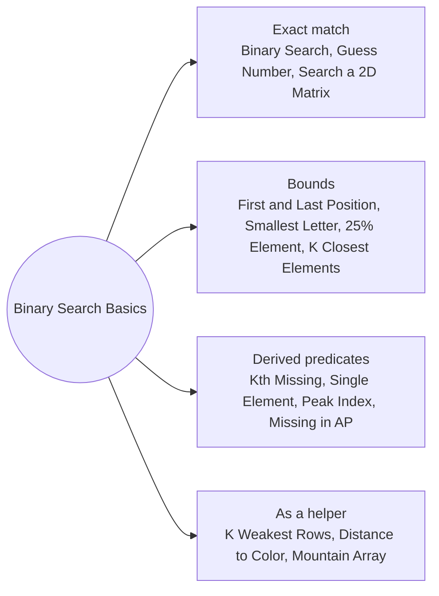

# Binary Search Basics: Pattern Map

> [!TIP]
> **🧠 One picture to keep**
> Binary search needs only a **yes/no question that flips once** along the array. Find the first "yes" with `lo < hi`, `hi = mid` or `lo = mid + 1`.
> 1. **Exact match**: closed range `lo <= hi` (Binary Search, Guess Number, Search a 2D Matrix).
> 2. **Lower and upper bound**: first index with value ≥ x or > x (First and Last Position, Smallest Letter, 25% Element, K Closest).
> 3. **Derived predicates**: missing count, pair parity, slope, progression (Kth Missing, Single Element, Peak, Missing in AP).
> 4. **Binary search as a helper**: inside rows, per color, on both sides of a peak (K Weakest Rows, Distance to Color, Mountain Array).

**All animations:** [▶ Binary Search Basics Animations](https://d9-cell.github.io/java-brain/Arrays/Binary%20Search%20Basics/Binary%20Search%20Basics%20Animations.html) · ⬆ [00 Brain Map](../../00%20Brain%20Map.md)

## Java toolkit
| Need | Java |
|---|---|
| Safe middle | `int mid = lo + (hi - lo) / 2;` |
| Exact match | `while (lo <= hi) { … lo = mid + 1; / hi = mid - 1; }` |
| First index where pred is true | `while (lo < hi) { if (pred(mid)) hi = mid; else lo = mid + 1; }` |
| Lower bound | `pred = nums[mid] >= x` |
| Upper bound | `pred = nums[mid] > x` |
| Library | `Collections.binarySearch(list, x)` returns `-(insertion) - 1` when missing |

## Patterns in this folder

| # | Problem | Pattern | Mantra | Level |
|---|---|---|---|---|
| 1 | [Binary Search](Binary%20Search.md) | Exact match | lo ≤ hi · mid = lo + (hi − lo)/2 · == → mid · < → lo = mid + 1 · > → hi = mid − 1 | Easy |
| 2 | [Guess Number Higher or Lower](Guess%20Number%20Higher%20or%20Lower.md) | Exact match, API-driven | g = guess(mid) · 0 → mid · −1 → hi = mid − 1 · 1 → lo = mid + 1 | Easy |
| 3 | [Find Smallest Letter Greater Than Target](Find%20Smallest%20Letter%20Greater%20Than%20Target.md) | Upper bound | first i with letters[i] > target · lo % n | Easy |
| 4 | [Find First and Last Position of Element in Sorted Array](Find%20First%20and%20Last%20Position%20of%20Element%20in%20Sorted%20Array.md) | Lower bound | first = lb(t) · missing → [−1, −1] · last = lb(t + 1) − 1 | Medium |
| 5 | [Element Appearing More Than 25% In Sorted Array](Element%20Appearing%20More%20Than%2025%25%20In%20Sorted%20Array.md) | Lower bound, Candidates | FOR pos in n/4, n/2, 3n/4: lb(x + 1) − lb(x) > n/4 → x | Easy |
| 6 | [Kth Missing Positive Number](Kth%20Missing%20Positive%20Number.md) | Derived predicate | first i: arr[i] − i − 1 ≥ k · RETURN lo + k | Easy |
| 7 | [Single Element in a Sorted Array](Single%20Element%20in%20a%20Sorted%20Array.md) | Pair parity | mid even · pair intact → lo = mid + 2 · ELSE hi = mid | Medium |
| 8 | [Peak Index in a Mountain Array](Peak%20Index%20in%20a%20Mountain%20Array.md) | Slope predicate | rising → lo = mid + 1 · ELSE hi = mid | Medium |
| 9 | [Find in Mountain Array](Find%20in%20Mountain%20Array.md) | Peak then two searches | peak = slope search · search(0..peak, up) · ELSE search(peak+1..n−1, down) | Hard |
| 10 | [Missing Number In Arithmetic Progression](Missing%20Number%20In%20Arithmetic%20Progression.md) | Derived predicate | d = (last − first)/n · first i: arr[i] ≠ arr[0] + i·d · RETURN arr[0] + lo·d | Easy |
| 11 | [Search a 2D Matrix](Search%20a%202D%20Matrix.md) | Exact match, Index mapping | lo = 0, hi = m·n − 1 · v = matrix[mid / n][mid % n] | Medium |
| 12 | [The K Weakest Rows in a Matrix](The%20K%20Weakest%20Rows%20in%20a%20Matrix.md) | Binary search per row, Sort | count = first 0 index · sort (count, row) · take k | Easy |
| 13 | [Shortest Distance to Target Color](Shortest%20Distance%20to%20Target%20Color.md) | Position lists, Binary search | pos[color] · ins = binarySearch · min(right − i, i − left) | Medium |
| 14 | [Find K Closest Elements](Find%20K%20Closest%20Elements.md) | Binary search on window start | x − arr[mid] > arr[mid + k] − x → lo = mid + 1 · ELSE hi = mid | Medium |

## Suggested learning order
1. [Binary Search](Binary%20Search.md) ⭐, [Guess Number Higher or Lower](Guess%20Number%20Higher%20or%20Lower.md), [Search a 2D Matrix](Search%20a%202D%20Matrix.md)
2. [Find First and Last Position of Element in Sorted Array](Find%20First%20and%20Last%20Position%20of%20Element%20in%20Sorted%20Array.md) ⭐, [Find Smallest Letter Greater Than Target](Find%20Smallest%20Letter%20Greater%20Than%20Target.md), [Element Appearing More Than 25% In Sorted Array](Element%20Appearing%20More%20Than%2025%25%20In%20Sorted%20Array.md)
3. [Peak Index in a Mountain Array](Peak%20Index%20in%20a%20Mountain%20Array.md), [Single Element in a Sorted Array](Single%20Element%20in%20a%20Sorted%20Array.md), [Kth Missing Positive Number](Kth%20Missing%20Positive%20Number.md), [Missing Number In Arithmetic Progression](Missing%20Number%20In%20Arithmetic%20Progression.md)
4. [The K Weakest Rows in a Matrix](The%20K%20Weakest%20Rows%20in%20a%20Matrix.md), [Shortest Distance to Target Color](Shortest%20Distance%20to%20Target%20Color.md), [Find K Closest Elements](Find%20K%20Closest%20Elements.md) ⭐, [Find in Mountain Array](Find%20in%20Mountain%20Array.md)

## Connections to other folders
- [Rotated Arrays and Sorted Queries - Pattern Map](../Rotated%20Arrays%20and%20Sorted%20Queries/Rotated%20Arrays%20and%20Sorted%20Queries%20-%20Pattern%20Map.md) for rotated arrays and query answering
- [Search on the Answer Rates and Capacities - Pattern Map](../Search%20on%20the%20Answer%20Rates%20and%20Capacities/Search%20on%20the%20Answer%20Rates%20and%20Capacities%20-%20Pattern%20Map.md) for binary search on the answer
- [Number of Matching Subsequences](../../HashMap/Number%20of%20Matching%20Subsequences.md) for binary search over letter positions
