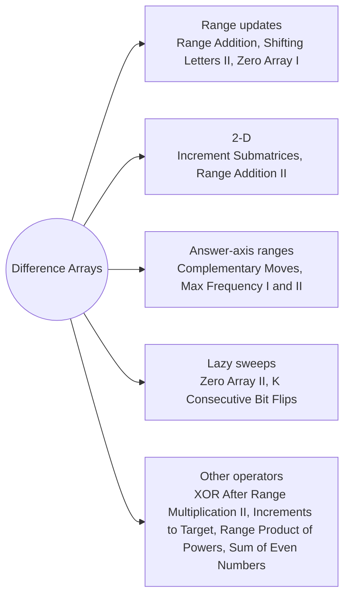

# Difference Arrays: Pattern Map

> [!TIP]
> **🧠 One picture to keep**
> To add v to a whole range, write **+v at the start and −v just after the end**; one prefix sum later every element has its total. Many range updates cost O(1) each.
> 1. **Plain range updates**: Range Addition, Shifting Letters II, Zero Array I.
> 2. **2-D**: four corner marks (Increment Submatrices; Range Addition II is the degenerate case).
> 3. **Updates over an answer axis**: add costs over target values or coverage counts (Complementary Moves, Max Frequency I and II).
> 4. **Lazy sweeps**: apply updates only when needed while scanning (Zero Array II, K Consecutive Bit Flips).
> 5. **Other operators**: multiply instead of add, jumps of k (XOR After Range Multiplication II); rises of an array as operations (Increments to Form a Target); exponent prefixes (Range Product of Powers); keep a running answer (Sum of Even Numbers).

**All animations:** [▶ Difference Arrays Animations](https://d9-cell.github.io/java-brain/Arrays/Difference%20Arrays/Difference%20Arrays%20Animations.html) · ⬆ [00 Brain Map](../../00%20Brain%20Map.md)

## Java toolkit
| Need | Java |
|---|---|
| Range add [l, r] | `diff[l] += v; diff[r + 1] -= v;` (size n + 1) |
| Materialise | `run += diff[i]; out[i] = run;` |
| 2-D range add | `d[r1][c1]++; d[r1][c2+1]--; d[r2+1][c1]--; d[r2+1][c2+1]++;` then 2-D prefix |
| Flip window | `endAt[i + k]++` and subtract when the sweep reaches it |
| Multiplicative diff | `diff[l] *= v; diff[next] *= inverse(v)` (MOD prime) |
| Negative mod | `((x % 26) + 26) % 26` |

## Patterns in this folder

| # | Problem | Pattern | Mantra | Level |
|---|---|---|---|---|
| 1 | [Range Addition](Range%20Addition.md) | Range updates | diff[s] += inc · diff[e+1] −= inc · out = prefix(diff) | Medium |
| 2 | [Range Addition II](Range%20Addition%20II.md) | Common rectangle | m = min a · n = min b · RETURN m · n | Easy |
| 3 | [Increment Submatrices by One](Increment%20Submatrices%20by%20One.md) | 2-D difference | corner marks · out[i][j] = d + up + left − diag | Medium |
| 4 | [Shifting Letters II](Shifting%20Letters%20II.md) | Range updates, Mod 26 | diff[s] += d · diff[e+1] −= d · letter + run mod 26 | Medium |
| 5 | [Zero Array Transformation I](Zero%20Array%20Transformation%20I.md) | Coverage count | diff marks per query · cover ≥ nums[i] for all i | Medium |
| 6 | [Zero Array Transformation II](Zero%20Array%20Transformation%20II.md) | Lazy sweep | WHILE cover + diff[i] < nums[i]: apply queries[k++] · out of queries → −1 | Medium |
| 7 | [Minimum Moves to Make Array Complementary](Minimum%20Moves%20to%20Make%20Array%20Complementary.md) | Answer-axis ranges | diff[2] += 2 · [a+1, b+limit] −1 · [a+b] another −1 · min over T | Medium |
| 8 | [Maximum Frequency of an Element After Performing Operations I](Maximum%20Frequency%20of%20an%20Element%20After%20Performing%20Operations%20I.md) | Counts + prefix | freq, prefix of freq · near = values in [t − k, t + k] · best over t | Medium |
| 9 | [Maximum Frequency of an Element After Performing Operations II](Maximum%20Frequency%20of%20an%20Element%20After%20Performing%20Operations%20II.md) | Candidate targets, Binary search | sort · t in {x, x + k} · near = upper(t + k) − lower(t − k) · same = count of t | Hard |
| 10 | [XOR After Range Multiplication Queries II](XOR%20After%20Range%20Multiplication%20Queries%20II.md) | Square root split, Multiplicative difference | k ≥ √n → direct · ELSE diff[l] *= v, diff[next] *= v⁻¹ · diff[i] *= diff[i − k] · multiply in | Hard |
| 11 | [Minimum Number of Increments on Subarrays to Form a Target Array](Minimum%20Number%20of%20Increments%20on%20Subarrays%20to%20Form%20a%20Target%20Array.md) | Rises | ops = target[0] + Σ max(0, target[i] − target[i−1]) | Hard |
| 12 | [Minimum Number of K Consecutive Bit Flips](Minimum%20Number%20of%20K%20Consecutive%20Bit%20Flips.md) | Lazy sweep, Flip window | active −= endAt[i] · (nums[i] + active) even → flip, endAt[i + k]++ · out of room → −1 | Hard |
| 13 | [Range Product Queries of Powers](Range%20Product%20Queries%20of%20Powers.md) | Exponent prefix | exps = set bit positions · pre of exps · 2^(pre[r+1] − pre[l]) mod | Medium |
| 14 | [Sum of Even Numbers After Queries](Sum%20of%20Even%20Numbers%20After%20Queries.md) | Running answer | old even → even −= old · update · new even → even += new | Medium |

## Suggested learning order
1. [Range Addition](Range%20Addition.md) ⭐, [Range Addition II](Range%20Addition%20II.md), [Shifting Letters II](Shifting%20Letters%20II.md), [Sum of Even Numbers After Queries](Sum%20of%20Even%20Numbers%20After%20Queries.md)
2. [Zero Array Transformation I](Zero%20Array%20Transformation%20I.md), [Zero Array Transformation II](Zero%20Array%20Transformation%20II.md) ⭐, [Increment Submatrices by One](Increment%20Submatrices%20by%20One.md)
3. [Minimum Number of Increments on Subarrays to Form a Target Array](Minimum%20Number%20of%20Increments%20on%20Subarrays%20to%20Form%20a%20Target%20Array.md), [Minimum Number of K Consecutive Bit Flips](Minimum%20Number%20of%20K%20Consecutive%20Bit%20Flips.md) ⭐, [Range Product Queries of Powers](Range%20Product%20Queries%20of%20Powers.md)
4. [Minimum Moves to Make Array Complementary](Minimum%20Moves%20to%20Make%20Array%20Complementary.md), [Maximum Frequency of an Element After Performing Operations I](Maximum%20Frequency%20of%20an%20Element%20After%20Performing%20Operations%20I.md), [Maximum Frequency of an Element After Performing Operations II](Maximum%20Frequency%20of%20an%20Element%20After%20Performing%20Operations%20II.md)
5. [XOR After Range Multiplication Queries II](XOR%20After%20Range%20Multiplication%20Queries%20II.md)

## Connections to other folders
- [Line Sweep - Pattern Map](../../Line%20Sweep/Line%20Sweep%20-%20Pattern%20Map.md) for event sweeps (the same idea on sorted events)
- [Prefix Sums Basics - Pattern Map](../Prefix%20Sums%20Basics/Prefix%20Sums%20Basics%20-%20Pattern%20Map.md) for the prefix step
- [Corporate Flight Bookings](../../Line%20Sweep/Corporate%20Flight%20Bookings.md) and [Car Pooling](../../Line%20Sweep/Car%20Pooling.md) for classic range-add problems
