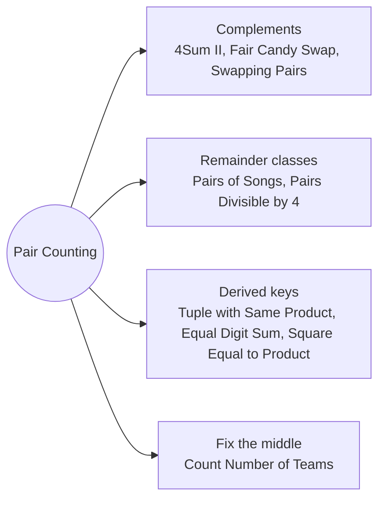

# Hash Map Pair Counting: Pattern Map

> [!TIP]
> **🧠 One picture to keep**
> To count pairs with a property, **turn the property into a key** (a complement, a remainder, a digit sum, a product) and count how many earlier items have the matching key.
> 1. **Complements**: a + b = 0, c + d looks up −(c + d) (4Sum II, Fair Candy Swap, Swapping Pairs).
> 2. **Remainder classes**: r pairs with (m − r) mod m (Pairs of Songs, Pairs Divisible by 4).
> 3. **Group by a derived key**: equal product, equal digit sum, square equals product (Tuple with Same Product, Equal Digit Sum, Square Equal to Product).
> 4. **Fix the middle**: left counts × right counts (Count Number of Teams).

**All animations:** [▶ Hash Map Pair Counting Animations](https://d9-cell.github.io/java-brain/Arrays/Hash%20Map%20Pair%20Counting/Hash%20Map%20Pair%20Counting%20Animations.html) · ⬆ [00 Brain Map](../../00%20Brain%20Map.md)

## Java toolkit
| Need | Java |
|---|---|
| Count a key | `map.merge(key, 1, Integer::sum)` |
| Matching earlier items | `count += map.getOrDefault(target, 0)` before adding the current one |
| Remainder partner | `(m - r) % m` |
| Pairs inside a group of c | `c * (c - 1) / 2` |
| Products as keys | `(long) a * b` to avoid overflow |
| Membership | `HashSet.contains(x)` |

## Patterns in this folder

| # | Problem | Pattern | Mantra | Level |
|---|---|---|---|---|
| 1 | [4Sum II](4Sum%20II.md) | Complements, Meet in the middle | map[a + b]++ · count += map[−(c + d)] | Medium |
| 2 | [Tuple with Same Product](Tuple%20with%20Same%20Product.md) | Derived key | FOR pairs: count += 8 · seen[product] · seen[product]++ | Medium |
| 3 | [Max Sum of a Pair With Equal Sum of Digits](Max%20Sum%20of%20a%20Pair%20With%20Equal%20Sum%20of%20Digits.md) | Derived key, Best per group | best[ds] → answer = max(best + x) · keep the larger | Medium |
| 4 | [Pairs of Songs With Total Durations Divisible by 60](Pairs%20of%20Songs%20With%20Total%20Durations%20Divisible%20by%2060.md) | Remainder classes | r = t % 60 · pairs += count[(60 − r) % 60] · count[r]++ | Medium |
| 5 | [Pairs which are Divisible by 4](Pairs%20which%20are%20Divisible%20by%204.md) | Remainder classes | C(c0, 2) + C(c2, 2) + c1 · c3 | Easy |
| 6 | [Number of Ways Where Square of Number Is Equal to Product of Two Numbers](Number%20of%20Ways%20Where%20Square%20of%20Number%20Is%20Equal%20to%20Product%20of%20Two%20Numbers.md) | Derived key | squares of a · FOR j < k in b: total += squares[b[j]·b[k]] · swap roles | Medium |
| 7 | [Fair Candy Swap](Fair%20Candy%20Swap.md) | Complements, Set lookup | delta = (sb − sa)/2 · x with x + delta in Bob → [x, x + delta] | Easy |
| 8 | [Swapping pairs make sum equal](Swapping%20pairs%20make%20sum%20equal.md) | Complements, Set lookup | odd difference → −1 · any x with x + delta in b → 1 | Medium |
| 9 | [Count Number of Teams](Count%20Number%20of%20Teams.md) | Fix the middle | FOR j: lessL·moreR + moreL·lessR | Medium |

## Suggested learning order
1. [Pairs of Songs With Total Durations Divisible by 60](Pairs%20of%20Songs%20With%20Total%20Durations%20Divisible%20by%2060.md) ⭐, [Pairs which are Divisible by 4](Pairs%20which%20are%20Divisible%20by%204.md), [Fair Candy Swap](Fair%20Candy%20Swap.md), [Swapping pairs make sum equal](Swapping%20pairs%20make%20sum%20equal.md)
2. [4Sum II](4Sum%20II.md) ⭐, [Max Sum of a Pair With Equal Sum of Digits](Max%20Sum%20of%20a%20Pair%20With%20Equal%20Sum%20of%20Digits.md), [Tuple with Same Product](Tuple%20with%20Same%20Product.md)
3. [Number of Ways Where Square of Number Is Equal to Product of Two Numbers](Number%20of%20Ways%20Where%20Square%20of%20Number%20Is%20Equal%20to%20Product%20of%20Two%20Numbers.md), [Count Number of Teams](Count%20Number%20of%20Teams.md)

## Connections to other folders
- [Prefix Sum and HashMap - Pattern Map](../Prefix%20Sum%20and%20HashMap/Prefix%20Sum%20and%20HashMap%20-%20Pattern%20Map.md) for counting subarrays with a map
- [HashMap - Pattern Map](../../HashMap/HashMap%20-%20Pattern%20Map.md) for more map counting
- [Count Good Triplets in an Array](../../Segment%20Tree/Count%20Good%20Triplets%20in%20an%20Array.md) for triple counting with a Fenwick tree
