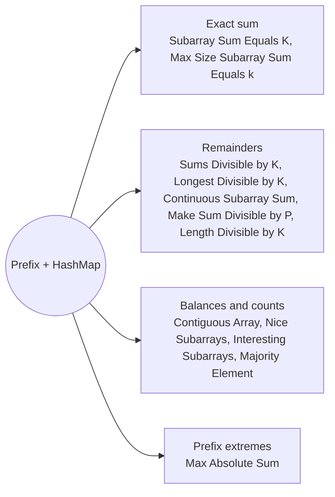

# Prefix Sum and HashMap: Pattern Map

> [!TIP]
> **🧠 One picture to keep**
> A subarray (i, j] has sum **pre[j] − pre[i]**. So "how many subarrays ending at j have property P" becomes "**how many earlier prefixes match**", answered by a hash map of prefixes seen so far.
> 1. **Exact sum**: look up pre − k (Subarray Sum Equals K, Max Size Subarray Sum Equals k).
> 2. **Divisibility**: equal remainders mod k (Sums Divisible by K, Longest Divisible by K, Continuous Subarray Sum, Make Sum Divisible by P, Length Divisible by K).
> 3. **Balance tricks**: turn the property into ±1 or a count (Contiguous Array, Nice Subarrays, Interesting Subarrays, Majority Element).
> 4. **Extremes of prefixes**: max − min prefix (Max Absolute Sum).
> 
> Store the **count** of a prefix to count subarrays, its **first index** for the longest, its **last index** for the shortest.

**All animations:** [▶ Prefix Sum and HashMap Animations](https://d9-cell.github.io/java-brain/Arrays/Prefix%20Sum%20and%20HashMap/Prefix%20Sum%20and%20HashMap%20Animations.html) · ⬆ [00 Brain Map](../../00%20Brain%20Map.md)

## Java toolkit
| Need | Java |
|---|---|
| Count earlier prefixes | `count += seen.getOrDefault(pre - k, 0); seen.merge(pre, 1, Integer::sum);` |
| Seed the empty prefix | `seen.put(0, 1)` (counting) or `first.put(0, -1)` (lengths) |
| Longest: first index | `first.putIfAbsent(pre, i)` |
| Shortest: last index | `last.put(pre, i)` |
| Remainder in [0, k) | `((pre % k) + k) % k` |
| Small key range | an `int[]` indexed by value + offset beats a HashMap |

## Patterns in this folder

| # | Problem | Pattern | Mantra | Level |
|---|---|---|---|---|
| 1 | [Subarray Sum Equals K (O(n))](Subarray%20Sum%20Equals%20K%20%28O%28n%29%29.md) | Exact sum, Prefix count | seen{0:1} · prefix += x · count += seen[prefix − k] · seen[prefix]++ | Medium |
| 2 | [Subarray Sums Divisible by K](Subarray%20Sums%20Divisible%20by%20K.md) | Remainders, Prefix count | r = ((pre + x) % k + k) % k · total += count[r] · count[r]++ | Medium |
| 3 | [Longest subarray with sum divisible by K](Longest%20subarray%20with%20sum%20divisible%20by%20K.md) | Remainders, First index | first{0:−1} · r seen → best = max(i − first[r]) · ELSE first[r] = i | Medium |
| 4 | [Maximum Size Subarray Sum Equals k](Maximum%20Size%20Subarray%20Sum%20Equals%20k.md) | Exact sum, First index | first{0:−1} · j = first[prefix − k] → best = max(i − j) · putIfAbsent(prefix, i) | Medium |
| 5 | [Contiguous Array](Contiguous%20Array.md) | Balance, First index | balance ±1 · seen → best = max(i − first[b]) · ELSE first[b] = i | Medium |
| 6 | [Continuous Subarray Sum](Continuous%20Subarray%20Sum.md) | Remainders, Length ≥ 2 | first{0:−1} · r seen at j, i − j ≥ 2 → true | Medium |
| 7 | [Count Number of Nice Subarrays](Count%20Number%20of%20Nice%20Subarrays.md) | Count transform, Prefix count | odd += x % 2 · count += seen[odd − k] · seen[odd]++ | Medium |
| 8 | [Count of Interesting Subarrays](Count%20of%20Interesting%20Subarrays.md) | Count transform, Remainders | cnt = (cnt + flag) % modulo · total += seen[(cnt − k) mod m] · seen[cnt]++ | Medium |
| 9 | [Make Sum Divisible by P](Make%20Sum%20Divisible%20by%20P.md) | Remainders, Last index | need = total % p · j = last[(pre − need) mod p] → best = min(i − j) · last[pre] = i | Medium |
| 10 | [Maximum Subarray Sum With Length Divisible by K](Maximum%20Subarray%20Sum%20With%20Length%20Divisible%20by%20K.md) | Index classes, Minimum prefix | cls = (i + 1) % k · best = max(pre − minPre[cls]) · minPre[cls] = min(…) | Medium |
| 11 | [Maximum Absolute Sum of Any Subarray](Maximum%20Absolute%20Sum%20of%20Any%20Subarray.md) | Prefix extremes | max = max(pre), min = min(pre) · RETURN max − min | Medium |
| 12 | [Count Subarrays With Majority Element I & II](Count%20Subarrays%20With%20Majority%20Element%20I%20%26%20II.md) | Balance, Running rank | +1: below += freq[old] · −1: below −= freq[new] · total += below · freq[cur]++ | Hard |

## Suggested learning order
1. [Subarray Sum Equals K (O(n))](Subarray%20Sum%20Equals%20K%20%28O%28n%29%29.md) ⭐, [Maximum Size Subarray Sum Equals k](Maximum%20Size%20Subarray%20Sum%20Equals%20k.md), [Contiguous Array](Contiguous%20Array.md)
2. [Subarray Sums Divisible by K](Subarray%20Sums%20Divisible%20by%20K.md) ⭐, [Longest subarray with sum divisible by K](Longest%20subarray%20with%20sum%20divisible%20by%20K.md), [Continuous Subarray Sum](Continuous%20Subarray%20Sum.md)
3. [Count Number of Nice Subarrays](Count%20Number%20of%20Nice%20Subarrays.md), [Count of Interesting Subarrays](Count%20of%20Interesting%20Subarrays.md), [Maximum Absolute Sum of Any Subarray](Maximum%20Absolute%20Sum%20of%20Any%20Subarray.md)
4. [Make Sum Divisible by P](Make%20Sum%20Divisible%20by%20P.md), [Maximum Subarray Sum With Length Divisible by K](Maximum%20Subarray%20Sum%20With%20Length%20Divisible%20by%20K.md), [Count Subarrays With Majority Element I & II](Count%20Subarrays%20With%20Majority%20Element%20I%20%26%20II.md)

## Connections to other folders
- [Prefix Sums Basics - Pattern Map](../Prefix%20Sums%20Basics/Prefix%20Sums%20Basics%20-%20Pattern%20Map.md) for plain prefix sums
- [Count Beautiful Substrings II](../../Strings/Binary%20Strings%20and%20Substring%20Counting/Count%20Beautiful%20Substrings%20II.md) for a prefix balance plus residue
- [HashMap - Pattern Map](../../HashMap/HashMap%20-%20Pattern%20Map.md) for more counting with maps
