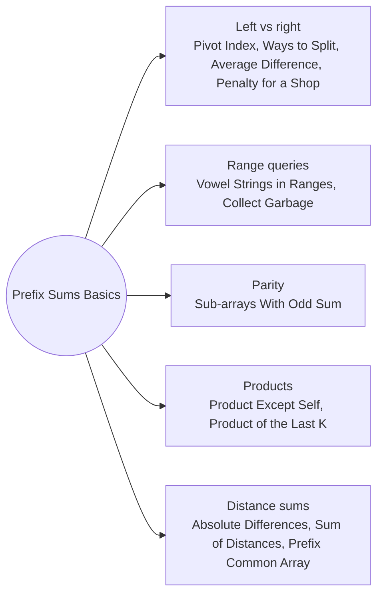

# Prefix Sums Basics: Pattern Map

> [!TIP]
> **🧠 One picture to keep**
> Store **pre[i] = sum of the first i values** once; then any range sum is **pre[r + 1] − pre[l]**, and "left part vs right part" is **left vs total − left**.
> 1. **Left vs right**: one running sum and the total (Pivot Index, Ways to Split, Average Difference, Penalty for a Shop).
> 2. **Range queries**: prefix counts answer each query in O(1) (Vowel Strings in Ranges, Collect Garbage).
> 3. **Parity of prefixes**: a subarray sum is odd when two prefixes differ in parity (Sub-arrays With Odd Sum).
> 4. **Prefix and suffix products**: everything except me (Product Except Self, Product of the Last K).
> 5. **Distance sums**: on sorted positions, left side gives x·i − leftSum, right side rightSum − x·(n−1−i) (Absolute Differences, Sum of Distances, Prefix Common Array).

**All animations:** [▶ Prefix Sums Basics Animations](https://d9-cell.github.io/java-brain/Arrays/Prefix%20Sums%20Basics/Prefix%20Sums%20Basics%20Animations.html) · ⬆ [00 Brain Map](../../00%20Brain%20Map.md)

## Java toolkit
| Need | Java |
|---|---|
| Prefix array | `long[] pre = new long[n + 1]; pre[i + 1] = pre[i] + a[i];` |
| Range sum [l, r] | `pre[r + 1] - pre[l]` |
| Right part from left | `total - left - a[i]` |
| Count of a property in a range | prefix of 0/1 flags |
| Sum of distances to x (sorted) | `x * i - left + right - x * (n - 1 - i)` |
| Use long | sums of 10⁵ values up to 10⁵ reach 10¹⁰ |

## Patterns in this folder

| # | Problem | Pattern | Mantra | Level |
|---|---|---|---|---|
| 1 | [Find Pivot Index](Find%20Pivot%20Index.md) | Left vs right | total · FOR i: left == total − left − a[i] → i · left += a[i] | Easy |
| 2 | [Number of Ways to Split Array](Number%20of%20Ways%20to%20Split%20Array.md) | Left vs right | left += a[i] · left ≥ total − left → ways++ | Medium |
| 3 | [Minimum Average Difference](Minimum%20Average%20Difference.md) | Left vs right, Integer averages | a = left/(i+1) · b = rest/(n−i−1) or 0 · keep smallest |a − b| | Medium |
| 4 | [Minimum Penalty for a Shop](Minimum%20Penalty%20for%20a%20Shop.md) | Running score | score += (Y ? −1 : +1) · best score → hour j + 1 | Medium |
| 5 | [Minimum Amount of Time to Collect Garbage](Minimum%20Amount%20of%20Time%20to%20Collect%20Garbage.md) | Prefix travel | total units + pre[lastM] + pre[lastP] + pre[lastG] | Medium |
| 6 | [Count Vowel Strings in Ranges](Count%20Vowel%20Strings%20in%20Ranges.md) | Prefix count | pre[i+1] = pre[i] + flag · answer = pre[r+1] − pre[l] | Medium |
| 7 | [Number of Sub-arrays With Odd Sum](Number%20of%20Sub-arrays%20With%20Odd%20Sum.md) | Prefix parity | odd prefix → add evens seen · even prefix → add odds seen | Medium |
| 8 | [Product of Array Except Self](Product%20of%20Array%20Except%20Self.md) | Prefix and suffix products | ans[i] = product before i · ans[i] *= product after i | Medium |
| 9 | [Product of the Last K Numbers](Product%20of%20the%20Last%20K%20Numbers.md) | Prefix products, Reset at zero | add 0 → reset · add x → pre.add(last · x) · k ≥ size → 0 | Medium |
| 10 | [Find the Prefix Common Array of Two Arrays](Find%20the%20Prefix%20Common%20Array%20of%20Two%20Arrays.md) | Running count | ++seen[A[i]] == 2 → common++ · same for B[i] | Medium |
| 11 | [Sum of Absolute Differences in a Sorted Array](Sum%20of%20Absolute%20Differences%20in%20a%20Sorted%20Array.md) | Distance sums | out[i] = x·i − left + right − x·(n−1−i) | Medium |
| 12 | [Sum of Distances](Sum%20of%20Distances.md) | Group by value, Distance sums | groups[value] = sorted indexes · per group: i·k − left + right − i·(m−1−k) | Medium |

## Suggested learning order
1. [Find Pivot Index](Find%20Pivot%20Index.md) ⭐, [Number of Ways to Split Array](Number%20of%20Ways%20to%20Split%20Array.md), [Minimum Average Difference](Minimum%20Average%20Difference.md)
2. [Count Vowel Strings in Ranges](Count%20Vowel%20Strings%20in%20Ranges.md), [Minimum Amount of Time to Collect Garbage](Minimum%20Amount%20of%20Time%20to%20Collect%20Garbage.md), [Minimum Penalty for a Shop](Minimum%20Penalty%20for%20a%20Shop.md)
3. [Product of Array Except Self](Product%20of%20Array%20Except%20Self.md) ⭐, [Product of the Last K Numbers](Product%20of%20the%20Last%20K%20Numbers.md), [Find the Prefix Common Array of Two Arrays](Find%20the%20Prefix%20Common%20Array%20of%20Two%20Arrays.md)
4. [Number of Sub-arrays With Odd Sum](Number%20of%20Sub-arrays%20With%20Odd%20Sum.md), [Sum of Absolute Differences in a Sorted Array](Sum%20of%20Absolute%20Differences%20in%20a%20Sorted%20Array.md), [Sum of Distances](Sum%20of%20Distances.md)

## Connections to other folders
- [Prefix Sum and HashMap - Pattern Map](../Prefix%20Sum%20and%20HashMap/Prefix%20Sum%20and%20HashMap%20-%20Pattern%20Map.md) for counting subarrays with a target sum
- [Difference Arrays - Pattern Map](../Difference%20Arrays/Difference%20Arrays%20-%20Pattern%20Map.md) for range updates
- [Minimum Number of Operations to Move All Balls to Each Box](../../Strings/Binary%20Strings%20and%20Substring%20Counting/Minimum%20Number%20of%20Operations%20to%20Move%20All%20Balls%20to%20Each%20Box.md) for running costs
