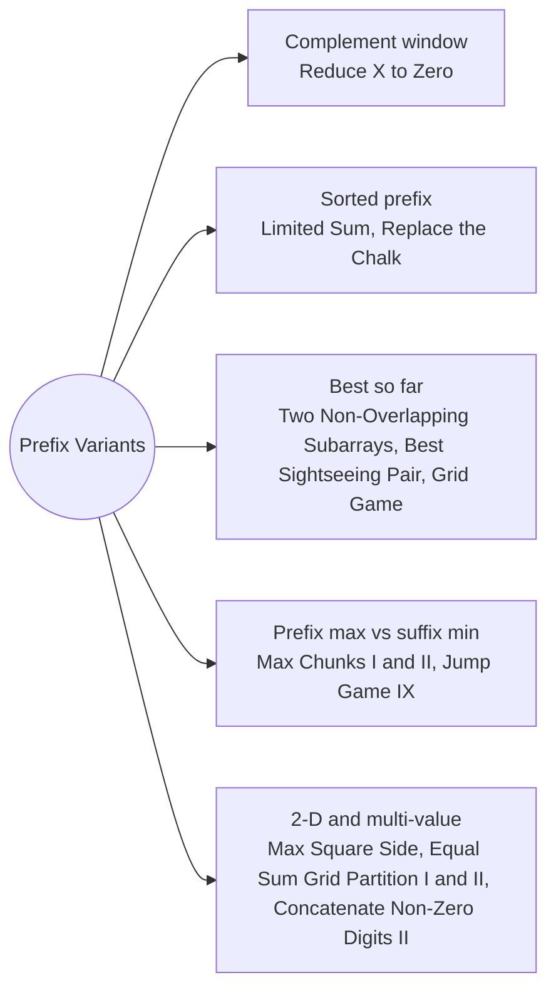

# Prefix Variants: Pattern Map

> [!TIP]
> **🧠 One picture to keep**
> Prefixes are not only sums. Keep a **running max, min, best-so-far, or a 2-D table**, and every split point or block can be scored in O(1).
> 1. **Complement windows**: what you remove from the ends leaves a middle block (Reduce X to Zero).
> 2. **Sorted prefix**: smallest values first answer "how many fit" (Limited Sum, Replace the Chalk).
> 3. **Best so far on the left**: pair the current block with the best earlier one (Two Non-Overlapping Subarrays, Best Sightseeing Pair, Grid Game).
> 4. **Prefix max vs suffix min**: where a cut is safe (Max Chunks I and II, Jump Game IX).
> 5. **2-D and multi-value prefixes**: rectangle sums, row and column sums, several prefix arrays per query (Max Square Side Length, Equal Sum Grid Partition I and II, Concatenate Non-Zero Digits II).

**All animations:** [▶ Prefix Variants Animations](https://d9-cell.github.io/java-brain/Arrays/Prefix%20Variants/Prefix%20Variants%20Animations.html) · ⬆ [00 Brain Map](../../00%20Brain%20Map.md)

## Java toolkit
| Need | Java |
|---|---|
| 2-D prefix | `pre[i][j] = a[i-1][j-1] + pre[i-1][j] + pre[i][j-1] - pre[i-1][j-1]` |
| Rectangle sum | `pre[r2][c2] - pre[r1][c2] - pre[r2][c1] + pre[r1][c1]` |
| Prefix max, suffix min | `maxL[i] = max(maxL[i-1], a[i])`, `minR[i] = min(minR[i+1], a[i])` |
| Best earlier block | `bestA = max(bestA, blockEndingAt(end - b))` |
| Rounds of a cycle | `k % total` |
| Modular concatenation | `x = (x * 10 + d) % MOD`, remove a prefix with `pow10[len]` |

## Patterns in this folder

| # | Problem | Pattern | Mantra | Level |
|---|---|---|---|---|
| 1 | [Minimum Operations to Reduce X to Zero](Minimum%20Operations%20to%20Reduce%20X%20to%20Zero.md) | Complement window | target = total − x · window sum == target → best length · answer n − best | Medium |
| 2 | [Longest Subsequence With Limited Sum](Longest%20Subsequence%20With%20Limited%20Sum.md) | Sorted prefix | sort · pre · largest m with pre[m] ≤ q | Easy |
| 3 | [Maximum Sum of Two Non-Overlapping Subarrays](Maximum%20Sum%20of%20Two%20Non-Overlapping%20Subarrays.md) | Best so far | pre · FOR end: bestA = max(bestA, A-block before) · best = max(bestA + B-block) | Medium |
| 4 | [Maximum Side Length of a Square with Sum Less than or Equal to Threshold](Maximum%20Side%20Length%20of%20a%20Square%20with%20Sum%20Less%20than%20or%20Equal%20to%20Threshold.md) | 2-D prefix | pre[i][j] · square sum of k at (i, j) ≤ threshold → side = k | Medium |
| 5 | [Grid Game](Grid%20Game.md) | Prefix and suffix, Minimax | top = suffix of row 0, bottom = prefix of row 1 · best = min over c of max(top, bottom) | Medium |
| 6 | [Equal Sum Grid Partition I](Equal%20Sum%20Grid%20Partition%20I.md) | Row and column prefixes | row sums, column sums · running prefix · 2·prefix == total → true | Medium |
| 7 | [Equal Sum Grid Partition II](Equal%20Sum%20Grid%20Partition%20II.md) | Prefix + set, Symmetry | diff = top − bottom · 0 or a removable cell value → true · removable: any seen cell if top is ≥ 2 rows and ≥ 2 columns, else only its ends | Hard |
| 8 | [Jump Game IX](Jump%20Game%20IX.md) | Prefix max vs suffix min | maxLeft, minRight · ans[i] = maxLeft[i] > minRight[i+1] ? ans[i+1] : maxLeft[i] | Medium |
| 9 | [Concatenate Non-Zero Digits and Multiply by Sum II](Concatenate%20Non-Zero%20Digits%20and%20Multiply%20by%20Sum%20II.md) | Several prefix arrays, Modular concatenation | x = number[r] − number[l]·10^(count[r] − count[l]) · answer x · (digitSum[r] − digitSum[l]) | Medium |
| 10 | [Max Chunks To Make Sorted](Max%20Chunks%20To%20Make%20Sorted.md) | Prefix max | max = max(max, arr[i]) · max == i → chunks++ | Medium |
| 11 | [Max Chunks To Make Sorted II](Max%20Chunks%20To%20Make%20Sorted%20II.md) | Prefix max vs suffix min | minRight · maxLeft ≤ minRight[i+1] → chunks++ | Hard |
| 12 | [Best Sightseeing Pair](Best%20Sightseeing%20Pair.md) | Best so far | best = max(bestLeft + v[j] − j) · bestLeft = max(bestLeft, v[j] + j) | Medium |
| 13 | [Find the Student that Will Replace the Chalk](Find%20the%20Student%20that%20Will%20Replace%20the%20Chalk.md) | Cycle reduction, Prefix scan | rest = k % total · first i with rest < chalk[i] | Medium |

## Suggested learning order
1. [Find the Student that Will Replace the Chalk](Find%20the%20Student%20that%20Will%20Replace%20the%20Chalk.md), [Longest Subsequence With Limited Sum](Longest%20Subsequence%20With%20Limited%20Sum.md), [Best Sightseeing Pair](Best%20Sightseeing%20Pair.md) ⭐
2. [Minimum Operations to Reduce X to Zero](Minimum%20Operations%20to%20Reduce%20X%20to%20Zero.md) ⭐, [Grid Game](Grid%20Game.md), [Maximum Sum of Two Non-Overlapping Subarrays](Maximum%20Sum%20of%20Two%20Non-Overlapping%20Subarrays.md)
3. [Max Chunks To Make Sorted](Max%20Chunks%20To%20Make%20Sorted.md), [Max Chunks To Make Sorted II](Max%20Chunks%20To%20Make%20Sorted%20II.md), [Jump Game IX](Jump%20Game%20IX.md)
4. [Maximum Side Length of a Square with Sum Less than or Equal to Threshold](Maximum%20Side%20Length%20of%20a%20Square%20with%20Sum%20Less%20than%20or%20Equal%20to%20Threshold.md), [Equal Sum Grid Partition I](Equal%20Sum%20Grid%20Partition%20I.md), [Equal Sum Grid Partition II](Equal%20Sum%20Grid%20Partition%20II.md)
5. [Concatenate Non-Zero Digits and Multiply by Sum II](Concatenate%20Non-Zero%20Digits%20and%20Multiply%20by%20Sum%20II.md)

## Connections to other folders
- [Prefix Sums Basics - Pattern Map](../Prefix%20Sums%20Basics/Prefix%20Sums%20Basics%20-%20Pattern%20Map.md) for plain prefix sums
- [Prefix Sum and HashMap - Pattern Map](../Prefix%20Sum%20and%20HashMap/Prefix%20Sum%20and%20HashMap%20-%20Pattern%20Map.md) for prefix lookups
- [Maximum Sum Rectangle](../../DP/Stock%20and%20Kadane%20States/Maximum%20Sum%20Rectangle.md) for 2-D Kadane
