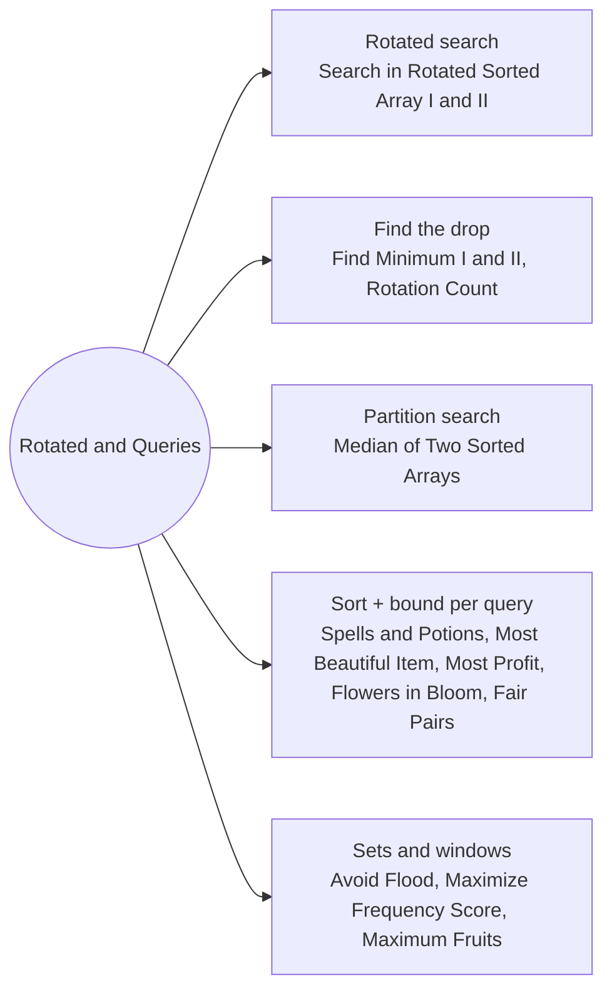

# Rotated Arrays and Sorted Queries: Pattern Map

> [!TIP]
> **🧠 One picture to keep**
> Two ideas: in a **rotated array one half around mid is always sorted**, and many query problems become easy once you **sort once and binary search per query**.
> 1. **Rotated search**: decide which half is sorted, test if the target is inside it (Search in Rotated I and II).
> 2. **Find the drop**: compare mid with the right end (Find Minimum I and II, Rotation Count).
> 3. **Partition search**: binary search a cut in the shorter array (Median of Two Sorted Arrays).
> 4. **Sort + bound per query**: thresholds, prefix maxima, start and end counts (Spells and Potions, Most Beautiful Item, Most Profit, Flowers in Full Bloom, Fair Pairs).
> 5. **Ordered sets and windows**: ceiling in a TreeSet, median cost with prefix sums, reach with prefix sums (Avoid Flood, Maximize Frequency Score, Maximum Fruits).

**All animations:** [▶ Rotated Arrays and Sorted Queries Animations](https://d9-cell.github.io/java-brain/Arrays/Rotated%20Arrays%20and%20Sorted%20Queries/Rotated%20Arrays%20and%20Sorted%20Queries%20Animations.html) · ⬆ [00 Brain Map](../../00%20Brain%20Map.md)

## Java toolkit
| Need | Java |
|---|---|
| Which half is sorted | `nums[lo] <= nums[mid]` → left half sorted |
| Drop position | `if (nums[mid] > nums[hi]) lo = mid + 1; else hi = mid;` |
| Ceiling division | `(a + b - 1) / b` with longs |
| Count ≤ x in sorted a | upper bound: `if (a[mid] <= x) lo = mid + 1; else hi = mid;` |
| Next free day ≥ d | `TreeSet.ceiling(d)` |
| Range sum | `pre[r + 1] - pre[l]` |

## Patterns in this folder

| # | Problem | Pattern | Mantra | Level |
|---|---|---|---|---|
| 1 | [Search in Rotated Sorted Array](Search%20in%20Rotated%20Sorted%20Array.md) | Sorted half | nums[lo] ≤ nums[mid] → left sorted: target in [lo, mid) ? left : right · ELSE mirror | Medium |
| 2 | [Search in Rotated Sorted Array II](Search%20in%20Rotated%20Sorted%20Array%20II.md) | Sorted half, Duplicates | all three equal → lo++, hi−− · ELSE sorted-half rule | Medium |
| 3 | [Find Minimum in Rotated Sorted Array](Find%20Minimum%20in%20Rotated%20Sorted%20Array.md) | Find the drop | nums[mid] > nums[hi] → lo = mid + 1 · ELSE hi = mid | Medium |
| 4 | [Find Minimum in Rotated Sorted Array II](Find%20Minimum%20in%20Rotated%20Sorted%20Array%20II.md) | Find the drop, Duplicates | > → lo = mid + 1 · < → hi = mid · == → hi−− | Hard |
| 5 | [Find the Rotation Count in Rotated Sorted array](Find%20the%20Rotation%20Count%20in%20Rotated%20Sorted%20array.md) | Find the drop | index of min via nums[mid] > nums[hi] | Easy |
| 6 | [Median of Two Sorted Arrays](Median%20of%20Two%20Sorted%20Arrays.md) | Partition search | i in [0, m] · j = half − i · aLeft > bRight → left · bLeft > aRight → right · ELSE median from the four borders | Hard |
| 7 | [Count the Number of Fair Pairs](Count%20the%20Number%20of%20Fair%20Pairs.md) | Sort, Two pointers, Count ≤ | sort · atMost(upper) − atMost(lower − 1) · atMost: sum ≤ L → add j − i, i++ · ELSE j−− | Medium |
| 8 | [Successful Pairs of Spells and Potions](Successful%20Pairs%20of%20Spells%20and%20Potions.md) | Sort + lower bound | need = ⌈success / s⌉ · m − lowerBound(need) | Medium |
| 9 | [Most Beautiful Item for Each Query](Most%20Beautiful%20Item%20for%20Each%20Query.md) | Sort + prefix max, Upper bound | sort by price · best[i] = max beauty up to i · upper bound(query) − 1 | Medium |
| 10 | [Most Profit Assigning Work](Most%20Profit%20Assigning%20Work.md) | Sort + prefix max, Upper bound | sort jobs · prefix max profit · per worker: upper bound → add | Medium |
| 11 | [Number of Flowers in Full Bloom](Number%20of%20Flowers%20in%20Full%20Bloom.md) | Two sorted lists, Count ≤ | count(start ≤ t) − count(end ≤ t − 1) | Hard |
| 12 | [Avoid Flood in The City](Avoid%20Flood%20in%20The%20City.md) | TreeSet ceiling, Greedy | rain on full lake → day = dry.ceiling(last[lake]) · none → [] · ans[day] = lake | Medium |
| 13 | [Apply Operations to Maximize Frequency Score](Apply%20Operations%20to%20Maximize%20Frequency%20Score.md) | Sort, Median cost, Sliding window | sort · prefix sums · cost(l, r) to median · shrink l while > k | Hard |
| 14 | [Maximum Fruits Harvested After at Most K Steps](Maximum%20Fruits%20Harvested%20After%20at%20Most%20K%20Steps.md) | Prefix sums, Try the turn | FOR d: left d then right k − 2d · right d then left k − 2d · range sum by bounds | Hard |

## Suggested learning order
1. [Find Minimum in Rotated Sorted Array](Find%20Minimum%20in%20Rotated%20Sorted%20Array.md) ⭐, [Find the Rotation Count in Rotated Sorted array](Find%20the%20Rotation%20Count%20in%20Rotated%20Sorted%20array.md), [Search in Rotated Sorted Array](Search%20in%20Rotated%20Sorted%20Array.md) ⭐
2. [Find Minimum in Rotated Sorted Array II](Find%20Minimum%20in%20Rotated%20Sorted%20Array%20II.md), [Search in Rotated Sorted Array II](Search%20in%20Rotated%20Sorted%20Array%20II.md)
3. [Successful Pairs of Spells and Potions](Successful%20Pairs%20of%20Spells%20and%20Potions.md), [Most Beautiful Item for Each Query](Most%20Beautiful%20Item%20for%20Each%20Query.md), [Most Profit Assigning Work](Most%20Profit%20Assigning%20Work.md), [Number of Flowers in Full Bloom](Number%20of%20Flowers%20in%20Full%20Bloom.md), [Count the Number of Fair Pairs](Count%20the%20Number%20of%20Fair%20Pairs.md)
4. [Avoid Flood in The City](Avoid%20Flood%20in%20The%20City.md), [Maximum Fruits Harvested After at Most K Steps](Maximum%20Fruits%20Harvested%20After%20at%20Most%20K%20Steps.md), [Apply Operations to Maximize Frequency Score](Apply%20Operations%20to%20Maximize%20Frequency%20Score.md)
5. [Median of Two Sorted Arrays](Median%20of%20Two%20Sorted%20Arrays.md) ⭐

## Connections to other folders
- [Binary Search Basics - Pattern Map](../Binary%20Search%20Basics/Binary%20Search%20Basics%20-%20Pattern%20Map.md) for the templates
- [Search on the Answer Rates and Capacities - Pattern Map](../Search%20on%20the%20Answer%20Rates%20and%20Capacities/Search%20on%20the%20Answer%20Rates%20and%20Capacities%20-%20Pattern%20Map.md) for searching on the answer
- [Line Sweep - Pattern Map](../../Line%20Sweep/Line%20Sweep%20-%20Pattern%20Map.md) for start and end events
