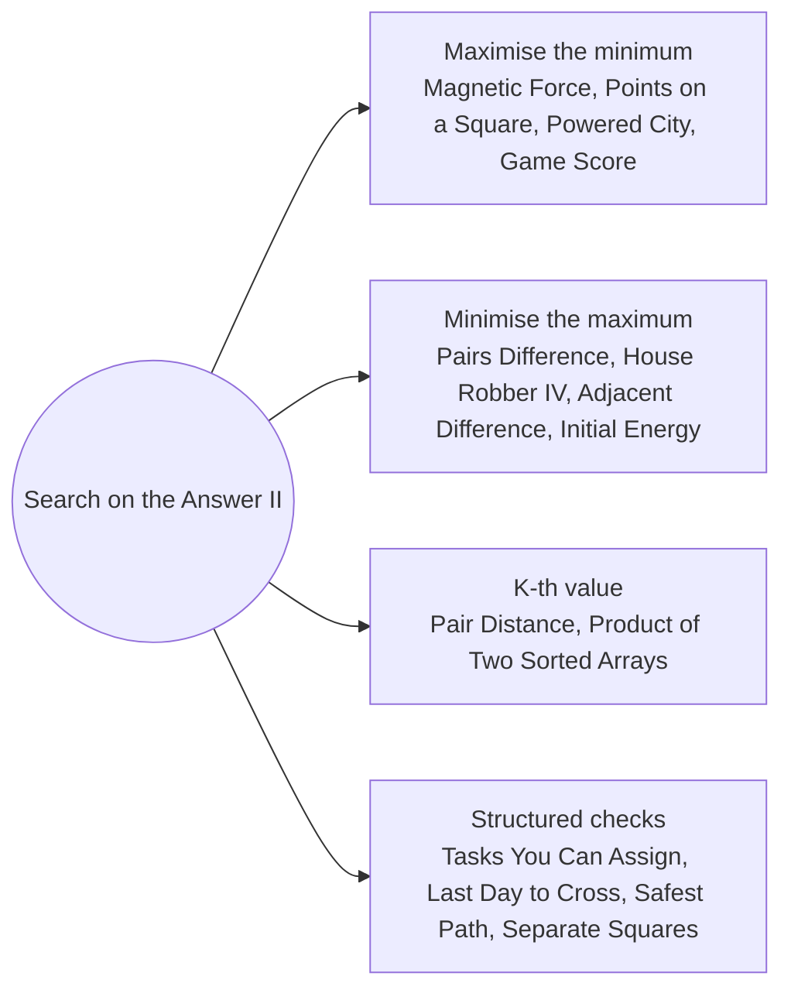

# Search on the Answer Distances and K-th Values: Pattern Map

> [!TIP]
> **🧠 One picture to keep**
> "**Maximise the minimum**", "**minimise the maximum**" and "**the k-th smallest value**" all turn into: guess a value, then **count or greedily check** whether it is reachable.
> 1. **Maximise the minimum gap**: place greedily from the left (Magnetic Force, Points on a Square, Minimum Powered City, Game Score).
> 2. **Minimise the maximum**: take the cheapest legal items greedily (Pairs Difference, House Robber IV, Adjacent Difference, Initial Energy).
> 3. **K-th smallest value**: count how many values are ≤ guess (Pair Distance, Product of Two Sorted Arrays).
> 4. **Feasibility with a structure**: TreeMap matching, BFS in a grid, area under a line (Tasks You Can Assign, Last Day to Cross, Safest Path, Separate Squares).

**All animations:** [▶ Search on the Answer Distances and K-th Values Animations](https://d9-cell.github.io/java-brain/Arrays/Search%20on%20the%20Answer%20Distances%20and%20K-th%20Values/Search%20on%20the%20Answer%20Distances%20and%20K-th%20Values%20Animations.html) · ⬆ [00 Brain Map](../../00%20Brain%20Map.md)

## Java toolkit
| Need | Java |
|---|---|
| Largest value that works | `mid = lo + (hi - lo + 1) / 2; if (ok(mid)) lo = mid; else hi = mid - 1;` |
| K-th smallest value | smallest v with `count(≤ v) >= k` |
| Floor division with negatives | `Math.floorDiv(a, b)` |
| Pairs within d (sorted) | window: `while (a[r] - a[l] > d) l++; count += r - l;` |
| Grid BFS | `ArrayDeque<int[]>` + `int[][] dirs = {{1,0},{-1,0},{0,1},{0,-1}}` |
| Real-valued search | fixed 100 iterations of bisection |

## Patterns in this folder

| # | Problem | Pattern | Mantra | Level |
|---|---|---|---|---|
| 1 | [Magnetic Force Between Two Balls](Magnetic%20Force%20Between%20Two%20Balls.md) | Maximise the minimum, Greedy placement | sort · fits(d): count balls placed greedily ≥ m → lo = mid | Medium |
| 2 | [Minimize the Maximum Difference of Pairs](Minimize%20the%20Maximum%20Difference%20of%20Pairs.md) | Minimise the maximum, Greedy adjacent pairs | sort · scan: nums[i] − nums[i−1] ≤ d → pair, i++ · pairs ≥ p → hi = mid | Medium |
| 3 | [House Robber IV](House%20Robber%20IV.md) | Minimise the maximum, Greedy skip | take nums[i] ≤ c, then i++ · taken ≥ k → hi = mid | Medium |
| 4 | [Find K-th Smallest Pair Distance](Find%20K-th%20Smallest%20Pair%20Distance.md) | K-th value, Sliding window count | count(d): for r, move l while a[r] − a[l] > d, add r − l · count ≥ k → hi = mid | Hard |
| 5 | [Kth Smallest Product of Two Sorted Arrays](Kth%20Smallest%20Product%20of%20Two%20Sorted%20Arrays.md) | K-th value, Signs | count(v) ≥ k → hi = mid · x ≥ 0: prefix bound · x < 0: suffix bound | Hard |
| 6 | [Maximum Number of Tasks You Can Assign](Maximum%20Number%20of%20Tasks%20You%20Can%20Assign.md) | Search on the answer, TreeMap greedy | k tasks vs k workers · hardest first · strongest ≥ need → use · ELSE ceiling(need − strength) with a pill | Hard |
| 7 | [Maximize the Minimum Powered City](Maximize%20the%20Minimum%20Powered%20City.md) | Maximise the minimum, Difference array | power via diff · reach(t): short city → add need at i + r, effect ends at i + 2r + 1 · total ≤ k | Hard |
| 8 | [Maximize the Minimum Game Score](Maximize%20the%20Minimum%20Game%20Score.md) | Maximise the minimum, Bounce greedy | need = ⌈x/p[i]⌉ − spill · need > 0: moves += 2·need − 1, spill = need − 1 · ELSE step on (except at the end) | Hard |
| 9 | [Maximize the Distance Between Points on a Square](Maximize%20the%20Distance%20Between%20Points%20on%20a%20Square.md) | Unroll the boundary, Greedy jumps | unroll · sort · canPick(d): per start, k − 1 lower-bound jumps · first + 4·side − last ≥ d | Hard |
| 10 | [Minimize the Maximum Adjacent Element Difference](Minimize%20the%20Maximum%20Adjacent%20Element%20Difference.md) | Minimise the maximum, Two candidate values | base = max known gap · x = mn + d, y = mx − d · each run: single value fits both ends, or two values when length ≥ 2 and |x − y| ≤ d | Hard |
| 11 | [Minimum Initial Energy to Finish Tasks](Minimum%20Initial%20Energy%20to%20Finish%20Tasks.md) | Exchange argument, Search on the answer | sort by (min − actual) desc · finishes(e) → hi = mid | Hard |
| 12 | [Last Day Where You Can Still Cross](Last%20Day%20Where%20You%20Can%20Still%20Cross.md) | Search on the answer, Grid BFS | canCross(day): flood first day cells · BFS top → bottom · ok → lo = mid | Hard |
| 13 | [Find the Safest Path in a Grid](Find%20the%20Safest%20Path%20in%20a%20Grid.md) | Multi-source BFS, Search on the answer | dist = BFS from thieves · pathExists(s) → lo = mid | Medium |
| 14 | [Separate Squares I](Separate%20Squares%20I.md) | Bisection on reals | 100 iterations: areaBelow(mid)·2 ≥ total → hi = mid · ELSE lo = mid | Medium |

## Suggested learning order
1. [Magnetic Force Between Two Balls](Magnetic%20Force%20Between%20Two%20Balls.md) ⭐, [House Robber IV](House%20Robber%20IV.md), [Minimize the Maximum Difference of Pairs](Minimize%20the%20Maximum%20Difference%20of%20Pairs.md)
2. [Find K-th Smallest Pair Distance](Find%20K-th%20Smallest%20Pair%20Distance.md) ⭐, [Kth Smallest Product of Two Sorted Arrays](Kth%20Smallest%20Product%20of%20Two%20Sorted%20Arrays.md)
3. [Minimum Initial Energy to Finish Tasks](Minimum%20Initial%20Energy%20to%20Finish%20Tasks.md), [Separate Squares I](Separate%20Squares%20I.md), [Last Day Where You Can Still Cross](Last%20Day%20Where%20You%20Can%20Still%20Cross.md), [Find the Safest Path in a Grid](Find%20the%20Safest%20Path%20in%20a%20Grid.md)
4. [Maximize the Minimum Powered City](Maximize%20the%20Minimum%20Powered%20City.md), [Maximum Number of Tasks You Can Assign](Maximum%20Number%20of%20Tasks%20You%20Can%20Assign.md), [Maximize the Minimum Game Score](Maximize%20the%20Minimum%20Game%20Score.md)
5. [Minimize the Maximum Adjacent Element Difference](Minimize%20the%20Maximum%20Adjacent%20Element%20Difference.md), [Maximize the Distance Between Points on a Square](Maximize%20the%20Distance%20Between%20Points%20on%20a%20Square.md)

## Connections to other folders
- [Search on the Answer Rates and Capacities - Pattern Map](../Search%20on%20the%20Answer%20Rates%20and%20Capacities/Search%20on%20the%20Answer%20Rates%20and%20Capacities%20-%20Pattern%20Map.md) for "smallest X that works" searches
- [Grid and BFS - Pattern Map](../../Graph/Grid%20and%20BFS/Grid%20and%20BFS%20-%20Pattern%20Map.md) for the BFS checks
- [Disjoint Set - Pattern Map](../../Graph/Disjoint%20Set/Disjoint%20Set%20-%20Pattern%20Map.md) for a union-find take on Last Day to Cross
