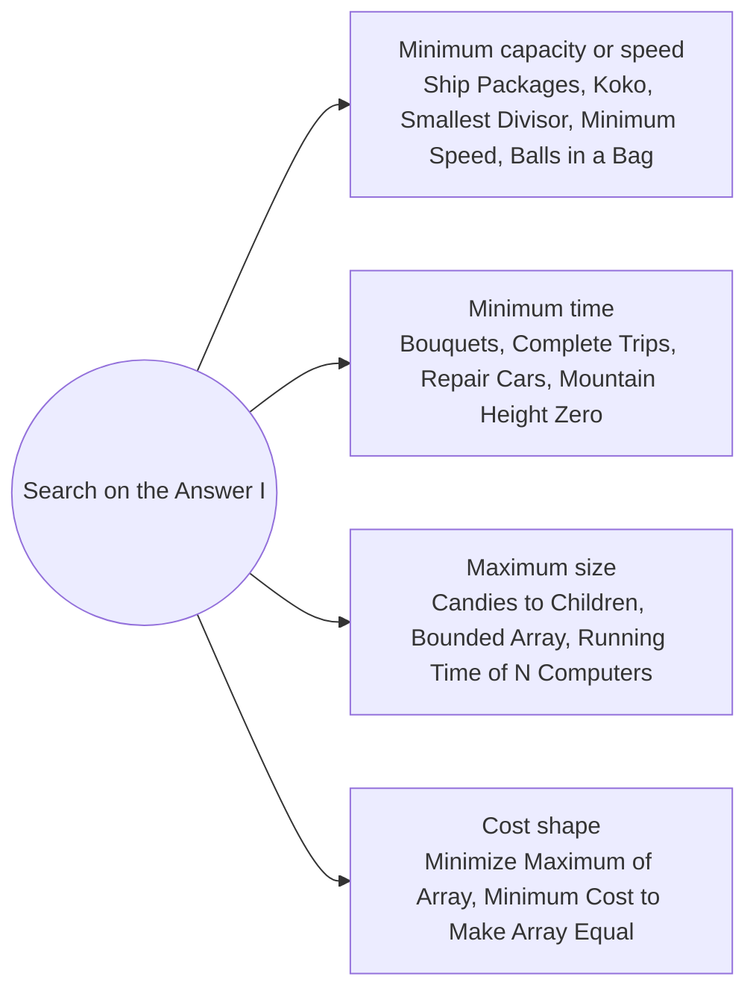

# Search on the Answer Rates and Capacities: Pattern Map

> [!TIP]
> **🧠 One picture to keep**
> When the question is "the smallest X that works" (or the largest), and **if X works then every bigger X works**, binary search X itself. Each guess runs a cheap **feasibility check**.
> 1. **Minimum capacity or speed**: hours, days or quotient sums shrink as X grows (Ship Packages, Koko, Smallest Divisor, Minimum Speed, Balls in a Bag).
> 2. **Minimum time**: work done grows with time (Bouquets, Complete Trips, Repair Cars, Mountain Height Zero).
> 3. **Maximum size or value**: search the largest X that still fits (Candies to Children, Bounded Array peak, Running Time of N Computers).
> 4. **Shape of the cost**: a formula instead of a search, or a convex cost searched by its slope (Minimize Maximum of Array, Minimum Cost to Make Array Equal).

**All animations:** [▶ Search on the Answer Rates and Capacities Animations](https://d9-cell.github.io/java-brain/Arrays/Search%20on%20the%20Answer%20Rates%20and%20Capacities/Search%20on%20the%20Answer%20Rates%20and%20Capacities%20Animations.html) · ⬆ [00 Brain Map](../../00%20Brain%20Map.md)

## Java toolkit
| Need | Java |
|---|---|
| Smallest X that works | `while (lo < hi) { mid = lo + (hi - lo) / 2; if (ok(mid)) hi = mid; else lo = mid + 1; }` |
| Largest X that works | `mid = lo + (hi - lo + 1) / 2; if (ok(mid)) lo = mid; else hi = mid - 1;` |
| Ceiling division | `(a + b - 1) / b` |
| Long counters | `long total` whenever counts can sum past 2³¹ |
| Integer square root | `(long) Math.sqrt(x)` then adjust by ±1 |
| Convex minimum | `if (f(mid) <= f(mid + 1)) hi = mid; else lo = mid + 1;` |

## Patterns in this folder

| # | Problem | Pattern | Mantra | Level |
|---|---|---|---|---|
| 1 | [Capacity To Ship Packages Within D Days](Capacity%20To%20Ship%20Packages%20Within%20D%20Days.md) | Search on the answer, Greedy check | lo = max w, hi = Σ w · daysNeeded(mid) ≤ days → hi = mid · ELSE lo = mid + 1 | Medium |
| 2 | [Koko Eating Bananas](Koko%20Eating%20Bananas.md) | Search on the answer | lo = 1, hi = max pile · hours(mid) ≤ h → hi = mid | Medium |
| 3 | [Find the Smallest Divisor Given a Threshold](Find%20the%20Smallest%20Divisor%20Given%20a%20Threshold.md) | Search on the answer | sum(mid) ≤ threshold → hi = mid · ELSE lo = mid + 1 | Medium |
| 4 | [Minimum Number of Days to Make m Bouquets](Minimum%20Number%20of%20Days%20to%20Make%20m%20Bouquets.md) | Search on the answer, Runs | m·k > n → −1 · bouquets(day) ≥ m → hi = mid | Medium |
| 5 | [Minimum Speed to Arrive on Time](Minimum%20Speed%20to%20Arrive%20on%20Time.md) | Search on the answer, Rounding | n − 1 ≥ hour → −1 · time(mid) ≤ hour → hi = mid | Medium |
| 6 | [Minimum Time to Complete Trips](Minimum%20Time%20to%20Complete%20Trips.md) | Search on the answer | hi = fastest · totalTrips · trips(mid) ≥ total → hi = mid | Medium |
| 7 | [Minimum Time to Repair Cars](Minimum%20Time%20to%20Repair%20Cars.md) | Search on the answer, Square root | fixed(mid) = Σ ⌊√(mid / r)⌋ ≥ cars → hi = mid | Medium |
| 8 | [Minimum Limit of Balls in a Bag](Minimum%20Limit%20of%20Balls%20in%20a%20Bag.md) | Search on the answer | ops(mid) = Σ (x − 1) / mid ≤ max → hi = mid | Medium |
| 9 | [Maximum Candies Allocated to K Children](Maximum%20Candies%20Allocated%20to%20K%20Children.md) | Search on the answer, Maximum | mid = lo + (hi − lo + 1)/2 · kids(mid) ≥ k → lo = mid · ELSE hi = mid − 1 | Medium |
| 10 | [Minimize Maximum of Array](Minimize%20Maximum%20of%20Array.md) | Prefix average, Search on the answer | best = max ⌈prefix / (i+1)⌉ · OR search limit, pushing excess left | Medium |
| 11 | [Maximum Value at a Given Index in a Bounded Array](Maximum%20Value%20at%20a%20Given%20Index%20in%20a%20Bounded%20Array.md) | Search on the answer, Arithmetic series | sum = side(v, left) + side(v, right) + v ≤ maxSum → lo = mid | Medium |
| 12 | [Maximum Running Time of N Computers](Maximum%20Running%20Time%20of%20N%20Computers.md) | Search on the answer, Capped sum | hi = Σ b / n · usable(mid) ≥ n·mid → lo = mid | Hard |
| 13 | [Minimum Cost to Make Array Equal](Minimum%20Cost%20to%20Make%20Array%20Equal.md) | Convex cost, Weighted median | f(mid) ≤ f(mid + 1) → hi = mid · ELSE lo = mid + 1 | Hard |
| 14 | [Minimum Number of Seconds to Make Mountain Height Zero](Minimum%20Number%20of%20Seconds%20to%20Make%20Mountain%20Height%20Zero.md) | Search on the answer, Triangular numbers | removed(mid) = Σ units(mid / t) ≥ height → hi = mid | Medium |

## Suggested learning order
1. [Koko Eating Bananas](Koko%20Eating%20Bananas.md) ⭐, [Find the Smallest Divisor Given a Threshold](Find%20the%20Smallest%20Divisor%20Given%20a%20Threshold.md), [Capacity To Ship Packages Within D Days](Capacity%20To%20Ship%20Packages%20Within%20D%20Days.md) ⭐
2. [Minimum Number of Days to Make m Bouquets](Minimum%20Number%20of%20Days%20to%20Make%20m%20Bouquets.md), [Minimum Time to Complete Trips](Minimum%20Time%20to%20Complete%20Trips.md), [Minimum Speed to Arrive on Time](Minimum%20Speed%20to%20Arrive%20on%20Time.md)
3. [Minimum Limit of Balls in a Bag](Minimum%20Limit%20of%20Balls%20in%20a%20Bag.md), [Maximum Candies Allocated to K Children](Maximum%20Candies%20Allocated%20to%20K%20Children.md), [Minimum Time to Repair Cars](Minimum%20Time%20to%20Repair%20Cars.md)
4. [Maximum Value at a Given Index in a Bounded Array](Maximum%20Value%20at%20a%20Given%20Index%20in%20a%20Bounded%20Array.md), [Maximum Running Time of N Computers](Maximum%20Running%20Time%20of%20N%20Computers.md), [Minimum Number of Seconds to Make Mountain Height Zero](Minimum%20Number%20of%20Seconds%20to%20Make%20Mountain%20Height%20Zero.md)
5. [Minimize Maximum of Array](Minimize%20Maximum%20of%20Array.md), [Minimum Cost to Make Array Equal](Minimum%20Cost%20to%20Make%20Array%20Equal.md)

## Connections to other folders
- [Search on the Answer Distances and K-th Values - Pattern Map](../Search%20on%20the%20Answer%20Distances%20and%20K-th%20Values/Search%20on%20the%20Answer%20Distances%20and%20K-th%20Values%20-%20Pattern%20Map.md) for "maximise the minimum" and k-th value searches
- [Binary Search Basics - Pattern Map](../Binary%20Search%20Basics/Binary%20Search%20Basics%20-%20Pattern%20Map.md) for the templates
- [Apply Operations to Maximize Frequency Score](../Rotated%20Arrays%20and%20Sorted%20Queries/Apply%20Operations%20to%20Maximize%20Frequency%20Score.md) for median cost
