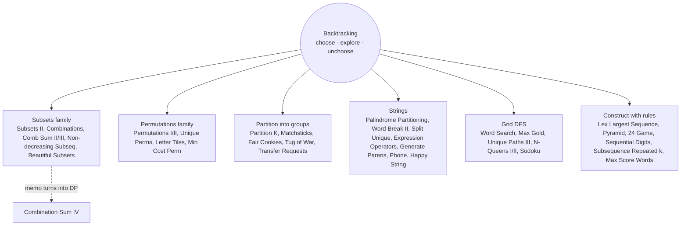

# Backtracking: Pattern Map

> [!TIP]
> **🧠 One picture to keep**
> The **khandani template**: `choose → explore → un-choose`.
> ```
> void solve(state) {
>     if (complete) { record; return; }
>     for (option : options) {
>         if (!valid / pruned) continue;
>         apply(option); solve(next); undo(option);
>     }
> }
> ```
> Draw the **choice tree**. Speed comes from **pruning**: bounds (sum > target, cost ≥ best), **duplicate rules** (sort + skip equal siblings, or branch on counts) and **symmetry** (identical buckets/kids/sides).

**All animations:** [▶ Backtracking Animations](https://d9-cell.github.io/java-brain/Backtracking/Backtracking%20Animations.html) · ⬆ [00 Brain Map](../00%20Brain%20Map.md)

## Java toolkit
| Need | Java |
|---|---|
| Path you build and undo | `List<Integer> cur` + `cur.remove(cur.size() - 1)`, or `StringBuilder` + `deleteCharAt` |
| Snapshot into the result | `res.add(new ArrayList<>(cur))` |
| Duplicates (sortable) | `Arrays.sort`; `if (i > idx && a[i] == a[i-1]) continue;` |
| Duplicates (order must stay) | `Set<Integer> usedHere` created **inside** each call |
| Permutation duplicates | twin rule `a[i]==a[i-1] && !used[i-1]`, or a count map |
| Grid visited | overwrite the cell (`'$'`, `0`, `-1`) and restore it |
| Memo with recursion | never `computeIfAbsent` recursively (ConcurrentModificationException) — use get/put |

## Patterns in this folder


| # | Problem | Pattern | Mantra | Level |
|---|---|---|---|---|
| 1 | [24 Game](24%20Game.md) | Merge-two backtracking | MERGE TWO, ALL OPS, RECURSE, UNDO | Hard |
| 2 | [All Unique Permutations of an array](All%20Unique%20Permutations%20of%20an%20array.md) | Permutations with duplicates | SORT, TWIN RULE: !used[i−1] → SKIP | Medium |
| 3 | [Combinations](Combinations.md) | Combinations | NEXT > LAST, LEAVE ROOM | Medium |
| 4 | [Combination Sum II](Combination%20Sum%20II.md) | Subsets with duplicates, Pruning | SORT, SKIP EQUAL SIBLINGS, BREAK ON OVERSHOOT | Medium |
| 5 | [Combination Sum III](Combination%20Sum%20III.md) | Combinations, Pruning | DIGITS 1..9 ONCE, PRUNE ON COUNT OR SUM | Medium |
| 6 | [Combination Sum IV](Combination%20Sum%20IV.md) | Backtracking + memo, Counting DP | MEMO f(t) | Medium |
| 7 | [Construct the Lexicographically Largest Valid Sequence](Construct%20the%20Lexicographically%20Largest%20Valid%20Sequence.md) | Greedy-order backtracking | FILL LEFT→RIGHT, LARGEST FIRST, FIRST HIT WINS | Medium |
| 8 | [Expression Add Operators](Expression%20Add%20Operators.md) | String backtracking, Precedence trick | TRACK val AND last; × → val − last + last·cur | Hard |
| 9 | [Fair Distribution of Cookies](Fair%20Distribution%20of%20Cookies.md) | Partition into groups, Pruning | GIVE BAG TO EACH KID, BOUND + SYMMETRY PRUNES | Medium |
| 10 | [Find the Minimum Cost Array Permutation](Find%20the%20Minimum%20Cost%20Array%20Permutation.md) | Permutation search, Bitmask DP | perm[0] = 0, PRUNE (or bitmask DP), SMALLEST FIRST | Hard |
| 11 | [Generate Parentheses](Generate%20Parentheses.md) | Constrained generation | OPEN < n → "(", CLOSE < OPEN → ")" | Medium |
| 12 | [Letter Combinations of a Phone Number](Letter%20Combinations%20of%20a%20Phone%20Number.md) | Cartesian product | ONE DIGIT PER LEVEL, EACH LETTER A BRANCH | Medium |
| 13 | [Letter Tile Possibilities](Letter%20Tile%20Possibilities.md) | Permutations with counts | COUNTS, EACH NODE = 1 SEQUENCE | Medium |
| 14 | [Longest Subsequence Repeated k Times](Longest%20Subsequence%20Repeated%20k%20Times.md) | BFS/backtracking over candidates | FILTER LETTERS, BFS BY LENGTH, Z→A | Hard |
| 15 | [Matchsticks to Square](Matchsticks%20to%20Square.md) | Partition into groups | SORT DESC, SKIP EQUAL SIDES | Medium |
| 16 | [Maximum Number of Achievable Transfer Requests](Maximum%20Number%20of%20Achievable%20Transfer%20Requests.md) | Take/skip subsets | TAKE/SKIP, NET[] == 0 AT THE END | Hard |
| 17 | [Maximum Score Words Formed by Letters](Maximum%20Score%20Words%20Formed%20by%20Letters.md) | Take/skip with resources | SKIP OR TAKE IF LETTERS ALLOW, UNDO | Hard |
| 18 | [Non-decreasing Subsequences](Non-decreasing%20Subsequences.md) | Subsets with order-preserving dedupe | PER-DEPTH SET, NON-DECREASING CHECK | Medium |
| 19 | [N-Queens](N-Queens.md) | Grid backtracking, O(1) safety | ROW BY ROW, col/d1/d2 FLAGS | Hard |
| 20 | [N-Queens II](N-Queens%20II.md) | Bitmask backtracking | BITMASKS, free & −free, SHIFT DIAGONALS | Hard |
| 21 | [Palindrome Partitioning](Palindrome%20Partitioning.md) | String partition backtracking | PAL TABLE, CUT ONLY AFTER PALINDROMES | Medium |
| 22 | [Partition to K Equal Sum Subsets](Partition%20to%20K%20Equal%20Sum%20Subsets.md) | Partition into groups | BUCKET BY BUCKET, k==1 → TRUE, TWIN RULE | Medium |
| 23 | [Path with Maximum Gold](Path%20with%20Maximum%20Gold.md) | Grid DFS backtracking | DFS FROM EVERY GOLD, ZERO → RESTORE | Medium |
| 24 | [Permutations](Permutations.md) | Permutations | USED[], CHOOSE, RECURSE, UNCHOOSE | Medium |
| 25 | [Permutations II](Permutations%20II.md) | Permutations with duplicates | COUNT MAP, BRANCH ON DISTINCT VALUES | Medium |
| 26 | [Pyramid Transition Matrix](Pyramid%20Transition%20Matrix.md) | Row-by-row backtracking, Memo | BUILD ROW ABOVE, RECURSE, MEMO FAILED ROWS | Medium |
| 27 | [Sequential Digits](Sequential%20Digits.md) | Enumeration | WINDOWS OF "123456789" | Medium |
| 28 | [Split a String Into the Max Number of Unique Substrings](Split%20a%20String%20Into%20the%20Max%20Number%20of%20Unique%20Substrings.md) | String partition backtracking | NEW PIECE ONLY, ADD/REMOVE FROM SET | Medium |
| 29 | [Subsets II](Subsets%20II.md) | Subsets with duplicates | SORT, RECORD EVERY NODE, SKIP EQUAL SIBLINGS | Medium |
| 30 | [Sudoku Solver](Sudoku%20Solver.md) | Grid backtracking | FIRST EMPTY, TRY 1..9 VALID, UNDO | Hard |
| 31 | [The k-th Lexicographical String of All Happy Strings of Length n](The%20k-th%20Lexicographical%20String%20of%20All%20Happy%20Strings%20of%20Length%20n.md) | Ordered generation | a,b,c ORDER, NO EQUAL NEIGHBOURS, STOP AT k | Medium |
| 32 | [The Number of Beautiful Subsets](The%20Number%20of%20Beautiful%20Subsets.md) | Take/skip with constraint | TAKE IF x±k NOT TAKEN (COUNT MAP) | Medium |
| 33 | [Tug of War](Tug%20of%20War.md) | Balanced partition | EACH ELEMENT → TEAM 1 OR 2, SIZE CAPS | Hard |
| 34 | [Unique Paths III](Unique%20Paths%20III.md) | Grid DFS backtracking | COUNT FREE CELLS, DFS, STEPS == FREE AT END | Hard |
| 35 | [Word Break II](Word%20Break%20II.md) | String partition + memo | CUT WORD, RECURSE, MEMO BY INDEX | Hard |
| 36 | [Word Search](Word%20Search.md) | Grid DFS backtracking | MATCH, MARK $, 4 DIRS, UNMARK | Medium |

## Suggested learning order
1. Template: [Subsets II](Subsets%20II.md), [Permutations](Permutations.md), [Combinations](Combinations.md), [Letter Combinations of a Phone Number](Letter%20Combinations%20of%20a%20Phone%20Number.md), [Generate Parentheses](Generate%20Parentheses.md)
2. Duplicates: [Combination Sum II](Combination%20Sum%20II.md), [Permutations II](Permutations%20II.md), [All Unique Permutations of an array](All%20Unique%20Permutations%20of%20an%20array.md), [Non-decreasing Subsequences](Non-decreasing%20Subsequences.md)
3. Strings: [Palindrome Partitioning](Palindrome%20Partitioning.md) ⭐, [Word Break II](Word%20Break%20II.md), [Split a String Into the Max Number of Unique Substrings](Split%20a%20String%20Into%20the%20Max%20Number%20of%20Unique%20Substrings.md), [Expression Add Operators](Expression%20Add%20Operators.md)
4. Grids: [Word Search](Word%20Search.md) ⭐, [Path with Maximum Gold](Path%20with%20Maximum%20Gold.md), [Unique Paths III](Unique%20Paths%20III.md), [N-Queens](N-Queens.md) ⭐, [N-Queens II](N-Queens%20II.md), [Sudoku Solver](Sudoku%20Solver.md)
5. Grouping: [Partition to K Equal Sum Subsets](Partition%20to%20K%20Equal%20Sum%20Subsets.md), [Matchsticks to Square](Matchsticks%20to%20Square.md), [Fair Distribution of Cookies](Fair%20Distribution%20of%20Cookies.md), [Tug of War](Tug%20of%20War.md)
6. The rest: [Combination Sum III](Combination%20Sum%20III.md), [Combination Sum IV](Combination%20Sum%20IV.md), [Letter Tile Possibilities](Letter%20Tile%20Possibilities.md), [The k-th Lexicographical String of All Happy Strings of Length n](The%20k-th%20Lexicographical%20String%20of%20All%20Happy%20Strings%20of%20Length%20n.md), [The Number of Beautiful Subsets](The%20Number%20of%20Beautiful%20Subsets.md), [Maximum Number of Achievable Transfer Requests](Maximum%20Number%20of%20Achievable%20Transfer%20Requests.md), [Maximum Score Words Formed by Letters](Maximum%20Score%20Words%20Formed%20by%20Letters.md), [Sequential Digits](Sequential%20Digits.md), [Pyramid Transition Matrix](Pyramid%20Transition%20Matrix.md), [Construct the Lexicographically Largest Valid Sequence](Construct%20the%20Lexicographically%20Largest%20Valid%20Sequence.md), [Longest Subsequence Repeated k Times](Longest%20Subsequence%20Repeated%20k%20Times.md), [24 Game](24%20Game.md), [Find the Minimum Cost Array Permutation](Find%20the%20Minimum%20Cost%20Array%20Permutation.md)

## Connections to other folders
- Basic recursion trees: [Recursion](../Recursion/Recursion%20-%20Pattern%20Map.md) (Subsets, Power Set, Rat in a Maze)
- Many words on a grid: [Word Search II](../Trie/Word%20Search%20II.md) (Trie)
- n ≈ 40 partitions: [Meet In The Middle](../Meet%20In%20The%20Middle/Meet%20In%20The%20Middle%20-%20Pattern%20Map.md)
- Memoised backtracking becomes DP: the `DP` folder
