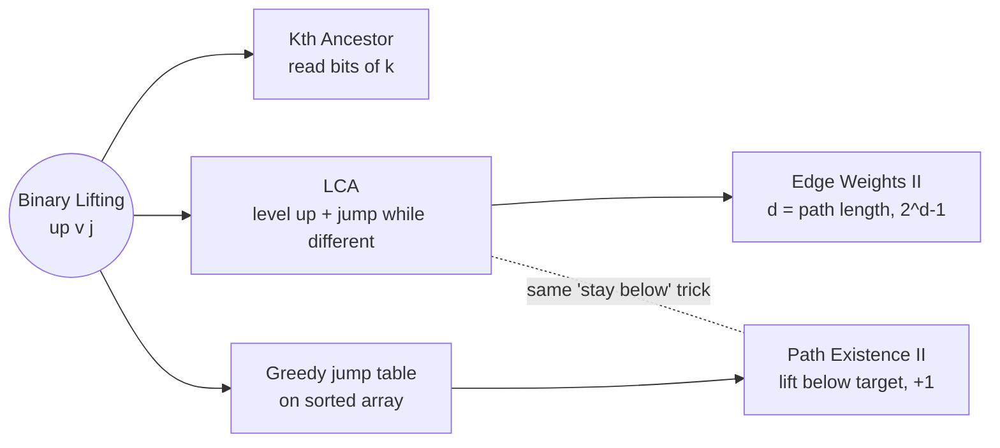

# Binary Lifting: Pattern Map

> [!TIP]
> **🧠 One picture to keep**
> An **elevator with express buttons**: +1, +2, +4, +8. Every button is two presses of the one below it: `up[v][j] = up[ up[v][j-1] ][j-1]`.
> Any distance k is just the **set bits of k**, so it takes O(log n) jumps instead of O(n) steps.

**All animations:** [▶ Binary Lifting Animations](https://d9-cell.github.io/java-brain/Binary%20Lifting/Binary%20Lifting%20Animations.html) · ⬆ [00 Brain Map](../00%20Brain%20Map.md)

## Java toolkit
| Need | Java |
|---|---|
| Number of columns (floor(log2 n) + 1) | `int LOG = 32 - Integer.numberOfLeadingZeros(n);` (exact; `Math.log` can round wrong) |
| Fill table with -1 | `for (int[] row : up) Arrays.fill(row, -1);` |
| Is bit j of k set? | `(k & (1 << j)) != 0` |
| Parent + depth on a big tree | BFS with `ArrayDeque`, not recursion (1e5 deep = StackOverflowError) |

## Patterns in this folder

| # | Problem | Pattern | Mantra | Level |
|---|---|---|---|---|
| 1 | [Kth Ancestor of a Tree Node](Kth%20Ancestor%20of%20a%20Tree%20Node.md) | Binary lifting, Bit decomposition | DOUBLE THE JUMP, READ THE BITS | Hard |
| 2 | [Number of Ways to Assign Edge Weights II](Number%20of%20Ways%20to%20Assign%20Edge%20Weights%20II.md) | Binary lifting, LCA, Parity counting | LEVEL UP, JUMP WHILE DIFFERENT, PARENT IS LCA | Hard |
| 3 | [Path Existence Queries in a Graph II](Path%20Existence%20Queries%20in%20a%20Graph%20II.md) | Binary lifting, Sorting + greedy, Binary search | SORT, FARTHEST HOP, LIFT BELOW TARGET, +1 | Hard |

## Suggested learning order
1. [Kth Ancestor of a Tree Node](Kth%20Ancestor%20of%20a%20Tree%20Node.md): learn the table.
2. [Number of Ways to Assign Edge Weights II](Number%20of%20Ways%20to%20Assign%20Edge%20Weights%20II.md): the table + LCA.
3. [Path Existence Queries in a Graph II](Path%20Existence%20Queries%20in%20a%20Graph%20II.md): the same idea on an array, not a tree.

## Connections to other folders
- Trees and LCA: the `Tree` folder (LCA of Binary Tree problems use the recursive LCA, not lifting)
- Sparse Table / doubling ideas also show up in [Segment Tree](../Segment%20Tree/Segment%20Tree%20-%20Pattern%20Map.md) range queries
- Bit reading `k & (1 << j)`: see the `Bit_Magic` folder
