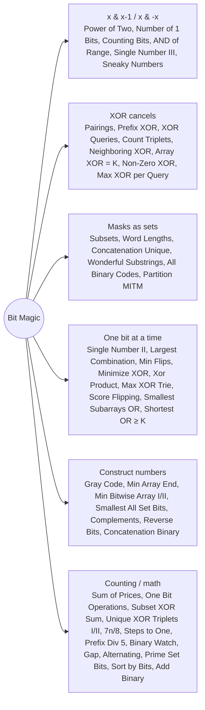

# Bit Magic: Pattern Map

> [!TIP]
> **🧠 One picture to keep**
> Think of a number as a **row of lamps**. Five moves cover almost everything:
> 1. `x & (x − 1)` switches off the lowest lit lamp (Power of Two, Number of 1 Bits, AND of Range).
> 2. `x & −x` isolates the lowest lit lamp (Single Number III, Sneaky Numbers).
> 3. `x ^ x = 0`: pairs cancel, XOR is its own undo (Single Number, Prefix XOR, XOR Queries, Pairings).
> 4. **Masks as sets**: a word, a subset or a parity vector is one int; overlap = AND (Subsets, Word Lengths, Wonderful Substrings).
> 5. **One bit at a time**: decide each bit independently, high to low (Max XOR, Xor Product, Minimize XOR, Flips, Single Number II).

**All animations:** [▶ Bit Magic Animations](https://d9-cell.github.io/java-brain/Bit_Magic/Bit%20Magic%20Animations.html) · ⬆ [00 Brain Map](../00%20Brain%20Map.md)

## Java toolkit
| Need | Java |
|---|---|
| Bit i of x | `(x >> i) & 1` |
| Set / clear / flip bit i | `x \| (1 << i)`, `x & ~(1 << i)`, `x ^ (1 << i)` |
| Lowest set bit | `x & -x` (or `Integer.lowestOneBit`) |
| Drop lowest set bit | `x & (x - 1)` |
| Popcount | `Integer.bitCount(x)` / `Long.bitCount` |
| Bit length | `32 - Integer.numberOfLeadingZeros(x)` |
| All ones of width w | `(1 << w) - 1` (use `1L` near 31 bits) |
| Unsigned shift | `x >>> 1` (sign-safe for negatives) |
| Reverse | `Integer.reverse(x)` |

## Patterns in this folder

| # | Problem | Pattern | Mantra | Level |
|---|---|---|---|---|
| 1 | [Bitwise AND of Numbers Range](Bitwise%20AND%20of%20Numbers%20Range.md) | x & (x−1), Common prefix | right &= right − 1 WHILE right > left | Medium |
| 2 | [Bitwise XOR of All Pairings](Bitwise%20XOR%20of%20All%20Pairings.md) | XOR cancels | XOR nums1 IF |nums2| ODD, nums2 IF |nums1| ODD | Medium |
| 3 | [Calculate 7n by 8 without using division and multiplication](Calculate%207n%20by%208%20without%20using%20division%20and%20multiplication.md) | Shifts | (n << 3) − n, THEN >> 3 (+7 FOR CEIL) | Easy |
| 4 | [Check If a String Contains All Binary Codes of Size K](Check%20If%20a%20String%20Contains%20All%20Binary%20Codes%20of%20Size%20K.md) | Rolling mask | ROLLING MASK, COUNT 2^k DISTINCT | Medium |
| 5 | [Concatenation of Consecutive Binary Numbers](Concatenation%20of%20Consecutive%20Binary%20Numbers.md) | Shifts, Modulo | res = (res << bits) | i, bits++ WHEN i & (i−1) == 0 | Medium |
| 6 | [Construct the Minimum Bitwise Array II](Construct%20the%20Minimum%20Bitwise%20Array%20II.md) | Bit construction | CLEAR THE BIT JUST BELOW THE FIRST 0 | Medium |
| 7 | [Counting Bits](Counting%20Bits.md) | DP on bits | dp[i] = dp[i >> 1] + (i & 1) | Easy |
| 8 | [Count Triplets That Can Form Two Arrays of Equal XOR](Count%20Triplets%20That%20Can%20Form%20Two%20Arrays%20of%20Equal%20XOR.md) | Prefix XOR | EQUAL PREFIX XOR, ADD k − i − 1 | Medium |
| 9 | [Find The Original Array of Prefix Xor](Find%20The%20Original%20Array%20of%20Prefix%20Xor.md) | XOR cancels | arr[i] = pref[i] ^ pref[i−1] | Medium |
| 10 | [Gray Code](Gray%20Code.md) | Reflection, Recursion | REFLECT + SET TOP BIT | Medium |
| 11 | [Largest Combination With Bitwise AND Greater Than Zero](Largest%20Combination%20With%20Bitwise%20AND%20Greater%20Than%20Zero.md) | One bit at a time | MAX OVER BITS OF COUNT | Medium |
| 12 | [Add Binary](Add%20Binary.md) | Carry simulation | SUM % 2 WRITE, SUM / 2 CARRY | Easy |
| 13 | [Binary Gap](Binary%20Gap.md) | Bit scan | REMEMBER THE PREVIOUS 1 | Easy |
| 14 | [Binary Number with Alternating Bits](Binary%20Number%20with%20Alternating%20Bits.md) | XOR trick | x = n ^ (n >> 1), x & (x+1) == 0 | Easy |
| 15 | [Binary Prefix Divisible By 5](Binary%20Prefix%20Divisible%20By%205.md) | Modular arithmetic | rem = (2·rem + bit) % 5 | Easy |
| 16 | [Binary Watch](Binary%20Watch.md) | Enumeration | bitCount(h) + bitCount(m) == k | Easy |
| 17 | [Complement of Base 10 Integer](Complement%20of%20Base%2010%20Integer.md) | Masks | n ^ ((1 << bits) − 1) | Easy |
| 18 | [Construct the Minimum Bitwise Array I](Construct%20the%20Minimum%20Bitwise%20Array%20I.md) | Brute force | FIRST x WITH x | (x+1) == num | Easy |
| 19 | [Number Complement](Number%20Complement.md) | Masks | num ^ ((highestOneBit << 1) − 1) | Easy |
| 20 | [Power of Two](Power%20of%20Two.md) | x & (x−1) | n > 0 && (n & (n−1)) == 0 | Easy |
| 21 | [Prime Number of Set Bits in Binary Representation](Prime%20Number%20of%20Set%20Bits%20in%20Binary%20Representation.md) | Lookup mask | primes >> bitCount(x) & 1 | Easy |
| 22 | [Reverse Bits](Reverse%20Bits.md) | Bit by bit | res = (res << 1) | (n & 1), n >>>= 1 | Easy |
| 23 | [Smallest Number With All Set Bits](Smallest%20Number%20With%20All%20Set%20Bits.md) | All-ones numbers | x = (x << 1) | 1 WHILE x < n | Easy |
| 24 | [Sum of All Subset XOR Totals](Sum%20of%20All%20Subset%20XOR%20Totals.md) | Subsets, Bit contribution | OR << (n − 1) | Easy |
| 25 | [The Two Sneaky Numbers of Digitville](The%20Two%20Sneaky%20Numbers%20of%20Digitville.md) | XOR cancels, Lowest set bit | XOR WITH 0..n−1, SPLIT BY LOWEST BIT | Easy |
| 26 | [Longest Subsequence With Non-Zero Bitwise XOR](Longest%20Subsequence%20With%20Non-Zero%20Bitwise%20XOR.md) | XOR property | n, n − 1, OR 0 | Medium |
| 27 | [Maximum Length of a Concatenated String with Unique Characters (Bit Magic)](Maximum%20Length%20of%20a%20Concatenated%20String%20with%20Unique%20Characters%20%28Bit%20Magic%29.md) | Masks as sets, Take / skip | MASK PER WORD, TAKE IF used & mask == 0 | Medium |
| 28 | [Maximum Number That Sum of the Prices Is Less Than or Equal to K](Maximum%20Number%20That%20Sum%20of%20the%20Prices%20Is%20Less%20Than%20or%20Equal%20to%20K.md) | Bit counting formula, Binary search on answer | COUNT BIT b UP TO n BY FORMULA, BINARY SEARCH num | Medium |
| 29 | [Maximum Product of Word Lengths](Maximum%20Product%20of%20Word%20Lengths.md) | Masks as sets | MASK PER WORD, O(1) OVERLAP CHECK | Medium |
| 30 | [Maximum XOR for Each Query](Maximum%20XOR%20for%20Each%20Query.md) | XOR cancels, Masks | k = xor ^ (2^maxBit − 1), REMOVE LAST | Medium |
| 31 | [Maximum XOR of Two Numbers in an Array](Maximum%20XOR%20of%20Two%20Numbers%20in%20an%20Array.md) | Bit trie, Greedy high bit | TRIE, GREEDY OPPOSITE BIT FROM THE TOP | Medium |
| 32 | [Maximum Xor Product](Maximum%20Xor%20Product.md) | One bit at a time, Balancing | EQUAL → BOTH 1, DIFFERENT → GIVE TO SMALLER | Medium |
| 33 | [Minimize XOR](Minimize%20XOR.md) | One bit at a time | COPY HIGH BITS, FILL LOWEST FREE BITS | Medium |
| 34 | [Minimum Array End](Minimum%20Array%20End.md) | Bit construction | (num + 1) | x, OR DEPOSIT n − 1 INTO x's ZEROS | Medium |
| 35 | [Minimum Flips to Make a OR b Equal to c](Minimum%20Flips%20to%20Make%20a%20OR%20b%20Equal%20to%20c.md) | One bit at a time | BIT BY BIT, OR POPCOUNT FORMULA | Medium |
| 36 | [Minimum Number of Operations to Make Array XOR Equal to K](Minimum%20Number%20of%20Operations%20to%20Make%20Array%20XOR%20Equal%20to%20K.md) | XOR property | bitCount(XOR ^ k) | Medium |
| 37 | [Minimum One Bit Operations to Make Integers Zero](Minimum%20One%20Bit%20Operations%20to%20Make%20Integers%20Zero.md) | Recurrence, Gray code | +f(high) − f(next) + f(next) … | Hard |
| 38 | [Neighboring Bitwise XOR](Neighboring%20Bitwise%20XOR.md) | XOR cancels | XOR OF derived == 0 | Medium |
| 39 | [Number of 1 Bits](Number%20of%201%20Bits.md) | x & (x−1) | n &= n − 1, COUNT | Easy |
| 40 | [Number of Steps to Reduce a Number in Binary Representation to One](Number%20of%20Steps%20to%20Reduce%20a%20Number%20in%20Binary%20Representation%20to%20One.md) | Carry simulation | ODD → 2 STEPS, CARRY 1; EVEN → 1 STEP | Medium |
| 41 | [Number of Unique XOR Triplets I](Number%20of%20Unique%20XOR%20Triplets%20I.md) | Observation | n ≤ 2 → n, ELSE NEXT POWER OF TWO | Medium |
| 42 | [Number of Unique XOR Triplets II](Number%20of%20Unique%20XOR%20Triplets%20II.md) | Pairs then triplets | PAIR XORS → TRIPLET XORS, SIZE T | Medium |
| 43 | [Number of Wonderful Substrings](Number%20of%20Wonderful%20Substrings.md) | Prefix parity mask | PREFIX MASK, COUNT SAME + 10 NEIGHBOURS | Medium |
| 44 | [Partition Array Into Two Arrays to Minimize Sum Difference (Bit Magic)](Partition%20Array%20Into%20Two%20Arrays%20to%20Minimize%20Sum%20Difference%20%28Bit%20Magic%29.md) | Meet in the middle, Bitmask subsets | SUBSET SUMS BY SIZE, BINARY SEARCH THE OTHER HALF | Hard |
| 45 | [Score After Flipping Matrix](Score%20After%20Flipping%20Matrix.md) | Greedy by bit weight | ROWS START WITH 1, COLUMNS MAJORITY 1 | Medium |
| 46 | [Shortest Subarray With OR at Least K II](Shortest%20Subarray%20With%20OR%20at%20Least%20K%20II.md) | Sliding window, Bit counts | SLIDING WINDOW, COUNT PER BIT | Medium |
| 47 | [Single Number II](Single%20Number%20II.md) | One bit at a time | PER BIT: ones % 3 | Medium |
| 48 | [Single Number III](Single%20Number%20III.md) | Lowest set bit, XOR cancels | xor & −xor SPLITS INTO TWO GROUPS | Medium |
| 49 | [Smallest Subarrays With Maximum Bitwise OR](Smallest%20Subarrays%20With%20Maximum%20Bitwise%20OR.md) | Per-bit nearest index | RIGHT TO LEFT, nearest[b], MAX END | Medium |
| 50 | [Sort Integers by The Number of 1 Bits](Sort%20Integers%20by%20The%20Number%20of%201%20Bits.md) | Custom sort key | bitCount · 100000 + value | Easy |
| 51 | [Subsets (Bit Magic)](Subsets%20%28Bit%20Magic%29.md) | Masks as sets | BIT i SET ⇒ TAKE nums[i] | Medium |
| 52 | [XOR Queries of a Subarray](XOR%20Queries%20of%20a%20Subarray.md) | Prefix XOR | pre[r+1] ^ pre[l] | Medium |

## Suggested learning order
1. Basics: [Number of 1 Bits](Number%20of%201%20Bits.md) ⭐, [Power of Two](Power%20of%20Two.md), [Counting Bits](Counting%20Bits.md), [Reverse Bits](Reverse%20Bits.md), [Add Binary](Add%20Binary.md)
2. XOR cancels: [Single Number III](Single%20Number%20III.md) ⭐, [Find The Original Array of Prefix Xor](Find%20The%20Original%20Array%20of%20Prefix%20Xor.md), [XOR Queries of a Subarray](XOR%20Queries%20of%20a%20Subarray.md), [Bitwise XOR of All Pairings](Bitwise%20XOR%20of%20All%20Pairings.md), [Count Triplets That Can Form Two Arrays of Equal XOR](Count%20Triplets%20That%20Can%20Form%20Two%20Arrays%20of%20Equal%20XOR.md)
3. One bit at a time: [Single Number II](Single%20Number%20II.md) ⭐, [Minimum Flips to Make a OR b Equal to c](Minimum%20Flips%20to%20Make%20a%20OR%20b%20Equal%20to%20c.md), [Minimize XOR](Minimize%20XOR.md), [Largest Combination With Bitwise AND Greater Than Zero](Largest%20Combination%20With%20Bitwise%20AND%20Greater%20Than%20Zero.md)
4. Masks: [Subsets (Bit Magic)](Subsets%20%28Bit%20Magic%29.md), [Maximum Product of Word Lengths](Maximum%20Product%20of%20Word%20Lengths.md), [Number of Wonderful Substrings](Number%20of%20Wonderful%20Substrings.md) ⭐
5. Constructions: [Gray Code](Gray%20Code.md), [Minimum Array End](Minimum%20Array%20End.md), [Bitwise AND of Numbers Range](Bitwise%20AND%20of%20Numbers%20Range.md)
6. Hard: [Maximum XOR of Two Numbers in an Array](Maximum%20XOR%20of%20Two%20Numbers%20in%20an%20Array.md), [Maximum Xor Product](Maximum%20Xor%20Product.md), [Minimum One Bit Operations to Make Integers Zero](Minimum%20One%20Bit%20Operations%20to%20Make%20Integers%20Zero.md), [Maximum Number That Sum of the Prices Is Less Than or Equal to K](Maximum%20Number%20That%20Sum%20of%20the%20Prices%20Is%20Less%20Than%20or%20Equal%20to%20K.md), [Partition Array Into Two Arrays to Minimize Sum Difference (Bit Magic)](Partition%20Array%20Into%20Two%20Arrays%20to%20Minimize%20Sum%20Difference%20%28Bit%20Magic%29.md)

## Connections to other folders
- Backtracking versions: [Subsets](../Recursion/Subsets.md), [Maximum Length of a Concatenated String with Unique Characters](../Recursion/Maximum%20Length%20of%20a%20Concatenated%20String%20with%20Unique%20Characters.md)
- Meet in the middle: [Partition Array Into Two Arrays to Minimize Sum Difference](../Meet%20In%20The%20Middle/Partition%20Array%20Into%20Two%20Arrays%20to%20Minimize%20Sum%20Difference.md)
- Bit trie: [Trie](../Trie/Trie%20-%20Pattern%20Map.md)
- OR of subarrays: [Bitwise ORs of Subarrays](../HashSet/Bitwise%20ORs%20of%20Subarrays.md)
- Prefix-parity + map idea: [Longest Balanced Substring II](../HashMap/Longest%20Balanced%20Substring%20II.md) (HashMap)
