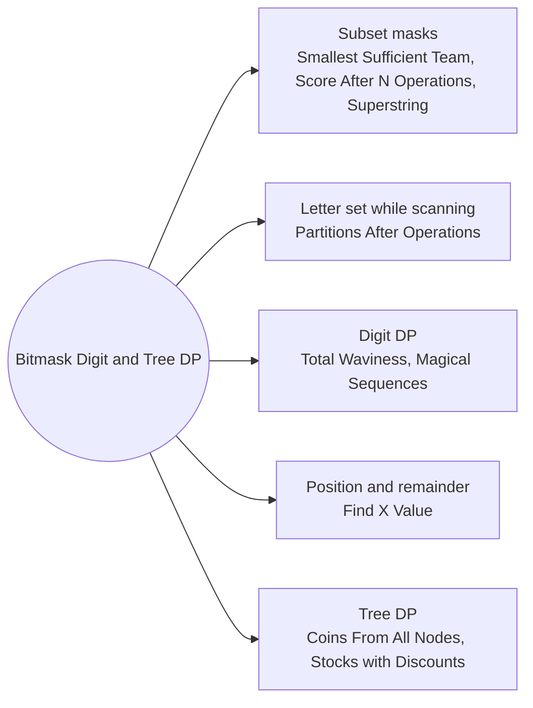

# Bitmask Digit and Tree DP: Pattern Map

> [!TIP]
> **🧠 One picture to keep**
> The state is something other than an index: **a set, a digit position, or a tree node**.
> 1. **Bitmask over a small set** (skills, words, letters, elements): `dp[mask]` or `dp[mask][last]` (Smallest Sufficient Team, Score After N Operations, Shortest Superstring).
> 2. **Letter set as state** while scanning: the mask of letters in the open partition (Partitions After Operations).
> 3. **Digit DP**: position, tight flag, and the last digits seen, returning (count, total) (Total Waviness).
> 4. **Count by carry**: build a sum bit by bit with a carry and a multinomial factor (Magical Sequences).
> 5. **Position + residue**: counts per remainder (Find X Value).
> 6. **Tree DP**: children first, state = what the ancestors did (halvings, boss bought, budget) (Coins From All Nodes, Stocks with Discounts).

**All animations:** [▶ Bitmask Digit and Tree DP Animations](https://d9-cell.github.io/java-brain/DP/Bitmask%20Digit%20and%20Tree%20DP/Bitmask%20Digit%20and%20Tree%20DP%20Animations.html) · ⬆ [00 Brain Map](../../00%20Brain%20Map.md)

## Java toolkit
| Need | Java |
|---|---|
| Subset loop | `for (int mask = 0; mask < (1 << n); mask++)` |
| Test and set a bit | `(mask >> i & 1) == 1` / `mask \| (1 << i)` |
| Count bits | `Integer.bitCount(mask)`, `Long.bitCount(m)` |
| Letter mask | `mask \|= 1 << (c - 'a');` |
| Tight digit DP | `int limit = tight ? digit[pos] : 9; ... go(pos + 1, tight && d == limit, ...)` |
| Memo key packing | `((long) i << 27) \| ((long) mask << 1) \| flag` in a `HashMap<Long, Integer>` |
| Binomials mod p | Pascal's triangle `C[i][j] = (C[i-1][j-1] + C[i-1][j]) % MOD` |
| Tree order without recursion | BFS list from the root, then process it in reverse |

## Patterns in this folder

| # | Problem | Pattern | Mantra | Level |
|---|---|---|---|---|
| 1 | [Maximize Score After N Operations](Maximize%20Score%20After%20N%20Operations.md) | Mask of used elements, Pairing | dp[mask | i | j] = dp[mask] + op · gcd(a[i], a[j]), op = popcount / 2 + 1 | Hard |
| 2 | [Smallest Sufficient Team](Smallest%20Sufficient%20Team.md) | Skill mask, Set cover | team[covered | skills(p)] = smaller of (itself, team[covered] + p) | Hard |
| 3 | [Find the Shortest Superstring](Find%20the%20Shortest%20Superstring.md) | TSP on words, Overlap matrix | dp[mask][last] = max over prev of dp[mask minus last][prev] + overlap[prev][last] | Hard |
| 4 | [Maximize the Number of Partitions After Operations](Maximize%20the%20Number%20of%20Partitions%20After%20Operations.md) | Letter set state, One free change | solve(i, mask, can): place s[i] or, if can, any other letter | Hard |
| 5 | [Find X Value of Array I](Find%20X%20Value%20of%20Array%20I.md) | Residue counts, Subarrays ending here | cnt'[x · v mod k] += cnt[x] · plus the single element v mod k | Medium |
| 6 | [Total Waviness of Numbers in Range II](Total%20Waviness%20of%20Numbers%20in%20Range%20II.md) | Digit DP, (count, total) pair | ANSWER = f(num2) − f(num1 − 1) | Hard |
| 7 | [Find Sum of Array Product of Magical Sequences](Find%20Sum%20of%20Array%20Product%20of%20Magical%20Sequences.md) | Digit DP on bits, Multinomial counts | go(i, rem, onesLeft, carry) = Σ_t C(rem, t) · nums[i]^t · go(i + 1, rem − t, onesLeft − bit, carry') | Hard |
| 8 | [Maximum Points After Collecting Coins From All Nodes](Maximum%20Points%20After%20Collecting%20Coins%20From%20All%20Nodes.md) | Tree DP, Halvings as state | dp[v][p] = max(coins>>p − k + Σ dp[child][p], coins>>(p+1) + Σ dp[child][p+1]) | Hard |
| 9 | [Maximum Profit from Trading Stocks with Discounts](Maximum%20Profit%20from%20Trading%20Stocks%20with%20Discounts.md) | Tree knapsack, Boss bought? | best[u][bossBought][b] = max(skip u: merge children, buy u: merge children (boss bought) + future − price) | Hard |

## Suggested learning order
1. [Maximize Score After N Operations](Maximize%20Score%20After%20N%20Operations.md) ⭐, [Smallest Sufficient Team](Smallest%20Sufficient%20Team.md)
2. [Find the Shortest Superstring](Find%20the%20Shortest%20Superstring.md), [Maximize the Number of Partitions After Operations](Maximize%20the%20Number%20of%20Partitions%20After%20Operations.md)
3. [Find X Value of Array I](Find%20X%20Value%20of%20Array%20I.md)
4. [Total Waviness of Numbers in Range II](Total%20Waviness%20of%20Numbers%20in%20Range%20II.md), [Find Sum of Array Product of Magical Sequences](Find%20Sum%20of%20Array%20Product%20of%20Magical%20Sequences.md)
5. [Maximum Points After Collecting Coins From All Nodes](Maximum%20Points%20After%20Collecting%20Coins%20From%20All%20Nodes.md), [Maximum Profit from Trading Stocks with Discounts](Maximum%20Profit%20from%20Trading%20Stocks%20with%20Discounts.md)

## Connections to other folders
- [Knapsack Series - Pattern Map](../Knapsack%20Series/Knapsack%20Series%20-%20Pattern%20Map.md) for the budget dimension used by the tree knapsack
- [Game DP - Pattern Map](../Game%20DP/Game%20DP%20-%20Pattern%20Map.md) for another bitmask minimax (Kill All Pawns)
- [Rotated Digits](../Stairs%20and%20Robbers/Rotated%20Digits.md) for a simpler digit-by-digit count
