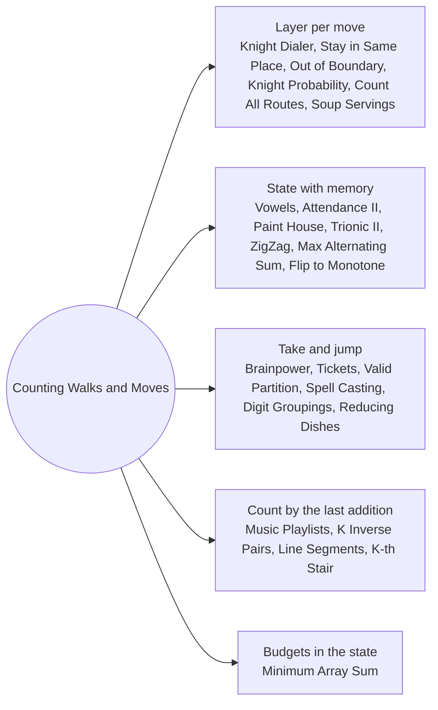

# Counting Walks and Moves: Pattern Map

> [!TIP]
> **🧠 One picture to keep**
> Here the state is **where you stand plus a little memory**. One layer of the table is one move, so the answer is "how many walks (or how much value) reach this state after t moves".
> 1. **Layer by layer**: `next[state] += cur[prev]` for every legal move (Knight Dialer, Stay in the Same Place, Out of Boundary Paths, Knight Probability).
> 2. **Small extra memory in the state**: absences and trailing lates, last colour, phase of a pattern (Attendance Record, Paint House, Trionic Array, ZigZag Arrays).
> 3. **Skip or take with a jump**: take item i and land on i + gap (Brainpower, Tickets, Spell Casting, Valid Partition).
> 4. **Count by what you add last**: a new song or a replay, the position of the newest number (Music Playlists, K Inverse Pairs, Line Segments).
> Prefix sums turn "sum over a range of previous states" into O(1) per cell.

**All animations:** [▶ Counting Walks and Moves Animations](https://d9-cell.github.io/java-brain/DP/Counting%20Walks%20and%20Moves/Counting%20Walks%20and%20Moves%20Animations.html) · ⬆ [00 Brain Map](../../00%20Brain%20Map.md)

## Java toolkit
| Need | Java |
|---|---|
| One layer per move | `long[] next = new long[S]; ... cur = next;` |
| Move table | `static final int[][] MOVES = {{4, 6}, {6, 8}, ...};` |
| Modulo counting | `next[to] = (next[to] + cur[from]) % MOD;` on `long` |
| Probability instead of count | `double[][]`, divide by the number of choices at each move |
| Range of previous states | prefix sum or sliding window: `window += dp[j]; window -= dp[j - i];` |
| Memo with -1 sentinel | `long[][] memo; for (long[] r : memo) Arrays.fill(r, -1);` |

## Patterns in this folder

| # | Problem | Pattern | Mantra | Level |
|---|---|---|---|---|
| 1 | [Knight Dialer](Knight%20Dialer.md) | Layer per move, Move table | next[to] += ways[from] FOR EVERY KNIGHT MOVE | Medium |
| 2 | [Count Vowels Permutation](Count%20Vowels%20Permutation.md) | Layer per letter, Rolling variables | ENDING-IN COUNTS; a ← e,i,u · e ← a,i · i ← e,o · o ← i · u ← i,o | Hard |
| 3 | [Student Attendance Record II](Student%20Attendance%20Record%20II.md) | State with memory, Automaton DP | dp[a][l]: P → l=0 · A → a+1, l=0 · L → l+1 | Hard |
| 4 | [Paint House](Paint%20House.md) | State with memory, Last colour | cost[c] = price[c] + min(OTHER TWO COLOURS) | Medium |
| 5 | [Reducing Dishes](Reducing%20Dishes.md) | Sort then take or skip, Suffix greedy | SORT; ADD SUFFIX SUM WHILE IT STAYS > 0 | Hard |
| 6 | [Maximum Alternating Subsequence Sum](Maximum%20Alternating%20Subsequence%20Sum.md) | Two-state DP, Sign as state | plus = max(plus, minus + x) · minus = max(minus, plus − x) | Medium |
| 7 | [Minimum Cost For Tickets](Minimum%20Cost%20For%20Tickets.md) | Take and jump, Calendar DP | dp[d] = min(dp[d−1]+c1, dp[d−7]+c7, dp[d−30]+c30) | Medium |
| 8 | [Solving Questions With Brainpower](Solving%20Questions%20With%20Brainpower.md) | Take and jump, Right-to-left DP | dp[i] = max(points + dp[i + bp + 1], dp[i + 1]) | Medium |
| 9 | [Check if There is a Valid Partition For The Array](Check%20if%20There%20is%20a%20Valid%20Partition%20For%20The%20Array.md) | Last block argument, Boolean DP | ok[i] = (ok[i−2] AND pair) OR (ok[i−3] AND triple) | Medium |
| 10 | [Flip String to Monotone Increasing](Flip%20String%20to%20Monotone%20Increasing.md) | Two-state DP, Prefix split | '1' → ones++ · '0' → flips = min(flips + 1, ones) | Medium |
| 11 | [Find Number of Ways to Reach the K-th Stair](Find%20Number%20of%20Ways%20to%20Reach%20the%20K-th%20Stair.md) | State with memory, Combinatorics | j UPS LAND ON 2^j; CHOOSE 2^j − k DOWNS AMONG j + 1 GAPS | Hard |
| 12 | [Maximum Total Damage With Spell Casting](Maximum%20Total%20Damage%20With%20Spell%20Casting.md) | Take and jump, Group equal values | SORT DISTINCT; dp[i] = max(dp[i−1], total(v) + dp[last v′ < v − 2]) | Medium |
| 13 | [Count digit groupings of a number](Count%20digit%20groupings%20of%20a%20number.md) | Take and jump, Previous value in the state | STATE (start, previous sum); TRY EVERY NEXT GROUP | Medium |
| 14 | [Soup Servings](Soup%20Servings.md) | Probability DP, Scale the units | p(a, b) = ¼ Σ p(a − 4, b), p(a − 3, b − 1), p(a − 2, b − 2), p(a − 1, b − 3) | Medium |
| 15 | [Number of Ways to Stay in the Same Place After Some Steps](Number%20of%20Ways%20to%20Stay%20in%20the%20Same%20Place%20After%20Some%20Steps.md) | Layer per move, Bound the reach | next[p] = cur[p − 1] + cur[p] + cur[p + 1]; WIDTH = min(len, steps/2 + 1) | Hard |
| 16 | [Trionic Array II](Trionic%20Array%20II.md) | Phase as state, Kadane-style extension | up1 = max(a[i−1], up1) + x · down = max(up1, down) + x · up2 = max(down, up2) + x | Hard |
| 17 | [Number of ZigZag Arrays I](Number%20of%20ZigZag%20Arrays%20I.md) | Direction as state, Prefix sums | up[v] = Σ down[u < v] · down[v] = Σ up[u > v] (PREFIX SUMS) | Hard |
| 18 | [Number of Music Playlists](Number%20of%20Music%20Playlists.md) | Count by the last addition, 2-D counting | dp[i][j] = dp[i−1][j−1]·(n−j+1) + dp[i−1][j]·max(j−k, 0) | Hard |
| 19 | [K Inverse Pairs Array](K%20Inverse%20Pairs%20Array.md) | Count by the last addition, Sliding window sum | dp[i][j] = Σ dp[i−1][j−t], t = 0..i−1 (WINDOW SUM) | Hard |
| 20 | [Number of Sets of K Non-Overlapping Line Segments](Number%20of%20Sets%20of%20K%20Non-Overlapping%20Line%20Segments.md) | State with an open flag, Stars and bars | MEMO (point, left, open) · ANSWER = C(n + k − 1, 2k) | Medium |
| 21 | [Out of Boundary Paths](Out%20of%20Boundary%20Paths.md) | Layer per move, Grid walks | next[nb] += dp[cell]; OFF THE GRID → out += dp[cell] | Medium |
| 22 | [Knight Probability in Chessboard](Knight%20Probability%20in%20Chessboard.md) | Probability DP, Layer per move | next[nb] += dp[cell] / 8; ANSWER = Σ dp AFTER k MOVES | Medium |
| 23 | [Count All Possible Routes](Count%20All%20Possible%20Routes.md) | Fuel in the state, Memo over (city, fuel) | routes(i, f) = [i == finish] + Σ routes(j, f − |loc i − loc j|) | Hard |
| 24 | [Minimum Array Sum](Minimum%20Array%20Sum.md) | Budgets in the state, Order of operations | MEMO (i, op1 left, op2 left); BOTH = min(ceil(x/2) − k, ceil((x − k)/2)) | Medium |

## Suggested learning order
1. [Knight Dialer](Knight%20Dialer.md) ⭐, [Count Vowels Permutation](Count%20Vowels%20Permutation.md), [Paint House](Paint%20House.md), [Student Attendance Record II](Student%20Attendance%20Record%20II.md)
2. [Solving Questions With Brainpower](Solving%20Questions%20With%20Brainpower.md) ⭐, [Minimum Cost For Tickets](Minimum%20Cost%20For%20Tickets.md), [Check if There is a Valid Partition For The Array](Check%20if%20There%20is%20a%20Valid%20Partition%20For%20The%20Array.md), [Maximum Total Damage With Spell Casting](Maximum%20Total%20Damage%20With%20Spell%20Casting.md)
3. [Maximum Alternating Subsequence Sum](Maximum%20Alternating%20Subsequence%20Sum.md), [Flip String to Monotone Increasing](Flip%20String%20to%20Monotone%20Increasing.md), [Reducing Dishes](Reducing%20Dishes.md), [Count digit groupings of a number](Count%20digit%20groupings%20of%20a%20number.md)
4. [Number of Ways to Stay in the Same Place After Some Steps](Number%20of%20Ways%20to%20Stay%20in%20the%20Same%20Place%20After%20Some%20Steps.md), [Out of Boundary Paths](Out%20of%20Boundary%20Paths.md), [Knight Probability in Chessboard](Knight%20Probability%20in%20Chessboard.md), [Count All Possible Routes](Count%20All%20Possible%20Routes.md), [Soup Servings](Soup%20Servings.md)
5. [Number of Music Playlists](Number%20of%20Music%20Playlists.md), [K Inverse Pairs Array](K%20Inverse%20Pairs%20Array.md) ⭐, [Number of Sets of K Non-Overlapping Line Segments](Number%20of%20Sets%20of%20K%20Non-Overlapping%20Line%20Segments.md), [Find Number of Ways to Reach the K-th Stair](Find%20Number%20of%20Ways%20to%20Reach%20the%20K-th%20Stair.md)
6. [Trionic Array II](Trionic%20Array%20II.md), [Number of ZigZag Arrays I](Number%20of%20ZigZag%20Arrays%20I.md), [Minimum Array Sum](Minimum%20Array%20Sum.md)

## Connections to other folders
- [Stairs and Robbers - Pattern Map](../Stairs%20and%20Robbers/Stairs%20and%20Robbers%20-%20Pattern%20Map.md) for the 1-D warm-up (last step, take or skip)
- [Grid and BFS - Pattern Map](../../Graph/Grid%20and%20BFS/Grid%20and%20BFS%20-%20Pattern%20Map.md) for walks where only the shortest one matters
- [Knapsack Series - Pattern Map](../Knapsack%20Series/Knapsack%20Series%20-%20Pattern%20Map.md) when the extra memory is a capacity
