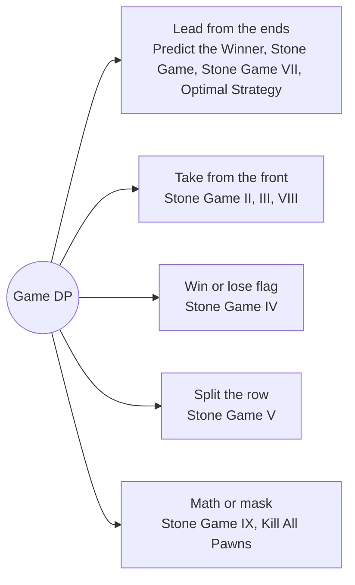

# Game DP: Pattern Map

> [!TIP]
> **🧠 One picture to keep**
> Two perfect players: define **dp = the mover's best result** and subtract the opponent's best from the rest.
> 1. **Score lead**: `dp[state] = max over moves of (gain − dp[next state])`, one number for both players (Predict the Winner, Stone Games III/VII/VIII).
> 2. **Own total**: `dp = suffix − dp[next]` when every stone ends up with someone (Stone Game II, GfG Optimal Strategy).
> 3. **Win or lose**: a boolean per state, true if some move reaches a losing state (Stone Game IV).
> 4. **Math shortcut**: find the invariant instead of searching (Stone Game, Stone Game IX).
> 5. **Max vs min players**: one maximises, the other minimises the same total, so turn parity is part of the state (Kill All Pawns).

**All animations:** [▶ Game DP Animations](https://d9-cell.github.io/java-brain/DP/Game%20DP/Game%20DP%20Animations.html) · ⬆ [00 Brain Map](../../00%20Brain%20Map.md)

## Java toolkit
| Need | Java |
|---|---|
| Mover's lead | `dp[i][j] = Math.max(a[i] - dp[i + 1][j], a[j] - dp[i][j - 1]);` |
| Interval order | `for (int len = 2; len <= n; len++) for (int i = 0; i + len <= n; i++) { int j = i + len - 1; ... }` |
| Prefix and suffix sums | `pre[i + 1] = pre[i] + a[i];` / `suffix[i] = suffix[i + 1] + a[i];` |
| Win flag | `win[i] = !win[i - s * s]` for some move s |
| Turn from the mask | `boolean alice = (n - Integer.bitCount(mask)) % 2 == 0;` |
| Memo with a sentinel | `int[][] memo; Arrays.fill(row, -1)` when 0 is a legal answer |

## Patterns in this folder

| # | Problem | Pattern | Mantra | Level |
|---|---|---|---|---|
| 1 | [Predict the Winner](Predict%20the%20Winner.md) | Lead from the ends, Interval DP | dp[i][j] = max(a[i] − dp[i+1][j], a[j] − dp[i][j−1]) | Medium |
| 2 | [Stone Game](Stone%20Game.md) | Parity argument, Lead from the ends | RETURN true | Medium |
| 3 | [Optimal Strategy For A Game](Optimal%20Strategy%20For%20A%20Game.md) | Own total, Interval DP | dp[i][j] = max(a[i] + min(dp[i+2][j], dp[i+1][j−1]), a[j] + min(dp[i+1][j−1], dp[i][j−2])) | Medium |
| 4 | [Stone Game VII](Stone%20Game%20VII.md) | Lead from the ends, Prefix sums | dp[i][j] = max(sum(i+1..j) − dp[i+1][j], sum(i..j−1) − dp[i][j−1]) | Medium |
| 5 | [Stone Game III](Stone%20Game%20III.md) | Take from the front, Lead | dp[i] = max over k = 1..3 of (sum of k stones − dp[i+k]) | Hard |
| 6 | [Stone Game II](Stone%20Game%20II.md) | Take from the front, Own total | dp[i][M] = max over X ≤ 2M of suffix[i] − dp[i+X][max(M, X)] | Medium |
| 7 | [Stone Game VIII](Stone%20Game%20VIII.md) | Prefix sums, One pass | best = max(best, pre[i] − best), WALKING i FROM THE END | Hard |
| 8 | [Stone Game IV](Stone%20Game%20IV.md) | Win flag, Perfect squares | win[i] = ∃ s: !win[i − s²] | Hard |
| 9 | [Stone Game V](Stone%20Game%20V.md) | Split the row, Interval DP | dp[l][r] = max over k of min-half sum + dp[that half] (tie: either) | Hard |
| 10 | [Stone Game IX](Stone%20Game%20IX.md) | Math invariant, Counting | zeros even → need both 1s and 2s · zeros odd → |c1 − c2| ≥ 3 | Medium |
| 11 | [Maximum Number of Moves to Kill All Pawns](Maximum%20Number%20of%20Moves%20to%20Kill%20All%20Pawns.md) | Bitmask game, BFS distances | Alice: max of d + play(next) · Bob: min of d + play(next) | Hard |

## Suggested learning order
1. [Predict the Winner](Predict%20the%20Winner.md) ⭐, [Stone Game](Stone%20Game.md), [Optimal Strategy For A Game](Optimal%20Strategy%20For%20A%20Game.md), [Stone Game VII](Stone%20Game%20VII.md)
2. [Stone Game III](Stone%20Game%20III.md), [Stone Game II](Stone%20Game%20II.md), [Stone Game VIII](Stone%20Game%20VIII.md)
3. [Stone Game IV](Stone%20Game%20IV.md), [Stone Game V](Stone%20Game%20V.md)
4. [Stone Game IX](Stone%20Game%20IX.md), [Maximum Number of Moves to Kill All Pawns](Maximum%20Number%20of%20Moves%20to%20Kill%20All%20Pawns.md)

## Connections to other folders
- [Interval DP - Pattern Map](../Interval%20DP/Interval%20DP%20-%20Pattern%20Map.md) for the range tables used by the end-taking games
- [Knapsack Series - Pattern Map](../Knapsack%20Series/Knapsack%20Series%20-%20Pattern%20Map.md) for choices over a prefix
- [Burst Balloons](../Interval%20DP/Burst%20Balloons.md) for another "last move" view of a range
