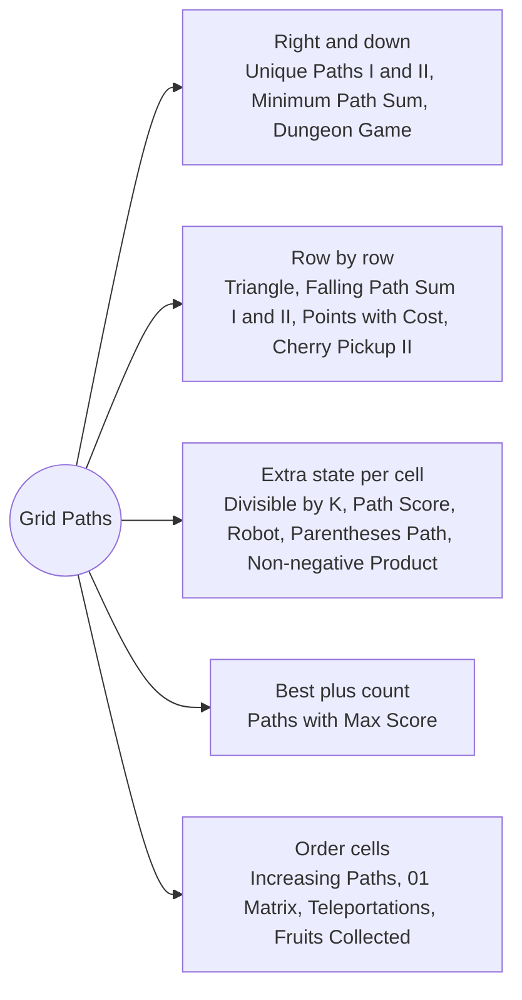

# Grid Paths: Pattern Map

> [!TIP]
> **🧠 One picture to keep**
> A cell's answer comes from the cells you could have **stepped from**.
> 1. **Right/down walks**: `dp[i][j]` from the cell above and the cell to the left (Unique Paths, Minimum Path Sum, Dungeon Game).
> 2. **Row by row, free column**: each row only reads the previous row, with 3 neighbours or the best of the rest (Falling Path Sum, Triangle, Points with Cost, Cherry Pickup II).
> 3. **Extra state per cell**: remainder, cost used, neutralisations left, balance, or max and min product (Divisible by K, Path Score, Robot, Parentheses Path, Non-negative Product).
> 4. **Pair (best, count)**: carry the number of ways that reach the best (Paths with Max Score).
> 5. **Order by value or by distance**: sort cells, or sweep forward then backward (Increasing Paths, 01 Matrix, Teleportations).
> 6. **Several walkers**: split the board between them (Fruits Collected, Cherry Pickup II).

**All animations:** [▶ Grid Paths Animations](https://d9-cell.github.io/java-brain/DP/Grid%20Paths/Grid%20Paths%20Animations.html) · ⬆ [00 Brain Map](../../00%20Brain%20Map.md)

## Java toolkit
| Need | Java |
|---|---|
| Rolling row | `int[] dp = new int[n]; dp[j] += dp[j - 1];` (dp[j] still holds the cell above) |
| Neighbour offsets | `int[] dr = {1, -1, 0, 0}, dc = {0, 0, 1, -1};` |
| 3-D table | `int[][][] dp = new int[m][n][k];` fill unreachable with a sentinel such as `-1` or `Integer.MIN_VALUE / 2` |
| Two smallest | keep `min1`, `min2`, `col1` instead of scanning the row again |
| Sort cells by value | `long code = ((long) value << 20) \| (i * n + j);` then `Arrays.sort(codes);` |
| Big products | `long` max and min per cell, `% MOD` only on the answer |
| Remainder state | `(r + grid[i][j]) % k` |

## Patterns in this folder

| # | Problem | Pattern | Mantra | Level |
|---|---|---|---|---|
| 1 | [Unique Paths](Unique%20Paths.md) | Right/down DP, Rolling row | ways[i][j] = ways[i−1][j] + ways[i][j−1] | Medium |
| 2 | [Unique Paths II](Unique%20Paths%20II.md) | Right/down DP, Blocked cells | ways[j] = 0 IF BLOCKED ELSE ways[j] + ways[j−1] | Medium |
| 3 | [Minimum Path Sum](Minimum%20Path%20Sum.md) | Right/down DP, Rolling row | dp[i][j] = grid[i][j] + min(up, left) | Medium |
| 4 | [Triangle](Triangle.md) | Bottom-up, Rolling row | dp[j] = tri[i][j] + min(dp[j], dp[j+1]) | Medium |
| 5 | [Minimum Falling Path Sum](Minimum%20Falling%20Path%20Sum.md) | Row by row, 3 neighbours | dp[i][j] = a[i][j] + min(dp[i−1][j−1..j+1]) | Medium |
| 6 | [Minimum Falling Path Sum II](Minimum%20Falling%20Path%20Sum%20II.md) | Row by row, Two smallest | cost = a[i][j] + (j == col1 ? min2 : min1) | Hard |
| 7 | [Maximum Number of Points with Cost](Maximum%20Number%20of%20Points%20with%20Cost.md) | Row by row, Left and right sweeps | left[j] = max(prev[j], left[j−1] − 1); right the same backwards | Medium |
| 8 | [Dungeon Game](Dungeon%20Game.md) | Right/down DP, Solve backwards | need = max(1, min(need_right, need_down) − cell) | Hard |
| 9 | [Cherry Pickup II](Cherry%20Pickup%20II.md) | Two walkers, Row by row | dp[r][c1][c2] = grid[r][c1] + grid[r][c2] + best of the 9 previous column pairs | Hard |
| 10 | [Paths in Matrix Whose Sum Is Divisible by K](Paths%20in%20Matrix%20Whose%20Sum%20Is%20Divisible%20by%20K.md) | Remainder state, Counting | dp[i][j][r] → dp[next][(r + cell) % k] | Hard |
| 11 | [Maximum Path Score in a Grid](Maximum%20Path%20Score%20in%20a%20Grid.md) | Cost dimension, Right/down DP | best[i][j][c] = cell + max(best[up][c − cost], best[left][c − cost]) | Medium |
| 12 | [Maximum Amount of Money Robot Can Earn](Maximum%20Amount%20of%20Money%20Robot%20Can%20Earn.md) | Used-count dimension, Right/down DP | dp[i][j][t] = max(take, neutralise IF coin < 0 AND t > 0) | Medium |
| 13 | [Check if There Is a Valid Parentheses String Path](Check%20if%20There%20Is%20a%20Valid%20Parentheses%20String%20Path.md) | Balance state, Boolean DP | ok[i][j][b] → ok[next][b ± 1] | Hard |
| 14 | [Maximum Non Negative Product in a Matrix](Maximum%20Non%20Negative%20Product%20in%20a%20Matrix.md) | Max and min state, Right/down DP | new max/min = best/worst of (hi, lo) × cell from both neighbours | Medium |
| 15 | [Number of Paths with Max Score](Number%20of%20Paths%20with%20Max%20Score.md) | Best + count, 3 directions | LONGER → copy count · EQUAL → add counts | Hard |
| 16 | [Number of Increasing Paths in a Grid](Number%20of%20Increasing%20Paths%20in%20a%20Grid.md) | Order by value, Counting | ways[c] = 1 + Σ ways[smaller neighbour] | Hard |
| 17 | [01 Matrix](01%20Matrix.md) | Two-pass sweep, Multi-source BFS | PASS 1: min(up, left) + 1 · PASS 2: min(down, right) + 1 | Medium |
| 18 | [Minimum Cost Path with Teleportations](Minimum%20Cost%20Path%20with%20Teleportations.md) | Layers by teleports, Prefix minimum by value | f_t = min(walk, min f_(t−1) over cells with value ≤ grid[i][j]) | Hard |
| 19 | [Find the Maximum Number of Fruits Collected](Find%20the%20Maximum%20Number%20of%20Fruits%20Collected.md) | Three walkers, Triangle DP | DIAGONAL FIRST; THEN TRIANGLE DP FOR CHILD 2, TRANSPOSE FOR CHILD 3 | Hard |

## Suggested learning order
1. [Unique Paths](Unique%20Paths.md) ⭐, [Unique Paths II](Unique%20Paths%20II.md), [Minimum Path Sum](Minimum%20Path%20Sum.md), [Triangle](Triangle.md), [Minimum Falling Path Sum](Minimum%20Falling%20Path%20Sum.md)
2. [Minimum Falling Path Sum II](Minimum%20Falling%20Path%20Sum%20II.md), [Maximum Number of Points with Cost](Maximum%20Number%20of%20Points%20with%20Cost.md), [Dungeon Game](Dungeon%20Game.md), [Cherry Pickup II](Cherry%20Pickup%20II.md)
3. [Paths in Matrix Whose Sum Is Divisible by K](Paths%20in%20Matrix%20Whose%20Sum%20Is%20Divisible%20by%20K.md), [Maximum Path Score in a Grid](Maximum%20Path%20Score%20in%20a%20Grid.md), [Maximum Amount of Money Robot Can Earn](Maximum%20Amount%20of%20Money%20Robot%20Can%20Earn.md), [Check if There Is a Valid Parentheses String Path](Check%20if%20There%20Is%20a%20Valid%20Parentheses%20String%20Path.md)
4. [Maximum Non Negative Product in a Matrix](Maximum%20Non%20Negative%20Product%20in%20a%20Matrix.md), [Number of Paths with Max Score](Number%20of%20Paths%20with%20Max%20Score.md)
5. [Number of Increasing Paths in a Grid](Number%20of%20Increasing%20Paths%20in%20a%20Grid.md), [01 Matrix](01%20Matrix.md), [Minimum Cost Path with Teleportations](Minimum%20Cost%20Path%20with%20Teleportations.md), [Find the Maximum Number of Fruits Collected](Find%20the%20Maximum%20Number%20of%20Fruits%20Collected.md)

## Connections to other folders
- [Grid Shapes and Colorings - Pattern Map](../Grid%20Shapes%20and%20Colorings/Grid%20Shapes%20and%20Colorings%20-%20Pattern%20Map.md) for squares, plus signs and colorings
- [Counting Walks and Moves - Pattern Map](../Counting%20Walks%20and%20Moves/Counting%20Walks%20and%20Moves%20-%20Pattern%20Map.md) for walks with a step budget
- [Knight Probability in Chessboard](../Counting%20Walks%20and%20Moves/Knight%20Probability%20in%20Chessboard.md) and [Out of Boundary Paths](../Counting%20Walks%20and%20Moves/Out%20of%20Boundary%20Paths.md) for moves in many directions
