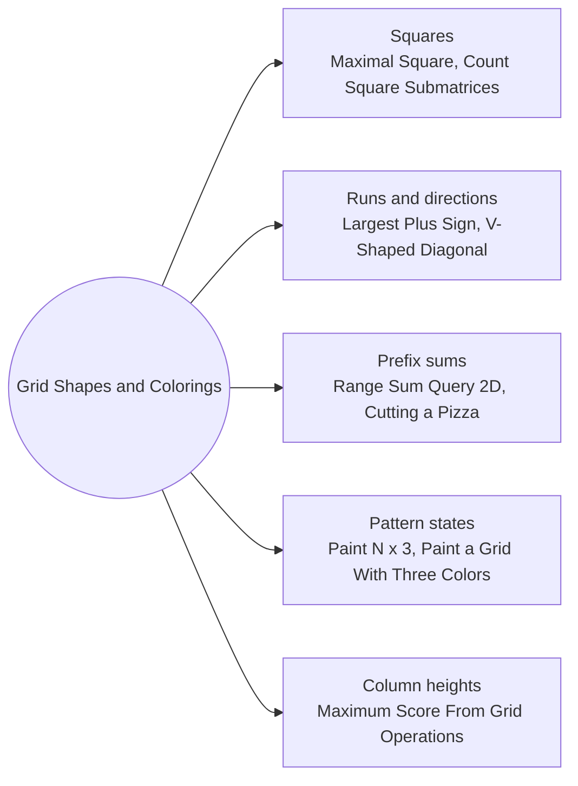

# Grid Shapes and Colorings: Pattern Map

> [!TIP]
> **🧠 One picture to keep**
> The DP looks at a **shape or a pattern** at each cell, not at a path.
> 1. **Square ending here**: `dp[i][j] = 1 + min(up, left, up-left)` (Maximal Square, Count Squares).
> 2. **Four run lengths**: sweep in four directions and take the minimum (Plus Sign).
> 3. **Direction and turn state**: `(cell, direction, turn left?)` (V-Shaped Diagonal).
> 4. **Prefix sums on a grid**: inclusion-exclusion over four corners (Range Sum 2D, Pizza).
> 5. **Row patterns as states**: classify a row or column coloring and count the compatible neighbours (Paint N × 3, Paint a Grid).
> 6. **Column heights as states**: the DP walks over columns with the last two heights (Grid Operations).

**All animations:** [▶ Grid Shapes and Colorings Animations](https://d9-cell.github.io/java-brain/DP/Grid%20Shapes%20and%20Colorings/Grid%20Shapes%20and%20Colorings%20Animations.html) · ⬆ [00 Brain Map](../../00%20Brain%20Map.md)

## Java toolkit
| Need | Java |
|---|---|
| Rolling square DP | `int diag = 0; int up = dp[j]; dp[j] = 1 + Math.min(diag, Math.min(dp[j - 1], up)); diag = up;` |
| 2D prefix sum | `pre[i + 1][j + 1] = a[i][j] + pre[i][j + 1] + pre[i + 1][j] - pre[i][j];` |
| Rectangle query | `pre[r2+1][c2+1] - pre[r1][c2+1] - pre[r2+1][c1] + pre[r1][c1]` |
| Directions in turn order | `int[][] DIRS = {{1, 1}, {1, -1}, {-1, -1}, {-1, 1}};` then `(d + 1) % 4` is a clockwise turn |
| Enumerate patterns | recursive `build(row, cur, out)` listing every valid column coloring |
| Compatible pairs | precompute `List<List<Integer>> next` once, then the DP only walks edges |

## Patterns in this folder

| # | Problem | Pattern | Mantra | Level |
|---|---|---|---|---|
| 1 | [Maximal Square](Maximal%20Square.md) | Square ending here, Rolling row | dp[i][j] = 1 + min(dp[i−1][j], dp[i][j−1], dp[i−1][j−1]) IF cell = 1 | Medium |
| 2 | [Count Square Submatrices with All Ones](Count%20Square%20Submatrices%20with%20All%20Ones.md) | Square ending here, Sum of dp | ANSWER = Σ dp[i][j] | Medium |
| 3 | [Largest Plus Sign](Largest%20Plus%20Sign.md) | Four runs, Min of arms | arm[i][j] = min(left, right, up, down) RUN OF 1s | Medium |
| 4 | [Range Sum Query 2D - Immutable](Range%20Sum%20Query%202D%20-%20Immutable.md) | 2D prefix sum, Inclusion-exclusion | sum = D − B − C + A | Medium |
| 5 | [Number of Ways of Cutting a Pizza](Number%20of%20Ways%20of%20Cutting%20a%20Pizza.md) | Suffix 2D sums, Cuts DP | dp[cuts][r][c] = Σ dp[cuts−1][next corner] FOR EACH CUT THAT GIVES AN APPLE TO THE PIECE CUT OFF | Hard |
| 6 | [Number of Ways to Paint N × 3 Grid](Number%20of%20Ways%20to%20Paint%20N%20%C3%97%203%20Grid.md) | Row type states, Counting | ABA' = 3·ABA + 2·ABC · ABC' = 2·ABA + 2·ABC | Hard |
| 7 | [Painting a Grid With Three Different Colors](Painting%20a%20Grid%20With%20Three%20Different%20Colors.md) | Column pattern states, Compatibility graph | dp[col][pattern] = Σ dp[col−1][compatible pattern] | Hard |
| 8 | [Length of Longest V-Shaped Diagonal Segment](Length%20of%20Longest%20V-Shaped%20Diagonal%20Segment.md) | Direction + turn state, Memo | KEEP GOING · OR TURN CLOCKWISE ONCE | Hard |
| 9 | [Maximum Score From Grid Operations](Maximum%20Score%20From%20Grid%20Operations.md) | Column heights, Three-column window | score(col) = Σ cells from h[col] to max(h[col−1], h[col+1]) − 1 | Hard |

## Suggested learning order
1. [Maximal Square](Maximal%20Square.md) ⭐, [Count Square Submatrices with All Ones](Count%20Square%20Submatrices%20with%20All%20Ones.md), [Largest Plus Sign](Largest%20Plus%20Sign.md)
2. [Range Sum Query 2D - Immutable](Range%20Sum%20Query%202D%20-%20Immutable.md), [Number of Ways of Cutting a Pizza](Number%20of%20Ways%20of%20Cutting%20a%20Pizza.md)
3. [Number of Ways to Paint N × 3 Grid](Number%20of%20Ways%20to%20Paint%20N%20%C3%97%203%20Grid.md), [Painting a Grid With Three Different Colors](Painting%20a%20Grid%20With%20Three%20Different%20Colors.md)
4. [Length of Longest V-Shaped Diagonal Segment](Length%20of%20Longest%20V-Shaped%20Diagonal%20Segment.md), [Maximum Score From Grid Operations](Maximum%20Score%20From%20Grid%20Operations.md)

## Connections to other folders
- [Grid Paths - Pattern Map](../Grid%20Paths/Grid%20Paths%20-%20Pattern%20Map.md) for DP along right/down walks
- [Maximum Sum Rectangle](../Stock%20and%20Kadane%20States/Maximum%20Sum%20Rectangle.md) for 2D Kadane over row pairs
- [Domino and Tromino Tiling](../Stairs%20and%20Robbers/Domino%20and%20Tromino%20Tiling.md) for the same "state per column" idea
