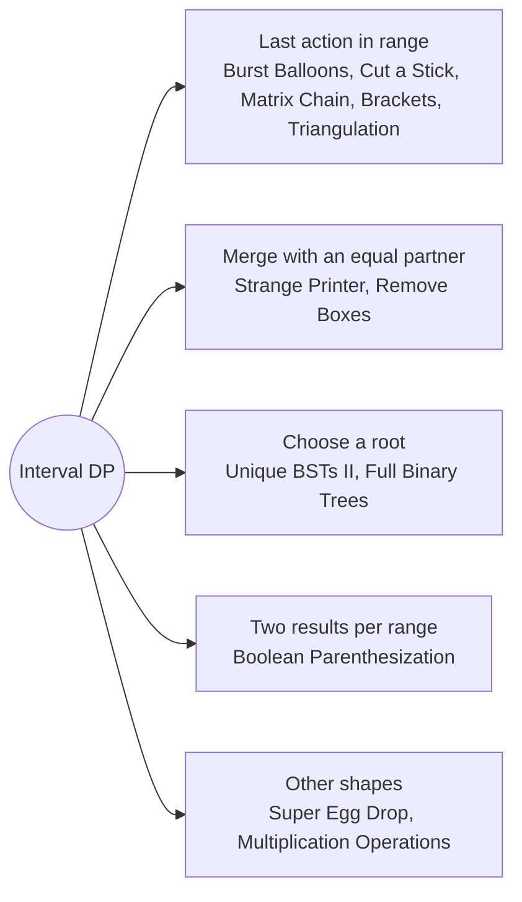

# Interval DP: Pattern Map

> [!TIP]
> **🧠 One picture to keep**
> Solve every **range [i, j]** by choosing one special element inside it, then combine two smaller ranges.
> 1. **Pick the LAST action**: the split point k is what happens last, so the two sides are independent (Burst Balloons, Cut a Stick, Matrix Chain, Triangulation).
> 2. **Pick the first element and a partner**: merge i with a later equal value (Strange Printer, Remove Boxes).
> 3. **Pick the root**: every value is a root, left and right are subproblems (Unique BSTs II, Full Binary Trees).
> 4. **Evaluate both outcomes**: keep a table per result (true/false) and combine them (Boolean Parenthesization).
> 5. **Interval by length**: loop `len` outwards so all shorter ranges are ready.
> 6. **Other state shapes**: eggs and moves (Super Egg Drop), prefix operations (Multiplication Operations).

**All animations:** [▶ Interval DP Animations](https://d9-cell.github.io/java-brain/DP/Interval%20DP/Interval%20DP%20Animations.html) · ⬆ [00 Brain Map](../../00%20Brain%20Map.md)

## Java toolkit
| Need | Java |
|---|---|
| Loop by length | `for (int len = 2; len <= n; len++) for (int i = 0; i + len <= n; i++) { int j = i + len; ... }` |
| Pad the ends | `int[] a = new int[n + 2]; a[0] = a[n + 1] = 1;` |
| Open interval | dp[l][r] covers l+1..r-1, so the answer sits at dp[0][n + 1] |
| Cost of a split | `dp[i][k] + dp[k][j] + cost(i, k, j)` |
| Rebuild the split | store `split[i][j] = k` while taking the min, then recurse on it |
| Mod arithmetic | `(a * b) % MOD` with ints small enough, otherwise cast to long |
| Third dimension | `int[][][] memo = new int[n][n][n];` with 0 meaning not yet computed |

## Patterns in this folder

| # | Problem | Pattern | Mantra | Level |
|---|---|---|---|---|
| 1 | [Matrix Chain Multiplication](Matrix%20Chain%20Multiplication.md) | Split point, Interval by length | dp[i][j] = min over k of dp[i][k] + dp[k+1][j] + arr[i−1]·arr[k]·arr[j] | Hard |
| 2 | [Brackets in Matrix Chain Multiplication](Brackets%20in%20Matrix%20Chain%20Multiplication.md) | Split point, Rebuild the choice | split[i][j] = best k · PRINT ( LEFT RIGHT ) | Hard |
| 3 | [Burst Balloons](Burst%20Balloons.md) | Last action, Padded ends | dp[l][r] = max over k of dp[l][k] + a[l]·a[k]·a[r] + dp[k][r] | Hard |
| 4 | [Minimum Cost to Cut a Stick](Minimum%20Cost%20to%20Cut%20a%20Stick.md) | Last action, Sorted cut points | dp[i][j] = (pts[j] − pts[i]) + min over k of dp[i][k] + dp[k][j] | Hard |
| 5 | [Minimum Score Triangulation of Polygon](Minimum%20Score%20Triangulation%20of%20Polygon.md) | Third corner, Interval by length | dp[i][j] = min over k of dp[i][k] + dp[k][j] + v[i]·v[k]·v[j] | Medium |
| 6 | [Boolean Parenthesization](Boolean%20Parenthesization.md) | Split at operator, Two tables | AND: T·T · OR: total − F·F · XOR: T·F + F·T | Hard |
| 7 | [Strange Printer](Strange%20Printer.md) | Merge with an equal partner, Interval by length | dp[i][j] = min(1 + dp[i+1][j], dp[i+1][k−1] + dp[k][j]) FOR s[k] = s[i] | Hard |
| 8 | [Remove Boxes](Remove%20Boxes.md) | Merge with an equal partner, 3-D memo | dp[l][r][k] = max(remove the run now, or clear a gap and merge with a later equal box) | Hard |
| 9 | [Unique Binary Search Trees II](Unique%20Binary%20Search%20Trees%20II.md) | Choose a root, Generate all | trees(lo, hi) = ∪ root: left × right | Medium |
| 10 | [All Possible Full Binary Trees](All%20Possible%20Full%20Binary%20Trees.md) | Choose a split, Memo by size | trees(n) = ∪ left (odd): trees(left) × trees(n − 1 − left) | Medium |
| 11 | [Maximum Score from Performing Multiplication Operations](Maximum%20Score%20from%20Performing%20Multiplication%20Operations.md) | Prefix of operations, Two ends | dp[i][left] = max(nums[left]·m[i] + dp[i+1][left+1], nums[right]·m[i] + dp[i+1][left]) | Hard |
| 12 | [Super Egg Drop](Super%20Egg%20Drop.md) | Moves instead of floors, Binary search on the DP | floors(m, e) = floors(m−1, e−1) + floors(m−1, e) + 1 | Hard |

## Suggested learning order
1. [Matrix Chain Multiplication](Matrix%20Chain%20Multiplication.md) ⭐, [Burst Balloons](Burst%20Balloons.md), [Minimum Cost to Cut a Stick](Minimum%20Cost%20to%20Cut%20a%20Stick.md), [Minimum Score Triangulation of Polygon](Minimum%20Score%20Triangulation%20of%20Polygon.md)
2. [Brackets in Matrix Chain Multiplication](Brackets%20in%20Matrix%20Chain%20Multiplication.md), [Boolean Parenthesization](Boolean%20Parenthesization.md)
3. [Strange Printer](Strange%20Printer.md), [Remove Boxes](Remove%20Boxes.md)
4. [Unique Binary Search Trees II](Unique%20Binary%20Search%20Trees%20II.md), [All Possible Full Binary Trees](All%20Possible%20Full%20Binary%20Trees.md)
5. [Maximum Score from Performing Multiplication Operations](Maximum%20Score%20from%20Performing%20Multiplication%20Operations.md), [Super Egg Drop](Super%20Egg%20Drop.md)

## Connections to other folders
- [Palindromes and Word Splits - Pattern Map](../Palindromes%20and%20Word%20Splits/Palindromes%20and%20Word%20Splits%20-%20Pattern%20Map.md) for range DP on strings
- [Game DP - Pattern Map](../Game%20DP/Game%20DP%20-%20Pattern%20Map.md) for ranges played by two players
- [Scramble String](../Palindromes%20and%20Word%20Splits/Scramble%20String.md) for a range DP with a swap choice
