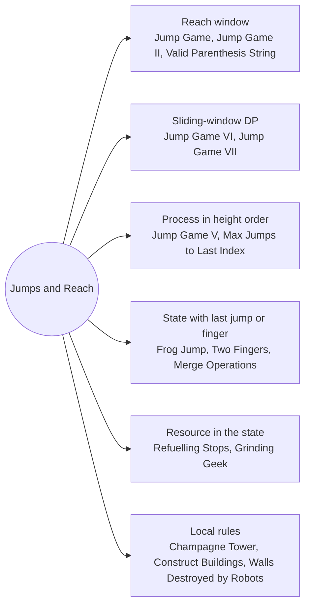

# Jumps and Reach: Pattern Map

> [!TIP]
> **🧠 One picture to keep**
> Positions on a line, and from each one you may **jump to a set of later positions**. Every problem asks "can I get there", "in how few jumps", or "with the most value".
> 1. **Reach window**: the set of places reachable so far is an interval, so track only its right end (Jump Game I and II, Valid Parenthesis String keeps a window of open counts).
> 2. **Best of a sliding window**: `dp[i] = value + best(dp[i−k..i−1])` with a monotonic deque or a running count (Jump Game VI and VII).
> 3. **State = (position, last jump)**: the next jump depends on the previous one (Frog Jump, Two Fingers, Merge Operations).
> 4. **Knapsack in disguise**: fuel or money is part of the state (Refuelling Stops, Grinding Geek).
> 5. **Overflow flows down**: each cell passes its surplus to the next row (Champagne Tower).

**All animations:** [▶ Jumps and Reach Animations](https://d9-cell.github.io/java-brain/DP/Jumps%20and%20Reach/Jumps%20and%20Reach%20Animations.html) · ⬆ [00 Brain Map](../../00%20Brain%20Map.md)

## Java toolkit
| Need | Java |
|---|---|
| Farthest reach | `reach = Math.max(reach, i + nums[i]);` |
| Window maximum | `Deque<Integer> dq`; pop back while `dp[back] <= dp[i]`, pop front when out of range |
| Window count of reachable | `inWindow += ok[i - min] ? 1 : 0; inWindow -= ok[i - max - 1] ? 1 : 0;` |
| Position → index | `Map<Integer, Integer> at` for sparse positions |
| Pair key in a map | `long key = (long) i << 32 | k;` |
| Largest so far | `PriorityQueue<Integer> pq = new PriorityQueue<>(Collections.reverseOrder());` |

## Patterns in this folder

| # | Problem | Pattern | Mantra | Level |
|---|---|---|---|---|
| 1 | [Jump Game](Jump%20Game.md) | Reach window, Greedy | i > reach → false; reach = max(reach, i + nums[i]) | Medium |
| 2 | [Jump Game II](Jump%20Game%20II.md) | BFS by layers, Greedy | i == end → jumps++, end = far | Medium |
| 3 | [Jump Game V](Jump%20Game%20V.md) | DAG by height, Memo DFS | best(i) = 1 + max best(j); SCAN EACH SIDE UNTIL A BAR IS ≥ arr[i] | Hard |
| 4 | [Jump Game VI](Jump%20Game%20VI.md) | Sliding-window maximum, Monotonic deque | dp[i] = nums[i] + max(dp[i−k..i−1]) VIA DECREASING DEQUE | Medium |
| 5 | [Jump Game VII](Jump%20Game%20VII.md) | Sliding-window count, Boolean DP | inWindow += ok[i − min]; inWindow −= ok[i − max − 1] | Medium |
| 6 | [Frog Jump](Frog%20Jump.md) | State = (position, last jump), Sets per stone | FOR EACH STONE, EACH k IN ITS SET: TRY k−1, k, k+1 | Hard |
| 7 | [Maximum Number of Jumps to Reach the Last Index](Maximum%20Number%20of%20Jumps%20to%20Reach%20the%20Last%20Index.md) | Longest path in a DAG, O(n²) DP | dp[j] = max(dp[i] + 1) OVER REACHABLE i < j WITH |Δ| ≤ target | Medium |
| 8 | [Minimum Number of Refueling Stops](Minimum%20Number%20of%20Refueling%20Stops.md) | Knapsack on stop count, Greedy with max-heap | dp[t + 1] = max(dp[t + 1], dp[t] + fuel) IF dp[t] ≥ pos (t DESCENDING) | Hard |
| 9 | [Champagne Tower](Champagne%20Tower.md) | Simulation by rows, Overflow flows down | extra = (amount − 1) / 2 → BOTH CHILDREN | Medium |
| 10 | [Count possible ways to construct buildings](Count%20possible%20ways%20to%20construct%20buildings.md) | Two-state DP, Independent sides | ONE SIDE = Fib(n + 2); ANSWER = SIDE² | Medium |
| 11 | [Grinding Geek](Grinding%20Geek.md) | Money in the state, Take or skip | best(i, money) = max(skip, 1 + best(i + 1, money − c + 9c/10)) | Medium |
| 12 | [Valid Parenthesis String](Valid%20Parenthesis%20String.md) | Range of open counts, Memo over (i, open) | ( → lo++, hi++ · ) → lo−−, hi−− · * → lo−−, hi++; hi < 0 → false; lo = max(lo, 0) | Medium |
| 13 | [Maximum Walls Destroyed by Robots](Maximum%20Walls%20Destroyed%20by%20Robots.md) | Sort then two-state DP, Binary search counts | STATE = PREVIOUS ROBOT FIRED RIGHT?; COUNT WALLS IN RANGE BY BINARY SEARCH | Hard |
| 14 | [Minimum Distance to Type a Word Using Two Fingers](Minimum%20Distance%20to%20Type%20a%20Word%20Using%20Two%20Fingers.md) | State = other finger, Rolling layer | dp[other]: SAME FINGER → dp + d(prev, cur) · OTHER FINGER → next[prev] = dp + d(other, cur) | Hard |
| 15 | [Merge Operations for Minimum Travel Time](Merge%20Operations%20for%20Minimum%20Travel%20Time.md) | State = (sign, merges left, rate), Choose the next kept sign | FROM SIGN i JUMP TO KEPT SIGN j; RATE(j) = time[j] + Σ REMOVED | Hard |

## Suggested learning order
1. [Jump Game](Jump%20Game.md) ⭐, [Jump Game II](Jump%20Game%20II.md) ⭐, [Jump Game VII](Jump%20Game%20VII.md), [Jump Game VI](Jump%20Game%20VI.md)
2. [Maximum Number of Jumps to Reach the Last Index](Maximum%20Number%20of%20Jumps%20to%20Reach%20the%20Last%20Index.md), [Jump Game V](Jump%20Game%20V.md), [Frog Jump](Frog%20Jump.md)
3. [Minimum Number of Refueling Stops](Minimum%20Number%20of%20Refueling%20Stops.md), [Grinding Geek](Grinding%20Geek.md), [Valid Parenthesis String](Valid%20Parenthesis%20String.md)
4. [Champagne Tower](Champagne%20Tower.md), [Count possible ways to construct buildings](Count%20possible%20ways%20to%20construct%20buildings.md)
5. [Minimum Distance to Type a Word Using Two Fingers](Minimum%20Distance%20to%20Type%20a%20Word%20Using%20Two%20Fingers.md), [Merge Operations for Minimum Travel Time](Merge%20Operations%20for%20Minimum%20Travel%20Time.md), [Maximum Walls Destroyed by Robots](Maximum%20Walls%20Destroyed%20by%20Robots.md)

## Connections to other folders
- [Stairs and Robbers - Pattern Map](../Stairs%20and%20Robbers/Stairs%20and%20Robbers%20-%20Pattern%20Map.md) for the plain 1-D versions
- [Sliding Window - Pattern Map](../../Sliding%20Window/Sliding%20Window%20-%20Pattern%20Map.md) for the deque that powers Jump Game VI
- [Heap - Pattern Map](../../Heap/Heap%20-%20Pattern%20Map.md) for the greedy refuelling
- [Knapsack Series - Pattern Map](../Knapsack%20Series/Knapsack%20Series%20-%20Pattern%20Map.md) when a budget joins the state
