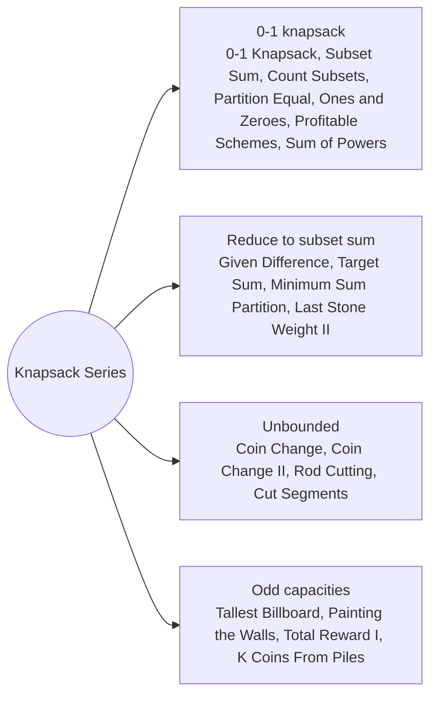

# Knapsack Series: Pattern Map

> [!TIP]
> **🧠 One picture to keep**
> A bag with a **capacity**, items with a **weight** and a **value**: the state is (items considered, capacity used).
> 1. **0-1 knapsack**: each item once → scan the capacity **downward** in a 1-D row (subset sum, partitions, target sum, Ones and Zeroes, Profitable Schemes).
> 2. **Unbounded knapsack**: items reusable → scan the capacity **upward** (Coin Change, Rod Cutting, Cut Segments).
> 3. **Count vs best vs possible**: the same table holds a count (+), a best value (max/min) or a boolean (|).
> 4. **Turn the question into a subset sum**: S1 − S2 = d means S2 = (total − d) / 2 (Target Sum, Given Difference, Last Stone Weight II).
> 5. **Capacity is something else**: a height difference (Tallest Billboard), walls covered (Painting the Walls), coins taken per pile (K Coins).

**All animations:** [▶ Knapsack Series Animations](https://d9-cell.github.io/java-brain/DP/Knapsack%20Series/Knapsack%20Series%20Animations.html) · ⬆ [00 Brain Map](../../00%20Brain%20Map.md)

## Java toolkit
| Need | Java |
|---|---|
| 0-1 row | `for (int x : items) for (int c = W; c >= x; c--) dp[c] = max(dp[c], dp[c - x] + v);` |
| Unbounded row | `for (int x : items) for (int c = x; c <= W; c++) ...` |
| Combinations (order ignored) | items in the **outer** loop |
| Permutations (order matters) | capacity in the outer loop |
| Boolean reachability | `boolean[] can; can[0] = true; can[s] |= can[s - x];` |
| Bitset of sums | `BigInteger bits = ONE; bits = bits.or(bits.shiftLeft(x));` |
| Cap a "big enough" value | `Math.min(minProfit, p + profit)` keeps one bucket for "enough" |

## Patterns in this folder

| # | Problem | Pattern | Mantra | Level |
|---|---|---|---|---|
| 1 | [0-1 Knapsack](0-1%20Knapsack.md) | 0-1 knapsack, Take or skip | dp[c] = max(dp[c], val + dp[c − wt]); c FROM W DOWN | Medium |
| 2 | [Subset Sum Problem](Subset%20Sum%20Problem.md) | 0-1 knapsack, Boolean reachability | can[s] |= can[s − x]; s FROM sum DOWN | Medium |
| 3 | [Count Subsets with Sum](Count%20Subsets%20with%20Sum.md) | 0-1 knapsack, Counting | ways[s] += ways[s − x]; s FROM target DOWN TO x | Medium |
| 4 | [Partition Equal Subset Sum](Partition%20Equal%20Subset%20Sum.md) | Reduce to subset sum, Bitset | ODD TOTAL → false; ELSE SUBSET SUM TO total / 2 | Medium |
| 5 | [Partitions with Given Difference](Partitions%20with%20Given%20Difference.md) | Reduce to subset sum, Counting | COUNT SUBSETS WITH SUM (total − d) / 2 | Medium |
| 6 | [Target Sum](Target%20Sum.md) | Reduce to subset sum, Memo with offset | NEG = (total − target) / 2; COUNT SUBSETS WITH SUM NEG | Medium |
| 7 | [Minimum Sum Partition](Minimum%20Sum%20Partition.md) | Reduce to subset sum, Closest reachable | LARGEST REACHABLE s ≤ total / 2 → total − 2s | Hard |
| 8 | [Last Stone Weight II](Last%20Stone%20Weight%20II.md) | Reduce to subset sum, Signs in disguise | ANSWER = total − 2 · (LARGEST REACHABLE s ≤ total / 2) | Medium |
| 9 | [Coin Change](Coin%20Change.md) | Unbounded knapsack, BFS over amounts | dp[a] = min(dp[a − c] + 1) OVER COINS | Medium |
| 10 | [Coin Change II](Coin%20Change%20II.md) | Unbounded knapsack, Combinations not permutations | FOR coin: FOR a = coin..amount: ways[a] += ways[a − coin] | Medium |
| 11 | [Rod Cutting](Rod%20Cutting.md) | Unbounded knapsack, Try the first piece | best[len] = max(price[piece − 1] + best[len − piece]) | Medium |
| 12 | [Maximize The Cut Segments](Maximize%20The%20Cut%20Segments.md) | Unbounded knapsack, Exact fill | best[len] = max(best[len − p] + 1), −1 IF UNREACHABLE | Medium |
| 13 | [Ones and Zeroes](Ones%20and%20Zeroes.md) | 0-1 knapsack, Two capacities | dp[i][j] = max(dp[i][j], dp[i − zeros][j − ones] + 1), BOTH DOWNWARD | Medium |
| 14 | [Profitable Schemes](Profitable%20Schemes.md) | 0-1 knapsack counting, Capped dimension | dp[m][min(P, p + profit)] += dp[m − group][p] | Hard |
| 15 | [Tallest Billboard](Tallest%20Billboard.md) | Knapsack over the difference, Three choices | ROD → TALLER SIDE: dp[d + r] · → SHORTER SIDE: dp[|d − r|] += min(d, r) · OR UNUSED | Hard |
| 16 | [Painting the Walls](Painting%20the%20Walls.md) | 0-1 knapsack, Coverage as capacity | dp[j] = min(dp[j], dp[max(0, j − time − 1)] + cost) | Hard |
| 17 | [Maximum Total Reward Using Operations I](Maximum%20Total%20Reward%20Using%20Operations%20I.md) | Sorted subset sum, Bounded reachability | FOR v ASCENDING: reach[s + v] |= reach[s] FOR s < v | Medium |
| 18 | [Ways to Express an Integer as Sum of Powers](Ways%20to%20Express%20an%20Integer%20as%20Sum%20of%20Powers.md) | 0-1 knapsack counting, Items are powers | FOR EACH b^x ≤ n: ways[s] += ways[s − b^x], s DOWN | Medium |
| 19 | [Maximum Value of K Coins From Piles](Maximum%20Value%20of%20K%20Coins%20From%20Piles.md) | Group knapsack, Prefix of each pile | dp[j] = max(dp[j − t] + top(t)) OVER t, j DOWNWARD | Hard |

## Suggested learning order
1. [0-1 Knapsack](0-1%20Knapsack.md) ⭐, [Subset Sum Problem](Subset%20Sum%20Problem.md), [Count Subsets with Sum](Count%20Subsets%20with%20Sum.md), [Partition Equal Subset Sum](Partition%20Equal%20Subset%20Sum.md) ⭐
2. [Partitions with Given Difference](Partitions%20with%20Given%20Difference.md), [Target Sum](Target%20Sum.md) ⭐, [Minimum Sum Partition](Minimum%20Sum%20Partition.md), [Last Stone Weight II](Last%20Stone%20Weight%20II.md)
3. [Coin Change](Coin%20Change.md) ⭐, [Coin Change II](Coin%20Change%20II.md) ⭐, [Rod Cutting](Rod%20Cutting.md), [Maximize The Cut Segments](Maximize%20The%20Cut%20Segments.md)
4. [Ones and Zeroes](Ones%20and%20Zeroes.md), [Ways to Express an Integer as Sum of Powers](Ways%20to%20Express%20an%20Integer%20as%20Sum%20of%20Powers.md), [Maximum Value of K Coins From Piles](Maximum%20Value%20of%20K%20Coins%20From%20Piles.md)
5. [Profitable Schemes](Profitable%20Schemes.md), [Painting the Walls](Painting%20the%20Walls.md), [Maximum Total Reward Using Operations I](Maximum%20Total%20Reward%20Using%20Operations%20I.md), [Tallest Billboard](Tallest%20Billboard.md)

## Connections to other folders
- [Fractional Knapsack](../../Greedy/Sorting%20and%20Matching/Fractional%20Knapsack.md) (greedy, in Greedy) when items can be split
- [Stairs and Robbers - Pattern Map](../Stairs%20and%20Robbers/Stairs%20and%20Robbers%20-%20Pattern%20Map.md) for Perfect Squares, the unbounded knapsack over squares
- [Partition to K Equal Sum Subsets](../../Backtracking/Partition%20to%20K%20Equal%20Sum%20Subsets.md) (Backtracking) for more than two groups
- [Counting Walks and Moves - Pattern Map](../Counting%20Walks%20and%20Moves/Counting%20Walks%20and%20Moves%20-%20Pattern%20Map.md) for budgets in the state
