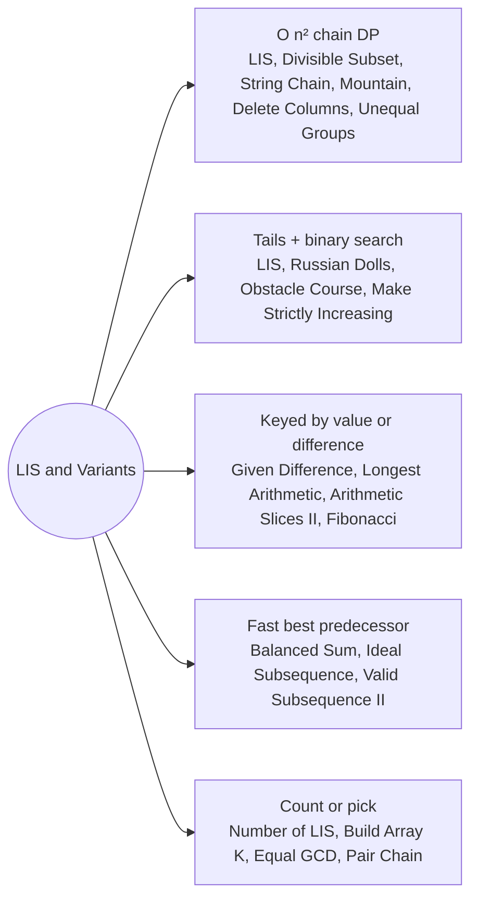

# LIS and Variants: Pattern Map

> [!TIP]
> **🧠 One picture to keep**
> Pick a **subsequence** that keeps a relation between neighbours: dp[i] = best chain **ending at i**.
> 1. **Quadratic LIS**: `dp[i] = 1 + max dp[j]` over earlier j that may precede i (LIS, divisible subset, string chain, mountain).
> 2. **Tails array**: keep the smallest tail per length and binary search (LIS, Russian Dolls, Obstacle Course).
> 3. **Count along with length**: store (len, count) pairs (Number of LIS).
> 4. **Key the state by a value**: HashMap by value or difference instead of an index (Given Difference, Arithmetic Slices II, Fibonacci).
> 5. **Window or tree for the best predecessor**: deque, Fenwick or residue table when "any earlier j" is too slow (Balanced Sum, Valid Subsequence II).

**All animations:** [▶ LIS and Variants Animations](https://d9-cell.github.io/java-brain/DP/LIS%20and%20Variants/LIS%20and%20Variants%20Animations.html) · ⬆ [00 Brain Map](../../00%20Brain%20Map.md)

## Java toolkit
| Need | Java |
|---|---|
| Strict LIS slot | `int pos = Arrays.binarySearch(tails, 0, size, x); if (pos < 0) pos = -pos - 1;` (use a hand-written lowerBound when duplicates matter) |
| Non-decreasing slot | hand-written upper bound: `if (tails[mid] <= x) lo = mid + 1; else hi = mid;` |
| Sort pairs | `Arrays.sort(a, (p, q) -> Integer.compare(p[0], q[0]));` (never `p[0] - q[0]` with big values) |
| Rebuild the answer | keep `prev[i]`, then `for (int i = end; i >= 0; i = prev[i]) res.addFirst(a[i]);` |
| Value-keyed state | `Map<Integer, Integer> len = new HashMap<>(); len.merge(x, v, Math::max);` |
| Diff as a key | `long d = (long) nums[i] - nums[j];` as `Map<Long, Integer>` |
| Window maximum | `Deque<Integer>` of indexes with decreasing dp values |

## Patterns in this folder

| # | Problem | Pattern | Mantra | Level |
|---|---|---|---|---|
| 1 | [Longest Increasing Subsequence](Longest%20Increasing%20Subsequence.md) | Chain DP, Tails array | dp[i] = 1 + max dp[j] (j < i, a[j] < a[i]) · OR TAILS + BINARY SEARCH | Medium |
| 2 | [Number of Longest Increasing Subsequence](Number%20of%20Longest%20Increasing%20Subsequence.md) | Chain DP, Count with length | LONGER → copy the count · EQUAL → add the count | Medium |
| 3 | [Russian Doll Envelopes](Russian%20Doll%20Envelopes.md) | Sort + LIS, Tails array | WIDTH ASC, HEIGHT DESC → LIS ON HEIGHT | Hard |
| 4 | [Find the Longest Valid Obstacle Course at Each Position](Find%20the%20Longest%20Valid%20Obstacle%20Course%20at%20Each%20Position.md) | Tails array, Non-decreasing LIS | UPPER BOUND IN tails → ANSWER = SLOT + 1 | Hard |
| 5 | [Maximum Length of Pair Chain](Maximum%20Length%20of%20Pair%20Chain.md) | Greedy, Chain DP | SORT BY END → TAKE IF START > LAST END | Medium |
| 6 | [Longest String Chain](Longest%20String%20Chain.md) | Chain DP, Remove one letter | best[w] = 1 + max best[w minus one letter] | Medium |
| 7 | [Largest Divisible Subset](Largest%20Divisible%20Subset.md) | Chain DP, Rebuild with prev | SORT; dp[i] = 1 + max dp[j] WHERE a[i] % a[j] == 0; KEEP prev[] | Medium |
| 8 | [Longest Ideal Subsequence](Longest%20Ideal%20Subsequence.md) | Keyed by letter, Window of predecessors | best[c] = 1 + max best[c − k .. c + k] | Medium |
| 9 | [Minimum Number of Removals to Make Mountain Array](Minimum%20Number%20of%20Removals%20to%20Make%20Mountain%20Array.md) | LIS from both ends, Chain DP | KEEP = max (inc[i] + dec[i] − 1) WITH inc, dec > 1 | Hard |
| 10 | [Delete Columns to Make Sorted III](Delete%20Columns%20to%20Make%20Sorted%20III.md) | LIS over columns, Chain DP | KEEP LONGEST CHAIN OF COLUMNS; DELETE THE REST | Hard |
| 11 | [Find the Maximum Length of Valid Subsequence I](Find%20the%20Maximum%20Length%20of%20Valid%20Subsequence%20I.md) | Parity cases, Greedy count | MAX(all even, all odd, alternating) | Medium |
| 12 | [Find the Maximum Length of Valid Subsequence II](Find%20the%20Maximum%20Length%20of%20Valid%20Subsequence%20II.md) | Residue DP, Keyed state | dp[r][s] = 1 + dp[(s − r) mod k][s] | Medium |
| 13 | [Longest Unequal Adjacent Groups Subsequence II](Longest%20Unequal%20Adjacent%20Groups%20Subsequence%20II.md) | Chain DP, Rebuild with prev | dp[i] = 1 + max dp[j] WHERE groups DIFFER AND words DIFFER BY ONE LETTER | Medium |
| 14 | [Maximum Balanced Subsequence Sum](Maximum%20Balanced%20Subsequence%20Sum.md) | Fenwick prefix max, Key transform | key = nums[i] − i · dp[i] = nums[i] + max(0, best dp with key ≤ key[i]) | Hard |
| 15 | [Build Array Where You Can Find The Maximum Exactly K Comparisons](Build%20Array%20Where%20You%20Can%20Find%20The%20Maximum%20Exactly%20K%20Comparisons.md) | State DP, Counting | dp[len][mx][cost] = mx · dp[len−1][mx][cost] + Σ dp[len−1][p<mx][cost−1] | Hard |
| 16 | [Longest Arithmetic Subsequence of Given Difference](Longest%20Arithmetic%20Subsequence%20of%20Given%20Difference.md) | Keyed by value, One pass | len[x] = len[x − diff] + 1 | Medium |
| 17 | [Longest Arithmetic Subsequence](Longest%20Arithmetic%20Subsequence.md) | Keyed by difference, Chain DP | dp[i][d] = dp[j][d] + 1 WITH d = a[i] − a[j] | Medium |
| 18 | [Length of Longest Fibonacci Subsequence](Length%20of%20Longest%20Fibonacci%20Subsequence.md) | Pair state, Value index map | dp[j][k] = dp[i][j] + 1 WHERE arr[i] = arr[k] − arr[j] | Medium |
| 19 | [Arithmetic Slices II - Subsequence](Arithmetic%20Slices%20II%20-%20Subsequence.md) | Keyed by difference, Counting | total += cnt[j][d] · cnt[i][d] += cnt[j][d] + 1 | Hard |
| 20 | [Make Array Strictly Increasing](Make%20Array%20Strictly%20Increasing.md) | Map DP, Binary search | KEEP IF x > last · REPLACE WITH upperBound(last) | Hard |
| 21 | [Find the Number of Subsequences With Equal GCD](Find%20the%20Number%20of%20Subsequences%20With%20Equal%20GCD.md) | Pair-state DP, Counting | dp[a][b] → ×3: skip, gcd(a,x), gcd(b,x) | Hard |

## Suggested learning order
1. [Longest Increasing Subsequence](Longest%20Increasing%20Subsequence.md) ⭐, [Number of Longest Increasing Subsequence](Number%20of%20Longest%20Increasing%20Subsequence.md), [Russian Doll Envelopes](Russian%20Doll%20Envelopes.md), [Find the Longest Valid Obstacle Course at Each Position](Find%20the%20Longest%20Valid%20Obstacle%20Course%20at%20Each%20Position.md)
2. [Maximum Length of Pair Chain](Maximum%20Length%20of%20Pair%20Chain.md), [Longest String Chain](Longest%20String%20Chain.md), [Largest Divisible Subset](Largest%20Divisible%20Subset.md), [Longest Ideal Subsequence](Longest%20Ideal%20Subsequence.md)
3. [Minimum Number of Removals to Make Mountain Array](Minimum%20Number%20of%20Removals%20to%20Make%20Mountain%20Array.md), [Delete Columns to Make Sorted III](Delete%20Columns%20to%20Make%20Sorted%20III.md), [Longest Unequal Adjacent Groups Subsequence II](Longest%20Unequal%20Adjacent%20Groups%20Subsequence%20II.md)
4. [Find the Maximum Length of Valid Subsequence I](Find%20the%20Maximum%20Length%20of%20Valid%20Subsequence%20I.md), [Find the Maximum Length of Valid Subsequence II](Find%20the%20Maximum%20Length%20of%20Valid%20Subsequence%20II.md), [Maximum Balanced Subsequence Sum](Maximum%20Balanced%20Subsequence%20Sum.md)
5. [Longest Arithmetic Subsequence of Given Difference](Longest%20Arithmetic%20Subsequence%20of%20Given%20Difference.md), [Longest Arithmetic Subsequence](Longest%20Arithmetic%20Subsequence.md), [Length of Longest Fibonacci Subsequence](Length%20of%20Longest%20Fibonacci%20Subsequence.md), [Arithmetic Slices II - Subsequence](Arithmetic%20Slices%20II%20-%20Subsequence.md)
6. [Build Array Where You Can Find The Maximum Exactly K Comparisons](Build%20Array%20Where%20You%20Can%20Find%20The%20Maximum%20Exactly%20K%20Comparisons.md), [Make Array Strictly Increasing](Make%20Array%20Strictly%20Increasing.md), [Find the Number of Subsequences With Equal GCD](Find%20the%20Number%20of%20Subsequences%20With%20Equal%20GCD.md)

## Connections to other folders
- [Strings and Subsequences - Pattern Map](../Strings%20and%20Subsequences/Strings%20and%20Subsequences%20-%20Pattern%20Map.md) for LCS style DP over two sequences
- [Stock and Kadane States - Pattern Map](../Stock%20and%20Kadane%20States/Stock%20and%20Kadane%20States%20-%20Pattern%20Map.md) for subarray (contiguous) cousins
- [Increasing Triplet Subsequence](../Stock%20and%20Kadane%20States/Increasing%20Triplet%20Subsequence.md) is LIS with k = 3
