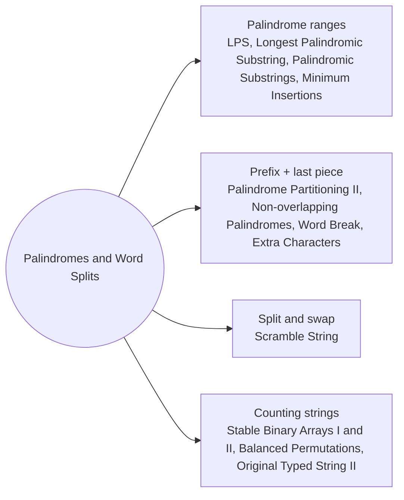

# Palindromes and Word Splits: Pattern Map

> [!TIP]
> **🧠 One picture to keep**
> DP inside **one string**: either over a range s[i..j] or over a prefix s[0..i).
> 1. **Range DP on palindromes**: `pal[i][j] = s[i] == s[j] && pal[i+1][j−1]`; fill i from the right so the inner range is ready (LPS, Longest Palindromic Substring, Palindromic Substrings, Minimum Insertions).
> 2. **Expand around centres**: 2n − 1 centres, grow while the ends match.
> 3. **Prefix DP with a last piece**: `dp[i] = best over j of dp[j] + cost(s[j..i))` (Word Break, Extra Characters, Palindrome Partitioning II, Non-overlapping Palindromes).
> 4. **Counting strings**: runs of equal characters, digit placements and factorials (Stable Binary Arrays, Balanced Permutations, Original Typed String).
> 5. **Split and swap**: memo over (start1, start2, length) (Scramble String).

**All animations:** [▶ Palindromes and Word Splits Animations](https://d9-cell.github.io/java-brain/DP/Palindromes%20and%20Word%20Splits/Palindromes%20and%20Word%20Splits%20Animations.html) · ⬆ [00 Brain Map](../../00%20Brain%20Map.md)

## Java toolkit
| Need | Java |
|---|---|
| Palindrome table | `pal[i][j] = s.charAt(i) == s.charAt(j) && (j - i < 2 || pal[i + 1][j - 1]);` (i from n − 1 down) |
| Centre loop | `for (int c = 0; c < 2 * n - 1; c++) { int l = c / 2, r = l + c % 2; ... }` |
| Dictionary lookups | `Set<String> dict = new HashSet<>(wordDict); dict.contains(s.substring(j, i))` |
| Same multiset check | `int[] cnt = new int[26];` add for one string, subtract for the other |
| Factorials mod p | `fact[i] = fact[i - 1] * i % MOD;` inverse via Fermat `pow(x, MOD - 2)` |
| Runs of equal chars | `while (j < n && s.charAt(j) == s.charAt(i)) j++;` |

## Patterns in this folder

| # | Problem | Pattern | Mantra | Level |
|---|---|---|---|---|
| 1 | [Longest Palindromic Subsequence](Longest%20Palindromic%20Subsequence.md) | Range DP, LCS with the reverse | dp[i][j] = s[i] == s[j] ? dp[i+1][j−1] + 2 : max(dp[i+1][j], dp[i][j−1]) | Medium |
| 2 | [Longest Palindromic Substring](Longest%20Palindromic%20Substring.md) | Expand around centre, Palindrome table | 2n − 1 CENTRES; EXPAND WHILE s[l] == s[r] | Medium |
| 3 | [Palindromic Substrings](Palindromic%20Substrings.md) | Expand around centre, Count while growing | FOR EACH CENTRE: WHILE ENDS MATCH → count++ | Medium |
| 4 | [Palindrome Partitioning II](Palindrome%20Partitioning%20II.md) | Prefix + last piece, Palindrome table | pal[i][j] → cuts[j] = i == 0 ? 0 : min(cuts[i − 1] + 1) | Hard |
| 5 | [Maximum Number of Non-overlapping Palindrome Substrings](Maximum%20Number%20of%20Non-overlapping%20Palindrome%20Substrings.md) | Prefix + last piece, Shortest pieces suffice | dp[i] = max(dp[i − 1], dp[i − k] + 1, dp[i − k − 1] + 1) IF PALINDROMES | Hard |
| 6 | [Minimum Insertion Steps to Make a String Palindrome](Minimum%20Insertion%20Steps%20to%20Make%20a%20String%20Palindrome.md) | Range DP, n − LPS | ENDS EQUAL → INNER · ELSE 1 + min(DROP LEFT, DROP RIGHT) | Hard |
| 7 | [Word Break](Word%20Break.md) | Prefix + last word, Boolean DP | ok[i] = ∃ j: ok[j] AND s[j..i) ∈ dict | Medium |
| 8 | [Extra Characters in a String](Extra%20Characters%20in%20a%20String.md) | Prefix + last word, Min cost | dp[i] = min(dp[i − 1] + 1, dp[j] IF s[j..i) ∈ dict) | Medium |
| 9 | [Scramble String](Scramble%20String.md) | Memo over (i, j, length), Split with or without swap | FOR EACH CUT k: (L↔L AND R↔R) OR (L↔R-END AND R↔L-START) | Hard |
| 10 | [Find All Possible Stable Binary Arrays I](Find%20All%20Possible%20Stable%20Binary%20Arrays%20I.md) | Build by runs, Memo over (zeros, ones, next symbol) | PLACE A RUN OF 1..limit, THEN SWITCH SYMBOL | Medium |
| 11 | [Find All Possible Stable Binary Arrays II](Find%20All%20Possible%20Stable%20Binary%20Arrays%20II.md) | Count by last symbol, Subtract the overflow | dp[i][j][0] = dp[i−1][j][0] + dp[i−1][j][1] − dp[i−limit−1][j][1] | Hard |
| 12 | [Count Number of Balanced Permutations](Count%20Number%20of%20Balanced%20Permutations.md) | Choose counts, then arrange, Multinomials | dp[used][sum] += dp · 1/(e! (cnt − e)!) · ANSWER × E! × O! | Hard |
| 13 | [Find the Original Typed String II](Find%20the%20Original%20Typed%20String%20II.md) | Complement counting, Prefix sums | ANSWER = Π g − #(LENGTH < k) VIA PREFIX-SUM DP | Hard |

## Suggested learning order
1. [Palindromic Substrings](Palindromic%20Substrings.md) ⭐, [Longest Palindromic Substring](Longest%20Palindromic%20Substring.md) ⭐, [Longest Palindromic Subsequence](Longest%20Palindromic%20Subsequence.md), [Minimum Insertion Steps to Make a String Palindrome](Minimum%20Insertion%20Steps%20to%20Make%20a%20String%20Palindrome.md)
2. [Word Break](Word%20Break.md) ⭐, [Extra Characters in a String](Extra%20Characters%20in%20a%20String.md), [Palindrome Partitioning II](Palindrome%20Partitioning%20II.md), [Maximum Number of Non-overlapping Palindrome Substrings](Maximum%20Number%20of%20Non-overlapping%20Palindrome%20Substrings.md)
3. [Scramble String](Scramble%20String.md)
4. [Find All Possible Stable Binary Arrays I](Find%20All%20Possible%20Stable%20Binary%20Arrays%20I.md), [Find All Possible Stable Binary Arrays II](Find%20All%20Possible%20Stable%20Binary%20Arrays%20II.md), [Find the Original Typed String II](Find%20the%20Original%20Typed%20String%20II.md), [Count Number of Balanced Permutations](Count%20Number%20of%20Balanced%20Permutations.md)

## Connections to other folders
- [Strings and Subsequences - Pattern Map](../Strings%20and%20Subsequences/Strings%20and%20Subsequences%20-%20Pattern%20Map.md) for DP over two strings
- [Word Break II](../../Backtracking/Word%20Break%20II.md) (Backtracking) to list every sentence
- Interval DP - Pattern Map for range DP beyond palindromes
