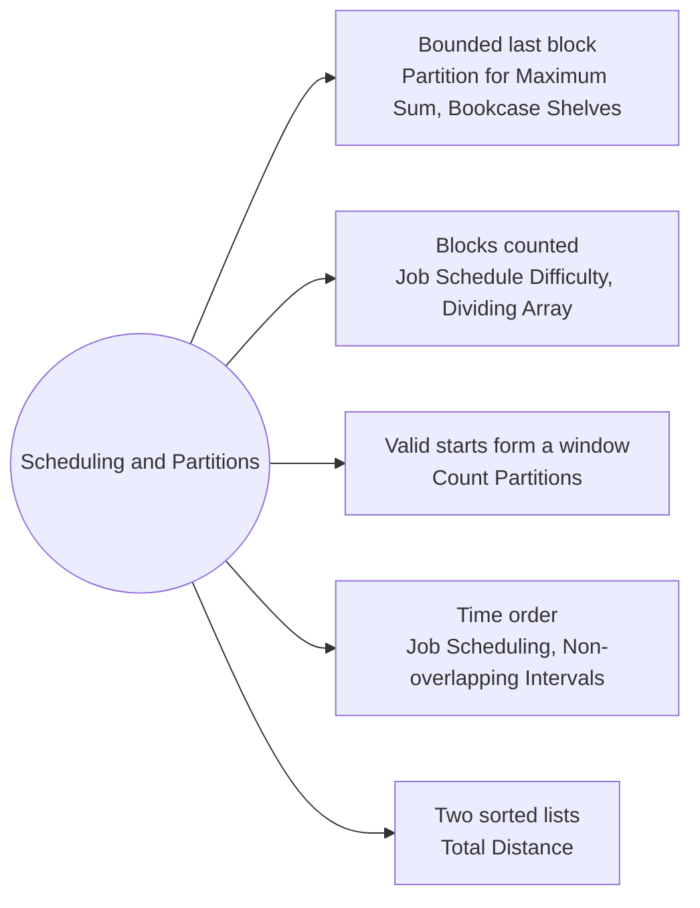

# Scheduling and Partitions: Pattern Map

> [!TIP]
> **🧠 One picture to keep**
> Cut a sequence into **consecutive blocks** and charge each block by a rule; dp[i] = best cost of the first i items.
> 1. **Last block of bounded size**: `dp[i] = best over len ≤ k of dp[i−len] + cost(block)` (Partition for Maximum Sum, Bookcase Shelves).
> 2. **Blocks counted in days or groups**: add a dimension for how many blocks were used (Job Schedule Difficulty, Dividing Array).
> 3. **Last block chosen by a condition**: the valid starts form a window, tracked by deques and prefix sums (Count Partitions).
> 4. **Intervals in time order**: sort, binary search the next compatible one (Job Scheduling, Non-overlapping Intervals).
> 5. **Match two sorted lists**: robots to factory slots (Total Distance).

**All animations:** [▶ Scheduling and Partitions Animations](https://d9-cell.github.io/java-brain/DP/Scheduling%20and%20Partitions/Scheduling%20and%20Partitions%20Animations.html) · ⬆ [00 Brain Map](../../00%20Brain%20Map.md)

## Java toolkit
| Need | Java |
|---|---|
| Last block loop | `for (int len = 1; len <= k && len <= i; len++) { mx = Math.max(mx, a[i - len]); dp[i] = Math.max(dp[i], dp[i - len] + mx * len); }` |
| Sort indexes | `Integer[] order = ...; Arrays.sort(order, (a, b) -> Integer.compare(end[a], end[b]));` |
| Binary search last fit | `while (lo < hi) { int mid = (lo + hi + 1) >>> 1; if (end[order[mid - 1]] <= start) lo = mid; else hi = mid - 1; }` |
| Window max and min | two `Deque<Integer>` of indexes, one decreasing and one increasing |
| Prefix sums mod | `ways[i] = ((prefix[i] - prefix[left]) % MOD + MOD) % MOD;` |
| Running AND groups | `Map<Integer,Integer>`: AND value → best dp, merged with `e.getKey() & x` |

## Patterns in this folder

| # | Problem | Pattern | Mantra | Level |
|---|---|---|---|---|
| 1 | [Partition Array for Maximum Sum](Partition%20Array%20for%20Maximum%20Sum.md) | Bounded last block, Prefix DP | dp[i] = max over len ≤ k of dp[i − len] + len · max(last len) | Medium |
| 2 | [Filling Bookcase Shelves](Filling%20Bookcase%20Shelves.md) | Bounded last block, Prefix DP | dp[i] = min over valid j of dp[j] + max height of books j..i−1 | Medium |
| 3 | [Minimum Difficulty of a Job Schedule](Minimum%20Difficulty%20of%20a%20Job%20Schedule.md) | Blocks counted, Prefix DP | dp[day][i] = min over j of dp[day − 1][j − 1] + max(jobs j..i) | Hard |
| 4 | [Maximum Profit in Job Scheduling](Maximum%20Profit%20in%20Job%20Scheduling.md) | Time order, Binary search | best[i] = max(best[i − 1], best[last compatible] + profit) | Hard |
| 5 | [Maximum Score of Non-overlapping Intervals](Maximum%20Score%20of%20Non-overlapping%20Intervals.md) | Time order, At most k picks | best[i][k] = better of (skip i, take i then jump to next compatible) | Hard |
| 6 | [Count Partitions With Max-Min Difference at Most K](Count%20Partitions%20With%20Max-Min%20Difference%20at%20Most%20K.md) | Window of starts, Deques + prefix sums | ways[i] = prefix[i] − prefix[left] | Medium |
| 7 | [Minimum Sum of Values by Dividing Array](Minimum%20Sum%20of%20Values%20by%20Dividing%20Array.md) | Blocks counted, Running AND groups | dp[j][i] = (best dp[j−1][start] with AND == target) + nums[i − 1] | Hard |
| 8 | [Minimum Total Distance Traveled](Minimum%20Total%20Distance%20Traveled.md) | Match sorted lists, Expanded slots | dp[i][j] = min(dp[i][j − 1], dp[i − 1][j − 1] + |robot_i − slot_j|) | Hard |

## Suggested learning order
1. [Partition Array for Maximum Sum](Partition%20Array%20for%20Maximum%20Sum.md) ⭐, [Filling Bookcase Shelves](Filling%20Bookcase%20Shelves.md), [Minimum Difficulty of a Job Schedule](Minimum%20Difficulty%20of%20a%20Job%20Schedule.md)
2. [Maximum Profit in Job Scheduling](Maximum%20Profit%20in%20Job%20Scheduling.md), [Maximum Score of Non-overlapping Intervals](Maximum%20Score%20of%20Non-overlapping%20Intervals.md)
3. [Count Partitions With Max-Min Difference at Most K](Count%20Partitions%20With%20Max-Min%20Difference%20at%20Most%20K.md), [Minimum Sum of Values by Dividing Array](Minimum%20Sum%20of%20Values%20by%20Dividing%20Array.md)
4. [Minimum Total Distance Traveled](Minimum%20Total%20Distance%20Traveled.md)

## Connections to other folders
- [Strings and Subsequences - Pattern Map](../Strings%20and%20Subsequences/Strings%20and%20Subsequences%20-%20Pattern%20Map.md) for DP over two sequences
- [Palindromes and Word Splits - Pattern Map](../Palindromes%20and%20Word%20Splits/Palindromes%20and%20Word%20Splits%20-%20Pattern%20Map.md) for cutting a string into pieces
- [Furthest Building You Can Reach](../../Heap/Furthest%20Building%20You%20Can%20Reach.md) (Heap) for a greedy twist on resource scheduling
