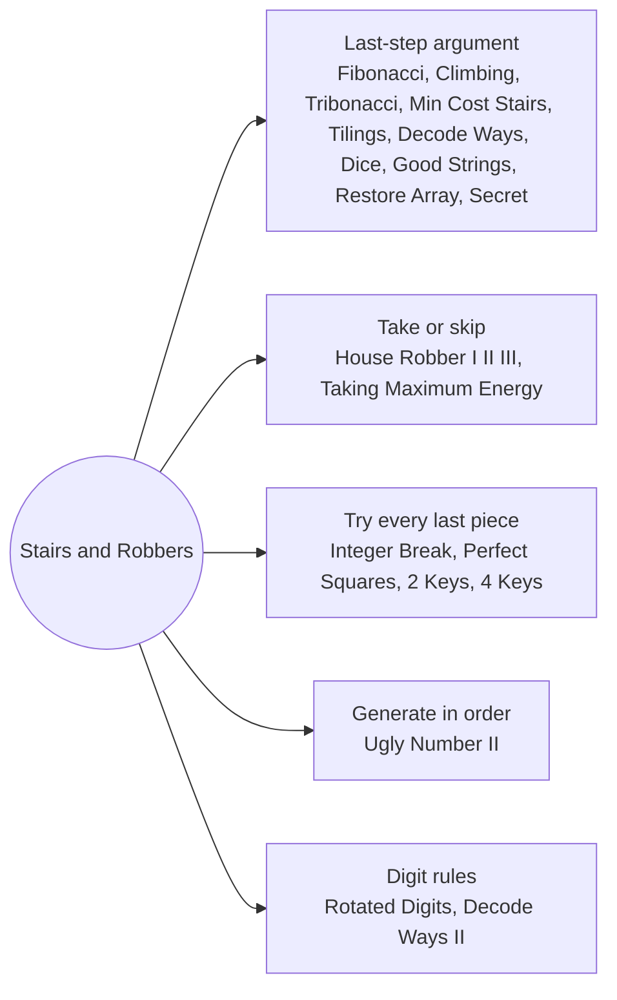

# Stairs and Robbers: Pattern Map

> [!TIP]
> **🧠 One picture to keep**
> Every DP answers four questions: **state** (what do I need to know?), **transition** (how do I get it from smaller states?), **base case** (where does it start?), **order** (which states first?). This folder is the 1-D warm-up where the state is just an index or a count:
> 1. **Last-step argument**: `ways(n) = ways(n-1) + ways(n-2)` because the last move was a 1 or a 2 (stairs, tilings, decoding, dice).
> 2. **Take or skip**: `best(i) = max(best(i-1), best(i-2) + a[i])` (House Robber and its circle and tree versions).
> 3. **Try every last piece**: `dp[i] = best over j of dp[j] + cost(j, i)` (Integer Break, Perfect Squares, 2 Keys).
> 4. **Roll the array**: when `dp[i]` depends on two or three previous values keep only those.
> Each note shows memoised recursion and the bottom-up table side by side and checks them against brute force.

**All animations:** [▶ Stairs and Robbers Animations](https://d9-cell.github.io/java-brain/DP/Stairs%20and%20Robbers/Stairs%20and%20Robbers%20Animations.html) · ⬆ [00 Brain Map](../../00%20Brain%20Map.md)

## Java toolkit
| Need | Java |
|---|---|
| 1-D table | `int[] dp = new int[n + 1]; dp[0] = 1;` |
| Rolling variables | `int a = 0, b = 1; for (...) { int c = a + b; a = b; b = c; }` |
| Memo with sentinel | `int[] memo = new int[n]; Arrays.fill(memo, -1);` (use `memo[i] = res + 1` when 0 is a legal answer) |
| Modulo | `(x + y) % MOD` on `long`, keep intermediate products in `long` |
| Two states per index | `int[] r = {taken, skipped}` returned from the recursion |
| Answers that overflow int | return `long` or apply `% 1_000_000_007` at every addition |

## Patterns in this folder

| # | Problem | Pattern | Mantra | Level |
|---|---|---|---|---|
| 1 | [Fibonacci Number](Fibonacci%20Number.md) | Last-step argument, Rolling variables | f(n) = f(n−1) + f(n−2); KEEP TWO VARIABLES | Easy |
| 2 | [Climbing Stairs](Climbing%20Stairs.md) | Last-step argument, Counting ways | ways(n) = ways(n−1) + ways(n−2) | Easy |
| 3 | [N-th Tribonacci Number](N-th%20Tribonacci%20Number.md) | Last-step argument, Three rolling variables | T(n) = T(n−1) + T(n−2) + T(n−3) | Easy |
| 4 | [Min Cost Climbing Stairs](Min%20Cost%20Climbing%20Stairs.md) | Min over the last step, Rolling variables | cost(i) = min(cost(i−1) + c[i−1], cost(i−2) + c[i−2]) | Easy |
| 5 | [House Robber](House%20Robber.md) | Take or skip, No adjacent choices | best(i) = max(best(i−1), best(i−2) + a[i]) | Medium |
| 6 | [House Robber II](House%20Robber%20II.md) | Take or skip, Break the circle | MAX(line[0..n−2], line[1..n−1]) | Medium |
| 7 | [House Robber III](House%20Robber%20III.md) | Take or skip on a tree, Pair per node | ROB: val + children skipped; SKIP: max of each child | Medium |
| 8 | [Integer Break](Integer%20Break.md) | Try every first piece, Math shortcut | dp[i] = max over j of j · max(i − j, dp[i − j]) | Medium |
| 9 | [Perfect Squares](Perfect%20Squares.md) | Try every last piece, Shortest path | dp[i] = 1 + min over squares s of dp[i − s] | Medium |
| 10 | [2 Keys Keyboard](2%20Keys%20Keyboard.md) | Divisors, Prime factors | dp[i] = min over divisors d of dp[d] + i / d | Medium |
| 11 | [4 Keys Keyboard](4%20Keys%20Keyboard.md) | Copy-paste blocks, Try every block start | dp[i] = max(dp[i−1] + 1, dp[j−2] · (i − j + 1)) | Medium |
| 12 | [Decode Ways](Decode%20Ways.md) | Last-piece argument, Strings | dp[i] = (s[i−1] ≠ 0 ? dp[i−1] : 0) + (10 ≤ s[i−2..i−1] ≤ 26 ? dp[i−2] : 0) | Medium |
| 13 | [Decode Ways II](Decode%20Ways%20II.md) | Last-piece argument, Wildcard multipliers | single(c) · dp[i−1] + pair(a, b) · dp[i−2] | Hard |
| 14 | [Ugly Number II](Ugly%20Number%20II.md) | Merge three streams, Three pointers | NEXT = MIN(u[i2]·2, u[i3]·3, u[i5]·5) | Medium |
| 15 | [Domino and Tromino Tiling](Domino%20and%20Tromino%20Tiling.md) | Last-column argument, Linear recurrence | f(n) = 2·f(n−1) + f(n−3) | Medium |
| 16 | [Count Ways To Build Good Strings](Count%20Ways%20To%20Build%20Good%20Strings.md) | Last-piece argument, Length counting | dp[len] = dp[len − zero] + dp[len − one] | Medium |
| 17 | [Number of Dice Rolls With Target Sum](Number%20of%20Dice%20Rolls%20With%20Target%20Sum.md) | Last-die argument, Sum DP | dp[d][t] = Σ dp[d−1][t − f] | Medium |
| 18 | [Restore The Array](Restore%20The%20Array.md) | Last-number argument, Digit strings | dp[i] = Σ dp[j] over valid last numbers s[j..i) | Hard |
| 19 | [Number of People Aware of a Secret](Number%20of%20People%20Aware%20of%20a%20Secret.md) | Sliding window sum, Delay and forget | new[day] = Σ new[j] for j in (day − forget, day − delay] | Medium |
| 20 | [Taking Maximum Energy From the Mystic Dungeon](Taking%20Maximum%20Energy%20From%20the%20Mystic%20Dungeon.md) | Suffix DP with stride k | dp[i] = energy[i] + dp[i + k] | Medium |
| 21 | [Rotated Digits](Rotated%20Digits.md) | Digit classification, DP over prefixes | dp[i] FROM dp[i / 10] AND dp[i % 10] | Medium |

## Suggested learning order
1. [Fibonacci Number](Fibonacci%20Number.md), [Climbing Stairs](Climbing%20Stairs.md), [N-th Tribonacci Number](N-th%20Tribonacci%20Number.md), [Min Cost Climbing Stairs](Min%20Cost%20Climbing%20Stairs.md)
2. [House Robber](House%20Robber.md) ⭐, [House Robber II](House%20Robber%20II.md), [House Robber III](House%20Robber%20III.md), [Taking Maximum Energy From the Mystic Dungeon](Taking%20Maximum%20Energy%20From%20the%20Mystic%20Dungeon.md)
3. [Decode Ways](Decode%20Ways.md) ⭐, [Decode Ways II](Decode%20Ways%20II.md), [Count Ways To Build Good Strings](Count%20Ways%20To%20Build%20Good%20Strings.md), [Restore The Array](Restore%20The%20Array.md)
4. [Number of Dice Rolls With Target Sum](Number%20of%20Dice%20Rolls%20With%20Target%20Sum.md), [Number of People Aware of a Secret](Number%20of%20People%20Aware%20of%20a%20Secret.md), [Domino and Tromino Tiling](Domino%20and%20Tromino%20Tiling.md)
5. [Integer Break](Integer%20Break.md), [Perfect Squares](Perfect%20Squares.md), [2 Keys Keyboard](2%20Keys%20Keyboard.md), [4 Keys Keyboard](4%20Keys%20Keyboard.md)
6. [Ugly Number II](Ugly%20Number%20II.md), [Rotated Digits](Rotated%20Digits.md)

## Connections to other folders
- [Knapsack Series - Pattern Map](../Knapsack%20Series/Knapsack%20Series%20-%20Pattern%20Map.md) when each item can be used once or many times
- [Strings and Subsequences - Pattern Map](../Strings%20and%20Subsequences/Strings%20and%20Subsequences%20-%20Pattern%20Map.md) for DP over two strings
- [Recursion - Pattern Map](../../Recursion/Recursion%20-%20Pattern%20Map.md) for the recursion habits behind top-down DP
- [Scans and Counting - Pattern Map](../../Greedy/Scans%20and%20Counting/Scans%20and%20Counting%20-%20Pattern%20Map.md) for problems where a greedy replaces the table
