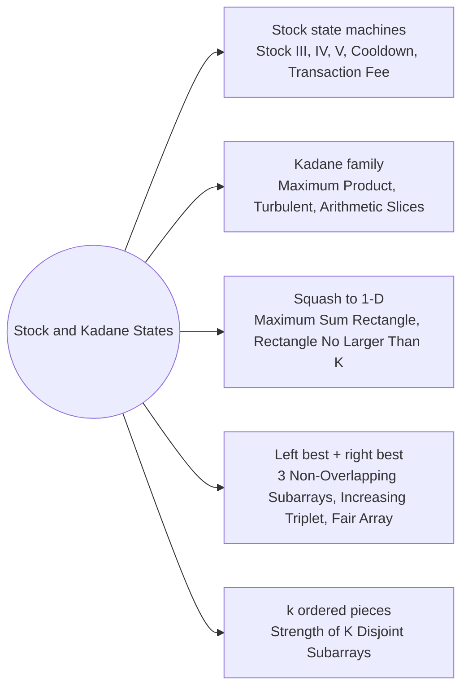

# Stock and Kadane States: Pattern Map

> [!TIP]
> **🧠 One picture to keep**
> Scan the array once and carry **a few running states** that summarise everything before.
> 1. **State machine per day**: holding / not holding / cooling down / trades used. Each price updates every state in O(1) (all Best Time to Buy and Sell Stock variants).
> 2. **Kadane**: best subarray ending here = extend or restart. Variants keep the max and the min (product), the direction of the last step (turbulent), or a run length (arithmetic slices).
> 3. **Squash 2-D to 1-D**: fix a row band, add its columns, run Kadane (maximum sum rectangle).
> 4. **Best-so-far arrays**: best window on the left of i and on the right of i (two transactions, three windows, increasing triplet).

**All animations:** [▶ Stock and Kadane States Animations](https://d9-cell.github.io/java-brain/DP/Stock%20and%20Kadane%20States/Stock%20and%20Kadane%20States%20Animations.html) · ⬆ [00 Brain Map](../../00%20Brain%20Map.md)

## Java toolkit
| Need | Java |
|---|---|
| Running states | `int hold = Integer.MIN_VALUE / 2, cash = 0;` (half MIN avoids overflow on `+ p`) |
| Update order | compute all new states from the old ones, then assign (`nHold`, `nCash`) |
| k transactions | `int[] buy = new int[k + 1], sell = new int[k + 1];` |
| Kadane | `cur = Math.max(x, cur + x); best = Math.max(best, cur);` |
| Subarray sum ≤ k | `TreeSet<Integer> seen; seen.ceiling(prefix - k)` |
| Max/min swap | `if (x < 0) { int t = hi; hi = lo; lo = t; }` |

## Patterns in this folder

| # | Problem | Pattern | Mantra | Level |
|---|---|---|---|---|
| 1 | [Best Time to Buy and Sell Stock III](Best%20Time%20to%20Buy%20and%20Sell%20Stock%20III.md) | State machine, Prefix + suffix best | buy1 = max(buy1, −p) · sell1 = max(sell1, buy1 + p) · buy2 = max(buy2, sell1 − p) · sell2 = max(sell2, buy2 + p) | Hard |
| 2 | [Best Time to Buy and Sell Stock IV](Best%20Time%20to%20Buy%20and%20Sell%20Stock%20IV.md) | State machine with a counter, Memo over (day, k, holding) | buy[t] = max(buy[t], sell[t − 1] − p) · sell[t] = max(sell[t], buy[t] + p) | Hard |
| 3 | [Best Time to Buy and Sell Stock V](Best%20Time%20to%20Buy%20and%20Sell%20Stock%20V.md) | Three positions, Long or short | flat → long (−p) or short (+p); long → flat (+p); short → flat (−p); k CLOSES | Medium |
| 4 | [Best Time to Buy and Sell Stock with Cooldown](Best%20Time%20to%20Buy%20and%20Sell%20Stock%20with%20Cooldown.md) | State machine, Cooldown state | hold = max(hold, rest − p) · sold = hold + p · rest = max(rest, sold) | Medium |
| 5 | [Best Time to Buy and Sell Stock with Transaction Fee](Best%20Time%20to%20Buy%20and%20Sell%20Stock%20with%20Transaction%20Fee.md) | Two states, Unlimited trades | cash = max(cash, hold + p − fee) · hold = max(hold, cash − p) | Medium |
| 6 | [Maximum Product Subarray](Maximum%20Product%20Subarray.md) | Kadane with max and min, Sign flip | x < 0 → SWAP hi, lo; hi = max(x, hi·x); lo = min(x, lo·x) | Medium |
| 7 | [Longest Turbulent Subarray](Longest%20Turbulent%20Subarray.md) | Kadane on direction, Two run lengths | UP: up = down + 1, down = 1 · DOWN: down = up + 1, up = 1 · EQUAL: both = 1 | Medium |
| 8 | [Arithmetic Slices](Arithmetic%20Slices.md) | Run length DP, Count ending here | SAME DIFF → run++ ELSE run = 0; total += run | Medium |
| 9 | [Ways to Make a Fair Array](Ways%20to%20Make%20a%20Fair%20Array.md) | Prefix sums, Parity swap | evenLeft + oddRight == oddLeft + evenRight | Medium |
| 10 | [Increasing Triplet Subsequence](Increasing%20Triplet%20Subsequence.md) | Two thresholds, LIS of length 3 | x ≤ first → first = x · x ≤ second → second = x · ELSE TRUE | Medium |
| 11 | [Maximum Sum Rectangle](Maximum%20Sum%20Rectangle.md) | 2-D Kadane, Squash rows | FOR top, bottom: col[c] += m[bottom][c]; best = max(best, KADANE(col)) | Hard |
| 12 | [Max Sum of Rectangle No Larger Than K](Max%20Sum%20of%20Rectangle%20No%20Larger%20Than%20K.md) | 2-D squash, Ordered prefix sums | best = prefix − seen.ceiling(prefix − k) | Hard |
| 13 | [Maximum Sum of 3 Non-Overlapping Subarrays](Maximum%20Sum%20of%203%20Non-Overlapping%20Subarrays.md) | Left best + right best, Window sums | FOR EACH MIDDLE: left[mid − k] + w[mid] + right[mid + k] | Hard |
| 14 | [Maximum Strength of K Disjoint Subarrays](Maximum%20Strength%20of%20K%20Disjoint%20Subarrays.md) | Open / closed states, Weighted pieces | open[j] = max(open[j], closed[j−1], open[j−1]) + w(j)·x; closed[j] = max(closed[j], open[j]) | Hard |

## Suggested learning order
1. [Best Time to Buy and Sell Stock with Transaction Fee](Best%20Time%20to%20Buy%20and%20Sell%20Stock%20with%20Transaction%20Fee.md) ⭐, [Best Time to Buy and Sell Stock with Cooldown](Best%20Time%20to%20Buy%20and%20Sell%20Stock%20with%20Cooldown.md), [Best Time to Buy and Sell Stock III](Best%20Time%20to%20Buy%20and%20Sell%20Stock%20III.md), [Best Time to Buy and Sell Stock IV](Best%20Time%20to%20Buy%20and%20Sell%20Stock%20IV.md) ⭐, [Best Time to Buy and Sell Stock V](Best%20Time%20to%20Buy%20and%20Sell%20Stock%20V.md)
2. [Maximum Product Subarray](Maximum%20Product%20Subarray.md) ⭐, [Longest Turbulent Subarray](Longest%20Turbulent%20Subarray.md), [Arithmetic Slices](Arithmetic%20Slices.md)
3. [Increasing Triplet Subsequence](Increasing%20Triplet%20Subsequence.md), [Ways to Make a Fair Array](Ways%20to%20Make%20a%20Fair%20Array.md), [Maximum Sum of 3 Non-Overlapping Subarrays](Maximum%20Sum%20of%203%20Non-Overlapping%20Subarrays.md)
4. [Maximum Sum Rectangle](Maximum%20Sum%20Rectangle.md), [Max Sum of Rectangle No Larger Than K](Max%20Sum%20of%20Rectangle%20No%20Larger%20Than%20K.md), [Maximum Strength of K Disjoint Subarrays](Maximum%20Strength%20of%20K%20Disjoint%20Subarrays.md)

## Connections to other folders
- [Counting Walks and Moves - Pattern Map](../Counting%20Walks%20and%20Moves/Counting%20Walks%20and%20Moves%20-%20Pattern%20Map.md) for state machines that count instead of maximise
- [Sliding Window - Pattern Map](../../Sliding%20Window/Sliding%20Window%20-%20Pattern%20Map.md) for fixed-length windows
- [Best Time to Buy and Sell Stock using Strategy](../../Sliding%20Window/Best%20Time%20to%20Buy%20and%20Sell%20Stock%20using%20Strategy.md) in Sliding Window
