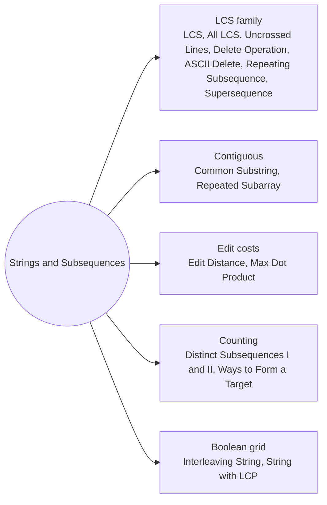

# Strings and Subsequences: Pattern Map

> [!TIP]
> **🧠 One picture to keep**
> Two strings, one grid: **dp[i][j] describes the prefixes a[0..i) and b[0..j)**. Each cell looks at its three neighbours: up (drop a char of a), left (drop a char of b), diagonal (use both last chars).
> 1. **LCS family**: match → diagonal + 1, else max(up, left) (LCS, Uncrossed Lines, Delete Operation, ASCII Delete, Repeating Subsequence, Supersequence).
> 2. **Contiguous version**: match → diagonal + 1, else **0** (Common Substring, Repeated Subarray).
> 3. **Edit-style costs**: replace = diagonal + 1, delete = up + 1, insert = left + 1 (Edit Distance).
> 4. **Counting**: ways = skip + (match ? use : 0) (Distinct Subsequences, Ways to Form a Target).
> 5. **Walk the table back** to print an answer (Print LCS, All LCS, Supersequence).

**All animations:** [▶ Strings and Subsequences Animations](https://d9-cell.github.io/java-brain/DP/Strings%20and%20Subsequences/Strings%20and%20Subsequences%20Animations.html) · ⬆ [00 Brain Map](../../00%20Brain%20Map.md)

## Java toolkit
| Need | Java |
|---|---|
| Table with an empty row and column | `int[][] dp = new int[m + 1][n + 1];` (index i means "first i chars") |
| Current chars | `a.charAt(i - 1)`, `b.charAt(j - 1)` |
| Two rows | `int[] prev, cur; ... int[] t = prev; prev = cur; cur = t;` |
| One row with a diagonal | save `diag = dp[j]` before overwriting |
| Rebuild a string | walk from `(m, n)` back to `(0, 0)` with a `StringBuilder`, then `reverse()` |
| Characters by count | `int[] freq = new int[26]; freq[c - 'a']++;` |

## Patterns in this folder

| # | Problem | Pattern | Mantra | Level |
|---|---|---|---|---|
| 1 | [Longest Common Subsequence](Longest%20Common%20Subsequence.md) | LCS grid, Print by walking back | MATCH → ↖ + 1 · ELSE max(↑, ←) | Medium |
| 2 | [All Longest Common Subsequences](All%20Longest%20Common%20Subsequences.md) | LCS grid, Collect every path back | MATCH → APPEND CHAR · ELSE GO ↑ AND/OR ← IF EQUAL | Hard |
| 3 | [Longest Common Substring](Longest%20Common%20Substring.md) | Contiguous match, Reset on mismatch | MATCH → ↖ + 1 · ELSE 0; ANSWER = MAX CELL | Medium |
| 4 | [Maximum Length of Repeated Subarray](Maximum%20Length%20of%20Repeated%20Subarray.md) | Contiguous match, One row backwards | dp[j] = a[i−1] == b[j−1] ? dp[j−1] + 1 : 0 (j DOWN) | Medium |
| 5 | [Delete Operation for Two Strings](Delete%20Operation%20for%20Two%20Strings.md) | LCS reduction, Direct grid | ANSWER = m + n − 2 · LCS | Medium |
| 6 | [Minimum ASCII Delete Sum for Two Strings](Minimum%20ASCII%20Delete%20Sum%20for%20Two%20Strings.md) | Weighted deletions, Edit-style grid | MATCH → ↖ · ELSE min(↑ + a[i], ← + b[j]) | Medium |
| 7 | [Uncrossed Lines](Uncrossed%20Lines.md) | LCS in disguise | SAME TABLE AS LCS | Medium |
| 8 | [Max Dot Product of Two Subsequences](Max%20Dot%20Product%20of%20Two%20Subsequences.md) | LCS-shaped grid, Non-empty choice | dp = max(pair, pair + ↖, ↑, ←) | Hard |
| 9 | [Edit Distance](Edit%20Distance.md) | Edit-style grid, One row + diagonal | MATCH → ↖ · ELSE 1 + min(↖, ↑, ←) | Medium |
| 10 | [Shortest Common Supersequence](Shortest%20Common%20Supersequence.md) | Print by walking back, LCS reduction | LENGTH = m + n − LCS; WALK BACK: MATCH ONCE, ELSE EMIT THE DROPPED CHAR | Hard |
| 11 | [Longest Repeating Subsequence](Longest%20Repeating%20Subsequence.md) | LCS of a string with itself, i ≠ j | LCS(s, s) WITH MATCH ONLY IF i ≠ j | Medium |
| 12 | [Distinct Subsequences](Distinct%20Subsequences.md) | Counting grid, Skip or use | ways[j] += ways[j − 1] IF s[i] == t[j − 1] (j DOWN) | Hard |
| 13 | [Distinct Subsequences II](Distinct%20Subsequences%20II.md) | Count by last character, Remove duplicates | fresh = total + 1; total += fresh − endsWith[c]; endsWith[c] = fresh | Hard |
| 14 | [Interleaving String](Interleaving%20String.md) | Boolean grid, Path in a grid | ok[i][j] = (ok[i−1][j] AND s1[i−1] == s3[i+j−1]) OR (ok[i][j−1] AND s2[j−1] == s3[i+j−1]) | Medium |
| 15 | [Number of Ways to Form a Target String Given a Dictionary](Number%20of%20Ways%20to%20Form%20a%20Target%20String%20Given%20a%20Dictionary.md) | Counting, Column frequencies | ways[i] += ways[i − 1] · freq[col][target[i − 1]] (i DOWN) | Hard |
| 16 | [Find the String with LCP](Find%20the%20String%20with%20LCP.md) | Greedy build + DP verify, LCP recurrence | BUILD: NEW GROUP → NEXT LETTER · VERIFY: lcp[i][j] = s[i] == s[j] ? lcp[i+1][j+1] + 1 : 0 | Hard |

## Suggested learning order
1. [Longest Common Subsequence](Longest%20Common%20Subsequence.md) ⭐, [Uncrossed Lines](Uncrossed%20Lines.md), [Delete Operation for Two Strings](Delete%20Operation%20for%20Two%20Strings.md), [Minimum ASCII Delete Sum for Two Strings](Minimum%20ASCII%20Delete%20Sum%20for%20Two%20Strings.md)
2. [Longest Common Substring](Longest%20Common%20Substring.md), [Maximum Length of Repeated Subarray](Maximum%20Length%20of%20Repeated%20Subarray.md)
3. [Edit Distance](Edit%20Distance.md) ⭐, [Shortest Common Supersequence](Shortest%20Common%20Supersequence.md), [Longest Repeating Subsequence](Longest%20Repeating%20Subsequence.md), [All Longest Common Subsequences](All%20Longest%20Common%20Subsequences.md)
4. [Distinct Subsequences](Distinct%20Subsequences.md), [Distinct Subsequences II](Distinct%20Subsequences%20II.md), [Number of Ways to Form a Target String Given a Dictionary](Number%20of%20Ways%20to%20Form%20a%20Target%20String%20Given%20a%20Dictionary.md)
5. [Interleaving String](Interleaving%20String.md) ⭐, [Max Dot Product of Two Subsequences](Max%20Dot%20Product%20of%20Two%20Subsequences.md), [Find the String with LCP](Find%20the%20String%20with%20LCP.md)

## Connections to other folders
- [Palindromes and Word Splits - Pattern Map](../Palindromes%20and%20Word%20Splits/Palindromes%20and%20Word%20Splits%20-%20Pattern%20Map.md) for DP inside one string
- LIS and Variants - Pattern Map for subsequences of one array
- [Sliding Window - Pattern Map](../../Sliding%20Window/Sliding%20Window%20-%20Pattern%20Map.md) for contiguous matching with a window
