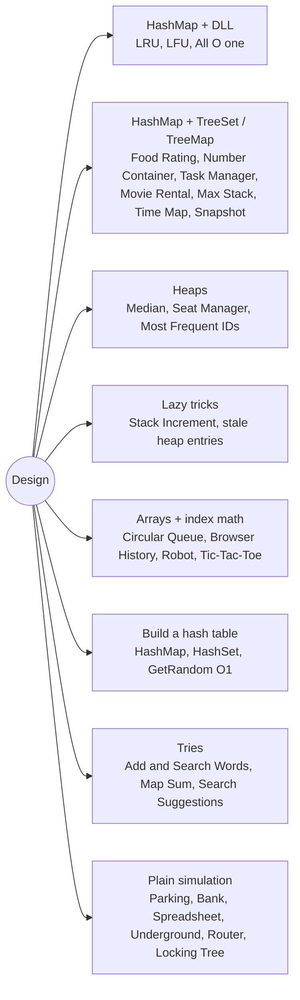

# Design: Pattern Map

> [!TIP]
> **🧠 One picture to keep**
> A design question is a **shopping list of complexities**: write each operation with its target (O(1)? O(log n)?), then pick structures that each make one requirement cheap, and **keep them in sync**.
> Recurring combos: **HashMap + doubly linked list** (LRU/LFU/AllOne), **HashMap + TreeSet** (leaderboards: Food Rating, Task Manager, Movie Rental), **two heaps** (median), **lazy tags** (Stack Increment, stale heap entries), **list + map with swap-delete** (GetRandom).

**All animations:** [▶ Design Animations](https://d9-cell.github.io/java-brain/Design/Design%20Animations.html) · ⬆ [00 Brain Map](../00%20Brain%20Map.md)

## Java toolkit
| Need | Java |
|---|---|
| O(1) recency order | own DLL with sentinels, or `LinkedHashMap(cap, 0.75f, true)` |
| Ordered set with custom ties | `new TreeSet<>((a, b) -> ...)` (never mutate a field the comparator reads while inside!) |
| Floor / ceiling lookups | `TreeMap.floorEntry`, `ceilingKey`, `TreeSet.first/last/pollFirst` |
| Min / max heap | `PriorityQueue<>()` / `new PriorityQueue<>(Collections.reverseOrder())` |
| Lazy deletion in a heap | push new snapshots; `while (top is stale) poll()` |
| Composite key | `(long) a << 32 \| b` or `a + "," + b` |

## Patterns in this folder

| # | Problem | Pattern | Mantra | Level |
|---|---|---|---|---|
| 1 | [LRU Cache](LRU%20Cache.md) | HashMap + DLL | HASHMAP + DLL, TOUCH → FRONT, EVICT TAIL | Medium |
| 2 | [LFU Cache](LFU%20Cache.md) | Frequency buckets, LinkedHashSet | FREQ BUCKETS (LinkedHashSet) + minFreq | Hard |
| 3 | [All Oone Data Structure](All%20Oone%20Data%20Structure.md) | HashMap + DLL of buckets | COUNT BUCKETS IN A DLL, MOVE ±1 | Hard |
| 4 | [Design Add and Search Words Data Structure](Design%20Add%20and%20Search%20Words%20Data%20Structure.md) | Trie, DFS with wildcard | TRIE + DFS ON "." | Medium |
| 5 | [Design a Food Rating System](Design%20a%20Food%20Rating%20System.md) | HashMap + TreeSet | TREESET (rating ↓, name ↑) PER CUISINE | Medium |
| 6 | [Design a Number Container System](Design%20a%20Number%20Container%20System.md) | Two maps, TreeSet | idx→num + num→TreeSet<idx> | Medium |
| 7 | [Design a Stack With Increment Operation](Design%20a%20Stack%20With%20Increment%20Operation.md) | Lazy propagation | LAZY inc[k−1], PASS DOWN ON POP | Medium |
| 8 | [Design Browser History](Design%20Browser%20History.md) | Array + pointers | ARRAY + cur + last | Medium |
| 9 | [Design Circular Queue](Design%20Circular%20Queue.md) | Ring buffer | front + size, INDEX % k | Medium |
| 10 | [Design HashMap](Design%20HashMap.md) | Hashing, Separate chaining | key % SIZE → BUCKET LIST | Easy |
| 11 | [Design HashSet](Design%20HashSet.md) | Direct addressing, Chaining | boolean[1e6+1] OR CHAINING | Easy |
| 12 | [Design Movie Rental System](Design%20Movie%20Rental%20System.md) | HashMap + TreeSets | available[movie] + rented: TreeSets | Hard |
| 13 | [Design Parking System](Design%20Parking%20System.md) | Counters | COUNTER PER TYPE | Easy |
| 14 | [Design Spreadsheet](Design%20Spreadsheet.md) | Simulation, Parsing | PARSE "=X+Y", CELL OR NUMBER | Medium |
| 15 | [Design Task Manager](Design%20Task%20Manager.md) | HashMap + TreeSet | TREESET (priority ↓, id ↓) + MAP | Medium |
| 16 | [Design Tic-Tac-Toe](Design%20Tic-Tac-Toe.md) | Counters | ROW/COL/DIAG COUNTERS ±1 | Medium |
| 17 | [Design Underground System](Design%20Underground%20System.md) | HashMaps | id → (station, t); ROUTE → (total, count) | Medium |
| 18 | [Finding Pairs With a Certain Sum](Finding%20Pairs%20With%20a%20Certain%20Sum.md) | Two Sum with a frequency map | LOOP SMALL, MAP BIG | Medium |
| 19 | [Find Median from Data Stream](Find%20Median%20from%20Data%20Stream.md) | Two heaps | MAX-HEAP LEFT, MIN-HEAP RIGHT, BALANCE | Hard |
| 20 | [Flatten Nested List Iterator](Flatten%20Nested%20List%20Iterator.md) | Stack, Lazy iterator | STACK, UNPACK IN hasNext() | Medium |
| 21 | [Implement Router](Implement%20Router.md) | Queue + set + binary search | QUEUE + SET + SORTED TIMES WITH START INDEX | Medium |
| 22 | [Implement Stack using Queues](Implement%20Stack%20using%20Queues.md) | Queue rotation | OFFER x, ROTATE n−1 | Easy |
| 23 | [Insert Delete GetRandom O(1)](Insert%20Delete%20GetRandom%20O%281%29.md) | List + map, Swap-delete | LIST + MAP, SWAP-WITH-LAST DELETE | Medium |
| 24 | [Map Sum Pairs](Map%20Sum%20Pairs.md) | Trie with sums | TRIE NODE SUMS, ADD THE DELTA | Medium |
| 25 | [Max Stack](Max%20Stack.md) | Two TreeSets | IDs + TREESET BY ID + TREESET BY (VAL, ID) | Hard |
| 26 | [Most Frequent IDs](Most%20Frequent%20IDs.md) | Lazy max-heap | COUNT MAP + LAZY MAX-HEAP | Medium |
| 27 | [Operations on Tree](Operations%20on%20Tree.md) | Tree traversal, Simulation | CHECK UP, CHECK DOWN, CLEAR DOWN | Medium |
| 28 | [Search Suggestions System](Search%20Suggestions%20System.md) | Sorting + binary search, Trie | SORT + LOWER BOUND + TAKE 3 | Medium |
| 29 | [Seat Reservation Manager](Seat%20Reservation%20Manager.md) | Min-heap, Counter | COUNTER + MIN-HEAP OF RETURNS | Medium |
| 30 | [Simple Bank System](Simple%20Bank%20System.md) | Simulation | VALIDATE, THEN APPLY | Medium |
| 31 | [Snapshot Array](Snapshot%20Array.md) | Versioned values, Binary search | PER INDEX (snapId, val) LIST + BINARY SEARCH | Medium |
| 32 | [Time Based Key-Value Store](Time%20Based%20Key-Value%20Store.md) | TreeMap floor | TREEMAP floorEntry | Medium |
| 33 | [Walking Robot Simulation II](Walking%20Robot%20Simulation%20II.md) | Cycle precomputation | PRECOMPUTE PERIMETER, step % LEN, ORIGIN FACES SOUTH | Medium |

## Suggested learning order
1. Warm-up: [Design Parking System](Design%20Parking%20System.md), [Simple Bank System](Simple%20Bank%20System.md), [Design Browser History](Design%20Browser%20History.md), [Design Circular Queue](Design%20Circular%20Queue.md)
2. Hashing: [Design HashSet](Design%20HashSet.md), [Design HashMap](Design%20HashMap.md), [Insert Delete GetRandom O(1)](Insert%20Delete%20GetRandom%20O%281%29.md)
3. Classic: [LRU Cache](LRU%20Cache.md) ⭐ → [LFU Cache](LFU%20Cache.md) → [All Oone Data Structure](All%20Oone%20Data%20Structure.md)
4. Heaps: [Find Median from Data Stream](Find%20Median%20from%20Data%20Stream.md) ⭐, [Seat Reservation Manager](Seat%20Reservation%20Manager.md), [Most Frequent IDs](Most%20Frequent%20IDs.md)
5. Ordered sets: [Time Based Key-Value Store](Time%20Based%20Key-Value%20Store.md), [Snapshot Array](Snapshot%20Array.md), [Design a Number Container System](Design%20a%20Number%20Container%20System.md), [Design a Food Rating System](Design%20a%20Food%20Rating%20System.md), [Design Task Manager](Design%20Task%20Manager.md), [Max Stack](Max%20Stack.md), [Design Movie Rental System](Design%20Movie%20Rental%20System.md)
6. Tries: [Design Add and Search Words Data Structure](Design%20Add%20and%20Search%20Words%20Data%20Structure.md), [Map Sum Pairs](Map%20Sum%20Pairs.md), [Search Suggestions System](Search%20Suggestions%20System.md)
7. The rest: [Design a Stack With Increment Operation](Design%20a%20Stack%20With%20Increment%20Operation.md), [Design Tic-Tac-Toe](Design%20Tic-Tac-Toe.md), [Design Underground System](Design%20Underground%20System.md), [Finding Pairs With a Certain Sum](Finding%20Pairs%20With%20a%20Certain%20Sum.md), [Flatten Nested List Iterator](Flatten%20Nested%20List%20Iterator.md), [Implement Router](Implement%20Router.md), [Implement Stack using Queues](Implement%20Stack%20using%20Queues.md), [Operations on Tree](Operations%20on%20Tree.md), [Design Spreadsheet](Design%20Spreadsheet.md), [Walking Robot Simulation II](Walking%20Robot%20Simulation%20II.md)

## Connections to other folders
- Tries: [Trie](../Trie/Trie%20-%20Pattern%20Map.md)
- Queue rotation (Stack using Queues): [Queue](../Queue/Queue%20-%20Pattern%20Map.md)
- Line sweep calendars: [Line Sweep](../Line%20Sweep/Line%20Sweep%20-%20Pattern%20Map.md)
- Heaps in depth: [Heap](../Heap/Heap%20-%20Pattern%20Map.md)
- TreeSet sliding windows: [HashSet](../HashSet/HashSet%20-%20Pattern%20Map.md)
