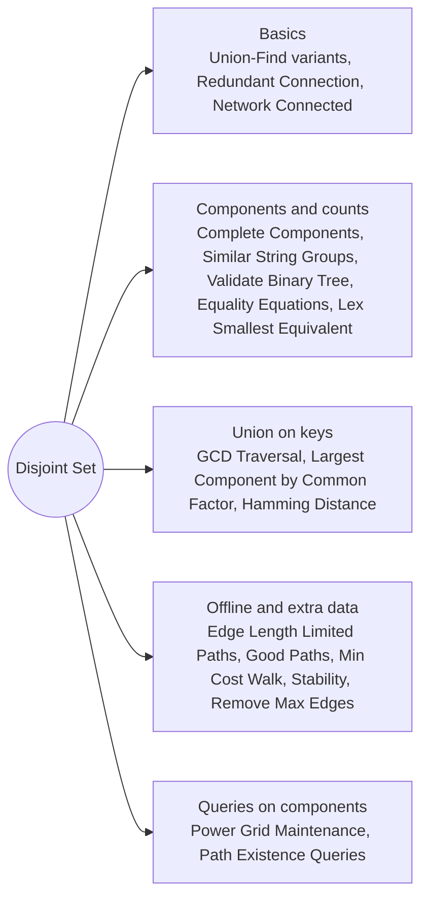

# Disjoint Set: Pattern Map

> [!TIP]
> **🧠 One picture to keep**
> Picture **clubs**: everyone points to a leader; two clubs merge when one leader follows the other.
> 1. **find** = ask "who is my leader?" up the chain, then tell everyone on the way the leader directly.
> 2. **union** = make one leader follow the other (the smaller club follows the bigger).
> 3. **Cycle?** An edge whose ends already share a leader closes a cycle.
> 4. **Count components** = n − number of successful unions.
> 5. **Offline queries**: sort edges and questions by a limit, add edges as the limit rises.

**All animations:** [▶ Disjoint Set Animations](https://d9-cell.github.io/java-brain/Graph/Disjoint%20Set/Disjoint%20Set%20Animations.html) · ⬆ [00 Brain Map](../../00%20Brain%20Map.md)

## Java toolkit
| Need | Java |
|---|---|
| Parents | `int[] parent = new int[n]; for (i) parent[i] = i;` |
| find with compression | `return parent[x] == x ? x : (parent[x] = find(parent, parent[x]));` |
| union, reports a merge | `a = find(x); b = find(y); if (a == b) return false; parent[a] = b; return true;` |
| Component count | start at n and subtract 1 per successful union |
| Size or extra data per root | `size[root] += size[other]`, `cost[root] &= cost[other]` |
| Union on keys, not nodes | offset ids: row `r`, column `c + 100001`; or `n + prime` |
| Offline queries | sort edges and queries by the limit, add edges while `edge < limit` |
| Deep recursion | path compression with recursion is fine to ~1e5; use iterative find if chains are long before compression |

## Patterns in this folder

| # | Problem | Pattern | Mantra | Level |
|---|---|---|---|---|
| 1 | [Disjoint Set (Union-Find)](Disjoint%20Set%20%28Union-Find%29.md) | Union-Find | find = climb to the root (compress); union = root under root | Medium |
| 2 | [Redundant Connection](Redundant%20Connection.md) | Union-Find, Cycle edge | EDGE WHOSE ENDS ALREADY SHARE A ROOT | Medium |
| 3 | [Checking Existence of Edge Length Limited Paths](Checking%20Existence%20of%20Edge%20Length%20Limited%20Paths.md) | Offline queries, Union-Find | SORT EDGES AND QUERIES; UNION EDGES < LIMIT | Hard |
| 4 | [Count the Number of Complete Components](Count%20the%20Number%20of%20Complete%20Components.md) | Components, Clique check, Union-Find | EDGES == nodes × (nodes − 1) / 2 | Medium |
| 5 | [Greatest Common Divisor Traversal](Greatest%20Common%20Divisor%20Traversal.md) | Union-Find on keys, Primes | UNION INDEX WITH EACH PRIME FACTOR | Hard |
| 6 | [Largest Component Size by Common Factor](Largest%20Component%20Size%20by%20Common%20Factor.md) | Union-Find on keys, Factors | UNION NUMBER WITH EACH FACTOR > 1 | Hard |
| 7 | [Maximize Spanning Tree Stability with Upgrades](Maximize%20Spanning%20Tree%20Stability%20with%20Upgrades.md) | Binary search on answer, Union-Find | BINARY SEARCH s; MUST ≥ s, OPTIONAL FREE OR UPGRADE | Hard |
| 8 | [Minimize Hamming Distance After Swap Operations](Minimize%20Hamming%20Distance%20After%20Swap%20Operations.md) | Union-Find, Multiset per component | COMPONENT MULTISET OF SOURCE vs TARGET | Medium |
| 9 | [Minimum Cost Walk in Weighted Graph](Minimum%20Cost%20Walk%20in%20Weighted%20Graph.md) | Union-Find with AND, Bit tricks | ANSWER = AND OF ALL EDGES IN THE COMPONENT | Hard |
| 10 | [Number of Good Paths](Number%20of%20Good%20Paths.md) | Union-Find, Process by value | ADD NODES BY VALUE; COUNT EQUAL PAIRS PER COMPONENT | Hard |
| 11 | [Number of Operations to Make Network Connected](Number%20of%20Operations%20to%20Make%20Network%20Connected.md) | Union-Find, Components | cables ≥ n − 1; ANSWER = components − 1 | Medium |
| 12 | [Remove Max Number of Edges to Keep Graph Fully Traversable](Remove%20Max%20Number%20of%20Edges%20to%20Keep%20Graph%20Fully%20Traversable.md) | Two Union-Finds, Greedy | TYPE 3 FIRST, THEN TYPE 1 AND TYPE 2; KEEP ONLY MERGES | Hard |
| 13 | [Satisfiability of Equality Equations](Satisfiability%20of%20Equality%20Equations.md) | Union-Find, Two passes | UNION ALL ==; THEN CHECK ALL != | Medium |
| 14 | [Similar String Groups](Similar%20String%20Groups.md) | Union-Find, DFS, BFS | SIMILAR = ≤ 2 DIFFERENT POSITIONS; COUNT COMPONENTS | Hard |
| 15 | [Validate Binary Tree Nodes](Validate%20Binary%20Tree%20Nodes.md) | Union-Find, In-degree, BFS | ONE PARENT EACH; NO CYCLE; ONE COMPONENT | Medium |
| 16 | [Lexicographically Smallest Equivalent String](Lexicographically%20Smallest%20Equivalent%20String.md) | Union-Find, DFS | SMALLER LETTER BECOMES THE ROOT | Medium |
| 17 | [Power Grid Maintenance](Power%20Grid%20Maintenance.md) | Union-Find, TreeSet, DFS | COMPONENT + SORTED SET OF ONLINE STATIONS | Medium |
| 18 | [Path Existence Queries in a Graph I](Path%20Existence%20Queries%20in%20a%20Graph%20I.md) | Components, Sorted array | NEW COMPONENT WHEN nums[i] − nums[i − 1] > maxDiff | Medium |

## Suggested learning order
1. Core idea: [Disjoint Set (Union-Find)](Disjoint%20Set%20%28Union-Find%29.md) ⭐, [Redundant Connection](Redundant%20Connection.md) ⭐, [Number of Operations to Make Network Connected](Number%20of%20Operations%20to%20Make%20Network%20Connected.md), [Satisfiability of Equality Equations](Satisfiability%20of%20Equality%20Equations.md)
2. Count and group: [Count the Number of Complete Components](Count%20the%20Number%20of%20Complete%20Components.md), [Similar String Groups](Similar%20String%20Groups.md), [Lexicographically Smallest Equivalent String](Lexicographically%20Smallest%20Equivalent%20String.md), [Validate Binary Tree Nodes](Validate%20Binary%20Tree%20Nodes.md)
3. Union on keys: [Greatest Common Divisor Traversal](Greatest%20Common%20Divisor%20Traversal.md), [Largest Component Size by Common Factor](Largest%20Component%20Size%20by%20Common%20Factor.md), [Minimize Hamming Distance After Swap Operations](Minimize%20Hamming%20Distance%20After%20Swap%20Operations.md)
4. Offline and extra data: [Checking Existence of Edge Length Limited Paths](Checking%20Existence%20of%20Edge%20Length%20Limited%20Paths.md) ⭐, [Number of Good Paths](Number%20of%20Good%20Paths.md) ⭐, [Minimum Cost Walk in Weighted Graph](Minimum%20Cost%20Walk%20in%20Weighted%20Graph.md), [Remove Max Number of Edges to Keep Graph Fully Traversable](Remove%20Max%20Number%20of%20Edges%20to%20Keep%20Graph%20Fully%20Traversable.md), [Maximize Spanning Tree Stability with Upgrades](Maximize%20Spanning%20Tree%20Stability%20with%20Upgrades.md)
5. Queries: [Power Grid Maintenance](Power%20Grid%20Maintenance.md), [Path Existence Queries in a Graph I](Path%20Existence%20Queries%20in%20a%20Graph%20I.md)

## Connections to other folders
- Same component counting with DFS/BFS: [Graph Basics](../Graph%20Basics/Graph%20Basics%20-%20Pattern%20Map.md)
- Island versions with Union-Find: [Grid and BFS](../Grid%20and%20BFS/Grid%20and%20BFS%20-%20Pattern%20Map.md)
- Union-Find inside Kruskal: [Spanning Trees and Euler](../Spanning%20Trees%20and%20Euler/Spanning%20Trees%20and%20Euler%20-%20Pattern%20Map.md)
- Minimax paths via Union-Find or Dijkstra: [Shortest Paths](../Shortest%20Paths/Shortest%20Paths%20-%20Pattern%20Map.md)
