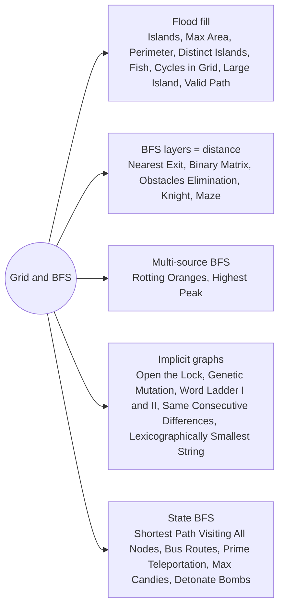

# Grid and BFS: Pattern Map

> [!TIP]
> **🧠 One picture to keep**
> A grid is a **board game map**.
> 1. **Flood fill**: pour paint on one land cell, count one island per bucket.
> 2. **BFS ripple**: the minute rotting spreads, the layer of a maze, the steps of a knight are all BFS layers.
> 3. **Multi-source**: drop many stones in the pond at once (all rotten oranges, all water cells).
> 4. **State BFS**: when position is not enough, the node is (cell, extra state), such as (cell, removals left) or (node, visited-set mask).
> 5. **Implicit graphs**: words, locks, genes and numbers are nodes too; neighbours are generated, not stored.

**All animations:** [▶ Grid and BFS Animations](https://d9-cell.github.io/java-brain/Graph/Grid%20and%20BFS/Grid%20and%20BFS%20Animations.html) · ⬆ [00 Brain Map](../../00%20Brain%20Map.md)

## Java toolkit
| Need | Java |
|---|---|
| Four directions | `int[][] DIRS = {{1, 0}, {-1, 0}, {0, 1}, {0, -1}};` |
| Eight directions | add `{1, 1}, {1, -1}, {-1, 1}, {-1, -1}` |
| In-bounds check | `x >= 0 && x < m && y >= 0 && y < n` |
| Mark visited cheaply | overwrite the grid cell (`'$'`, `-1`, `2`) when mutation is allowed |
| BFS by layers | `for (int size = que.size(); size > 0; size--)` around one level |
| Cell as a key | `i * n + j`, or `((long) x << 32) ^ (y & 0xffffffffL)` for negatives |
| State with extra info | `new int[]{x, y, k}` and `boolean[m][n][k + 1]` |
| Implicit neighbours | build them on the fly: `char[] c = s.toCharArray(); c[i] = ch;` |

## Patterns in this folder

| # | Problem | Pattern | Mantra | Level |
|---|---|---|---|---|
| 1 | [Number of Islands](Number%20of%20Islands.md) | Flood fill, DFS, BFS | NEW LAND ⇒ COUNT++, SINK THE ISLAND | Medium |
| 2 | [Max Area of Island](Max%20Area%20of%20Island.md) | Flood fill, DFS, Union-Find | DFS RETURNS THE SIZE: 1 + SUM OF NEIGHBOURS | Medium |
| 3 | [Island Perimeter](Island%20Perimeter.md) | Counting, DFS, BFS | 4 × LAND − 2 × SHARED EDGES | Easy |
| 4 | [Number of Distinct Islands](Number%20of%20Distinct%20Islands.md) | Flood fill, Shape signature | DFS PATH STRING, WITH BACKTRACK MARKS | Medium |
| 5 | [Detect Cycles in 2D Grid](Detect%20Cycles%20in%202D%20Grid.md) | Undirected cycle, DFS, BFS | VISITED SAME LETTER THAT IS NOT MY PARENT | Medium |
| 6 | [Check if There is a Valid Path in a Grid](Check%20if%20There%20is%20a%20Valid%20Path%20in%20a%20Grid.md) | Grid graph, DFS, BFS | MOVE ONLY IF THE NEIGHBOUR POINTS BACK | Medium |
| 7 | [Rotting Oranges](Rotting%20Oranges.md) | Multi-source BFS | ALL ROTTEN START IN THE QUEUE; LAYER = MINUTE | Medium |
| 8 | [Map of Highest Peak](Map%20of%20Highest%20Peak.md) | Multi-source BFS | HEIGHT = DISTANCE TO NEAREST WATER | Medium |
| 9 | [Maximum Number of Fish in a Grid](Maximum%20Number%20of%20Fish%20in%20a%20Grid.md) | Flood fill, DFS, BFS, Union-Find | DFS RETURNS THE SUM OF THE POND | Medium |
| 10 | [Making A Large Island](Making%20A%20Large%20Island.md) | Flood fill, Island ids, Union-Find | LABEL ONCE; 1 + DISTINCT NEIGHBOUR SIZES | Hard |
| 11 | [Nearest Exit from Entrance in Maze](Nearest%20Exit%20from%20Entrance%20in%20Maze.md) | BFS layers | BFS FROM ENTRANCE; FIRST BORDER CELL | Medium |
| 12 | [Shortest Path in Binary Matrix](Shortest%20Path%20in%20Binary%20Matrix.md) | BFS layers, Dijkstra, 8 directions | BFS, 8 DIRECTIONS, COUNT CELLS | Medium |
| 13 | [Shortest Path in a Grid with Obstacles Elimination](Shortest%20Path%20in%20a%20Grid%20with%20Obstacles%20Elimination.md) | State BFS | STATE = (ROW, COL, REMOVALS USED) | Hard |
| 14 | [The Maze](The%20Maze.md) | BFS on stopping points, DFS | NODE = STOPPING POINT, EDGE = ONE FULL ROLL | Medium |
| 15 | [The Maze II](The%20Maze%20II.md) | Dijkstra on stopping points, DFS | DIJKSTRA ON STOPS, WEIGHT = ROLL LENGTH | Medium |
| 16 | [Minimum Knight Moves](Minimum%20Knight%20Moves.md) | BFS layers, Symmetry | FOLD TO FIRST QUADRANT, ALLOW −2 MARGIN | Medium |
| 17 | [Open the Lock](Open%20the%20Lock.md) | Implicit graph BFS, Bidirectional BFS | STATE = 4-DIGIT STRING; DEADENDS ARE WALLS | Medium |
| 18 | [Minimum Genetic Mutation](Minimum%20Genetic%20Mutation.md) | Implicit graph BFS | ONE LETTER CHANGE, MUST BE IN THE BANK | Medium |
| 19 | [Word Ladder](Word%20Ladder.md) | Implicit graph BFS, Bidirectional BFS | BFS; NEIGHBOUR = ONE LETTER CHANGED AND IN THE LIST | Hard |
| 20 | [Word Ladder II](Word%20Ladder%20II.md) | BFS + backtracking | BFS FOR LEVELS + PARENTS, DFS BACK FROM END | Hard |
| 21 | [Bus Routes](Bus%20Routes.md) | BFS on routes | BOARDING A BUS = ONE EDGE TO ALL ITS STOPS | Hard |
| 22 | [Shortest Path Visiting All Nodes](Shortest%20Path%20Visiting%20All%20Nodes.md) | State BFS, Bitmask | STATE = (NODE, MASK OF VISITED) | Hard |
| 23 | [Numbers With Same Consecutive Differences](Numbers%20With%20Same%20Consecutive%20Differences.md) | Implicit graph, DFS, BFS | APPEND last ± k; SKIP DUPLICATE WHEN k = 0 | Medium |
| 24 | [Lexicographically Smallest String After Applying Operations](Lexicographically%20Smallest%20String%20After%20Applying%20Operations.md) | Implicit graph BFS, DFS | BFS ALL REACHABLE STATES, KEEP THE MIN | Medium |
| 25 | [Minimum Jumps to Reach End via Prime Teleportation](Minimum%20Jumps%20to%20Reach%20End%20via%20Prime%20Teleportation.md) | BFS, Sieve, Implicit edges | GROUP INDICES BY PRIME FACTOR; USE EACH GROUP ONCE | Medium |
| 26 | [Detonate the Maximum Bombs](Detonate%20the%20Maximum%20Bombs.md) | Directed graph, DFS, BFS | EDGE i → j IF j IS INSIDE i'S CIRCLE | Medium |
| 27 | [Maximum Candies You Can Get from Boxes](Maximum%20Candies%20You%20Can%20Get%20from%20Boxes.md) | BFS, DFS, State tracking | OPEN WHEN HAVE BOX AND (OPEN OR KEY) | Hard |

## Suggested learning order
1. Flood fill: [Number of Islands](Number%20of%20Islands.md) ⭐, [Max Area of Island](Max%20Area%20of%20Island.md), [Island Perimeter](Island%20Perimeter.md), [Maximum Number of Fish in a Grid](Maximum%20Number%20of%20Fish%20in%20a%20Grid.md), [Number of Distinct Islands](Number%20of%20Distinct%20Islands.md)
2. Grid graph tricks: [Detect Cycles in 2D Grid](Detect%20Cycles%20in%202D%20Grid.md), [Check if There is a Valid Path in a Grid](Check%20if%20There%20is%20a%20Valid%20Path%20in%20a%20Grid.md), [Making A Large Island](Making%20A%20Large%20Island.md) ⭐, [Detonate the Maximum Bombs](Detonate%20the%20Maximum%20Bombs.md)
3. BFS layers: [Nearest Exit from Entrance in Maze](Nearest%20Exit%20from%20Entrance%20in%20Maze.md), [Shortest Path in Binary Matrix](Shortest%20Path%20in%20Binary%20Matrix.md) ⭐, [Rotting Oranges](Rotting%20Oranges.md) ⭐, [Map of Highest Peak](Map%20of%20Highest%20Peak.md)
4. Implicit graphs: [Open the Lock](Open%20the%20Lock.md), [Minimum Genetic Mutation](Minimum%20Genetic%20Mutation.md), [Word Ladder](Word%20Ladder.md) ⭐, [Word Ladder II](Word%20Ladder%20II.md), [Numbers With Same Consecutive Differences](Numbers%20With%20Same%20Consecutive%20Differences.md), [Lexicographically Smallest String After Applying Operations](Lexicographically%20Smallest%20String%20After%20Applying%20Operations.md)
5. Extra state: [Shortest Path in a Grid with Obstacles Elimination](Shortest%20Path%20in%20a%20Grid%20with%20Obstacles%20Elimination.md) ⭐, [Shortest Path Visiting All Nodes](Shortest%20Path%20Visiting%20All%20Nodes.md) ⭐, [Bus Routes](Bus%20Routes.md), [Minimum Jumps to Reach End via Prime Teleportation](Minimum%20Jumps%20to%20Reach%20End%20via%20Prime%20Teleportation.md), [Maximum Candies You Can Get from Boxes](Maximum%20Candies%20You%20Can%20Get%20from%20Boxes.md)
6. Rolling and knights: [The Maze](The%20Maze.md), [The Maze II](The%20Maze%20II.md), [Minimum Knight Moves](Minimum%20Knight%20Moves.md)

## Connections to other folders
- Graph basics (adjacency lists, cycles): [Graph Basics](../Graph%20Basics/Graph%20Basics%20-%20Pattern%20Map.md)
- Weighted grid paths (Dijkstra): [Shortest Paths](../Shortest%20Paths/Shortest%20Paths%20-%20Pattern%20Map.md)
- Union-Find versions of islands: [Disjoint Set](../Disjoint%20Set/Disjoint%20Set%20-%20Pattern%20Map.md)
- Backtracking on grids: [Backtracking](../../Backtracking/Backtracking%20-%20Pattern%20Map.md)
