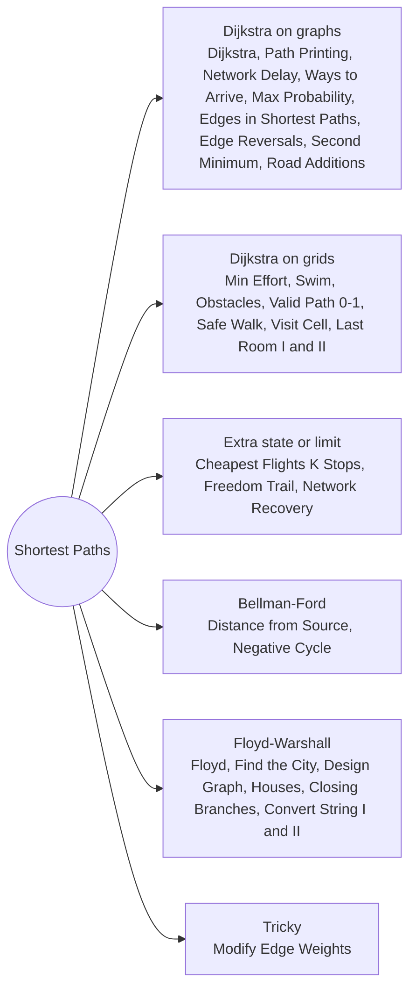

# Shortest Paths: Pattern Map

> [!TIP]
> **🧠 One picture to keep**
> A **GPS**.
> 1. **Dijkstra**: the tide of distance rises evenly; the first time it touches a node is that node's final distance.
> 2. **Heap** keeps the next closest; stale entries are skipped.
> 3. **Max instead of sum**: "biggest climb", "highest water" are still Dijkstra.
> 4. **0-1 BFS**: free moves go to the front of a deque, costly moves to the back.
> 5. **Bellman-Ford**: ask every road "can you improve anyone?" over and over; one extra round that still improves means a negative cycle.
> 6. **Floyd-Warshall**: try every city as a stop-over for every pair.

**All animations:** [▶ Shortest Paths Animations](https://d9-cell.github.io/java-brain/Graph/Shortest%20Paths/Shortest%20Paths%20Animations.html) · ⬆ [00 Brain Map](../../00%20Brain%20Map.md)

## Java toolkit
| Need | Java |
|---|---|
| Min-heap of (dist, node) | `new PriorityQueue<>((a, b) -> a[0] - b[0])` |
| Skip stale heap entries | `if (d > dist[u]) continue;` |
| Infinity | `Integer.MAX_VALUE` (never add to it) or `Long.MAX_VALUE / 4`; use `long` for sums |
| Path reconstruction | `parent[v] = u` on every relaxation, walk back from the target |
| 0-1 BFS | `ArrayDeque` with `addFirst` (weight 0) and `addLast` (weight 1) |
| Max-heap | `(a, b) -> Double.compare(b[0], a[0])` |
| Grid Dijkstra | `int[]{value, row, col}` in the heap, `dist[m][n]` filled with MAX |
| State with extra info | `dist[node][parity]`, `dist[node][stops]`, `dist[cell][k]` |
| All pairs | triple loop with the **via** node outermost |

## Patterns in this folder

| # | Problem | Pattern | Mantra | Level |
|---|---|---|---|---|
| 1 | [Dijkstra's Algorithm](Dijkstra%27s%20Algorithm.md) | Dijkstra, Min-heap | SETTLE THE CLOSEST; RELAX ITS EDGES | Medium |
| 2 | [Shortest Path in Weighted Undirected Graph](Shortest%20Path%20in%20Weighted%20Undirected%20Graph.md) | Dijkstra, Path reconstruction | parent[v] = u ON EVERY IMPROVEMENT | Medium |
| 3 | [Network Delay Time](Network%20Delay%20Time.md) | Dijkstra, Bellman-Ford | MAX OF THE SHORTEST DISTANCES | Medium |
| 4 | [Path With Minimum Effort](Path%20With%20Minimum%20Effort.md) | Minimax Dijkstra, Binary search | COST = max(previous, this step) | Medium |
| 5 | [Cheapest Flights Within K Stops](Cheapest%20Flights%20Within%20K%20Stops.md) | Bellman-Ford rounds, Level BFS, State Dijkstra | ONE ROUND = ONE FLIGHT; RELAX FROM A COPY | Medium |
| 6 | [Swim in Rising Water](Swim%20in%20Rising%20Water.md) | Minimax Dijkstra, Binary search, Union-Find | TIME = HIGHEST CELL ON THE PATH | Hard |
| 7 | [Path with Maximum Probability](Path%20with%20Maximum%20Probability.md) | Dijkstra with a max-heap, Bellman-Ford | MAX-HEAP; MULTIPLY INSTEAD OF ADD | Medium |
| 8 | [Number of Ways to Arrive at Destination](Number%20of%20Ways%20to%20Arrive%20at%20Destination.md) | Dijkstra, Counting paths | SHORTER ⇒ COPY THE COUNT; EQUAL ⇒ ADD THE COUNT | Medium |
| 9 | [Minimum Obstacle Removal to Reach Corner](Minimum%20Obstacle%20Removal%20to%20Reach%20Corner.md) | 0-1 BFS, Dijkstra | 0-1 BFS: weight 0 → addFirst, weight 1 → addLast | Hard |
| 10 | [Minimum Cost to Make at Least One Valid Path in a Grid](Minimum%20Cost%20to%20Make%20at%20Least%20One%20Valid%20Path%20in%20a%20Grid.md) | 0-1 BFS, Dijkstra | FOLLOW THE ARROW = 0, ANY OTHER DIRECTION = 1 | Hard |
| 11 | [Find a Safe Walk Through a Grid](Find%20a%20Safe%20Walk%20Through%20a%20Grid.md) | 0-1 BFS, Dijkstra | LEAST DAMAGE, THEN health − damage ≥ 1 | Medium |
| 12 | [Minimum Time to Visit a Cell In a Grid](Minimum%20Time%20to%20Visit%20a%20Cell%20In%20a%20Grid.md) | Dijkstra on time, Parity | ARRIVE EARLY ⇒ WAIT IN STEPS OF 2 | Hard |
| 13 | [Find Minimum Time to Reach Last Room I](Find%20Minimum%20Time%20to%20Reach%20Last%20Room%20I.md) | Dijkstra on time | finish = max(now, opening) + 1 | Medium |
| 14 | [Find Minimum Time to Reach Last Room II](Find%20Minimum%20Time%20to%20Reach%20Last%20Room%20II.md) | Dijkstra with parity state | STATE = (CELL, MOVES MOD 2) | Medium |
| 15 | [Second Minimum Time to Reach Destination](Second%20Minimum%20Time%20to%20Reach%20Destination.md) | BFS with two distances, Traffic lights | FIRST AND SECOND DISTINCT EDGE COUNTS, THEN CLOCK IT | Hard |
| 16 | [Shortest Distance After Road Addition Queries I](Shortest%20Distance%20After%20Road%20Addition%20Queries%20I.md) | BFS per query, Dijkstra | ADD EDGE, RE-RUN BFS | Medium |
| 17 | [Find Edges in Shortest Paths](Find%20Edges%20in%20Shortest%20Paths.md) | Two-ended Dijkstra | dist0[u] + w + distEnd[v] == shortest | Hard |
| 18 | [Modify Graph Edge Weights](Modify%20Graph%20Edge%20Weights.md) | Two-pass Dijkstra | PASS 1 WITH -1 AS 1; PASS 2 RAISES EACH -1 JUST ENOUGH | Hard |
| 19 | [Network Recovery Pathways](Network%20Recovery%20Pathways.md) | Binary search on answer, Dijkstra | BINARY SEARCH THE MIN EDGE; DIJKSTRA FOR THE BUDGET | Hard |
| 20 | [Minimum Cost Path with Edge Reversals](Minimum%20Cost%20Path%20with%20Edge%20Reversals.md) | Dijkstra on an augmented graph | ADD v → u WITH COST 2w, THEN DIJKSTRA | Medium |
| 21 | [Freedom Trail](Freedom%20Trail.md) | Dijkstra, DP on (position, index) | STATE = (RING POSITION, KEY INDEX); COST = SHORT ROTATION + 1 | Hard |
| 22 | [Minimum Cost to Convert String I](Minimum%20Cost%20to%20Convert%20String%20I.md) | Dijkstra, Floyd-Warshall | 26-NODE GRAPH; SUM THE CHEAPEST CONVERSION PER POSITION | Medium |
| 23 | [Minimum Cost to Convert String II](Minimum%20Cost%20to%20Convert%20String%20II.md) | Floyd-Warshall, Dijkstra, DP over positions | DIST BETWEEN RULE STRINGS + dp[i] OVER POSITIONS | Hard |
| 24 | [Design Graph With Shortest Path Calculator](Design%20Graph%20With%20Shortest%20Path%20Calculator.md) | Design, Dijkstra, Floyd-Warshall | DIJKSTRA PER QUERY OR FLOYD TABLE PATCHED IN O(n²) | Hard |
| 25 | [Find the City With the Smallest Number of Neighbors at a Threshold Distance](Find%20the%20City%20With%20the%20Smallest%20Number%20of%20Neighbors%20at%20a%20Threshold%20Distance.md) | Floyd-Warshall, Dijkstra, Bellman-Ford | ALL PAIRS, THEN COUNT d ≤ threshold | Medium |
| 26 | [Distance from the Source (Bellman-Ford Algorithm)](Distance%20from%20the%20Source%20%28Bellman-Ford%20Algorithm%29.md) | Bellman-Ford, Negative edges | RELAX ALL EDGES V − 1 TIMES; ONE MORE IMPROVEMENT = NEGATIVE CYCLE | Medium |
| 27 | [Negative Weight Cycle](Negative%20Weight%20Cycle.md) | Bellman-Ford, Cycle detection | STILL IMPROVING IN ROUND n ⇒ NEGATIVE CYCLE | Medium |
| 28 | [Floyd Warshall](Floyd%20Warshall.md) | Floyd-Warshall, All pairs | via OUTERMOST: d[i][j] = min(d[i][j], d[i][via] + d[via][j]) | Medium |
| 29 | [Count the Number of Houses at a Certain Distance I](Count%20the%20Number%20of%20Houses%20at%20a%20Certain%20Distance%20I.md) | Floyd-Warshall, BFS | LINE + ONE EXTRA EDGE, THEN ALL PAIRS | Medium |
| 30 | [Number of Possible Sets of Closing Branches](Number%20of%20Possible%20Sets%20of%20Closing%20Branches.md) | Bitmask subsets, Floyd-Warshall | 2ⁿ SUBSETS × FLOYD INSIDE THE SUBSET | Hard |

## Suggested learning order
1. Core: [Dijkstra's Algorithm](Dijkstra%27s%20Algorithm.md) ⭐, [Shortest Path in Weighted Undirected Graph](Shortest%20Path%20in%20Weighted%20Undirected%20Graph.md), [Network Delay Time](Network%20Delay%20Time.md) ⭐, [Path With Minimum Effort](Path%20With%20Minimum%20Effort.md) ⭐, [Swim in Rising Water](Swim%20in%20Rising%20Water.md)
2. Variants of the cost: [Path with Maximum Probability](Path%20with%20Maximum%20Probability.md), [Number of Ways to Arrive at Destination](Number%20of%20Ways%20to%20Arrive%20at%20Destination.md) ⭐, [Minimum Obstacle Removal to Reach Corner](Minimum%20Obstacle%20Removal%20to%20Reach%20Corner.md), [Minimum Cost to Make at Least One Valid Path in a Grid](Minimum%20Cost%20to%20Make%20at%20Least%20One%20Valid%20Path%20in%20a%20Grid.md), [Find a Safe Walk Through a Grid](Find%20a%20Safe%20Walk%20Through%20a%20Grid.md)
3. Time-dependent: [Minimum Time to Visit a Cell In a Grid](Minimum%20Time%20to%20Visit%20a%20Cell%20In%20a%20Grid.md), [Find Minimum Time to Reach Last Room I](Find%20Minimum%20Time%20to%20Reach%20Last%20Room%20I.md), [Find Minimum Time to Reach Last Room II](Find%20Minimum%20Time%20to%20Reach%20Last%20Room%20II.md), [Second Minimum Time to Reach Destination](Second%20Minimum%20Time%20to%20Reach%20Destination.md)
4. State or limit: [Cheapest Flights Within K Stops](Cheapest%20Flights%20Within%20K%20Stops.md) ⭐, [Freedom Trail](Freedom%20Trail.md), [Network Recovery Pathways](Network%20Recovery%20Pathways.md), [Minimum Cost Path with Edge Reversals](Minimum%20Cost%20Path%20with%20Edge%20Reversals.md)
5. Bellman-Ford and Floyd-Warshall: [Distance from the Source (Bellman-Ford Algorithm)](Distance%20from%20the%20Source%20%28Bellman-Ford%20Algorithm%29.md), [Negative Weight Cycle](Negative%20Weight%20Cycle.md), [Floyd Warshall](Floyd%20Warshall.md), [Find the City With the Smallest Number of Neighbors at a Threshold Distance](Find%20the%20City%20With%20the%20Smallest%20Number%20of%20Neighbors%20at%20a%20Threshold%20Distance.md) ⭐, [Design Graph With Shortest Path Calculator](Design%20Graph%20With%20Shortest%20Path%20Calculator.md)
6. Harder: [Find Edges in Shortest Paths](Find%20Edges%20in%20Shortest%20Paths.md), [Modify Graph Edge Weights](Modify%20Graph%20Edge%20Weights.md), [Minimum Cost to Convert String I](Minimum%20Cost%20to%20Convert%20String%20I.md), [Minimum Cost to Convert String II](Minimum%20Cost%20to%20Convert%20String%20II.md), [Shortest Distance After Road Addition Queries I](Shortest%20Distance%20After%20Road%20Addition%20Queries%20I.md), [Count the Number of Houses at a Certain Distance I](Count%20the%20Number%20of%20Houses%20at%20a%20Certain%20Distance%20I.md), [Number of Possible Sets of Closing Branches](Number%20of%20Possible%20Sets%20of%20Closing%20Branches.md)

## Connections to other folders
- Unweighted version (BFS layers): [Grid and BFS](../Grid%20and%20BFS/Grid%20and%20BFS%20-%20Pattern%20Map.md)
- Union-Find alternatives to minimax paths: [Disjoint Set](../Disjoint%20Set/Disjoint%20Set%20-%20Pattern%20Map.md)
- Minimax by binary search: [Trees and Advanced Graphs](../Trees%20and%20Advanced%20Graphs/Trees%20and%20Advanced%20Graphs%20-%20Pattern%20Map.md)
- Spanning trees (cheapest connection, not path): [Spanning Trees and Euler](../Spanning%20Trees%20and%20Euler/Spanning%20Trees%20and%20Euler%20-%20Pattern%20Map.md)
