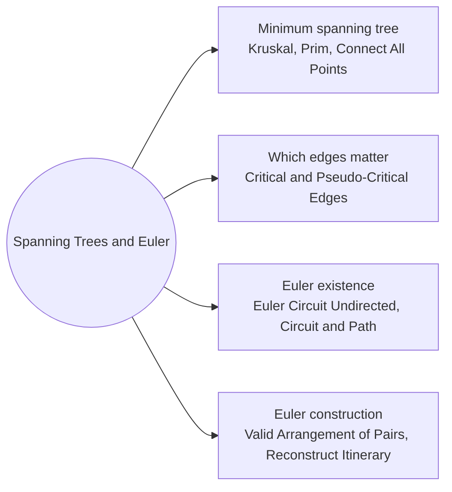

# Spanning Trees and Euler: Pattern Map

> [!TIP]
> **🧠 One picture to keep**
> Two classic tours.
> 1. **MST = cheapest road network** that keeps every town connected: no loops, V − 1 roads.
> 2. **Kruskal** buys the cheapest road anywhere that links two still-separate regions.
> 3. **Prim** grows a single region outward, always buying the cheapest road leaving it.
> 4. **Euler** = a postman who walks every street exactly once: odd intersections can only be the start and the end.
> 5. **Hierholzer**: walk until stuck, then backtrack and splice in the side loops.

**All animations:** [▶ Spanning Trees and Euler Animations](https://d9-cell.github.io/java-brain/Graph/Spanning%20Trees%20and%20Euler/Spanning%20Trees%20and%20Euler%20Animations.html) · ⬆ [00 Brain Map](../../00%20Brain%20Map.md)

## Java toolkit
| Need | Java |
|---|---|
| Sort edges by weight | `Arrays.sort(edges, (a, b) -> a[2] - b[2])` |
| Cycle test for Kruskal | Union-Find: `find(a) == find(b)` means skip |
| Prim heap | `PriorityQueue<int[]>` of `{cost, node}`; skip nodes already in the tree |
| Dense Prim | `best[]` array and an O(n²) scan, no edge list |
| MST complete? | `used == V - 1` edges, else the graph is disconnected |
| Euler degrees | `adj.get(v).size() % 2` for undirected; `out - in` for directed |
| Hierholzer | stack of nodes, `poll` an unused edge, otherwise pop into the path, reverse at the end |
| Smallest-first edges | `PriorityQueue<String>` per airport (itinerary) |

## Patterns in this folder

| # | Problem | Pattern | Mantra | Level |
|---|---|---|---|---|
| 1 | [Minimum Spanning Tree (Kruskal's Algorithm)](Minimum%20Spanning%20Tree%20%28Kruskal%27s%20Algorithm%29.md) | Kruskal, Union-Find, Greedy | SORT EDGES; TAKE IF find(a) != find(b) | Medium |
| 2 | [Minimum Spanning Tree (Prim's Algorithm)](Minimum%20Spanning%20Tree%20%28Prim%27s%20Algorithm%29.md) | Prim, Min-heap | CHEAPEST EDGE LEAVING THE TREE | Medium |
| 3 | [Min Cost to Connect All Points](Min%20Cost%20to%20Connect%20All%20Points.md) | Prim, Kruskal, Complete graph | PRIM WITH best[] ARRAY, O(n²) | Medium |
| 4 | [Find Critical and Pseudo-Critical Edges in Minimum Spanning Tree](Find%20Critical%20and%20Pseudo-Critical%20Edges%20in%20Minimum%20Spanning%20Tree.md) | Kruskal, MST variants | CRITICAL: WITHOUT IT THE MST GETS HEAVIER. PSEUDO: FORCED IN STILL EQUALS THE MST. | Hard |
| 5 | [Euler Circuit in an Undirected Graph](Euler%20Circuit%20in%20an%20Undirected%20Graph.md) | Euler circuit, Degrees | ALL DEGREES EVEN AND ALL EDGES CONNECTED | Medium |
| 6 | [Euler Circuit and Path](Euler%20Circuit%20and%20Path.md) | Euler path, Degrees | 0 ODD ⇒ CIRCUIT; 2 ODD ⇒ PATH; ELSE NONE | Medium |
| 7 | [Valid Arrangement of Pairs](Valid%20Arrangement%20of%20Pairs.md) | Euler path, Hierholzer, Directed graph | START AT out − in = 1; WALK UNTIL STUCK; REVERSE | Hard |
| 8 | [Reconstruct Itinerary](Reconstruct%20Itinerary.md) | Euler path, Hierholzer, Lexicographic order | SMALLEST TICKET FIRST; ADD AIRPORT TO THE FRONT AFTER ALL ITS TICKETS ARE USED | Hard |

## Suggested learning order
1. MST: [Minimum Spanning Tree (Kruskal's Algorithm)](Minimum%20Spanning%20Tree%20%28Kruskal%27s%20Algorithm%29.md) ⭐, [Minimum Spanning Tree (Prim's Algorithm)](Minimum%20Spanning%20Tree%20%28Prim%27s%20Algorithm%29.md) ⭐, [Min Cost to Connect All Points](Min%20Cost%20to%20Connect%20All%20Points.md) ⭐
2. Which edges matter: [Find Critical and Pseudo-Critical Edges in Minimum Spanning Tree](Find%20Critical%20and%20Pseudo-Critical%20Edges%20in%20Minimum%20Spanning%20Tree.md)
3. Euler existence: [Euler Circuit in an Undirected Graph](Euler%20Circuit%20in%20an%20Undirected%20Graph.md), [Euler Circuit and Path](Euler%20Circuit%20and%20Path.md)
4. Euler construction: [Valid Arrangement of Pairs](Valid%20Arrangement%20of%20Pairs.md) ⭐, [Reconstruct Itinerary](Reconstruct%20Itinerary.md) ⭐

## Connections to other folders
- Union-Find (the engine of Kruskal): [Disjoint Set](../Disjoint%20Set/Disjoint%20Set%20-%20Pattern%20Map.md)
- Shortest paths versus spanning trees: [Shortest Paths](../Shortest%20Paths/Shortest%20Paths%20-%20Pattern%20Map.md)
- Hamiltonian-style subset search lives in [Bit Magic](../../Bit_Magic/Bit%20Magic%20-%20Pattern%20Map.md) and [Backtracking](../../Backtracking/Backtracking%20-%20Pattern%20Map.md)
