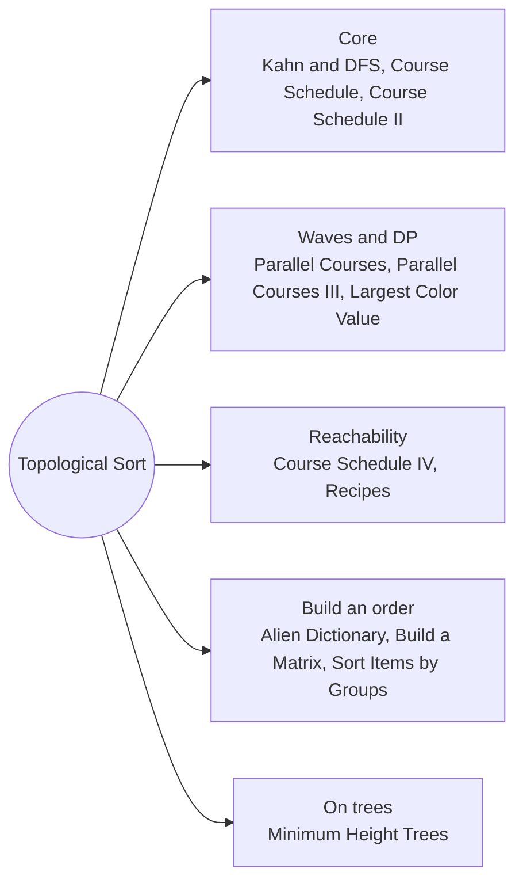

# Topological Sort: Pattern Map

> [!TIP]
> **🧠 One picture to keep**
> Getting dressed: **socks before shoes**.
> 1. **Kahn** = repeatedly pick something with nothing left to wait for.
> 2. **A leftover** that never reaches zero means two things wait for each other: a cycle.
> 3. **Waves** of Kahn = rounds / semesters; the number of waves is the longest chain.
> 4. **DP on the order**: finish[v] = max(finish[u]) + cost: the longest path in a DAG.
> 5. **DFS version**: put a node down only after everything that depends on it.
> 6. **Peeling leaves** (degree 1) is Kahn on a tree: it finds the centre.

**All animations:** [▶ Topological Sort Animations](https://d9-cell.github.io/java-brain/Graph/Topological%20Sort/Topological%20Sort%20Animations.html) · ⬆ [00 Brain Map](../../00%20Brain%20Map.md)

## Java toolkit
| Need | Java |
|---|---|
| In-degree | `int[] indegree = new int[n]; for (edge u -> v) indegree[v]++;` |
| Queue of ready nodes | `Queue<Integer> que = new ArrayDeque<>()` |
| Kahn loop | `u = que.poll(); order.add(u); for (v : adj[u]) if (--indegree[v] == 0) que.add(v);` |
| Cycle test | `order.size() != n` |
| By waves | `for (int size = que.size(); size > 0; size--)` inside `while` |
| Longest path DP | `finish[v] = Math.max(finish[v], finish[u] + time[v])` while relaxing |
| DFS order | three states (0 new, 1 on path, 2 done), `stack.push(u)` after the loop |
| Names as nodes | `Map<String, List<String>>` and `Map<String, Integer>` for in-degree |

## Patterns in this folder

| # | Problem | Pattern | Mantra | Level |
|---|---|---|---|---|
| 1 | [Topological Sort (BFS - Kahn's Algorithm)](Topological%20Sort%20%28BFS%20-%20Kahn%27s%20Algorithm%29.md) | Kahn, DFS finish order | INDEGREE 0 ⇒ GO; LOWER THE REST | Medium |
| 2 | [Course Schedule](Course%20Schedule.md) | Kahn, Cycle check | ALL COURSES REMOVED ⇔ NO CYCLE | Medium |
| 3 | [Course Schedule II](Course%20Schedule%20II.md) | Kahn, DFS | REMOVAL ORDER = STUDY ORDER | Medium |
| 4 | [Course Schedule IV](Course%20Schedule%20IV.md) | Reachability, Kahn, Floyd-Warshall | CHILD INHERITS PARENT + PARENT'S PREREQUISITES | Medium |
| 5 | [Alien Dictionary](Alien%20Dictionary.md) | Build the graph, Kahn, DFS | FIRST DIFFERING LETTER ⇒ EDGE; PREFIX TRAP ⇒ "" | Hard |
| 6 | [Build a Matrix With Conditions](Build%20a%20Matrix%20With%20Conditions.md) | Two topological sorts | SORT ROWS, SORT COLUMNS, PLACE v AT (rowPos, colPos) | Hard |
| 7 | [Find All Possible Recipes from Given Supplies](Find%20All%20Possible%20Recipes%20from%20Given%20Supplies.md) | Kahn, Named nodes | MISSING-INGREDIENT COUNT IS THE INDEGREE | Medium |
| 8 | [Largest Color Value in a Directed Graph](Largest%20Color%20Value%20in%20a%20Directed%20Graph.md) | Kahn + DP, Cycle check | count[v][c] = max over parents; ADD OWN COLOUR WHEN PROCESSED | Hard |
| 9 | [Minimum Height Trees](Minimum%20Height%20Trees.md) | Leaf peeling, Tree centre | REMOVE ALL LEAVES UNTIL ≤ 2 NODES REMAIN | Medium |
| 10 | [Parallel Courses](Parallel%20Courses.md) | Kahn by waves | ONE KAHN WAVE = ONE SEMESTER | Medium |
| 11 | [Parallel Courses III](Parallel%20Courses%20III.md) | Kahn + longest path, DP on a DAG | finish[v] = max(finish[u]) + time[v] | Hard |
| 12 | [Sort Items by Groups Respecting Dependencies](Sort%20Items%20by%20Groups%20Respecting%20Dependencies.md) | Two-level topological sort | TOPO THE GROUPS, TOPO THE ITEMS, GROUP BY GROUP | Hard |

## Suggested learning order
1. Core: [Topological Sort (BFS - Kahn's Algorithm)](Topological%20Sort%20%28BFS%20-%20Kahn%27s%20Algorithm%29.md) ⭐, [Course Schedule](Course%20Schedule.md) ⭐, [Course Schedule II](Course%20Schedule%20II.md) ⭐
2. Waves and DP: [Parallel Courses](Parallel%20Courses.md), [Parallel Courses III](Parallel%20Courses%20III.md) ⭐, [Largest Color Value in a Directed Graph](Largest%20Color%20Value%20in%20a%20Directed%20Graph.md)
3. Reachability and names: [Course Schedule IV](Course%20Schedule%20IV.md), [Find All Possible Recipes from Given Supplies](Find%20All%20Possible%20Recipes%20from%20Given%20Supplies.md)
4. Build an order: [Alien Dictionary](Alien%20Dictionary.md) ⭐, [Build a Matrix With Conditions](Build%20a%20Matrix%20With%20Conditions.md), [Sort Items by Groups Respecting Dependencies](Sort%20Items%20by%20Groups%20Respecting%20Dependencies.md)
5. On trees: [Minimum Height Trees](Minimum%20Height%20Trees.md)

## Connections to other folders
- Directed cycle detection by DFS colours: [Graph Basics](../Graph%20Basics/Graph%20Basics%20-%20Pattern%20Map.md)
- Safe nodes via Kahn on the reversed graph: [Find Eventual Safe States](../Graph%20Basics/Find%20Eventual%20Safe%20States.md)
- Ancestors via topological order: [All Ancestors of a Node in a Directed Acyclic Graph](../Graph%20Basics/All%20Ancestors%20of%20a%20Node%20in%20a%20Directed%20Acyclic%20Graph.md)
- Longest path / DP on DAGs: [Shortest Paths](../Shortest%20Paths/Shortest%20Paths%20-%20Pattern%20Map.md)
