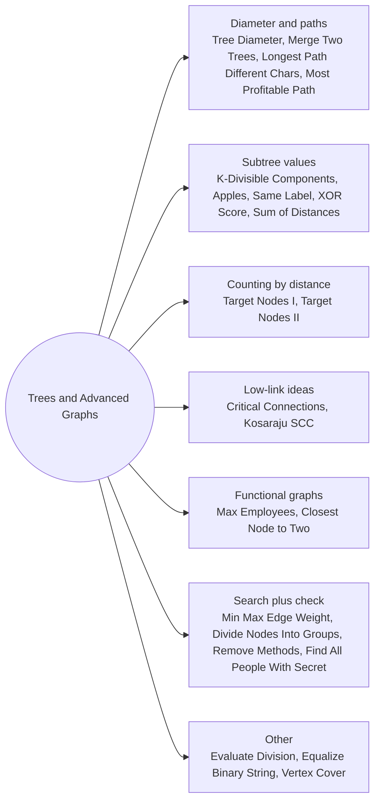

# Trees and Advanced Graphs: Pattern Map

> [!TIP]
> **🧠 One picture to keep**
> A tree is a **family tree with no marriages between cousins**: only one way between any two people.
> 1. **Down pass**: each node asks its children and combines their answers (height, sum, count).
> 2. **Diameter**: the best path bends at one node and uses its two tallest children.
> 3. **Re-rooting**: first answer for the root, then slide the root across each edge in O(1).
> 4. **Bridges**: if the far side cannot climb back above you, the edge is a bridge (low > tin).
> 5. **Functional graphs** (≤ 1 outgoing edge): every component holds exactly one cycle with trees hanging into it.

**All animations:** [▶ Trees and Advanced Graphs Animations](https://d9-cell.github.io/java-brain/Graph/Trees%20and%20Advanced%20Graphs/Trees%20and%20Advanced%20Graphs%20Animations.html) · ⬆ [00 Brain Map](../../00%20Brain%20Map.md)

## Java toolkit
| Need | Java |
|---|---|
| Rooted tree from parent[] | `children.get(parent[i]).add(i)` for i ≥ 1 |
| Skip the parent in DFS | `if (v == parent) continue;` (no visited array needed in a tree) |
| Two tallest children | keep `top1`, `top2` while looping the children |
| Subtree size / xor / sum | return it from the DFS and add the children's values |
| Euler times | `tin[u] = timer++` on entry, `tout[u] = timer++` on exit; ancestor test `tin[u] <= tin[v] && tout[v] <= tout[u]` |
| Binary search on the answer | `while (low <= high)` with a feasibility check that is monotone |
| Bridges | `low[u] = min(low[u], tin[v])` for back edges; bridge if `low[v] > tin[u]` |
| Deep recursion | a path-shaped tree of 1e5 nodes overflows the stack: use BFS or iterate |

## Patterns in this folder

| # | Problem | Pattern | Mantra | Level |
|---|---|---|---|---|
| 1 | [Tree Diameter](Tree%20Diameter.md) | Two BFS, Tree DP | FARTHEST FROM ANYWHERE, THEN FARTHEST FROM THAT | Medium |
| 2 | [Find Minimum Diameter After Merging Two Trees](Find%20Minimum%20Diameter%20After%20Merging%20Two%20Trees.md) | Tree diameter, Centres | JOIN THE CENTRES: max(d1, d2, ⌈d1/2⌉ + ⌈d2/2⌉ + 1) | Hard |
| 3 | [Maximize the Number of Target Nodes After Connecting Trees I](Maximize%20the%20Number%20of%20Target%20Nodes%20After%20Connecting%20Trees%20I.md) | BFS within distance k, Two trees | OWN TREE WITHIN k + BEST OF OTHER TREE WITHIN k − 1 | Medium |
| 4 | [Maximize the Number of Target Nodes After Connecting Trees II](Maximize%20the%20Number%20of%20Target%20Nodes%20After%20Connecting%20Trees%20II.md) | Parity, Tree colouring | EVEN DISTANCE = SAME COLOUR; ATTACH FOR THE BIGGER OTHER CLASS | Hard |
| 5 | [Most Profitable Path in a Tree](Most%20Profitable%20Path%20in%20a%20Tree.md) | Tree DFS, Two walkers | BOB'S TIMES FIRST, THEN ALICE'S BEST ROOT-TO-LEAF | Medium |
| 6 | [Maximum Number of K-Divisible Components](Maximum%20Number%20of%20K-Divisible%20Components.md) | Tree DP, Subtree sums mod k | SUBTREE SUM % k == 0 ⇒ CUT | Hard |
| 7 | [Minimum Time to Collect All Apples in a Tree](Minimum%20Time%20to%20Collect%20All%20Apples%20in%20a%20Tree.md) | Tree DFS | EDGE COSTS 2 IF ITS SUBTREE HAS AN APPLE | Medium |
| 8 | [Longest Path With Different Adjacent Characters](Longest%20Path%20With%20Different%20Adjacent%20Characters.md) | Tree DP, Two best children | TOP TWO VALID CHILD CHAINS + 1 | Hard |
| 9 | [Sum of Distances in Tree](Sum%20of%20Distances%20in%20Tree.md) | Re-rooting, Tree DP | ANS[child] = ANS[parent] − size + (n − size) | Hard |
| 10 | [Number of Nodes in the Sub-Tree With the Same Label](Number%20of%20Nodes%20in%20the%20Sub-Tree%20With%20the%20Same%20Label.md) | Tree DFS, Counting | RETURN A 26-LETTER COUNT UPWARD | Medium |
| 11 | [Minimum Score After Removals on a Tree](Minimum%20Score%20After%20Removals%20on%20a%20Tree.md) | Subtree xor, Euler times | TRY EVERY PAIR OF NODES; xor FROM ANCESTOR RELATION | Hard |
| 12 | [Critical Connections in a Network](Critical%20Connections%20in%20a%20Network.md) | Bridges, Tarjan low-link | low[v] > tin[u] ⇒ u–v IS A BRIDGE | Hard |
| 13 | [Strongly Connected Components (Kosaraju's Algo)](Strongly%20Connected%20Components%20%28Kosaraju%27s%20Algo%29.md) | SCC, Two-pass DFS, Tarjan | FINISH ORDER, REVERSE EDGES, DFS IN REVERSE ORDER | Hard |
| 14 | [Vertex Cover](Vertex%20Cover.md) | Binary search, Bit subsets, Gosper's hack | MONOTONE IN k ⇒ BINARY SEARCH; TRY ALL k-SUBSETS | Hard |
| 15 | [Divide Nodes Into the Maximum Number of Groups](Divide%20Nodes%20Into%20the%20Maximum%20Number%20of%20Groups.md) | Bipartite, BFS depth, Components | BIPARTITE CHECK + DEEPEST BFS PER COMPONENT, SUMMED | Hard |
| 16 | [Maximum Employees to Be Invited to a Meeting](Maximum%20Employees%20to%20Be%20Invited%20to%20a%20Meeting.md) | Functional graph, Kahn, Cycles | MAX(LONGEST CYCLE, SUM OF 2-CYCLES + THEIR CHAINS) | Hard |
| 17 | [Evaluate Division](Evaluate%20Division.md) | Weighted graph, DFS, Floyd-Warshall | a/b = w ⇒ EDGES a→b = w AND b→a = 1/w; MULTIPLY ALONG THE PATH | Medium |
| 18 | [Minimum Operations to Equalize Binary String](Minimum%20Operations%20to%20Equalize%20Binary%20String.md) | BFS on counts, Ordered sets | STATE = NUMBER OF ZEROS; NEXT = z + k − 2f | Hard |
| 19 | [Remove Methods From Project](Remove%20Methods%20From%20Project.md) | DFS, BFS, In-degree | MARK DOOMED GROUP, THEN CHECK EXTERNAL CALLERS | Medium |
| 20 | [Find All People With Secret](Find%20All%20People%20With%20Secret.md) | Time-ordered BFS, Union-Find, Dijkstra | SORT BY TIME; SPREAD INSIDE EACH TIME SLOT | Hard |
| 21 | [Find Closest Node to Given Two Nodes](Find%20Closest%20Node%20to%20Given%20Two%20Nodes.md) | Functional graph, BFS | MIN OF MAX(d1, d2); TIES → SMALLER INDEX | Medium |
| 22 | [Minimize the Maximum Edge Weight of Graph](Minimize%20the%20Maximum%20Edge%20Weight%20of%20Graph.md) | Binary search on answer, Reverse graph, Minimax Dijkstra | BINARY SEARCH w; REVERSED BFS FROM 0 USING EDGES ≤ w | Medium |

## Suggested learning order
1. Basics on trees: [Tree Diameter](Tree%20Diameter.md) ⭐, [Minimum Time to Collect All Apples in a Tree](Minimum%20Time%20to%20Collect%20All%20Apples%20in%20a%20Tree.md), [Number of Nodes in the Sub-Tree With the Same Label](Number%20of%20Nodes%20in%20the%20Sub-Tree%20With%20the%20Same%20Label.md), [Maximum Number of K-Divisible Components](Maximum%20Number%20of%20K-Divisible%20Components.md), [Longest Path With Different Adjacent Characters](Longest%20Path%20With%20Different%20Adjacent%20Characters.md)
2. Re-rooting and Euler times: [Sum of Distances in Tree](Sum%20of%20Distances%20in%20Tree.md) ⭐, [Minimum Score After Removals on a Tree](Minimum%20Score%20After%20Removals%20on%20a%20Tree.md), [Most Profitable Path in a Tree](Most%20Profitable%20Path%20in%20a%20Tree.md)
3. Two trees and parity: [Find Minimum Diameter After Merging Two Trees](Find%20Minimum%20Diameter%20After%20Merging%20Two%20Trees.md), [Maximize the Number of Target Nodes After Connecting Trees I](Maximize%20the%20Number%20of%20Target%20Nodes%20After%20Connecting%20Trees%20I.md), [Maximize the Number of Target Nodes After Connecting Trees II](Maximize%20the%20Number%20of%20Target%20Nodes%20After%20Connecting%20Trees%20II.md)
4. Low-link ideas: [Critical Connections in a Network](Critical%20Connections%20in%20a%20Network.md) ⭐, [Strongly Connected Components (Kosaraju's Algo)](Strongly%20Connected%20Components%20%28Kosaraju%27s%20Algo%29.md) ⭐
5. Functional graphs: [Find Closest Node to Given Two Nodes](Find%20Closest%20Node%20to%20Given%20Two%20Nodes.md), [Maximum Employees to Be Invited to a Meeting](Maximum%20Employees%20to%20Be%20Invited%20to%20a%20Meeting.md)
6. Search plus check: [Minimize the Maximum Edge Weight of Graph](Minimize%20the%20Maximum%20Edge%20Weight%20of%20Graph.md), [Divide Nodes Into the Maximum Number of Groups](Divide%20Nodes%20Into%20the%20Maximum%20Number%20of%20Groups.md), [Remove Methods From Project](Remove%20Methods%20From%20Project.md), [Find All People With Secret](Find%20All%20People%20With%20Secret.md)
7. Misc: [Evaluate Division](Evaluate%20Division.md), [Minimum Operations to Equalize Binary String](Minimum%20Operations%20to%20Equalize%20Binary%20String.md), [Vertex Cover](Vertex%20Cover.md)

## Connections to other folders
- Basic traversals and cycles: [Graph Basics](../Graph%20Basics/Graph%20Basics%20-%20Pattern%20Map.md)
- DSU versions of component questions: [Disjoint Set](../Disjoint%20Set/Disjoint%20Set%20-%20Pattern%20Map.md)
- Dijkstra / minimax paths: [Shortest Paths](../Shortest%20Paths/Shortest%20Paths%20-%20Pattern%20Map.md)
- Topological ideas (Kahn on functional graphs): [Topological Sort](../Topological%20Sort/Topological%20Sort%20-%20Pattern%20Map.md)
