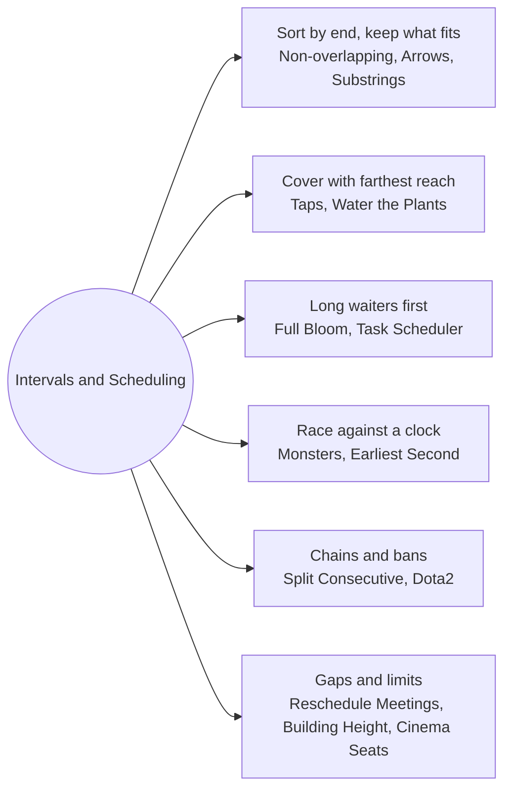

# Intervals and Scheduling: Pattern Map

> [!TIP]
> **🧠 One picture to keep**
> When items have a **time window**, the right sort key is almost always an *end* or a *deadline*:
> 1. **Sort by end** and keep what fits: choosing the interval that finishes first leaves the most room. Non-overlapping intervals, arrows for balloons, non-overlapping substrings.
> 2. **Sort by start and extend the farthest reach**: interval cover, jump-game style. Taps and sprinklers.
> 3. **Order by the long tail first**: when one part is passive waiting (growing, cooling), start the long waiters first (full bloom, task scheduler).
> 4. **Arrival times vs your clock**: shoot the monster that arrives first, and fail when its arrival is not later than the minute index.
> 5. **Hand-offs and counters**: chains that extend or start new ones (consecutive subsequences), bans (Dota2), gaps and restrictions (meetings, buildings).
> Prove each with the exchange argument: if an optimal answer does something else, swap in the greedy choice without making it worse.

**All animations:** [▶ Intervals and Scheduling Animations](https://d9-cell.github.io/java-brain/Greedy/Intervals%20and%20Scheduling/Intervals%20and%20Scheduling%20Animations.html) · ⬆ [00 Brain Map](../../00%20Brain%20Map.md)

## Java toolkit
| Need | Java |
|---|---|
| Sort pairs by end | `Arrays.sort(a, (x, y) -> Integer.compare(x[1], y[1]))` (never `x[1] - y[1]` with big values) |
| Non-overlap test | touching ends are fine: `next.start >= lastEnd` |
| Frequency table of letters | `int[] cnt = new int[26]; cnt[c - 'a']++` |
| Heap of remaining counts | `PriorityQueue<Integer>(Collections.reverseOrder())` |
| Bit masks for small sets | `mask & (1 << i)`, e.g. seats in a row |
| Binary search on the answer | `while (lo <= hi) { mid = (lo + hi) >>> 1; if (ok(mid)) { ans = mid; hi = mid - 1; } else lo = mid + 1; }` |

## Patterns in this folder

| # | Problem | Pattern | Mantra | Level |
|---|---|---|---|---|
| 1 | [Non-overlapping Intervals](Non-overlapping%20Intervals.md) | Sort by end, Activity selection | SORT BY END, KEEP IF start ≥ lastEnd | Medium |
| 2 | [Minimum Number of Arrows to Burst Balloons](Minimum%20Number%20of%20Arrows%20to%20Burst%20Balloons.md) | Sort by end, Stab intervals | SHOOT AT THE FIRST END, SKIP EVERYTHING IT HITS | Medium |
| 3 | [Minimum Number of Taps to Open to Water a Garden](Minimum%20Number%20of%20Taps%20to%20Open%20to%20Water%20a%20Garden.md) | Interval cover, Farthest reach | maxReach[left], THEN JUMP LIKE JUMP GAME II | Hard |
| 4 | [Water the Plants](Water%20the%20Plants.md) | Interval cover, Farthest reach | SORT BY LEFT, EXTEND WITH THE FARTHEST RIGHT | Hard |
| 5 | [Earliest Possible Day of Full Bloom](Earliest%20Possible%20Day%20of%20Full%20Bloom.md) | Order by the long tail, Exchange argument | PLANT THE LONGEST-GROWING FIRST | Hard |
| 6 | [Eliminate Maximum Number of Monsters](Eliminate%20Maximum%20Number%20of%20Monsters.md) | Arrival times, Shoot the earliest first | SORT ARRIVALS, FAIL WHEN arrival ≤ index | Medium |
| 7 | [Task Scheduler](Task%20Scheduler.md) | Frequency formula, Heap simulation | (maxFreq − 1)·(n + 1) + tiesAtMax | Medium |
| 8 | [Cinema Seat Allocation](Cinema%20Seat%20Allocation.md) | Bit mask per row, Three candidate blocks | EMPTY ROW = 2, LEFT+RIGHT FREE = 2, ANY BLOCK = 1 | Medium |
| 9 | [Maximum Building Height](Maximum%20Building%20Height.md) | Propagate limits, Peak between two limits | FORWARD PASS, BACKWARD PASS, PEAK = (hL + hR + dist) / 2 | Hard |
| 10 | [Split Array into Consecutive Subsequences](Split%20Array%20into%20Consecutive%20Subsequences.md) | Extend or start, Counts | EXTEND FIRST, ELSE START x,x+1,x+2 | Medium |
| 11 | [Maximum Number of Non-Overlapping Substrings](Maximum%20Number%20of%20Non-Overlapping%20Substrings.md) | Expand ranges, Sort by end | EXPAND FIRST..LAST, THEN ACTIVITY SELECTION | Hard |
| 12 | [Dota2 Senate](Dota2%20Senate.md) | Queues of indexes, Ban the next opponent | TWO QUEUES, SMALLER INDEX WINS AND RETURNS +n | Medium |
| 13 | [Reschedule Meetings for Maximum Free Time II](Reschedule%20Meetings%20for%20Maximum%20Free%20Time%20II.md) | Gaps, Prefix and suffix maxima | GAP LEFT + GAP RIGHT (+ DURATION IF IT FITS ELSEWHERE) | Medium |
| 14 | [Earliest Second to Mark Indices I](Earliest%20Second%20to%20Mark%20Indices%20I.md) | Binary search on the answer, Last occurrence | BINARY SEARCH s, MARK AT THE LAST OCCURRENCE | Medium |

## Suggested learning order
1. [Non-overlapping Intervals](Non-overlapping%20Intervals.md) ⭐, [Minimum Number of Arrows to Burst Balloons](Minimum%20Number%20of%20Arrows%20to%20Burst%20Balloons.md)
2. [Minimum Number of Taps to Open to Water a Garden](Minimum%20Number%20of%20Taps%20to%20Open%20to%20Water%20a%20Garden.md), [Water the Plants](Water%20the%20Plants.md)
3. [Earliest Possible Day of Full Bloom](Earliest%20Possible%20Day%20of%20Full%20Bloom.md), [Task Scheduler](Task%20Scheduler.md), [Eliminate Maximum Number of Monsters](Eliminate%20Maximum%20Number%20of%20Monsters.md)
4. [Split Array into Consecutive Subsequences](Split%20Array%20into%20Consecutive%20Subsequences.md), [Dota2 Senate](Dota2%20Senate.md), [Cinema Seat Allocation](Cinema%20Seat%20Allocation.md)
5. Hard: [Maximum Building Height](Maximum%20Building%20Height.md), [Maximum Number of Non-Overlapping Substrings](Maximum%20Number%20of%20Non-Overlapping%20Substrings.md), [Reschedule Meetings for Maximum Free Time II](Reschedule%20Meetings%20for%20Maximum%20Free%20Time%20II.md), [Earliest Second to Mark Indices I](Earliest%20Second%20to%20Mark%20Indices%20I.md)

## Connections to other folders
- [Sorting and Matching - Pattern Map](../Sorting%20and%20Matching/Sorting%20and%20Matching%20-%20Pattern%20Map.md) for sort-then-take problems without time windows
- [Line Sweep - Pattern Map](../../Line%20Sweep/Line%20Sweep%20-%20Pattern%20Map.md) for the same sort-by-position idea
- [Heap - Pattern Map](../../Heap/Heap%20-%20Pattern%20Map.md) for the heap in Task Scheduler
