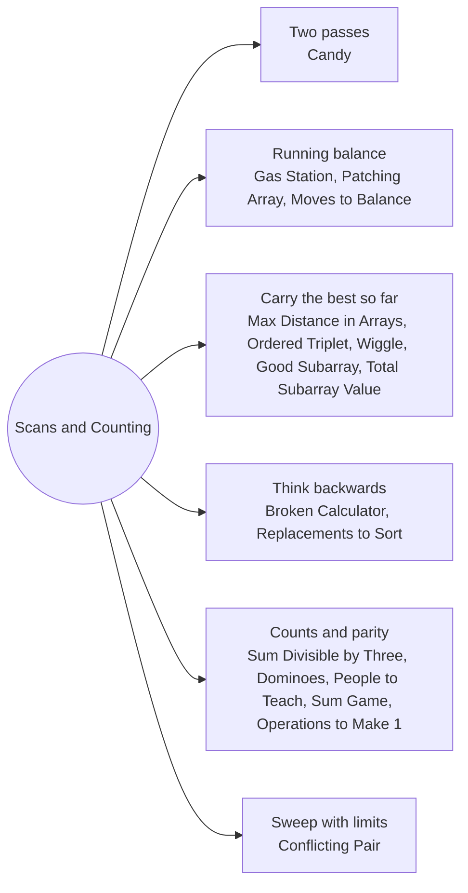

# Scans and Counting: Pattern Map

> [!TIP]
> **🧠 One picture to keep**
> No sorting here: the greedy decision is made **while walking the array once** (or from a few counters).
> 1. **Two passes** that each satisfy one constraint: left neighbour, then right neighbour (Candy).
> 2. **A running balance that resets**: gas stations, patching, Kadane-like scans.
> 3. **Carry the best-so-far** (min / max / prefix max) so each new element is judged in O(1): maximum distance, ordered triplet, wiggle.
> 4. **Work backwards** when forward choices are ambiguous (broken calculator, replacements to sort).
> 5. **Count and reduce**: parity, remainders and totals decide feasibility (grid of remainders for sum divisible by 3, balance games).
> For each problem the notes name the invariant that makes the shortcut safe, and each one was checked against an exhaustive search.

**All animations:** [▶ Scans and Counting Animations](https://d9-cell.github.io/java-brain/Greedy/Scans%20and%20Counting/Scans%20and%20Counting%20Animations.html) · ⬆ [00 Brain Map](../../00%20Brain%20Map.md)

## Java toolkit
| Need | Java |
|---|---|
| Two passes | `for (i = 1..n-1) ...; for (i = n-2..0) ...` using the same array |
| Running total that may reset | `tank += diff; if (tank < 0) { start = i + 1; tank = 0; }` |
| Best so far | `maxPrefix = Math.max(maxPrefix, x)` updated after using it |
| Overflow-safe products | `(long) a * b`, return `long` when the constraints say so |
| Reverse simulation | `while (target > start) target = target % 2 == 0 ? target / 2 : target + 1;` |
| Remainder buckets | `List<Integer>[] byRemainder` or `int[3]` DP over `sum % 3` |

## Patterns in this folder

| # | Problem | Pattern | Mantra | Level |
|---|---|---|---|---|
| 1 | [Candy](Candy.md) | Two passes, Slopes | LEFT PASS +1, RIGHT PASS max(c, next + 1) | Hard |
| 2 | [Gas Station](Gas%20Station.md) | Running balance, Reset on negative | RESET THE START WHEN THE TANK GOES NEGATIVE | Medium |
| 3 | [Greatest Sum Divisible by Three](Greatest%20Sum%20Divisible%20by%20Three.md) | Remainders, Remove the cheapest | sum % 3 = 1 → drop one r1 or two r2 | Medium |
| 4 | [Wiggle Subsequence](Wiggle%20Subsequence.md) | Peaks and valleys, Sign changes | up = down + 1 ON A RISE, down = up + 1 ON A FALL | Medium |
| 5 | [Maximum Distance in Arrays](Maximum%20Distance%20in%20Arrays.md) | Carry min and max | COMPARE THE NEW ENDS WITH GLOBAL MIN / MAX FROM EARLIER ARRAYS | Medium |
| 6 | [Minimum Domino Rotations For Equal Row](Minimum%20Domino%20Rotations%20For%20Equal%20Row.md) | Candidate values, Count swaps | CANDIDATES: tops[0], bottoms[0] | Medium |
| 7 | [Minimum Replacements to Sort the Array](Minimum%20Replacements%20to%20Sort%20the%20Array.md) | Work from the right, Equal split | parts = ceil(x / limit), NEW LIMIT = x / parts | Hard |
| 8 | [Broken Calculator](Broken%20Calculator.md) | Reverse process | TARGET EVEN → /2, ODD → +1, THEN SUBTRACT THE GAP | Medium |
| 9 | [Minimum Number of Operations to Make All Array Elements Equal to 1](Minimum%20Number%20of%20Operations%20to%20Make%20All%20Array%20Elements%20Equal%20to%201.md) | GCD, Shortest subarray with gcd 1 | ONES? n − ones; ELSE (shortest gcd-1 window − 1) + (n − 1) | Medium |
| 10 | [Maximum Score of a Good Subarray](Maximum%20Score%20of%20a%20Good%20Subarray.md) | Expand around k, Larger neighbour first | EXPAND TO THE LARGER SIDE, SCORE = min · length | Hard |
| 11 | [Maximize Subarrays After Removing One Conflicting Pair](Maximize%20Subarrays%20After%20Removing%20One%20Conflicting%20Pair.md) | Sweep the right end, Top two conflicts | KEEP THE TWO LARGEST CONFLICTS, CREDIT THE REMOVAL | Hard |
| 12 | [Minimum Moves to Balance Circular Array](Minimum%20Moves%20to%20Balance%20Circular%20Array.md) | Ring distance, Fill from the nearest | DEBTOR FILLS FROM DISTANCE 1, THEN 2, … | Medium |
| 13 | [Minimum Number of People to Teach](Minimum%20Number%20of%20People%20to%20Teach.md) | Choose one language, Count the sad users | SAD USERS, TEACH THE MOST COMMON LANGUAGE | Medium |
| 14 | [Patching Array](Patching%20Array.md) | Reachable range, Doubling | miss = smallest unreachable sum; PATCH miss → DOUBLE THE RANGE | Hard |
| 15 | [Sum Game](Sum%20Game.md) | Game theory, Counting | ODD ? → ALICE; ELSE COMPARE KNOWN SUMS WITH 9 PER ?-PAIR | Medium |
| 16 | [Maximum Total Subarray Value I](Maximum%20Total%20Subarray%20Value%20I.md) | Whole array is best | (MAX − MIN) × k | Easy |
| 17 | [Maximum Value of an Ordered Triplet I](Maximum%20Value%20of%20an%20Ordered%20Triplet%20I.md) | Carry best prefix, Best difference | maxPrefix → maxDiff → value | Easy |

## Suggested learning order
1. Warm up: [Maximum Total Subarray Value I](Maximum%20Total%20Subarray%20Value%20I.md), [Maximum Distance in Arrays](Maximum%20Distance%20in%20Arrays.md), [Maximum Value of an Ordered Triplet I](Maximum%20Value%20of%20an%20Ordered%20Triplet%20I.md)
2. Scans: [Gas Station](Gas%20Station.md) ⭐, [Candy](Candy.md) ⭐, [Wiggle Subsequence](Wiggle%20Subsequence.md), [Minimum Domino Rotations For Equal Row](Minimum%20Domino%20Rotations%20For%20Equal%20Row.md)
3. Counting: [Greatest Sum Divisible by Three](Greatest%20Sum%20Divisible%20by%20Three.md), [Minimum Number of People to Teach](Minimum%20Number%20of%20People%20to%20Teach.md), [Sum Game](Sum%20Game.md)
4. Backwards: [Broken Calculator](Broken%20Calculator.md), [Minimum Replacements to Sort the Array](Minimum%20Replacements%20to%20Sort%20the%20Array.md)
5. Harder: [Patching Array](Patching%20Array.md) ⭐, [Maximum Score of a Good Subarray](Maximum%20Score%20of%20a%20Good%20Subarray.md), [Minimum Number of Operations to Make All Array Elements Equal to 1](Minimum%20Number%20of%20Operations%20to%20Make%20All%20Array%20Elements%20Equal%20to%201.md), [Minimum Moves to Balance Circular Array](Minimum%20Moves%20to%20Balance%20Circular%20Array.md), [Maximize Subarrays After Removing One Conflicting Pair](Maximize%20Subarrays%20After%20Removing%20One%20Conflicting%20Pair.md)

## Connections to other folders
- [Sorting and Matching - Pattern Map](../Sorting%20and%20Matching/Sorting%20and%20Matching%20-%20Pattern%20Map.md) for sort-then-take greedy
- [Intervals and Scheduling - Pattern Map](../Intervals%20and%20Scheduling/Intervals%20and%20Scheduling%20-%20Pattern%20Map.md) for greedy on time windows
- [Strings and Digits - Pattern Map](../Strings%20and%20Digits/Strings%20and%20Digits%20-%20Pattern%20Map.md) for lexicographic and digit greedy
- [Sliding Window - Pattern Map](../../Sliding%20Window/Sliding%20Window%20-%20Pattern%20Map.md) for the two-pointer expansion in Good Subarray
