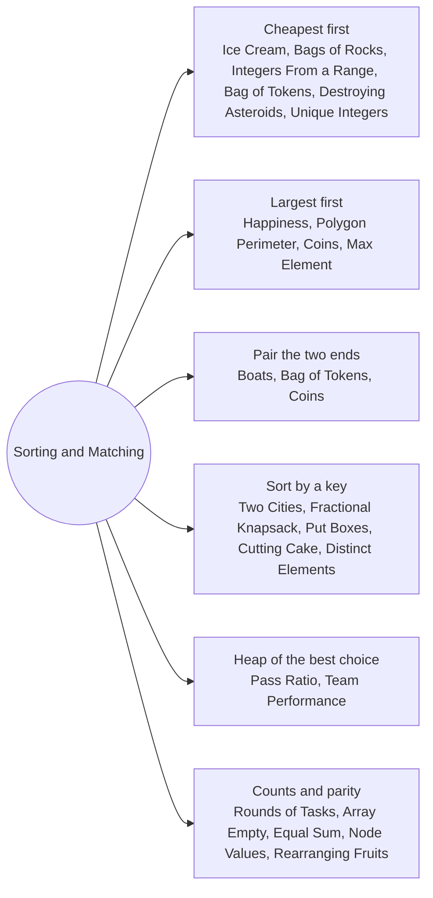

# Sorting and Matching: Pattern Map

> [!TIP]
> **🧠 One picture to keep**
> Most greedy problems are **"sort, then take the obvious next item"**. The skill is knowing *what to sort by* and *which end to take*:
> 1. **Cheapest first** when every item costs the same budget (ice cream, bags of rocks, integers in a range, cheapest tokens).
> 2. **Largest first** when you want maximum value early (happiness, polygon sides, coins from piles).
> 3. **Two ends together** (two pointers on a sorted array): pair the heaviest with the lightest (boats, tokens).
> 4. **Sort by a ratio or a difference** when items compete for one resource (fractional knapsack by value/weight, two cities by cost difference).
> 5. **Heap** when the best choice changes after every step (pass ratio, team performance).
> To trust a greedy, argue by exchange: swapping any other choice for the greedy one never makes the answer worse. These notes also check each greedy against brute force.

**All animations:** [▶ Sorting and Matching Animations](https://d9-cell.github.io/java-brain/Greedy/Sorting%20and%20Matching/Sorting%20and%20Matching%20Animations.html) · ⬆ [00 Brain Map](../../00%20Brain%20Map.md)

## Java toolkit
| Need | Java |
|---|---|
| Sort a primitive array | `Arrays.sort(a)` (ascending only) |
| Sort descending / by key | `Integer[]` or `int[][]` with `Arrays.sort(arr, (x, y) -> y[1] - x[1])`; use `Integer.compare` when subtraction can overflow |
| Min-heap / max-heap | `new PriorityQueue<>()` / `new PriorityQueue<>(Collections.reverseOrder())` |
| Count frequencies | `Map<Integer, Integer> freq; freq.merge(x, 1, Integer::sum)` |
| Two pointers on sorted data | `for (int lo = 0, hi = n - 1; lo <= hi; hi--) { if (a[lo] + a[hi] <= limit) lo++; boats++; }` |
| Sums that may overflow | accumulate in `long`, cast the result |

## Patterns in this folder

| # | Problem | Pattern | Mantra | Level |
|---|---|---|---|---|
| 1 | [Bag of Tokens](Bag%20of%20Tokens.md) | Sort + two pointers, Buy low, sell high | CHEAPEST FOR SCORE, DEAREST FOR POWER | Medium |
| 2 | [Boats to Save People](Boats%20to%20Save%20People.md) | Sort + two pointers, Pair heaviest with lightest | HEAVIEST ALWAYS RIDES, LIGHTEST JOINS IF IT FITS | Medium |
| 3 | [Destroying Asteroids](Destroying%20Asteroids.md) | Sort, Grow first | SMALLEST FIRST, MASS GROWS | Medium |
| 4 | [Maximum Number of Coins You Can Get](Maximum%20Number%20of%20Coins%20You%20Can%20Get.md) | Sort, Skip the largest | GIVE BOB THE SMALLEST THIRD, TAKE EVERY SECOND PILE | Medium |
| 5 | [Two City Scheduling](Two%20City%20Scheduling.md) | Sort by a difference | SORT BY costA − costB | Medium |
| 6 | [Put Boxes Into the Warehouse I](Put%20Boxes%20Into%20the%20Warehouse%20I.md) | Prefix minimum, Sort | ROOM LIMIT = PREFIX MIN, SMALLEST BOXES DEEPEST | Medium |
| 7 | [Maximum Bags With Full Capacity of Rocks](Maximum%20Bags%20With%20Full%20Capacity%20of%20Rocks.md) | Sort, Cheapest first | SORT FREE SPACE, FILL FROM THE SMALLEST | Medium |
| 8 | [Maximum Ice Cream Bars](Maximum%20Ice%20Cream%20Bars.md) | Sort, Cheapest first | SORT COSTS, BUY UNTIL BROKE | Medium |
| 9 | [Maximum Number of Integers to Choose From a Range I](Maximum%20Number%20of%20Integers%20to%20Choose%20From%20a%20Range%20I.md) | Cheapest first, Hash set | WALK 1..n, SKIP BANNED, STOP AT THE CAP | Medium |
| 10 | [Maximize Happiness of Selected Children](Maximize%20Happiness%20of%20Selected%20Children.md) | Sort descending, Penalty by turn | HAPPIEST FIRST, SUBTRACT THE TURN NUMBER | Medium |
| 11 | [Maximum Element After Decreasing and Rearranging](Maximum%20Element%20After%20Decreasing%20and%20Rearranging.md) | Sort, Staircase cap | cur = min(cur + 1, x) | Medium |
| 12 | [Least Number of Unique Integers after K Removals](Least%20Number%20of%20Unique%20Integers%20after%20K%20Removals.md) | Frequency, Remove the rarest values | SORT FREQUENCIES, WIPE OUT SMALLEST FIRST | Medium |
| 13 | [Fractional Knapsack](Fractional%20Knapsack.md) | Sort by ratio | SORT BY VALUE / WEIGHT | Medium |
| 14 | [Maximum Performance of a Team](Maximum%20Performance%20of%20a%20Team.md) | Sort by efficiency, Min-heap of speeds | EFFICIENCY DESC, HEAP KEEPS THE K FASTEST | Hard |
| 15 | [Find Polygon With the Largest Perimeter](Find%20Polygon%20With%20the%20Largest%20Perimeter.md) | Sort, Prefix sums | SORT, PREFIX > NEXT SIDE → VALID | Medium |
| 16 | [Maximum Number of Distinct Elements After Operations](Maximum%20Number%20of%20Distinct%20Elements%20After%20Operations.md) | Sort, Lowest free value | SORT, PICK max(prev + 1, x − k), IF ≤ x + k | Medium |
| 17 | [Minimum Equal Sum of Two Arrays After Replacing Zeros](Minimum%20Equal%20Sum%20of%20Two%20Arrays%20After%20Replacing%20Zeros.md) | Case analysis, Minimum sums | ZEROS → 1 FOR MINIMUM, SMALLER SIDE MUST HAVE A ZERO | Medium |
| 18 | [Rearranging Fruits](Rearranging%20Fruits.md) | Frequency difference, Cheapest swap path | MOVE HALF THE SURPLUS, COST MIN(x, 2·MIN) | Hard |
| 19 | [Find the Maximum Sum of Node Values](Find%20the%20Maximum%20Sum%20of%20Node%20Values.md) | XOR parity, Take every gain | TAKE ALL GAINS, FIX PARITY WITH THE SMALLEST LOSS | Hard |
| 20 | [Minimum Cost for Cutting Cake I - II](Minimum%20Cost%20for%20Cutting%20Cake%20I%20-%20II.md) | Sort descending, Most expensive cut first | LARGEST CUT FIRST | Hard |
| 21 | [Minimum Rounds to Complete All Tasks](Minimum%20Rounds%20to%20Complete%20All%20Tasks.md) | Frequency, Groups of 2 and 3 | f = 1 → −1, ELSE ceil(f / 3) | Medium |
| 22 | [Minimum Number of Operations to Make Array Empty](Minimum%20Number%20of%20Operations%20to%20Make%20Array%20Empty.md) | Frequency, Groups of 2 and 3 | f = 1 → −1, ELSE ceil(f / 3) | Medium |
| 23 | [Maximum Average Pass Ratio](Maximum%20Average%20Pass%20Ratio.md) | Max-heap by marginal gain | HEAP KEYED BY (p+1)/(t+1) − p/t | Medium |

## Suggested learning order
1. [Maximum Ice Cream Bars](Maximum%20Ice%20Cream%20Bars.md), [Maximum Bags With Full Capacity of Rocks](Maximum%20Bags%20With%20Full%20Capacity%20of%20Rocks.md), [Maximum Number of Integers to Choose From a Range I](Maximum%20Number%20of%20Integers%20to%20Choose%20From%20a%20Range%20I.md)
2. [Maximize Happiness of Selected Children](Maximize%20Happiness%20of%20Selected%20Children.md), [Maximum Number of Coins You Can Get](Maximum%20Number%20of%20Coins%20You%20Can%20Get.md), [Find Polygon With the Largest Perimeter](Find%20Polygon%20With%20the%20Largest%20Perimeter.md)
3. Two pointers: [Boats to Save People](Boats%20to%20Save%20People.md) ⭐, [Bag of Tokens](Bag%20of%20Tokens.md), [Destroying Asteroids](Destroying%20Asteroids.md)
4. Sort by a key: [Two City Scheduling](Two%20City%20Scheduling.md) ⭐, [Fractional Knapsack](Fractional%20Knapsack.md), [Put Boxes Into the Warehouse I](Put%20Boxes%20Into%20the%20Warehouse%20I.md), [Maximum Number of Distinct Elements After Operations](Maximum%20Number%20of%20Distinct%20Elements%20After%20Operations.md)
5. Heaps: [Maximum Performance of a Team](Maximum%20Performance%20of%20a%20Team.md) ⭐, [Maximum Average Pass Ratio](Maximum%20Average%20Pass%20Ratio.md)
6. Counting: [Minimum Rounds to Complete All Tasks](Minimum%20Rounds%20to%20Complete%20All%20Tasks.md), [Least Number of Unique Integers after K Removals](Least%20Number%20of%20Unique%20Integers%20after%20K%20Removals.md), [Minimum Equal Sum of Two Arrays After Replacing Zeros](Minimum%20Equal%20Sum%20of%20Two%20Arrays%20After%20Replacing%20Zeros.md)
7. Harder: [Rearranging Fruits](Rearranging%20Fruits.md), [Find the Maximum Sum of Node Values](Find%20the%20Maximum%20Sum%20of%20Node%20Values.md), [Minimum Cost for Cutting Cake I - II](Minimum%20Cost%20for%20Cutting%20Cake%20I%20-%20II.md)

## Connections to other folders
- [Intervals and Scheduling - Pattern Map](../Intervals%20and%20Scheduling/Intervals%20and%20Scheduling%20-%20Pattern%20Map.md) when the sort key is an interval end
- [Scans and Counting - Pattern Map](../Scans%20and%20Counting/Scans%20and%20Counting%20-%20Pattern%20Map.md) for greedy decided in one pass
- [Heap - Pattern Map](../../Heap/Heap%20-%20Pattern%20Map.md) for the heap idioms
- [Knapsack DP](../../DP/Knapsack%20Series/Knapsack%20Series%20-%20Pattern%20Map.md) when the greedy fails (0/1 items)
