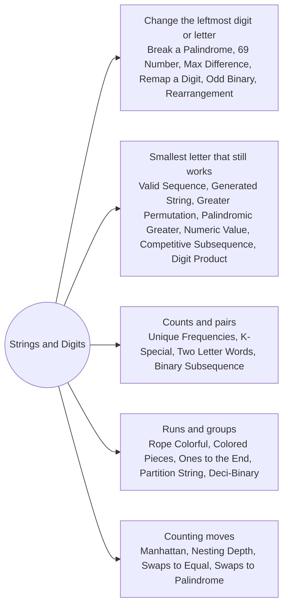

# Strings and Digits: Pattern Map

> [!TIP]
> **🧠 One picture to keep**
> Strings and numbers have a built-in order, so greedy means **decide the most significant place first**:
> 1. **Change the leftmost useful character**: make a number bigger by raising its first non-9 digit; make a string smaller by lowering its first non-`a` (Break a Palindrome, 69 Number, Max Difference, Remapping a Digit).
> 2. **Lexicographic order with a feasibility check**: take the smallest letter that still leaves a valid completion (Valid Sequence, Generated String, Permutation Greater Than Target, Numeric Value).
> 3. **Count letters, then reason about the counts**: frequencies, pairs, parity (Unique Frequencies, K-Special, Two Letter Words, Palindromic Rearrangement).
> 4. **Run-based decisions**: each run of equal characters contributes independently (Rope Colorful, Colored Pieces, Ones to the End).
> 5. **Reverse thinking** where forward choices branch (nearest suffix match for Valid Sequence).
> Every solution here is checked against brute force over all small strings, which is the only way to trust a lexicographic greedy.

**All animations:** [▶ Strings and Digits Animations](https://d9-cell.github.io/java-brain/Greedy/Strings%20and%20Digits/Strings%20and%20Digits%20Animations.html) · ⬆ [00 Brain Map](../../00%20Brain%20Map.md)

## Java toolkit
| Need | Java |
|---|---|
| Mutate a string | `char[] c = s.toCharArray(); c[i] = 'a'; new String(c)` |
| Letter counts | `int[] cnt = new int[26]; cnt[ch - 'a']++` |
| Build text | `StringBuilder sb; sb.append(...); sb.reverse(); sb.setLength(sb.length() - 1)` |
| Repeat a character | `"1".repeat(k)` |
| Lexicographic compare | `a.compareTo(b)`, `Arrays.compare(x, y)` for int arrays |
| Leading zeros | parse with `Integer.parseInt`, compare lengths first when strings can be long |
| Digits to value | `value = value * 10 + (c - '0')` |

## Patterns in this folder

| # | Problem | Pattern | Mantra | Level |
|---|---|---|---|---|
| 1 | [Break a Palindrome](Break%20a%20Palindrome.md) | Leftmost change, First half only | FIRST NON-a IN THE FIRST HALF → a, ELSE LAST → b | Medium |
| 2 | [Find the Most Competitive Subsequence](Find%20the%20Most%20Competitive%20Subsequence.md) | Monotonic stack, Lexicographically smallest subsequence | POP IF TOP > x AND ENOUGH ELEMENTS LEFT | Medium |
| 3 | [Find the Lexicographically Smallest Valid Sequence](Find%20the%20Lexicographically%20Smallest%20Valid%20Sequence.md) | Suffix match table, One allowed mismatch | MATCH GREEDILY, SPEND THE CHANGE WHEN suffix[i+1] STILL FITS | Medium |
| 4 | [Lexicographically Smallest Generated String](Lexicographically%20Smallest%20Generated%20String.md) | Forced windows, Fix the Fs | T WRITES str2, FREE → a, F THAT MATCHES → BUMP THE LAST FREE LETTER TO b | Hard |
| 5 | [Lexicographically Smallest Permutation Greater Than Target](Lexicographically%20Smallest%20Permutation%20Greater%20Than%20Target.md) | Next greater with a bag of letters | TIGHT WITH THE TARGET, BREAK OUT WITH THE SMALLEST LARGER LETTER | Hard |
| 6 | [Lexicographically Smallest Palindromic Permutation Greater Than Target](Lexicographically%20Smallest%20Palindromic%20Permutation%20Greater%20Than%20Target.md) | Choose the left half, Mirror | HALF COUNTS, BACKTRACK THE HALF, MIRROR AND COMPARE | Hard |
| 7 | [Longest Binary Subsequence Less Than or Equal to K](Longest%20Binary%20Subsequence%20Less%20Than%20or%20Equal%20to%20K.md) | Zeros are free, Ones from the right | KEEP ALL ZEROS, ADD ONES FROM THE RIGHT WHILE value ≤ k | Medium |
| 8 | [Longest Palindrome by Concatenating Two Letter Words](Longest%20Palindrome%20by%20Concatenating%20Two%20Letter%20Words.md) | Pair with the reverse, Odd middle | PAIR WITH REVERSE (+4), ONE xx LEFT OVER (+2) | Medium |
| 9 | [Max Difference You Can Get From Changing an Integer](Max%20Difference%20You%20Can%20Get%20From%20Changing%20an%20Integer.md) | Leftmost digit change, Maximum and minimum | MAX: FIRST NON-9 → 9. MIN: FIRST DIGIT → 1, ELSE FIRST NON-0/1 → 0 | Medium |
| 10 | [Maximum 69 Number](Maximum%2069%20Number.md) | Leftmost digit change | LEFTMOST 6 → 9 | Easy |
| 11 | [Maximum Manhattan Distance After K Changes](Maximum%20Manhattan%20Distance%20After%20K%20Changes.md) | Prefix scan, Wasted steps | dist + min(2k, wasted) | Medium |
| 12 | [Maximum Nesting Depth of Two Valid Parentheses Strings](Maximum%20Nesting%20Depth%20of%20Two%20Valid%20Parentheses%20Strings.md) | Alternate by depth | DEPTH PARITY DECIDES THE GROUP | Medium |
| 13 | [Maximum Number of Operations to Move Ones to the End](Maximum%20Number%20of%20Operations%20to%20Move%20Ones%20to%20the%20End.md) | Runs of zeros, Count ones to the left | AT EACH ZERO BLOCK ADD THE ONES SEEN SO FAR | Medium |
| 14 | [Min Swaps to Make Palindrome](Min%20Swaps%20to%20Make%20Palindrome.md) | Two pointers, Bubble the match | LEFT LETTER ← NEAREST EQUAL FROM THE RIGHT, BUBBLE TO THE END | Hard |
| 15 | [Minimum Time to Make Rope Colorful](Minimum%20Time%20to%20Make%20Rope%20Colorful.md) | Runs, Keep the most expensive | RUN COST = SUM − MAX | Medium |
| 16 | [Minimum Deletions to Make Character Frequencies Unique](Minimum%20Deletions%20to%20Make%20Character%20Frequencies%20Unique.md) | Sort frequencies, Lower until free | EACH FREQUENCY ≤ PREVIOUS − 1 | Medium |
| 17 | [Minimum Deletions to Make String K-Special](Minimum%20Deletions%20to%20Make%20String%20K-Special.md) | Try each minimum frequency, Trim the rest | FOR EACH f: DELETE g < f, TRIM g > f + k | Medium |
| 18 | [Minimum Swaps to Make Strings Equal](Minimum%20Swaps%20to%20Make%20Strings%20Equal.md) | Count mismatch types | xy/2 + yx/2 + 2·(xy % 2) | Medium |
| 19 | [Optimal Partition of String](Optimal%20Partition%20of%20String.md) | Cut when a letter repeats | EXTEND UNTIL A REPEAT, THEN CUT | Medium |
| 20 | [Partitioning Into Minimum Number Of Deci-Binary Numbers](Partitioning%20Into%20Minimum%20Number%20Of%20Deci-Binary%20Numbers.md) | Largest digit | ANSWER = MAX DIGIT | Medium |
| 21 | [Remove Colored Pieces if Both Neighbors are the Same Color](Remove%20Colored%20Pieces%20if%20Both%20Neighbors%20are%20the%20Same%20Color.md) | Independent moves, Counting | ALICE WINS IF HER MOVES > BOB'S MOVES | Medium |
| 22 | [Smallest Divisible Digit Product II](Smallest%20Divisible%20Digit%20Product%20II.md) | Longest prefix, Factor into digits | LONGEST PREFIX, SMALLER TAIL, FACTORS AS DIGITS 9..2 | Hard |
| 23 | [Smallest Palindromic Rearrangement I](Smallest%20Palindromic%20Rearrangement%20I.md) | Sort the half | SORT THE FIRST HALF, MIRROR | Medium |
| 24 | [Smallest String With A Given Numeric Value](Smallest%20String%20With%20A%20Given%20Numeric%20Value.md) | Fill from the right, Left stays small | k − n EXTRA, SPEND 25 AT A TIME FROM THE RIGHT | Medium |
| 25 | [Maximum Difference by Remapping a Digit](Maximum%20Difference%20by%20Remapping%20a%20Digit.md) | Leftmost digit change | MAX: FIRST NON-9 → 9, MIN: FIRST DIGIT → 0 | Easy |
| 26 | [Maximum Odd Binary Number](Maximum%20Odd%20Binary%20Number.md) | Reserve the last bit | ONES − 1 FIRST, ZEROS, THEN A 1 | Easy |

## Suggested learning order
1. Leftmost change: [Maximum 69 Number](Maximum%2069%20Number.md), [Maximum Odd Binary Number](Maximum%20Odd%20Binary%20Number.md), [Break a Palindrome](Break%20a%20Palindrome.md), [Max Difference You Can Get From Changing an Integer](Max%20Difference%20You%20Can%20Get%20From%20Changing%20an%20Integer.md), [Maximum Difference by Remapping a Digit](Maximum%20Difference%20by%20Remapping%20a%20Digit.md)
2. Counts: [Partitioning Into Minimum Number Of Deci-Binary Numbers](Partitioning%20Into%20Minimum%20Number%20Of%20Deci-Binary%20Numbers.md), [Optimal Partition of String](Optimal%20Partition%20of%20String.md), [Minimum Time to Make Rope Colorful](Minimum%20Time%20to%20Make%20Rope%20Colorful.md), [Minimum Deletions to Make Character Frequencies Unique](Minimum%20Deletions%20to%20Make%20Character%20Frequencies%20Unique.md)
3. Lexicographic: [Smallest String With A Given Numeric Value](Smallest%20String%20With%20A%20Given%20Numeric%20Value.md), [Find the Most Competitive Subsequence](Find%20the%20Most%20Competitive%20Subsequence.md), [Smallest Palindromic Rearrangement I](Smallest%20Palindromic%20Rearrangement%20I.md)
4. Games and moves: [Remove Colored Pieces if Both Neighbors are the Same Color](Remove%20Colored%20Pieces%20if%20Both%20Neighbors%20are%20the%20Same%20Color.md), [Minimum Swaps to Make Strings Equal](Minimum%20Swaps%20to%20Make%20Strings%20Equal.md), [Maximum Nesting Depth of Two Valid Parentheses Strings](Maximum%20Nesting%20Depth%20of%20Two%20Valid%20Parentheses%20Strings.md), [Maximum Number of Operations to Move Ones to the End](Maximum%20Number%20of%20Operations%20to%20Move%20Ones%20to%20the%20End.md)
5. Harder: [Longest Binary Subsequence Less Than or Equal to K](Longest%20Binary%20Subsequence%20Less%20Than%20or%20Equal%20to%20K.md), [Longest Palindrome by Concatenating Two Letter Words](Longest%20Palindrome%20by%20Concatenating%20Two%20Letter%20Words.md), [Minimum Deletions to Make String K-Special](Minimum%20Deletions%20to%20Make%20String%20K-Special.md), [Maximum Manhattan Distance After K Changes](Maximum%20Manhattan%20Distance%20After%20K%20Changes.md), [Min Swaps to Make Palindrome](Min%20Swaps%20to%20Make%20Palindrome.md)
6. Hard lexicographic: [Find the Lexicographically Smallest Valid Sequence](Find%20the%20Lexicographically%20Smallest%20Valid%20Sequence.md), [Lexicographically Smallest Generated String](Lexicographically%20Smallest%20Generated%20String.md), [Lexicographically Smallest Permutation Greater Than Target](Lexicographically%20Smallest%20Permutation%20Greater%20Than%20Target.md), [Lexicographically Smallest Palindromic Permutation Greater Than Target](Lexicographically%20Smallest%20Palindromic%20Permutation%20Greater%20Than%20Target.md), [Smallest Divisible Digit Product II](Smallest%20Divisible%20Digit%20Product%20II.md)

## Connections to other folders
- [Scans and Counting - Pattern Map](../Scans%20and%20Counting/Scans%20and%20Counting%20-%20Pattern%20Map.md) for one-pass counting greedy
- [Sorting and Matching - Pattern Map](../Sorting%20and%20Matching/Sorting%20and%20Matching%20-%20Pattern%20Map.md) for greedy that sorts first
- [Stack - Pattern Map](../../Stack/Stack%20-%20Pattern%20Map.md) for the monotonic stack used in competitive subsequences
- [Bit Magic - Pattern Map](../../Bit_Magic/Bit%20Magic%20-%20Pattern%20Map.md) for digit and bit tricks
