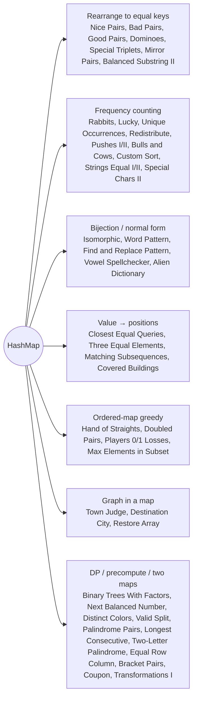

# HashMap: Pattern Map

> [!TIP]
> **🧠 One picture to keep**
> A HashMap is a **memory of what you have seen — and how often, or where**. Six shapes to recognise:
> 1. **Rearrange to equal keys**: turn a condition on a pair (i, j) into key(i) == key(j), then count equal keys while scanning (Nice Pairs, Bad Pairs, Good Pairs, Dominoes, Balanced Substring).
> 2. **Frequency count**: count, then reason about the counts (Rabbits, Lucky, Unique Occurrences, Redistribute, Pushes).
> 3. **Bijection / normal form**: two maps or "first-seen index" (Isomorphic, Word Pattern, Find and Replace Pattern).
> 4. **Value → positions**: lists of indices per value (Closest Equal Queries, Three Equal, Matching Subsequences).
> 5. **Ordered map greedy**: TreeMap and take the smallest first (Hand of Straights, Doubled Pairs, Players).
> 6. **Graph in a map**: adjacency or degree maps (Town Judge, Destination City, Restore Array).

**All animations:** [▶ HashMap Animations](https://d9-cell.github.io/java-brain/HashMap/HashMap%20Animations.html) · ⬆ [00 Brain Map](../00%20Brain%20Map.md)

## Java toolkit
| Need | Java |
|---|---|
| Count | `cnt.merge(x, 1, Integer::sum)` |
| Count and get previous | `int before = cnt.getOrDefault(x, 0); cnt.put(x, before + 1);` |
| Decrement and remove at 0 | `if (cnt.merge(x, -1, Integer::sum) == 0) cnt.remove(x);` |
| List per key | `map.computeIfAbsent(k, z -> new ArrayList<>()).add(i)` |
| First index only | `first.putIfAbsent(key, i)` (returns the old value or null) |
| Array as a key | `List<Integer>` / `Arrays.toString(arr)` (never `int[]`) |
| Sorted keys | `TreeMap` → `firstKey()`, `ceilingKey()` |
| Small alphabet | `int[26]` beats a map |

## Patterns in this folder

| # | Problem | Pattern | Mantra | Level |
|---|---|---|---|---|
| 1 | [Array of Doubled Pairs](Array%20of%20Doubled%20Pairs.md) | Ordered-map greedy | SORT BY |x|, MATCH x WITH 2x | Medium |
| 2 | [Binary Trees With Factors](Binary%20Trees%20With%20Factors.md) | DP over a map | SORT, dp[x] = 1 + Σ dp[a]·dp[x/a] | Medium |
| 3 | [Bulls and Cows](Bulls%20and%20Cows.md) | Frequency counting | BULL = SAME SPOT, COW WHEN THE COUNTER CANCELS | Medium |
| 4 | [Check If Array Pairs Are Divisible by k](Check%20If%20Array%20Pairs%20Are%20Divisible%20by%20k.md) | Frequency counting, Remainders | r ↔ k − r, REMAINDER 0 EVEN | Medium |
| 5 | [Check if Strings Can be Made Equal With Operations II](Check%20if%20Strings%20Can%20be%20Made%20Equal%20With%20Operations%20II.md) | Frequency counting | EVEN MULTISET == EVEN, ODD == ODD | Medium |
| 6 | [Closest Equal Element Queries](Closest%20Equal%20Element%20Queries.md) | Value → positions, Binary search | VALUE → SORTED INDICES, CHECK NEIGHBOURS WITH WRAP | Medium |
| 7 | [Count Covered Buildings](Count%20Covered%20Buildings.md) | Value → extremes | ROW MIN/MAX, COLUMN MIN/MAX, STRICTLY INSIDE | Medium |
| 8 | [Count Nice Pairs in an Array](Count%20Nice%20Pairs%20in%20an%20Array.md) | Rearrange to equal keys | KEY = x − rev(x), COUNT EQUAL KEYS | Medium |
| 9 | [Count Number of Bad Pairs](Count%20Number%20of%20Bad%20Pairs.md) | Rearrange to equal keys, Complement counting | BAD = ALL − GOOD, KEY nums[i] − i | Medium |
| 10 | [Count Special Triplets](Count%20Special%20Triplets.md) | Fix the middle, Left/right maps | LEFT MAP × RIGHT MAP AT EACH j | Medium |
| 11 | [Count the Number of Special Characters II](Count%20the%20Number%20of%20Special%20Characters%20II.md) | First / last index | LAST LOWER < FIRST UPPER | Medium |
| 12 | [Custom Sort String](Custom%20Sort%20String.md) | Frequency counting | COUNT, POUR IN ORDER, THEN THE REST | Medium |
| 13 | [Destination City (HashMap)](Destination%20City%20%28HashMap%29.md) | Graph in a map | OUT-DEGREE 0 | Easy |
| 14 | [Equal Row and Column Pairs](Equal%20Row%20and%20Column%20Pairs.md) | Array as a key | COUNT ROWS BY CONTENT, LOOK UP COLUMNS | Medium |
| 15 | [Evaluate the Bracket Pairs of a String](Evaluate%20the%20Bracket%20Pairs%20of%20a%20String.md) | Lookup table | MAP, REPLACE (key) WITH VALUE OR "?" | Medium |
| 16 | [Find and Replace Pattern](Find%20and%20Replace%20Pattern.md) | Bijection, Normal form | NORMAL FORM EQUALITY | Medium |
| 17 | [Find Players With Zero or One Losses](Find%20Players%20With%20Zero%20or%20One%20Losses.md) | Ordered map | TREEMAP LOSSES, PICK 0 AND 1 | Medium |
| 18 | [Find the Maximum Number of Elements in Subset](Find%20the%20Maximum%20Number%20of%20Elements%20in%20Subset.md) | Frequency counting, Chains | CLIMB x → x² WHILE COUNT ≥ 2, PEAK NEEDS 1 | Medium |
| 19 | [Find the Number of Distinct Colors Among the Balls](Find%20the%20Number%20of%20Distinct%20Colors%20Among%20the%20Balls.md) | Two maps | BALL→COLOR, COLOR→COUNT, SIZE | Medium |
| 20 | [Find the Town Judge](Find%20the%20Town%20Judge.md) | Graph in a map, Degrees | SCORE = IN − OUT | Easy |
| 21 | [Hand of Straights](Hand%20of%20Straights.md) | Ordered-map greedy | TREEMAP, TAKE firstKey .. +groupSize | Medium |
| 22 | [Isomorphic Strings](Isomorphic%20Strings.md) | Bijection | TWO MAPS, ANY CONFLICT → FALSE | Easy |
| 23 | [Check if Strings Can be Made Equal With Operations I](Check%20if%20Strings%20Can%20be%20Made%20Equal%20With%20Operations%20I.md) | Pairs | PAIR (0,2), PAIR (1,3) | Easy |
| 24 | [Coupon Code Validator](Coupon%20Code%20Validator.md) | Lookup table, Custom sort | FILTER, SORT BY (LINE RANK, CODE) | Easy |
| 25 | [Find Lucky Integer in an Array](Find%20Lucky%20Integer%20in%20an%20Array.md) | Frequency counting | COUNT ARRAY, SCAN DOWN | Easy |
| 26 | [Number of Equivalent Domino Pairs](Number%20of%20Equivalent%20Domino%20Pairs.md) | Rearrange to equal keys | KEY = 10·min + max | Easy |
| 27 | [Longest Balanced Substring II](Longest%20Balanced%20Substring%20II.md) | Rearrange to equal keys, Prefix differences | 1 / 2 / 3 LETTER CASES, FIRST INDEX PER DIFFERENCE | Medium |
| 28 | [Longest Consecutive Sequence (HashMap)](Longest%20Consecutive%20Sequence%20%28HashMap%29.md) | Run starts | START IF x − 1 MISSING, WALK UP | Medium |
| 29 | [Longest Palindrome by Concatenating Two Letter Words](Longest%20Palindrome%20by%20Concatenating%20Two%20Letter%20Words.md) | Frequency counting, Pairing | PAIR WITH REVERSE (+4), ONE "xx" IN THE MIDDLE (+2) | Medium |
| 30 | [Minimum Absolute Distance Between Mirror Pairs](Minimum%20Absolute%20Distance%20Between%20Mirror%20Pairs.md) | Rearrange to equal keys, Latest index | STORE reverse(x) → LATEST INDEX | Medium |
| 31 | [Minimum Distance Between Three Equal Elements I & II](Minimum%20Distance%20Between%20Three%20Equal%20Elements%20I%20%26%20II.md) | Value → positions | THREE CONSECUTIVE OCCURRENCES, 2(k − i) | Medium |
| 32 | [Minimum Index of a Valid Split](Minimum%20Index%20of%20a%20Valid%20Split.md) | Two maps, Boyer–Moore | BOYER–MOORE, SWEEP THE LEFT COUNT | Medium |
| 33 | [Minimum Number of Pushes to Type Word I](Minimum%20Number%20of%20Pushes%20to%20Type%20Word%20I.md) | Greedy | i / 8 + 1 | Easy |
| 34 | [Minimum Number of Pushes to Type Word II](Minimum%20Number%20of%20Pushes%20to%20Type%20Word%20II.md) | Frequency counting, Greedy | SORT COUNTS DESC, COST i / 8 + 1 | Medium |
| 35 | [Next Greater Numerically Balanced Number](Next%20Greater%20Numerically%20Balanced%20Number.md) | Precompute, Frequency counting | PRECOMPUTE ≤ 1224444, BINARY SEARCH | Medium |
| 36 | [Number of Good Pairs](Number%20of%20Good%20Pairs.md) | Frequency counting | ADD THE COUNT SO FAR | Easy |
| 37 | [Number of Matching Subsequences](Number%20of%20Matching%20Subsequences.md) | Value → positions, Waiting buckets | BUCKETS BY NEXT LETTER, ONE PASS OF s | Medium |
| 38 | [Palindrome Pairs (HashMap)](Palindrome%20Pairs%20%28HashMap%29.md) | Map of reversed words, Split points | MAP OF REVERSED WORDS, TRY EVERY CUT | Hard |
| 39 | [Rabbits in Forest](Rabbits%20in%20Forest.md) | Frequency counting | ceil(c / (x + 1)) · (x + 1) | Medium |
| 40 | [Redistribute Characters to Make All Strings Equal](Redistribute%20Characters%20to%20Make%20All%20Strings%20Equal.md) | Frequency counting | COUNT % n == 0 | Easy |
| 41 | [Restore the Array From Adjacent Pairs](Restore%20the%20Array%20From%20Adjacent%20Pairs.md) | Graph in a map | ADJACENCY MAP, START AT DEGREE 1, NEVER STEP BACK | Medium |
| 42 | [Total Characters in String After Transformations I](Total%20Characters%20in%20String%20After%20Transformations%20I.md) | Frequency counting, Count DP | 26 COUNTS, SHIFT, z → a + b | Medium |
| 43 | [Unique Number of Occurrences](Unique%20Number%20of%20Occurrences.md) | Frequency counting | MAP OF COUNTS, SET OF COUNTS | Easy |
| 44 | [Verifying an Alien Dictionary](Verifying%20an%20Alien%20Dictionary.md) | Lookup table, Custom comparison | RANK ARRAY, ADJACENT PAIRS | Easy |
| 45 | [Vowel Spellchecker](Vowel%20Spellchecker.md) | Several lookup maps | EXACT, LOWERCASE, DEVOWEL — FIRST MATCH | Medium |
| 46 | [Word Pattern](Word%20Pattern.md) | Bijection | FIRST-SEEN INDEX MUST MATCH | Easy |

## Suggested learning order
1. Counting: [Number of Good Pairs](Number%20of%20Good%20Pairs.md) ⭐, [Find Lucky Integer in an Array](Find%20Lucky%20Integer%20in%20an%20Array.md), [Unique Number of Occurrences](Unique%20Number%20of%20Occurrences.md), [Redistribute Characters to Make All Strings Equal](Redistribute%20Characters%20to%20Make%20All%20Strings%20Equal.md), [Number of Equivalent Domino Pairs](Number%20of%20Equivalent%20Domino%20Pairs.md)
2. Bijection: [Isomorphic Strings](Isomorphic%20Strings.md) ⭐, [Word Pattern](Word%20Pattern.md), [Find and Replace Pattern](Find%20and%20Replace%20Pattern.md)
3. Equal keys: [Count Number of Bad Pairs](Count%20Number%20of%20Bad%20Pairs.md) ⭐, [Count Nice Pairs in an Array](Count%20Nice%20Pairs%20in%20an%20Array.md), [Count Special Triplets](Count%20Special%20Triplets.md), [Minimum Absolute Distance Between Mirror Pairs](Minimum%20Absolute%20Distance%20Between%20Mirror%20Pairs.md)
4. Graph in a map: [Find the Town Judge](Find%20the%20Town%20Judge.md), [Destination City (HashMap)](Destination%20City%20%28HashMap%29.md), [Restore the Array From Adjacent Pairs](Restore%20the%20Array%20From%20Adjacent%20Pairs.md)
5. Ordered greedy: [Hand of Straights](Hand%20of%20Straights.md) ⭐, [Array of Doubled Pairs](Array%20of%20Doubled%20Pairs.md), [Find Players With Zero or One Losses](Find%20Players%20With%20Zero%20or%20One%20Losses.md)
6. Positions: [Closest Equal Element Queries](Closest%20Equal%20Element%20Queries.md), [Minimum Distance Between Three Equal Elements I & II](Minimum%20Distance%20Between%20Three%20Equal%20Elements%20I%20%26%20II.md), [Number of Matching Subsequences](Number%20of%20Matching%20Subsequences.md)
7. Hard: [Palindrome Pairs (HashMap)](Palindrome%20Pairs%20%28HashMap%29.md), [Longest Balanced Substring II](Longest%20Balanced%20Substring%20II.md), [Binary Trees With Factors](Binary%20Trees%20With%20Factors.md)

## Connections to other folders
- HashSet (presence only): [HashSet](../HashSet/HashSet%20-%20Pattern%20Map.md)
- Same remainder pairing as [Check If Array Pairs Are Divisible by k](Check%20If%20Array%20Pairs%20Are%20Divisible%20by%20k.md): the HashSet folder's Pair Sum Divisibility
- Prefix-sum + map (subarray sum equals k): the `Prefix Sum` folder
- Trie version of Palindrome Pairs: [Palindrome Pairs](../Trie/Palindrome%20Pairs.md) (Trie)
- HashSet version: [Destination City](../HashSet/Destination%20City.md), [Longest Consecutive Sequence](../HashSet/Longest%20Consecutive%20Sequence.md)
