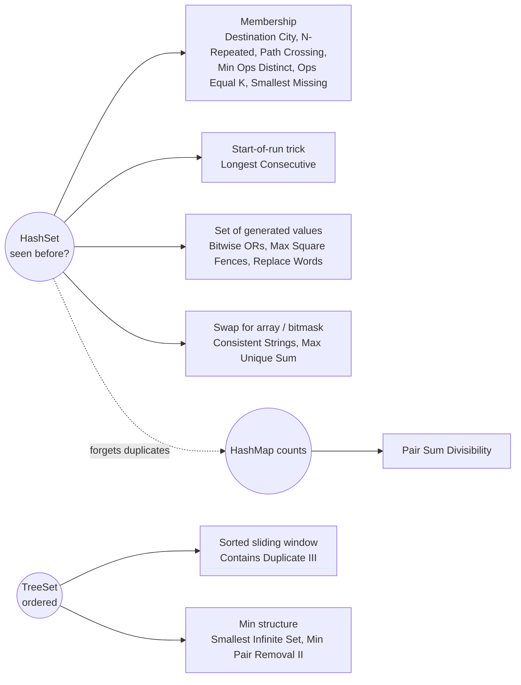

# HashSet: Pattern Map

> [!TIP]
> **🧠 One picture to keep**
> A **bouncer with a guest list**: "have I seen you before?" in O(1).
> Need order (smallest, ceiling, floor)? → **TreeSet**, O(log n). Need *how many* times? → a **HashMap of counts** (a set forgets duplicates!).
> Small fixed alphabet or range? → a `boolean[]` or an `int` bitmask beats the set.

**All animations:** [▶ HashSet Animations](https://d9-cell.github.io/java-brain/HashSet/HashSet%20Animations.html) · ⬆ [00 Brain Map](../00%20Brain%20Map.md)

## Java toolkit
| Need | Java |
|---|---|
| Seen before? | `if (!set.add(x)) /* duplicate */` (add returns false if present) |
| Sorted set queries | `TreeSet`: `ceiling`, `floor`, `higher`, `lower`, `first`, `pollFirst` |
| Points / pairs as keys | `((long) x << 32) \| (y & 0xffffffffL)` or `record P(int x, int y)` |
| Letters a–z | `boolean[26]` or `int mask \|= 1 << (c - 'a')` |
| Counts | `map.merge(key, 1, Integer::sum)` |
| Set of pairs ordered | `new TreeSet<long[]>((a, b) -> a[0] != b[0] ? Long.compare(a[0], b[0]) : Long.compare(a[1], b[1]))` |

## Patterns in this folder

| # | Problem | Pattern | Mantra | Level |
|---|---|---|---|---|
| 1 | [Array Pair Sum Divisibility Problem](Array%20Pair%20Sum%20Divisibility%20Problem.md) | Remainder counting, HashMap | COUNT REMAINDERS, r ↔ k−r, 0 & k/2 EVEN | Medium |
| 2 | [Bitwise ORs of Subarrays](Bitwise%20ORs%20of%20Subarrays.md) | Set of generated values, Bit monotonicity | PREV ORs | x, PLUS x; COLLECT ALL | Medium |
| 3 | [Contains Duplicate III](Contains%20Duplicate%20III.md) | TreeSet, Sliding window | WINDOW ≤ k, CEILING(v − t) ≤ v + t | Hard |
| 4 | [Count the Number of Consistent Strings](Count%20the%20Number%20of%20Consistent%20Strings.md) | HashSet, Boolean array, Bitmask | MASK, (word & ~allowed) == 0 | Easy |
| 5 | [Destination City](Destination%20City.md) | HashSet membership | SET OF SOURCES, FIND NON-SOURCE | Easy |
| 6 | [Longest Consecutive Sequence](Longest%20Consecutive%20Sequence.md) | HashSet, Start-of-run | START ONLY IF x−1 MISSING, WALK UP | Medium |
| 7 | [Maximum Square Area by Removing Fences From a Field](Maximum%20Square%20Area%20by%20Removing%20Fences%20From%20a%20Field.md) | Set of generated values | ADD BORDERS, SET OF WIDTHS, MATCH HEIGHTS | Medium |
| 8 | [Minimum Pair Removal to Sort Array II](Minimum%20Pair%20Removal%20to%20Sort%20Array%20II.md) | TreeSet as min-structure, Linked list simulation | TREESET(sum, idx) + LINKED LIST + BAD COUNT | Hard |
| 9 | [Replace Words (HashSet)](Replace%20Words%20%28HashSet%29.md) | HashSet of prefixes | PREFIXES SHORT → LONG, FIRST HIT | Medium |
| 10 | [Smallest Number in Infinite Set](Smallest%20Number%20in%20Infinite%20Set.md) | TreeSet, Counter + overflow set | TAIL COUNTER + TREESET OF RETURNS | Medium |
| 11 | [Maximum Unique Subarray Sum After Deletion](Maximum%20Unique%20Subarray%20Sum%20After%20Deletion.md) | Distinct positives, Boolean array | DISTINCT POSITIVES, ELSE MAX NON-POSITIVE | Easy |
| 12 | [Minimum Number of Operations to Make Elements in Array Distinct](Minimum%20Number%20of%20Operations%20to%20Make%20Elements%20in%20Array%20Distinct.md) | HashSet, Reverse scan | SCAN BACK, FIRST REPEAT i → ceil((i+1)/3) | Easy |
| 13 | [Minimum Operations to Make Array Values Equal to K](Minimum%20Operations%20to%20Make%20Array%20Values%20Equal%20to%20K.md) | Distinct counting | ANY < k → −1, ELSE #DISTINCT > k | Easy |
| 14 | [N-Repeated Element in Size 2N Array](N-Repeated%20Element%20in%20Size%202N%20Array.md) | HashSet, Pigeonhole | CHECK i−1 AND i−2, ELSE nums[0] | Easy |
| 15 | [Path Crossing](Path%20Crossing.md) | HashSet of points | WALK, SET OF POINTS, ADD FAILS → CROSS | Easy |
| 16 | [Smallest Missing Integer Greater Than Sequential Prefix Sum](Smallest%20Missing%20Integer%20Greater%20Than%20Sequential%20Prefix%20Sum.md) | HashSet membership | SUM SEQUENTIAL PREFIX, BUMP WHILE PRESENT | Easy |

## Suggested learning order
1. Warm-up: [Destination City](Destination%20City.md), [N-Repeated Element in Size 2N Array](N-Repeated%20Element%20in%20Size%202N%20Array.md), [Path Crossing](Path%20Crossing.md), [Minimum Operations to Make Array Values Equal to K](Minimum%20Operations%20to%20Make%20Array%20Values%20Equal%20to%20K.md)
2. [Count the Number of Consistent Strings](Count%20the%20Number%20of%20Consistent%20Strings.md) (set → array → bitmask)
3. [Longest Consecutive Sequence](Longest%20Consecutive%20Sequence.md) ⭐ classic
4. [Bitwise ORs of Subarrays](Bitwise%20ORs%20of%20Subarrays.md), [Maximum Square Area by Removing Fences From a Field](Maximum%20Square%20Area%20by%20Removing%20Fences%20From%20a%20Field.md)
5. TreeSet: [Smallest Number in Infinite Set](Smallest%20Number%20in%20Infinite%20Set.md), [Contains Duplicate III](Contains%20Duplicate%20III.md)
6. [Array Pair Sum Divisibility Problem](Array%20Pair%20Sum%20Divisibility%20Problem.md) (why counts beat a set)
7. Hard: [Minimum Pair Removal to Sort Array II](Minimum%20Pair%20Removal%20to%20Sort%20Array%20II.md)

## Connections to other folders
- Trie version of Replace Words: [Replace Words](../Trie/Replace%20Words.md) in Trie
- Sliding window family (Contains Duplicate III): [Sliding Window](../Sliding%20Window/Sliding%20Window%20-%20Pattern%20Map.md)
- Counting with maps: the `HashMap` folder
- Bitmask tricks: the `Bit_Magic` folder
