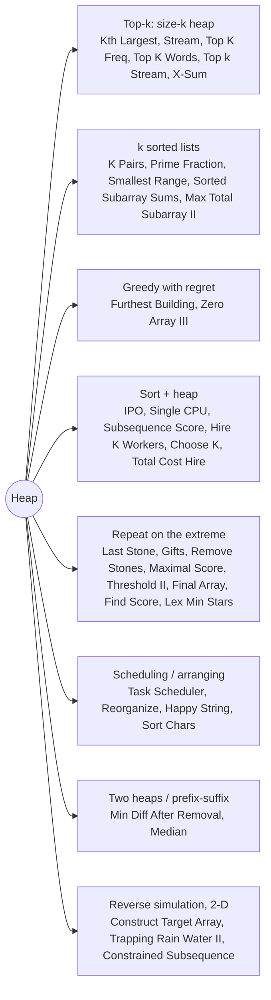

# Heap: Pattern Map

> [!TIP]
> **🧠 One picture to keep**
> A heap is a **bouncer who always knows the smallest (or largest) person in the room** — O(1) to look, O(log n) to let someone in or out.
> Five shapes to recognise:
> 1. **Top-k** → heap of size k with the *opposite* order (min-heap for the k largest).
> 2. **k sorted lists** → seed one head per list, pop and push its successor (K Pairs, Prime Fraction, Smallest Range, sorted subarray sums).
> 3. **Greedy with regret** → act now, keep receipts in a heap, undo the worst later (Furthest Building, Zero Array III).
> 4. **Sort + heap** → sort by one key, heap by another (IPO, CPU, Subsequence Score, Hire Workers).
> 5. **Lazy deletion** → push new versions, skip stale tops.

**All animations:** [▶ Heap Animations](https://d9-cell.github.io/java-brain/Heap/Heap%20Animations.html) · ⬆ [00 Brain Map](../00%20Brain%20Map.md)

## Java toolkit
| Need | Java |
|---|---|
| Min-heap | `new PriorityQueue<>()` |
| Max-heap | `new PriorityQueue<>(Collections.reverseOrder())` or `(a, b) -> b - a` |
| Heap of pairs | `new PriorityQueue<int[]>((a, b) -> a[0] != b[0] ? Integer.compare(a[0], b[0]) : a[1] - b[1])` |
| Safe comparator | `Integer.compare(a, b)` / `Long.compare` (avoid `a - b` with large values) |
| Keep k largest | `pq.offer(x); if (pq.size() > k) pq.poll();` |
| Values may overflow | `PriorityQueue<Long>` |

## Patterns in this folder

| # | Problem | Pattern | Mantra | Level |
|---|---|---|---|---|
| 1 | [Kth Largest Element in an Array](Kth%20Largest%20Element%20in%20an%20Array.md) | Top-k heap, Quickselect | MIN-HEAP SIZE k, TOP = ANSWER | Medium |
| 2 | [Kth Largest Element in a Stream](Kth%20Largest%20Element%20in%20a%20Stream.md) | Top-k heap | MIN-HEAP SIZE k | Easy |
| 3 | [Last Stone Weight](Last%20Stone%20Weight.md) | Repeat on the extreme | MAX-HEAP, SMASH TOP TWO | Easy |
| 4 | [Lexicographically Minimum String After Removing Stars](Lexicographically%20Minimum%20String%20After%20Removing%20Stars.md) | Heap of (char, -index), Per-letter stacks | PER-LETTER STACKS, DELETE SMALLEST LETTER'S RIGHTMOST | Medium |
| 5 | [Find K Pairs with Smallest Sums](Find%20K%20Pairs%20with%20Smallest%20Sums.md) | k sorted lists | SEED COLUMN 0, POP → PUSH RIGHT NEIGHBOUR | Medium |
| 6 | [K-th Smallest Prime Fraction](K-th%20Smallest%20Prime%20Fraction.md) | k sorted lists | SEED arr[i]/arr[n−1], POP k−1 TIMES | Medium |
| 7 | [Furthest Building You Can Reach](Furthest%20Building%20You%20Can%20Reach.md) | Greedy with regret | BRICKS FIRST, MAX-HEAP OF CLIMBS, RETRO-FIT LADDER | Medium |
| 8 | [IPO](IPO.md) | Sort + heap | SORT BY CAPITAL, UNLOCK, TAKE MAX PROFIT | Hard |
| 9 | [Construct Target Array With Multiple Sums](Construct%20Target%20Array%20With%20Multiple%20Sums.md) | Reverse simulation, Max-heap | MAX-HEAP, prev = max % rest | Hard |
| 10 | [Find Score of an Array After Marking All Elements](Find%20Score%20of%20an%20Array%20After%20Marking%20All%20Elements.md) | Repeat on the extreme, Lazy skip | MIN-HEAP (value, index), SKIP MARKED | Medium |
| 11 | [Constrained Subsequence Sum](Constrained%20Subsequence%20Sum.md) | DP + heap, Sliding window max | dp = num + max(0, best in window) | Hard |
| 12 | [Choose K Elements With Maximum Sum](Choose%20K%20Elements%20With%20Maximum%20Sum.md) | Sort + heap | SORT BY nums1, MIN-HEAP OF k LARGEST nums2 | Medium |
| 13 | [Longest Happy String](Longest%20Happy%20String.md) | Greedy + heap | MAX-HEAP, AVOID 3-RUN WITH RUNNER-UP | Medium |
| 14 | [Maximal Score After Applying K Operations](Maximal%20Score%20After%20Applying%20K%20Operations.md) | Repeat on the extreme | MAX-HEAP, ADD x, PUSH ceil(x/3) | Medium |
| 15 | [Maximum Subsequence Score](Maximum%20Subsequence%20Score.md) | Sort + heap | SORT nums2 ↓, MIN-HEAP KEEPS k LARGEST nums1 | Medium |
| 16 | [Maximum Total Subarray Value II](Maximum%20Total%20Subarray%20Value%20II.md) | k sorted lists, Sparse table | SEED [l, n−1], POP k, PUSH [l, r−1] | Hard |
| 17 | [Minimum Cost to Hire K Workers](Minimum%20Cost%20to%20Hire%20K%20Workers.md) | Sort + heap | SORT BY RATIO, MAX-HEAP DROPS BIGGEST QUALITY | Hard |
| 18 | [Minimum Difference in Sums After Removal of Elements](Minimum%20Difference%20in%20Sums%20After%20Removal%20of%20Elements.md) | Prefix/suffix heaps | PREFIX n SMALLEST, SUFFIX n LARGEST, TRY EVERY SPLIT | Hard |
| 19 | [Minimum Operations to Exceed Threshold Value II](Minimum%20Operations%20to%20Exceed%20Threshold%20Value%20II.md) | Repeat on the extreme | MIN-HEAP OF LONG, 2·min + max | Medium |
| 20 | [Range Sum of Sorted Subarray Sums](Range%20Sum%20of%20Sorted%20Subarray%20Sums.md) | k sorted lists | SEED SINGLES, POP, EXTEND BY ONE | Medium |
| 21 | [Remove Stones to Minimize the Total](Remove%20Stones%20to%20Minimize%20the%20Total.md) | Repeat on the extreme | MAX-HEAP, REMOVE floor(x/2) | Medium |
| 22 | [Single-Threaded CPU](Single-Threaded%20CPU.md) | Sort + heap, Simulation | SORT BY ENQUEUE, HEAP (duration, index), JUMP WHEN IDLE | Medium |
| 23 | [Smallest Range Covering Elements from K Lists](Smallest%20Range%20Covering%20Elements%20from%20K%20Lists.md) | k sorted lists | HEAP OF HEADS, TRACK MAX, ADVANCE MIN | Hard |
| 24 | [Reorganize String](Reorganize%20String.md) | Greedy arrangement | MAX ≤ (n+1)/2, EVEN SLOTS FIRST | Medium |
| 25 | [Sort Characters By Frequency](Sort%20Characters%20By%20Frequency.md) | Counting + heap | COUNT, POUR BY COUNT | Medium |
| 26 | [Top K Frequent Elements](Top%20K%20Frequent%20Elements.md) | Top-k heap, Bucket sort | COUNT, BUCKET BY FREQ, READ HIGH → LOW | Medium |
| 27 | [Top K Frequent Words](Top%20K%20Frequent%20Words.md) | Top-k heap | MIN-HEAP OF WORST, REVERSE AT THE END | Medium |
| 28 | [Task Scheduler](Task%20Scheduler.md) | Greedy + heap, Math | CYCLES OF n+1, MOST FREQUENT FIRST | Medium |
| 29 | [Top k numbers in a stream](Top%20k%20numbers%20in%20a%20stream.md) | Ranking with bubbling | RANKED ARRAY OF k+1, BUBBLE THE NEW ONE | Medium |
| 30 | [Total Cost to Hire K Workers](Total%20Cost%20to%20Hire%20K%20Workers.md) | Two heaps | TWO MIN-HEAPS, REFILL FROM THE MIDDLE | Medium |
| 31 | [Trapping Rain Water II](Trapping%20Rain%20Water%20II.md) | Min-heap BFS from the boundary | BORDER IN MIN-HEAP, EXPAND LOWEST, FILL TO WALL | Hard |
| 32 | [Zero Array Transformation III](Zero%20Array%20Transformation%20III.md) | Greedy with regret, Difference array | SWEEP, HEAP OF ENDS, DIFF ARRAY, q − used | Medium |
| 33 | [Final Array State After K Multiplication Operations I](Final%20Array%20State%20After%20K%20Multiplication%20Operations%20I.md) | Repeat on the extreme | MIN-HEAP (value, index) | Easy |
| 34 | [Find X-Sum of All K-Long Subarrays I](Find%20X-Sum%20of%20All%20K-Long%20Subarrays%20I.md) | Sliding window + heap | SLIDE FREQ MAP, HEAP TOP x | Easy |
| 35 | [Take Gifts From the Richest Pile](Take%20Gifts%20From%20the%20Richest%20Pile.md) | Repeat on the extreme | MAX-HEAP, PUSH floor(√x) | Easy |

## Suggested learning order
1. Basics: [Last Stone Weight](Last%20Stone%20Weight.md), [Kth Largest Element in an Array](Kth%20Largest%20Element%20in%20an%20Array.md) ⭐, [Kth Largest Element in a Stream](Kth%20Largest%20Element%20in%20a%20Stream.md), [Take Gifts From the Richest Pile](Take%20Gifts%20From%20the%20Richest%20Pile.md)
2. Top-k: [Top K Frequent Elements](Top%20K%20Frequent%20Elements.md) ⭐, [Top K Frequent Words](Top%20K%20Frequent%20Words.md), [Sort Characters By Frequency](Sort%20Characters%20By%20Frequency.md)
3. k sorted lists: [Find K Pairs with Smallest Sums](Find%20K%20Pairs%20with%20Smallest%20Sums.md) → [K-th Smallest Prime Fraction](K-th%20Smallest%20Prime%20Fraction.md) → [Smallest Range Covering Elements from K Lists](Smallest%20Range%20Covering%20Elements%20from%20K%20Lists.md)
4. Sort + heap: [IPO](IPO.md), [Single-Threaded CPU](Single-Threaded%20CPU.md), [Maximum Subsequence Score](Maximum%20Subsequence%20Score.md), [Minimum Cost to Hire K Workers](Minimum%20Cost%20to%20Hire%20K%20Workers.md)
5. Greedy with regret: [Furthest Building You Can Reach](Furthest%20Building%20You%20Can%20Reach.md), [Zero Array Transformation III](Zero%20Array%20Transformation%20III.md)
6. Scheduling: [Task Scheduler](Task%20Scheduler.md) ⭐, [Reorganize String](Reorganize%20String.md), [Longest Happy String](Longest%20Happy%20String.md)
7. Hard: [Trapping Rain Water II](Trapping%20Rain%20Water%20II.md), [Construct Target Array With Multiple Sums](Construct%20Target%20Array%20With%20Multiple%20Sums.md), [Minimum Difference in Sums After Removal of Elements](Minimum%20Difference%20in%20Sums%20After%20Removal%20of%20Elements.md), [Maximum Total Subarray Value II](Maximum%20Total%20Subarray%20Value%20II.md)

## Connections to other folders
- Two heaps for the median: [Find Median from Data Stream](../Design/Find%20Median%20from%20Data%20Stream.md) (Design)
- Line sweep + heap (Meeting Rooms): [Line Sweep](../Line%20Sweep/Line%20Sweep%20-%20Pattern%20Map.md)
- Deque instead of heap (Constrained Subsequence Sum): [Sliding Window Maximum](../Sliding%20Window/Sliding%20Window%20Maximum.md) in [Sliding Window](../Sliding%20Window/Sliding%20Window%20-%20Pattern%20Map.md)
- 1-D Trapping Rain Water: the `Stack` folder
- Dijkstra = heap on graphs: the `Graph` folder
