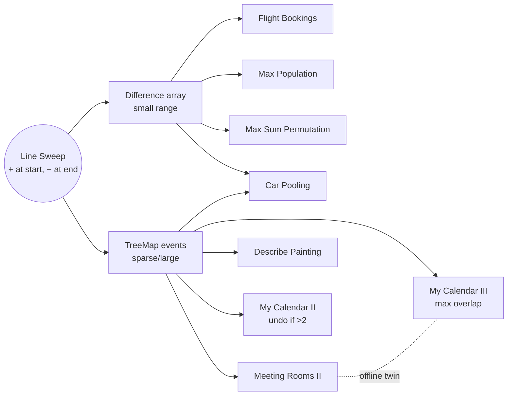

# Line Sweep: Pattern Map

> [!TIP]
> **🧠 One picture to keep**
> A **bus conductor's notebook**: write only the moments something changes (+k at a start, −k at an end). Read the notebook left to right with a running sum, and you know the count at every moment.
> Two flavours: **difference array** (small coordinate range) and **TreeMap of events** (big or sparse coordinates).
> !300

**All animations:** [▶ Line Sweep Animations](https://d9-cell.github.io/java-brain/Line%20Sweep/Line%20Sweep%20Animations.html) · ⬆ [00 Brain Map](../00%20Brain%20Map.md)

## Java toolkit
| Need | Java |
|---|---|
| Sorted events with += | `TreeMap<Integer,Integer> ev; ev.merge(t, d, Integer::sum);` |
| Sweep in time order | `for (int d : ev.values())` (TreeMap iterates in key order) |
| Small range | `int[] diff = new int[MAX + 2]; diff[l] += x; diff[r + 1] -= x;` |
| Half-open [s, e) | −x at `e` |
| Closed [s, e] | −x at `e + 1` |
| Sort pairs with tie-break | `Arrays.sort(ev, (a, b) -> a[0] != b[0] ? Integer.compare(a[0], b[0]) : Integer.compare(a[1], b[1]))` |

## Patterns in this folder

| # | Problem | Pattern | Mantra | Level |
|---|---|---|---|---|
| 1 | [Car Pooling](Car%20Pooling.md) | Line sweep, Difference array | + AT START, − AT END, RUNNING SUM ≤ CAP | Medium |
| 2 | [Corporate Flight Bookings](Corporate%20Flight%20Bookings.md) | Difference array | diff[l] += x; diff[r+1] −= x; PREFIX | Medium |
| 3 | [Describe the Painting](Describe%20the%20Painting.md) | Line sweep, TreeMap | BOUNDARIES CUT PIECES, SUM > 0 → EMIT | Medium |
| 4 | [Maximum Population Year](Maximum%20Population%20Year.md) | Difference array, Sorted events | BIRTH +1, DEATH −1, FIRST MAX | Easy |
| 5 | [Maximum Sum Obtained of Any Permutation](Maximum%20Sum%20Obtained%20of%20Any%20Permutation.md) | Difference array, Greedy sorting | COUNT COVERAGE, SORT BOTH, BIG×BIG | Medium |
| 6 | [Meeting Rooms II](Meeting%20Rooms%20II.md) | Line sweep, Max overlap | MAX OVERLAP = ROOMS | Medium |
| 7 | [My Calendar II](My%20Calendar%20II.md) | Line sweep, Undo on failure | ADD, SWEEP, >2 → UNDO | Medium |
| 8 | [My Calendar III](My%20Calendar%20III.md) | Line sweep, Max overlap | ADD, SWEEP, RETURN MAX | Hard |

## Suggested learning order
1. [Corporate Flight Bookings](Corporate%20Flight%20Bookings.md): pure difference array.
2. [Car Pooling](Car%20Pooling.md): both flavours.
3. [Maximum Population Year](Maximum%20Population%20Year.md): tie-breaking.
4. [Meeting Rooms II](Meeting%20Rooms%20II.md): max overlap.
5. [My Calendar III](My%20Calendar%20III.md) then [My Calendar II](My%20Calendar%20II.md): online versions.
6. [Describe the Painting](Describe%20the%20Painting.md): boundaries matter.
7. [Maximum Sum Obtained of Any Permutation](Maximum%20Sum%20Obtained%20of%20Any%20Permutation.md): sweep + greedy.

## Connections to other folders
- Range updates in O(log n) when queries interleave: [Segment Tree](../Segment%20Tree/Segment%20Tree%20-%20Pattern%20Map.md) (lazy propagation)
- Meeting Rooms II with a min-heap: the `Heap` folder
- Prefix sums in general: the `Arrays` folder
