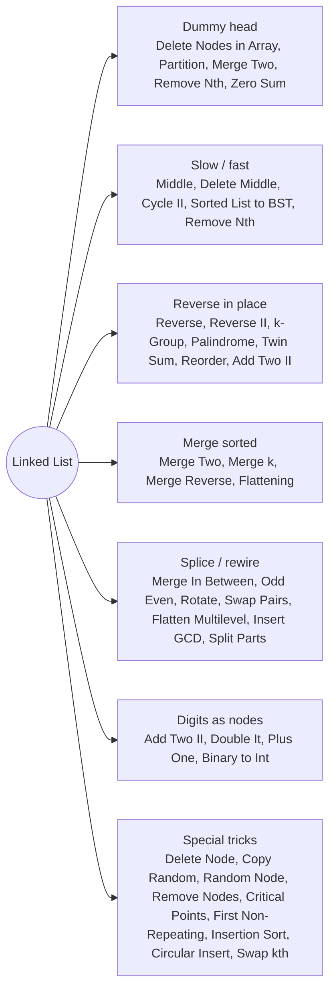

# Linked List: Pattern Map

> [!TIP]
> **🧠 One picture to keep**
> Draw **boxes and arrows**, and change one arrow per line. Five tools cover nearly every problem:
> 1. **Dummy head** — the first node stops being special.
> 2. **Slow / fast pointers** — middle, cycle, n-th from the end (fixed gap).
> 3. **Reverse in place** — prev / cur / next; reversing the second half unlocks palindrome, twin sum, reorder.
> 4. **Merge two sorted** — the building block of merge k, flattening, sort list.
> 5. **Head insertion** — move the node after `cur` to the front of a window (Reverse II, k-Group).
> All solutions use LeetCode's node: `class ListNode { int val; ListNode next; ListNode(int v) { val = v; } ListNode(int v, ListNode n) { val = v; next = n; } }`

**All animations:** [▶ Linked List Animations](https://d9-cell.github.io/java-brain/Linked%20List/Linked%20List%20Animations.html) · ⬆ [00 Brain Map](../00%20Brain%20Map.md)

## Java toolkit
| Need | Java |
|---|---|
| Dummy head | `ListNode dummy = new ListNode(0, head), t = dummy; … return dummy.next;` |
| Middle | `while (fast != null && fast.next != null) { slow = slow.next; fast = fast.next.next; }` |
| Reverse | `ListNode prev = null; while (h != null) { ListNode nx = h.next; h.next = prev; prev = h; h = nx; }` |
| Min-heap of nodes | `new PriorityQueue<ListNode>((a, b) -> Integer.compare(a.val, b.val))` |
| Node identity map | `Map<Node, Node>` (IdentityHashMap if equals is overridden) |
| Deep recursion | lists can be 1e5 long — prefer iterative versions in Java |

## Patterns in this folder

| # | Problem | Pattern | Mantra | Level |
|---|---|---|---|---|
| 1 | [Add Two Numbers II](Add%20Two%20Numbers%20II.md) | Digits as nodes, Stack / reverse | STACKS (OR REVERSE), PREPEND | Medium |
| 2 | [Convert Sorted List to Binary Search Tree](Convert%20Sorted%20List%20to%20Binary%20Search%20Tree.md) | Slow / fast, Divide and conquer | MIDDLE = ROOT, RECURSE HALVES | Medium |
| 3 | [Copy List with Random Pointer](Copy%20List%20with%20Random%20Pointer.md) | Interleaving | INTERLEAVE, SET random, UNZIP | Medium |
| 4 | [Delete Node in a Linked List](Delete%20Node%20in%20a%20Linked%20List.md) | Copy successor | COPY NEXT VALUE, SKIP NEXT | Medium |
| 5 | [Delete Nodes From Linked List Present in Array](Delete%20Nodes%20From%20Linked%20List%20Present%20in%20Array.md) | Dummy head, HashSet | SET + DUMMY + LOOK AHEAD | Medium |
| 6 | [Delete the Middle Node of a Linked List](Delete%20the%20Middle%20Node%20of%20a%20Linked%20List.md) | Slow / fast | fast = head.next.next | Medium |
| 7 | [Double a Number Represented as a Linked List](Double%20a%20Number%20Represented%20as%20a%20Linked%20List.md) | Digits as nodes | CARRY = NEXT ≥ 5 | Medium |
| 8 | [First non-repeating character in a stream](First%20non-repeating%20character%20in%20a%20stream.md) | Doubly linked list / queue | QUEUE / DLL OF CANDIDATES | Medium |
| 9 | [Find the Minimum and Maximum Number of Nodes Between Critical Points](Find%20the%20Minimum%20and%20Maximum%20Number%20of%20Nodes%20Between%20Critical%20Points.md) | One pass with prev/next | TRACK first, last, minGap | Medium |
| 10 | [Flatten a Multilevel Doubly Linked List](Flatten%20a%20Multilevel%20Doubly%20Linked%20List.md) | Splicing | CHILD BETWEEN cur AND cur.next | Medium |
| 11 | [Flattening a Linked List](Flattening%20a%20Linked%20List.md) | Merge sorted | FLATTEN RIGHT, MERGE TWO SORTED | Medium |
| 12 | [Insert Greatest Common Divisors in Linked List](Insert%20Greatest%20Common%20Divisors%20in%20Linked%20List.md) | Splicing | INSERT gcd, JUMP TWO | Medium |
| 13 | [Insertion Sort List](Insertion%20Sort%20List.md) | Dummy head | DUMMY, FIND SLOT, INSERT | Medium |
| 14 | [Convert Binary Number in a Linked List to Integer](Convert%20Binary%20Number%20in%20a%20Linked%20List%20to%20Integer.md) | Digits as nodes | v = 2v + bit | Easy |
| 15 | [Linked List Cycle II](Linked%20List%20Cycle%20II.md) | Floyd cycle detection | FLOYD MEET, RESET ONE TO HEAD | Medium |
| 16 | [Linked List Random Node](Linked%20List%20Random%20Node.md) | Reservoir sampling | RESERVOIR SAMPLING | Medium |
| 17 | [Maximum Twin Sum of a Linked List](Maximum%20Twin%20Sum%20of%20a%20Linked%20List.md) | Reverse second half | MIDDLE, REVERSE SECOND HALF, PAIR UP | Medium |
| 18 | [Merge 2 sorted linked list in reverse order](Merge%202%20sorted%20linked%20list%20in%20reverse%20order.md) | Merge sorted, Prepend | MERGE + PREPEND | Medium |
| 19 | [Merge In Between Linked Lists](Merge%20In%20Between%20Linked%20Lists.md) | Splicing | FIND a−1 AND b+1, SPLICE | Medium |
| 20 | [Merge k Sorted Lists](Merge%20k%20Sorted%20Lists.md) | Merge sorted, Heap, Divide and conquer | MIN-HEAP OF HEADS (OR DIVIDE & CONQUER) | Hard |
| 21 | [Merge Nodes in Between Zeros](Merge%20Nodes%20in%20Between%20Zeros.md) | In-place rewiring | REUSE ZEROS AS HOLDERS | Medium |
| 22 | [Merge Two Sorted Lists](Merge%20Two%20Sorted%20Lists.md) | Merge sorted, Dummy head | DUMMY + TAIL, TAKE SMALLER, ATTACH REST | Easy |
| 23 | [Middle of the Linked List](Middle%20of%20the%20Linked%20List.md) | Slow / fast | SLOW 1, FAST 2 | Easy |
| 24 | [Odd Even Linked List](Odd%20Even%20Linked%20List.md) | In-place rewiring | TWO CHAINS IN PLACE, ODDS THEN EVENS | Medium |
| 25 | [Palindrome Linked List](Palindrome%20Linked%20List.md) | Reverse second half | MIDDLE, REVERSE SECOND HALF, COMPARE | Easy |
| 26 | [Partition List](Partition%20List.md) | Two dummy chains | TWO DUMMY CHAINS, more.next = null | Medium |
| 27 | [Plus One Linked List](Plus%20One%20Linked%20List.md) | Digits as nodes | LAST NON-9 ++, ZEROS AFTER, SENTINEL | Medium |
| 28 | [Remove Nodes From Linked List](Remove%20Nodes%20From%20Linked%20List.md) | Monotonic stack / recursion | RECURSE RIGHT, KEEP IF ≥ NEXT | Medium |
| 29 | [Remove Nth Node From End of List](Remove%20Nth%20Node%20From%20End%20of%20List.md) | Two pointers with a gap | GAP n, MOVE BOTH, UNLINK slow.next | Medium |
| 30 | [Remove Zero Sum Consecutive Nodes from Linked List](Remove%20Zero%20Sum%20Consecutive%20Nodes%20from%20Linked%20List.md) | Prefix sums | LAST NODE PER PREFIX SUM, JUMP | Medium |
| 31 | [Reorder List](Reorder%20List.md) | Middle + reverse + merge | MIDDLE, REVERSE SECOND HALF, ZIP | Medium |
| 32 | [Reverse Linked List](Reverse%20Linked%20List.md) | Reverse in place | SAVE NEXT, FLIP, ADVANCE | Easy |
| 33 | [Reverse Linked List II](Reverse%20Linked%20List%20II.md) | Head insertion | STOP BEFORE left, HEAD-INSERT right−left TIMES | Medium |
| 34 | [Reverse Nodes in k-Group](Reverse%20Nodes%20in%20k-Group.md) | Head insertion | COUNT, HEAD-INSERT k−1 PER GROUP | Hard |
| 35 | [Rotate List](Rotate%20List.md) | Ring and cut | k %= len, RING, CUT | Medium |
| 36 | [Sorted insert for circular linked list](Sorted%20insert%20for%20circular%20linked%20list.md) | Circular list | SMALLER THAN HEAD → NEW HEAD; ELSE AFTER LAST ≤ | Medium |
| 37 | [Split Linked List in Parts](Split%20Linked%20List%20in%20Parts.md) | Counting | SIZE = n/k (+1 FOR FIRST n%k) | Medium |
| 38 | [Swap Nodes in Pairs](Swap%20Nodes%20in%20Pairs.md) | Recursion | SECOND → HEAD → SWAP(REST) | Medium |
| 39 | [Swapping Nodes in a Linked List](Swapping%20Nodes%20in%20a%20Linked%20List.md) | Two pointers with a gap | FIND FIRST, TRAIL TO SECOND, SWAP VALUES | Medium |

## Suggested learning order
1. Core: [Reverse Linked List](Reverse%20Linked%20List.md) ⭐, [Middle of the Linked List](Middle%20of%20the%20Linked%20List.md), [Merge Two Sorted Lists](Merge%20Two%20Sorted%20Lists.md) ⭐, [Linked List Cycle II](Linked%20List%20Cycle%20II.md) ⭐
2. Pointers with a gap: [Remove Nth Node From End of List](Remove%20Nth%20Node%20From%20End%20of%20List.md), [Swapping Nodes in a Linked List](Swapping%20Nodes%20in%20a%20Linked%20List.md), [Delete the Middle Node of a Linked List](Delete%20the%20Middle%20Node%20of%20a%20Linked%20List.md)
3. Reverse + middle combos: [Palindrome Linked List](Palindrome%20Linked%20List.md), [Maximum Twin Sum of a Linked List](Maximum%20Twin%20Sum%20of%20a%20Linked%20List.md), [Reorder List](Reorder%20List.md)
4. Windows: [Reverse Linked List II](Reverse%20Linked%20List%20II.md) → [Reverse Nodes in k-Group](Reverse%20Nodes%20in%20k-Group.md)
5. Merging: [Merge k Sorted Lists](Merge%20k%20Sorted%20Lists.md), [Flattening a Linked List](Flattening%20a%20Linked%20List.md), [Merge 2 sorted linked list in reverse order](Merge%202%20sorted%20linked%20list%20in%20reverse%20order.md)
6. Rewiring: [Odd Even Linked List](Odd%20Even%20Linked%20List.md), [Partition List](Partition%20List.md), [Rotate List](Rotate%20List.md), [Swap Nodes in Pairs](Swap%20Nodes%20in%20Pairs.md), [Merge In Between Linked Lists](Merge%20In%20Between%20Linked%20Lists.md), [Split Linked List in Parts](Split%20Linked%20List%20in%20Parts.md), [Flatten a Multilevel Doubly Linked List](Flatten%20a%20Multilevel%20Doubly%20Linked%20List.md)
7. Tricks: [Copy List with Random Pointer](Copy%20List%20with%20Random%20Pointer.md), [Delete Node in a Linked List](Delete%20Node%20in%20a%20Linked%20List.md), [Linked List Random Node](Linked%20List%20Random%20Node.md), [Remove Zero Sum Consecutive Nodes from Linked List](Remove%20Zero%20Sum%20Consecutive%20Nodes%20from%20Linked%20List.md), [Remove Nodes From Linked List](Remove%20Nodes%20From%20Linked%20List.md)
8. Digits: [Add Two Numbers II](Add%20Two%20Numbers%20II.md), [Double a Number Represented as a Linked List](Double%20a%20Number%20Represented%20as%20a%20Linked%20List.md), [Plus One Linked List](Plus%20One%20Linked%20List.md), [Convert Binary Number in a Linked List to Integer](Convert%20Binary%20Number%20in%20a%20Linked%20List%20to%20Integer.md)
9. The rest: [Convert Sorted List to Binary Search Tree](Convert%20Sorted%20List%20to%20Binary%20Search%20Tree.md), [Delete Nodes From Linked List Present in Array](Delete%20Nodes%20From%20Linked%20List%20Present%20in%20Array.md), [Find the Minimum and Maximum Number of Nodes Between Critical Points](Find%20the%20Minimum%20and%20Maximum%20Number%20of%20Nodes%20Between%20Critical%20Points.md), [Insert Greatest Common Divisors in Linked List](Insert%20Greatest%20Common%20Divisors%20in%20Linked%20List.md), [Insertion Sort List](Insertion%20Sort%20List.md), [Merge Nodes in Between Zeros](Merge%20Nodes%20in%20Between%20Zeros.md), [Sorted insert for circular linked list](Sorted%20insert%20for%20circular%20linked%20list.md), [First non-repeating character in a stream](First%20non-repeating%20character%20in%20a%20stream.md)

## Connections to other folders
- LRU / LFU caches use doubly linked lists: [LRU Cache](../Design/LRU%20Cache.md), [LFU Cache](../Design/LFU%20Cache.md) (Design)
- Merge k with a heap: [Heap](../Heap/Heap%20-%20Pattern%20Map.md)
- Remove Nodes uses a monotonic stack: [Stack](../Stack/Stack%20-%20Pattern%20Map.md)
- Floyd cycle detection also finds duplicates in arrays (Find the Duplicate Number, Arrays folder)
