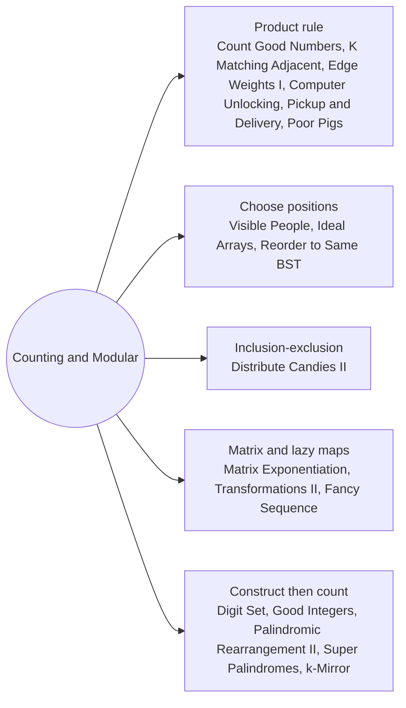

# Counting and Modular Combinatorics: Pattern Map

> [!TIP]
> **🧠 One picture to keep**
> Count the **structure**, not the objects: choose positions, multiply independent choices, and reduce mod 1e9+7 after every product.
> 1. **Product rule**: independent slots multiply (Count Good Numbers, K Matching Adjacent, Edge Weights, Computer Unlocking).
> 2. **Choose positions**: nCr with factorials and Fermat inverses, or Pascal (Visible People, Ideal Arrays, Reorder to Same BST).
> 3. **Inclusion-exclusion**: count all, remove the cases that break a limit (Distribute Candies II).
> 4. **Linear recurrences**: a transition matrix raised to the t-th power, or a lazy global affine map (Matrix Exponentiation, Transformations II, Fancy Sequence).
> 5. **Construct, then count**: generate palindromes or prefixes in order instead of scanning numbers (Digit Set, Good Integers, Palindromic Rearrangement II, Super Palindromes, k-Mirror).

**All animations:** [▶ Counting and Modular Combinatorics Animations](https://d9-cell.github.io/java-brain/Mathematical/Counting%20and%20Modular%20Combinatorics/Counting%20and%20Modular%20Combinatorics%20Animations.html) · ⬆ [00 Brain Map](../../00%20Brain%20Map.md)

## Java toolkit
| Need | Java |
|---|---|
| Modular product | `ways = ways * x % MOD;` with long and MOD = 1_000_000_007 |
| Fast power | `if ((e & 1) == 1) r = r * b % MOD; b = b * b % MOD; e >>= 1;` |
| Modular inverse (MOD prime) | `power(a, MOD - 2)` |
| Factorials and inverses | `fact[i] = fact[i - 1] * i % MOD; inv[i - 1] = inv[i] * i % MOD;` |
| Pascal's triangle | `C[i][j] = (C[i - 1][j - 1] + C[i - 1][j]) % MOD;` |
| Stars and bars | ways to split n into r non-negative parts = C(n + r − 1, r − 1) |

## Patterns in this folder

| # | Problem | Pattern | Mantra | Level |
|---|---|---|---|---|
| 1 | [Count Good Numbers](Count%20Good%20Numbers.md) | Product rule, Fast power | power(5, (n+1)/2) · power(4, n/2) % MOD | Medium |
| 2 | [Count All Valid Pickup and Delivery Options](Count%20All%20Valid%20Pickup%20and%20Delivery%20Options.md) | Insertion counting | ways *= (2i − 1) · i | Hard |
| 3 | [Direction Assignments with Exactly K Visible People](Direction%20Assignments%20with%20Exactly%20K%20Visible%20People.md) | Choose positions, Fermat inverse | 2 · C(n − 1, k) % MOD | Medium |
| 4 | [Count the Number of Arrays with K Matching Adjacent Elements](Count%20the%20Number%20of%20Arrays%20with%20K%20Matching%20Adjacent%20Elements.md) | Choose positions, Factorials | m · C(n−1, k) · (m−1)^(n−1−k) | Hard |
| 5 | [Count the Number of Ideal Arrays](Count%20the%20Number%20of%20Ideal%20Arrays.md) | Prime exponents, Stars and bars | FOR v: Π over primes C(n−1+e, e) · sum | Hard |
| 6 | [Number of Ways to Reorder Array to Get Same BST](Number%20of%20Ways%20to%20Reorder%20Array%20to%20Get%20Same%20BST.md) | Interleavings, Pascal | ways(list) = C(n−1, |L|) · ways(L) · ways(R) · RETURN ways − 1 | Hard |
| 7 | [Count the Number of Computer Unlocking Permutations](Count%20the%20Number%20of%20Computer%20Unlocking%20Permutations.md) | Observation, Factorial | any c[i] ≤ c[0] → 0 · ELSE (n − 1)! | Medium |
| 8 | [Number of Ways to Assign Edge Weights I](Number%20of%20Ways%20to%20Assign%20Edge%20Weights%20I.md) | BFS depth, Parity counting | d = max depth from node 1 · RETURN 2^(d − 1) | Medium |
| 9 | [Distribute Candies Among Children II](Distribute%20Candies%20Among%20Children%20II.md) | Stars and bars, Inclusion-exclusion | Σ (−1)^j · C(3, j) · C(n − j(limit+1) + 2, 2) | Medium |
| 10 | [Poor Pigs](Poor%20Pigs.md) | Information counting | states = test/die + 1 · smallest p with states^p ≥ buckets | Hard |
| 11 | [Matrix Exponentiation](Matrix%20Exponentiation.md) | Linear recurrence, Matrix power | M = (1 1 / 1 0) · M^n has F(n) in the top-right corner | Medium |
| 12 | [Total Characters in String After Transformations II](Total%20Characters%20in%20String%20After%20Transformations%20II.md) | Matrix power, Letter counts | T[(c+j)%26][c]++ · P = T^t · Σ P · counts | Hard |
| 13 | [Fancy Sequence](Fancy%20Sequence.md) | Lazy affine map, Modular inverse | append: (v − add) · mul⁻¹ · addAll: add += inc · multAll: mul, add *= m · get: v·mul + add | Hard |
| 14 | [Numbers At Most N Given Digit Set](Numbers%20At%20Most%20N%20Given%20Digit%20Set.md) | Digit counting | Σ d^len (len < L) · per position: smaller → + d^(L−1−i) · no equal → stop · end → +1 | Hard |
| 15 | [Find the Count of Good Integers](Find%20the%20Count%20of%20Good%20Integers.md) | Generate palindromes, Multiset permutations | FOR half: pal % k == 0 · new multiset → (n − c0)·(n−1)! / Π c! | Hard |
| 16 | [Smallest Palindromic Rearrangement II](Smallest%20Palindromic%20Rearrangement%20II.md) | Greedy by block size, Capped multinomial | FOR pos: FOR c: ways = arrangements(rest) · ways ≥ k → take c · ELSE k −= ways | Hard |
| 17 | [Super Palindromes](Super%20Palindromes.md) | Generate palindromes | FOR half < 10⁵: p odd and even · p² in [L, R] && palindrome → count | Hard |
| 18 | [Sum of k-Mirror Numbers](Sum%20of%20k-Mirror%20Numbers.md) | Generate palindromes, Base k | FOR len, FOR half: mirror → p · palindrome in base k → sum, found++ | Hard |

## Suggested learning order
1. [Count Good Numbers](Count%20Good%20Numbers.md) ⭐, [Count the Number of Computer Unlocking Permutations](Count%20the%20Number%20of%20Computer%20Unlocking%20Permutations.md), [Number of Ways to Assign Edge Weights I](Number%20of%20Ways%20to%20Assign%20Edge%20Weights%20I.md), [Poor Pigs](Poor%20Pigs.md)
2. [Count All Valid Pickup and Delivery Options](Count%20All%20Valid%20Pickup%20and%20Delivery%20Options.md), [Direction Assignments with Exactly K Visible People](Direction%20Assignments%20with%20Exactly%20K%20Visible%20People.md), [Count the Number of Arrays with K Matching Adjacent Elements](Count%20the%20Number%20of%20Arrays%20with%20K%20Matching%20Adjacent%20Elements.md) ⭐
3. [Distribute Candies Among Children II](Distribute%20Candies%20Among%20Children%20II.md), [Number of Ways to Reorder Array to Get Same BST](Number%20of%20Ways%20to%20Reorder%20Array%20to%20Get%20Same%20BST.md), [Count the Number of Ideal Arrays](Count%20the%20Number%20of%20Ideal%20Arrays.md)
4. [Matrix Exponentiation](Matrix%20Exponentiation.md) ⭐, [Total Characters in String After Transformations II](Total%20Characters%20in%20String%20After%20Transformations%20II.md), [Fancy Sequence](Fancy%20Sequence.md)
5. [Numbers At Most N Given Digit Set](Numbers%20At%20Most%20N%20Given%20Digit%20Set.md), [Super Palindromes](Super%20Palindromes.md), [Sum of k-Mirror Numbers](Sum%20of%20k-Mirror%20Numbers.md), [Find the Count of Good Integers](Find%20the%20Count%20of%20Good%20Integers.md), [Smallest Palindromic Rearrangement II](Smallest%20Palindromic%20Rearrangement%20II.md)

## Connections to other folders
- [Digits and Powers - Pattern Map](../Digits%20and%20Powers/Digits%20and%20Powers%20-%20Pattern%20Map.md) for fast power and digit loops
- [Primes Divisors and Remainders - Pattern Map](../Primes%20Divisors%20and%20Remainders/Primes%20Divisors%20and%20Remainders%20-%20Pattern%20Map.md) for factorisation
- [Counting Walks and Moves - Pattern Map](../../DP/Counting%20Walks%20and%20Moves/Counting%20Walks%20and%20Moves%20-%20Pattern%20Map.md) for the DP form of the same recurrences
- [Total Characters in String After Transformations I](../../HashMap/Total%20Characters%20in%20String%20After%20Transformations%20I.md) for the one-step DP version
