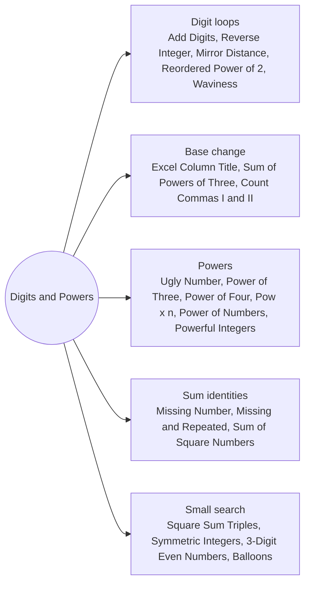

# Digits and Powers: Pattern Map

> [!TIP]
> **🧠 One picture to keep**
> A number is a **list of digits in some base**. Peel digits with `% base` and `/ base`, rebuild with `* base + d`.
> 1. **Digit loops**: reverse, digit sums, digit signatures (Reverse Integer, Add Digits, Reordered Power of 2).
> 2. **Base change**: base 3 digits, base 26 with no zero, base 1000 bands (Sum of Powers of Three, Excel Column Title, Count Commas II).
> 3. **Powers**: divide out a prime, test one set bit, square-and-multiply (Power of Three/Four, Pow(x, n)).
> 4. **Sum identities**: expected minus actual sum, sum of squares, XOR cancel (Missing Number, Missing and Repeated).
> 5. **Small search**: when the range is tiny, enumerate and check (Square Sum Triples, Symmetric Integers, 3-Digit Even Numbers).

**All animations:** [▶ Digits and Powers Animations](https://d9-cell.github.io/java-brain/Mathematical/Digits%20and%20Powers/Digits%20and%20Powers%20Animations.html) · ⬆ [00 Brain Map](../../00%20Brain%20Map.md)

## Java toolkit
| Need | Java |
|---|---|
| Last digit, drop it | `int d = x % 10; x /= 10;` |
| Append a digit | `rev = rev * 10 + d;` (check overflow first) |
| Digit string | `Integer.toString(x)`, `Long.toString(x)` |
| One set bit | `n > 0 && (n & (n - 1)) == 0` |
| Square and multiply | `if ((e & 1) == 1) r *= b; b *= b; e >>= 1;` |
| Integer square root | `long b = (long) Math.sqrt(c);` then fix by ±1 if needed |
| Sum 0..n, squares 1..n | `n * (n + 1) / 2`, `n * (n + 1) * (2n + 1) / 6` in long |

## Patterns in this folder

| # | Problem | Pattern | Mantra | Level |
|---|---|---|---|---|
| 1 | [Add Digits](Add%20Digits.md) | Digital root, Mod 9 | n == 0 → 0 · ELSE 1 + (n − 1) % 9 | Easy |
| 2 | [Reverse Integer](Reverse%20Integer.md) | Digit loop, Overflow guard | d = x % 10 · GUARD rev vs MAX/10 · rev = rev*10 + d | Medium |
| 3 | [Mirror Distance of an Integer](Mirror%20Distance%20of%20an%20Integer.md) | Digit loop | rev = rev*10 + x % 10 · RETURN |n − rev| | Easy |
| 4 | [Excel Sheet Column Title](Excel%20Sheet%20Column%20Title.md) | Base 26, Bijective base | n−− · append A + n % 26 · n /= 26 · REVERSE | Easy |
| 5 | [Ugly Number](Ugly%20Number.md) | Divide out primes | FOR p IN 2,3,5: WHILE n % p == 0: n /= p · RETURN n == 1 | Easy |
| 6 | [Power of Three](Power%20of%20Three.md) | Divide out, Largest power trick | n > 0 && 1162261467 % n == 0 | Easy |
| 7 | [Power of Four](Power%20of%20Four.md) | One set bit, Bit mask | n > 0 && (n & (n−1)) == 0 && (n & 0x55555555) != 0 | Easy |
| 8 | [Pow(x, n)](Pow%28x%2C%20n%29.md) | Binary exponentiation | e < 0 → x = 1/x · WHILE e: IF e&1 r *= x · x *= x · e >>= 1 | Medium |
| 9 | [Power of Numbers](Power%20of%20Numbers.md) | Binary exponentiation, Modulo | rev = reverse(n) · power(n, rev) % MOD | Easy |
| 10 | [Check if Number is a Sum of Powers of Three](Check%20if%20Number%20is%20a%20Sum%20of%20Powers%20of%20Three.md) | Base 3 | WHILE n: IF n % 3 == 2 → false · n /= 3 | Medium |
| 11 | [Powerful Integers](Powerful%20Integers.md) | Enumerate powers, Set | FOR a = x^i ≤ bound: FOR b = y^j: ADD a+b · BREAK IF base == 1 | Medium |
| 12 | [Reordered Power of 2](Reordered%20Power%20of%202.md) | Digit signature | key = sorted digits of n · ANY 2^p WITH SAME key | Medium |
| 13 | [Sum of Square Numbers](Sum%20of%20Square%20Numbers.md) | Two pointers, Integer square root | a=0, b=√c · s<c a++ · s>c b−− · s==c true | Medium |
| 14 | [Count Square Sum Triples](Count%20Square%20Sum%20Triples.md) | Enumerate pairs | FOR a, b: c = √(a²+b²) · c ≤ n && c² == a²+b² → count++ | Easy |
| 15 | [Count Symmetric Integers](Count%20Symmetric%20Integers.md) | Digit halves | odd length → skip · sum(first half) == sum(second half) | Easy |
| 16 | [Finding 3-Digit Even Numbers](Finding%203-Digit%20Even%20Numbers.md) | Digit counts, Enumerate answers | have = counts · FOR x = 100..998 step 2: need ≤ have → add | Easy |
| 17 | [Count Commas in Range](Count%20Commas%20in%20Range.md) | Closed form | max(n − 999, 0) | Easy |
| 18 | [Count Commas in Range II](Count%20Commas%20in%20Range%20II.md) | Base 1000 bands | FOR lower = 1000, ×1000: count(lower..min(n, 1000·lower − 1)) · k | Medium |
| 19 | [Total Waviness of Numbers in Range I](Total%20Waviness%20of%20Numbers%20in%20Range%20I.md) | Digit scan | FOR x IN range: FOR inner digit b: b > both OR b < both → +1 | Medium |
| 20 | [Missing Number](Missing%20Number.md) | Sum identity, XOR cancel | n(n+1)/2 − sum · OR x = n ^ i ^ nums[i] | Easy |
| 21 | [Find Missing and Repeated Values](Find%20Missing%20and%20Repeated%20Values.md) | Sum identity, Counting | d = sum − S · q = sq − Q · a = (q/d + d)/2 · b = (q/d − d)/2 | Easy |
| 22 | [Maximum Number of Balloons](Maximum%20Number%20of%20Balloons.md) | Letter counts | min(b, a, l/2, o/2, n) | Easy |

## Suggested learning order
1. [Reverse Integer](Reverse%20Integer.md) ⭐, [Add Digits](Add%20Digits.md), [Mirror Distance of an Integer](Mirror%20Distance%20of%20an%20Integer.md), [Excel Sheet Column Title](Excel%20Sheet%20Column%20Title.md)
2. [Ugly Number](Ugly%20Number.md), [Power of Three](Power%20of%20Three.md), [Power of Four](Power%20of%20Four.md), [Pow(x, n)](Pow%28x%2C%20n%29.md) ⭐, [Power of Numbers](Power%20of%20Numbers.md)
3. [Check if Number is a Sum of Powers of Three](Check%20if%20Number%20is%20a%20Sum%20of%20Powers%20of%20Three.md), [Powerful Integers](Powerful%20Integers.md), [Reordered Power of 2](Reordered%20Power%20of%202.md)
4. [Missing Number](Missing%20Number.md) ⭐, [Find Missing and Repeated Values](Find%20Missing%20and%20Repeated%20Values.md), [Sum of Square Numbers](Sum%20of%20Square%20Numbers.md), [Count Square Sum Triples](Count%20Square%20Sum%20Triples.md)
5. [Count Symmetric Integers](Count%20Symmetric%20Integers.md), [Finding 3-Digit Even Numbers](Finding%203-Digit%20Even%20Numbers.md), [Maximum Number of Balloons](Maximum%20Number%20of%20Balloons.md), [Count Commas in Range](Count%20Commas%20in%20Range.md), [Count Commas in Range II](Count%20Commas%20in%20Range%20II.md), [Total Waviness of Numbers in Range I](Total%20Waviness%20of%20Numbers%20in%20Range%20I.md)

## Connections to other folders
- [Primes Divisors and Remainders - Pattern Map](../Primes%20Divisors%20and%20Remainders/Primes%20Divisors%20and%20Remainders%20-%20Pattern%20Map.md) for factorisation and GCD
- [Power of Two](../../Bit_Magic/Power%20of%20Two.md) in Bit Magic for the one-set-bit test
- [Counting and Modular Combinatorics - Pattern Map](../Counting%20and%20Modular%20Combinatorics/Counting%20and%20Modular%20Combinatorics%20-%20Pattern%20Map.md) for fast power under a modulus
