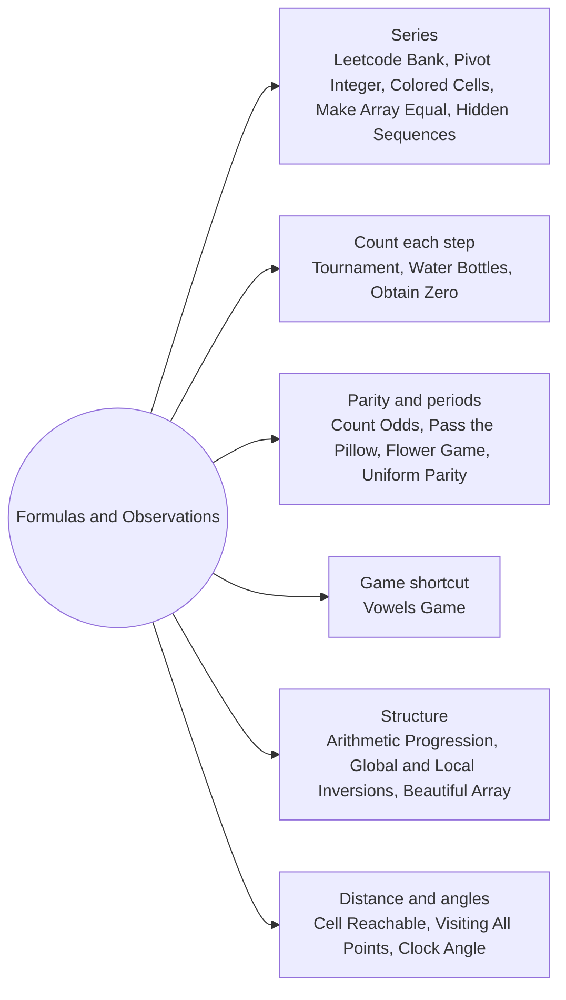

# Formulas and Observations: Pattern Map

> [!TIP]
> **🧠 One picture to keep**
> Simulate a tiny case by hand, **spot the invariant**, and replace the loop with a formula.
> 1. **Series**: arithmetic sums, rings, prefix sums (Leetcode Bank, Pivot Integer, Colored Cells, Make Array Equal, Hidden Sequences).
> 2. **Count what each step does**: every match removes one team, every trade nets k − 1 bottles, bulk subtraction is Euclid (Tournament, Water Bottles, Obtain Zero).
> 3. **Parity and periods**: odd counts, back-and-forth trips, odd + even sums (Count Odds, Pass the Pillow, Flower Game, Uniform Parity).
> 4. **Game shortcuts**: find who can always move (Vowels Game).
> 5. **Structure**: AP slots, inversions only between neighbours, odd/even split (Arithmetic Progression, Global and Local Inversions, Beautiful Array).
> 6. **Distance and angles**: diagonal moves make the distance max(dx, dy), clock hands are measured then folded (Cell Reachable, Visiting All Points, Clock Angle).

**All animations:** [▶ Formulas and Observations Animations](https://d9-cell.github.io/java-brain/Mathematical/Formulas%20and%20Observations/Formulas%20and%20Observations%20Animations.html) · ⬆ [00 Brain Map](../../00%20Brain%20Map.md)

## Java toolkit
| Need | Java |
|---|---|
| 1 + 2 + … + n | `n * (n + 1) / 2` (long if n > 46340) |
| Arithmetic series a, a + d, … (k terms) | `k * a + d * k * (k - 1) / 2` |
| Odd numbers in [0, x] | `(x + 1) / 2` |
| Perfect square check | `int r = (int) Math.sqrt(s); r * r == s` |
| Chebyshev distance | `Math.max(Math.abs(dx), Math.abs(dy))` |
| Fold an angle | `Math.min(diff, 360 - diff)` |

## Patterns in this folder

| # | Problem | Pattern | Mantra | Level |
|---|---|---|---|---|
| 1 | [Calculate Money in Leetcode Bank](Calculate%20Money%20in%20Leetcode%20Bank.md) | Arithmetic series | w = n/7, r = n%7 · 28w + 7·w(w−1)/2 + r(w+1) + r(r−1)/2 | Easy |
| 2 | [Count of Matches in Tournament](Count%20of%20Matches%20in%20Tournament.md) | Count each step | RETURN n − 1 | Easy |
| 3 | [Pass the Pillow](Pass%20the%20Pillow.md) | Period, Parity of trips | trips = time/(n−1), rest = time%(n−1) · even → 1 + rest · odd → n − rest | Easy |
| 4 | [Water Bottles](Water%20Bottles.md) | Count each step | b + (b − 1) / (e − 1) | Easy |
| 5 | [Count Operations to Obtain Zero](Count%20Operations%20to%20Obtain%20Zero.md) | Euclid in bulk | ops += big / small · big %= small | Easy |
| 6 | [Count Odd Numbers in an Interval Range](Count%20Odd%20Numbers%20in%20an%20Interval%20Range.md) | Prefix count | (high + 1)/2 − low/2 | Easy |
| 7 | [Find the Pivot Integer](Find%20the%20Pivot%20Integer.md) | Series, Perfect square | total = n(n+1)/2 · x = √total · x² == total ? x : −1 | Easy |
| 8 | [Count Total Number of Colored Cells](Count%20Total%20Number%20of%20Colored%20Cells.md) | Rings, Series | 1 + 2·n·(n − 1) | Medium |
| 9 | [Alice and Bob Playing Flower Game](Alice%20and%20Bob%20Playing%20Flower%20Game.md) | Parity | RETURN (long) n * m / 2 | Medium |
| 10 | [Vowels Game in a String](Vowels%20Game%20in%20a%20String.md) | Game shortcut | RETURN s contains a vowel | Medium |
| 11 | [Angle Between Hands of a Clock](Angle%20Between%20Hands%20of%20a%20Clock.md) | Rates, Fold the angle | m = 6·min · h = 30·(hour%12) + 0.5·min · min(|h − m|, 360 − |h − m|) | Medium |
| 12 | [Minimum Operations to Make Array Equal](Minimum%20Operations%20to%20Make%20Array%20Equal.md) | Symmetric series | RETURN n * n / 4 | Medium |
| 13 | [Can Make Arithmetic Progression From Sequence](Can%20Make%20Arithmetic%20Progression%20From%20Sequence.md) | Sort, Slot check | d = (max − min)/(n − 1) · slot = (x − min)/d · no repeats | Easy |
| 14 | [Count the Hidden Sequences](Count%20the%20Hidden%20Sequences.md) | Prefix sums, Sliding the shape | track prefix min, max · RETURN max(0, (upper − lower) − (max − min) + 1) | Medium |
| 15 | [Global and Local Inversions](Global%20and%20Local%20Inversions.md) | Invariant | ANY |nums[i] − i| > 1 → false | Medium |
| 16 | [Construct Uniform Parity Array II](Construct%20Uniform%20Parity%20Array%20II.md) | Parity, Observation | min odd → true · ELSE all even ? | Medium |
| 17 | [Beautiful Array](Beautiful%20Array.md) | Divide and conquer, Affine maps | res = [1] · next = (2x − 1 for x) + (2x for x), filtered ≤ n | Medium |
| 18 | [Determine if a Cell Is Reachable at a Given Time](Determine%20if%20a%20Cell%20Is%20Reachable%20at%20a%20Given%20Time.md) | Chebyshev distance | same cell → t != 1 · ELSE max(dx, dy) ≤ t | Medium |
| 19 | [Minimum Time Visiting All Points](Minimum%20Time%20Visiting%20All%20Points.md) | Chebyshev distance | Σ max(|dx|, |dy|) | Easy |

## Suggested learning order
1. [Count of Matches in Tournament](Count%20of%20Matches%20in%20Tournament.md), [Count Odd Numbers in an Interval Range](Count%20Odd%20Numbers%20in%20an%20Interval%20Range.md), [Calculate Money in Leetcode Bank](Calculate%20Money%20in%20Leetcode%20Bank.md) ⭐, [Pass the Pillow](Pass%20the%20Pillow.md)
2. [Water Bottles](Water%20Bottles.md), [Count Operations to Obtain Zero](Count%20Operations%20to%20Obtain%20Zero.md), [Find the Pivot Integer](Find%20the%20Pivot%20Integer.md), [Count Total Number of Colored Cells](Count%20Total%20Number%20of%20Colored%20Cells.md)
3. [Alice and Bob Playing Flower Game](Alice%20and%20Bob%20Playing%20Flower%20Game.md), [Vowels Game in a String](Vowels%20Game%20in%20a%20String.md), [Construct Uniform Parity Array II](Construct%20Uniform%20Parity%20Array%20II.md)
4. [Angle Between Hands of a Clock](Angle%20Between%20Hands%20of%20a%20Clock.md), [Minimum Time Visiting All Points](Minimum%20Time%20Visiting%20All%20Points.md), [Determine if a Cell Is Reachable at a Given Time](Determine%20if%20a%20Cell%20Is%20Reachable%20at%20a%20Given%20Time.md)
5. [Minimum Operations to Make Array Equal](Minimum%20Operations%20to%20Make%20Array%20Equal.md), [Can Make Arithmetic Progression From Sequence](Can%20Make%20Arithmetic%20Progression%20From%20Sequence.md), [Count the Hidden Sequences](Count%20the%20Hidden%20Sequences.md) ⭐
6. [Global and Local Inversions](Global%20and%20Local%20Inversions.md) ⭐, [Beautiful Array](Beautiful%20Array.md)

## Connections to other folders
- [Digits and Powers - Pattern Map](../Digits%20and%20Powers/Digits%20and%20Powers%20-%20Pattern%20Map.md) for sum identities like Missing Number
- [Primes Divisors and Remainders - Pattern Map](../Primes%20Divisors%20and%20Remainders/Primes%20Divisors%20and%20Remainders%20-%20Pattern%20Map.md) for gcd and remainder arguments
- [Geometry and Randomness - Pattern Map](../Geometry%20and%20Randomness/Geometry%20and%20Randomness%20-%20Pattern%20Map.md) for coordinates and shapes
