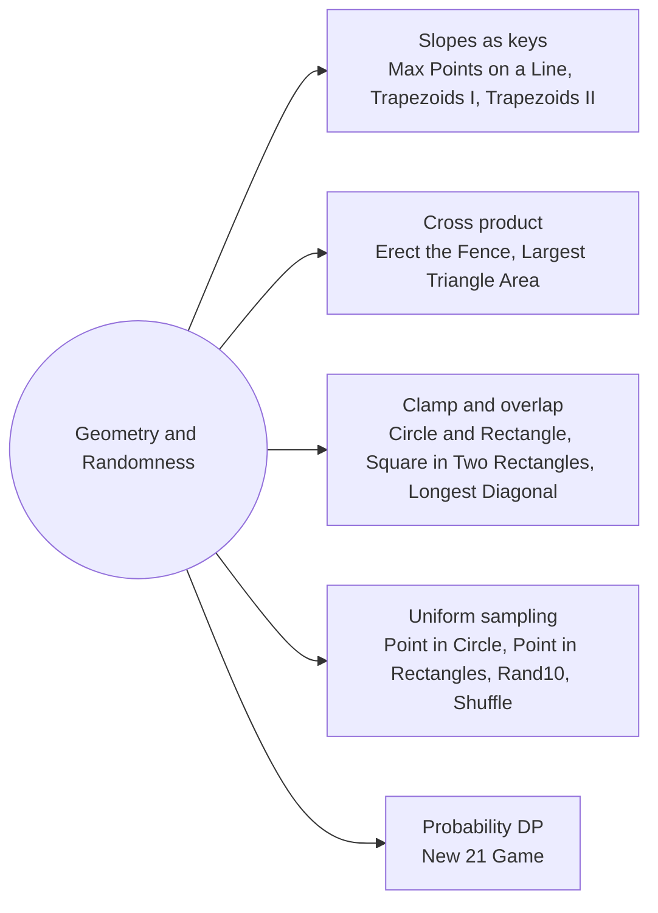

# Geometry and Randomness: Pattern Map

> [!TIP]
> **🧠 One picture to keep**
> Keep geometry in **integers**: cross products for turns, reduced (dx, dy) for slopes, squared distances instead of square roots. For randomness, make every outcome **equally likely by construction**.
> 1. **Slopes as keys**: reduce (dx, dy) by gcd with a fixed sign (Max Points on a Line, Trapezoids I and II).
> 2. **Cross product**: orientation, convex hull, triangle area (Erect the Fence, Largest Triangle Area).
> 3. **Clamp and overlap**: closest point of a box, overlap of two boxes (Circle and Rectangle, Largest Square in Two Rectangles, Longest Diagonal).
> 4. **Uniform sampling**: √u for radius, weight by count, rejection, Fisher-Yates (Random Point in Circle, Rectangles, Rand10, Shuffle).
> 5. **Probability DP**: a sliding window of the last maxPts probabilities (New 21 Game).

**All animations:** [▶ Geometry and Randomness Animations](https://d9-cell.github.io/java-brain/Mathematical/Geometry%20and%20Randomness/Geometry%20and%20Randomness%20Animations.html) · ⬆ [00 Brain Map](../../00%20Brain%20Map.md)

## Java toolkit
| Need | Java |
|---|---|
| Cross product o→a→b | `(a[0]-o[0])*(b[1]-o[1]) - (a[1]-o[1])*(b[0]-o[0])` (> 0 left turn) |
| Normalised slope | `g = gcd(|dx|, |dy|); dx /= g; dy /= g;` then make dx > 0 or (dx == 0, dy > 0) |
| Clamp | `Math.max(lo, Math.min(x, hi))` |
| Box overlap side | `Math.min(r1, r2) - Math.max(l1, l2)` (≤ 0 means none) |
| Random int in [0, n) | `rng.nextInt(n)` |
| Uniform radius | `Math.sqrt(rng.nextDouble()) * r` |

## Patterns in this folder

| # | Problem | Pattern | Mantra | Level |
|---|---|---|---|---|
| 1 | [Max Points on a Line](Max%20Points%20on%20a%20Line.md) | Slopes as keys, Hash map | FOR i: map[(dx/g, dy/g) with sign fixed]++ · best = max + 1 | Hard |
| 2 | [Erect the Fence](Erect%20the%20Fence.md) | Convex hull, Monotone chain | sort · lower: pop while cross < 0 · upper: same backwards · dedupe | Hard |
| 3 | [Count Number of Trapezoids I](Count%20Number%20of%20Trapezoids%20I.md) | Group by row, Running sum | segs = C(c, 2) · result += segs · before · before += segs | Medium |
| 4 | [Count Number of Trapezoids II](Count%20Number%20of%20Trapezoids%20II.md) | Slopes as keys, Midpoints | (pairs same slope − same line) − (pairs same midpoint − same midpoint and slope) | Hard |
| 5 | [Circle and Rectangle Overlapping](Circle%20and%20Rectangle%20Overlapping.md) | Clamp | cx = clamp(xC, x1, x2), cy = clamp(yC, y1, y2) · (cx−xC)² + (cy−yC)² ≤ r² | Medium |
| 6 | [Find the Largest Area of Square Inside Two Rectangles](Find%20the%20Largest%20Area%20of%20Square%20Inside%20Two%20Rectangles.md) | Box overlap | w = min(tr) − max(bl) on x · h on y · side = max(min(w, h)) | Medium |
| 7 | [Largest Triangle Area](Largest%20Triangle%20Area.md) | Cross product | max over i<j<k of |(b−a) × (c−a)| / 2 | Easy |
| 8 | [Maximum Area of Longest Diagonal Rectangle](Maximum%20Area%20of%20Longest%20Diagonal%20Rectangle.md) | Squared distance | diag = l² + w² · bigger diag OR (same diag AND bigger area) → keep | Easy |
| 9 | [Generate Random Point in a Circle](Generate%20Random%20Point%20in%20a%20Circle.md) | Uniform sampling, Polar | len = √u · R · angle = 2π·v · (x + len cos, y + len sin) | Medium |
| 10 | [Random Point in Non-overlapping Rectangles](Random%20Point%20in%20Non-overlapping%20Rectangles.md) | Weighted pick, Prefix + binary search | prefix of (w+1)(h+1) · target = rand(total) · first prefix > target | Medium |
| 11 | [Implement Rand10() Using Rand7()](Implement%20Rand10%28%29%20Using%20Rand7%28%29.md) | Rejection sampling | idx = (rand7() − 1)·7 + rand7() · idx ≤ 40 → 1 + (idx − 1) % 10 · ELSE retry | Medium |
| 12 | [Shuffle an Array](Shuffle%20an%20Array.md) | Fisher-Yates | FOR i = n−1..1: j = rand(i + 1) · swap(a[i], a[j]) | Medium |
| 13 | [New 21 Game](New%2021%20Game.md) | Probability DP, Sliding window | dp[i] = window / maxPts · i < k → window += dp[i] · ELSE result += dp[i] · drop dp[i − maxPts] | Medium |

## Suggested learning order
1. [Maximum Area of Longest Diagonal Rectangle](Maximum%20Area%20of%20Longest%20Diagonal%20Rectangle.md), [Largest Triangle Area](Largest%20Triangle%20Area.md), [Circle and Rectangle Overlapping](Circle%20and%20Rectangle%20Overlapping.md) ⭐, [Find the Largest Area of Square Inside Two Rectangles](Find%20the%20Largest%20Area%20of%20Square%20Inside%20Two%20Rectangles.md)
2. [Max Points on a Line](Max%20Points%20on%20a%20Line.md) ⭐, [Count Number of Trapezoids I](Count%20Number%20of%20Trapezoids%20I.md), [Count Number of Trapezoids II](Count%20Number%20of%20Trapezoids%20II.md)
3. [Erect the Fence](Erect%20the%20Fence.md)
4. [Shuffle an Array](Shuffle%20an%20Array.md) ⭐, [Implement Rand10() Using Rand7()](Implement%20Rand10%28%29%20Using%20Rand7%28%29.md), [Random Point in Non-overlapping Rectangles](Random%20Point%20in%20Non-overlapping%20Rectangles.md), [Generate Random Point in a Circle](Generate%20Random%20Point%20in%20a%20Circle.md)
5. [New 21 Game](New%2021%20Game.md)

## Connections to other folders
- [Formulas and Observations - Pattern Map](../Formulas%20and%20Observations/Formulas%20and%20Observations%20-%20Pattern%20Map.md) for Chebyshev distance and angles
- [Primes Divisors and Remainders - Pattern Map](../Primes%20Divisors%20and%20Remainders/Primes%20Divisors%20and%20Remainders%20-%20Pattern%20Map.md) for gcd
- [Linked List Random Node](../../Linked%20List/Linked%20List%20Random%20Node.md) for reservoir sampling
