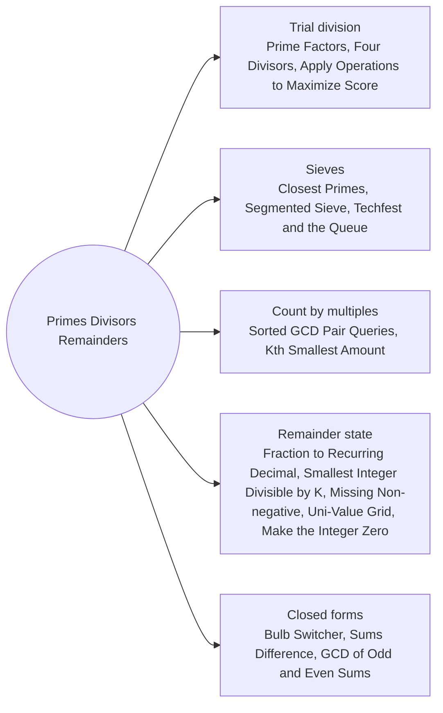

# Primes Divisors and Remainders: Pattern Map

> [!TIP]
> **🧠 One picture to keep**
> Most number theory questions reduce to **divisors come in pairs up to √n**, **sieve once and reuse**, or **only the remainder matters**.
> 1. **Trial division**: try d up to √n, divide out, leftover > 1 is a prime (Prime Factors, Four Divisors, Prime Score).
> 2. **Sieves**: Eratosthenes, segmented for a far-away window, smallest-prime-factor table (Closest Primes, Segmented Sieve, Techfest).
> 3. **Count by multiples**: count pairs or values per multiple of g, then subtract larger multiples or use inclusion-exclusion (Sorted GCD Pair Queries, Kth Smallest Amount).
> 4. **Remainder state**: long division and repunits revisit a remainder within k steps; residue classes decide reachability (Recurring Decimal, Divisible by K, Missing Non-negative, Uni-Value Grid).
> 5. **Closed forms**: square numbers have odd divisor count, sums of multiples, gcd of n² and n(n+1) (Bulb Switcher, Sums Difference, GCD of Odd and Even Sums).

**All animations:** [▶ Primes Divisors and Remainders Animations](https://d9-cell.github.io/java-brain/Mathematical/Primes%20Divisors%20and%20Remainders/Primes%20Divisors%20and%20Remainders%20Animations.html) · ⬆ [00 Brain Map](../../00%20Brain%20Map.md)

## Java toolkit
| Need | Java |
|---|---|
| Trial division | `for (int p = 2; (long) p * p <= n; p++) while (n % p == 0) n /= p;` |
| Sieve | `for (int i = 2; (long) i * i <= N; i++) if (!comp[i]) for (int j = i * i; j <= N; j += i) comp[j] = true;` |
| First multiple of p ≥ L | `(L + p - 1) / p * p` |
| gcd, lcm | `gcd(a, b) = b == 0 ? a : gcd(b, a % b)`, `a / gcd(a, b) * b` |
| Non-negative remainder | `((x % m) + m) % m` |
| Set bits of a long | `Long.bitCount(x)` |

## Patterns in this folder

| # | Problem | Pattern | Mantra | Level |
|---|---|---|---|---|
| 1 | [Prime Factors](Prime%20Factors.md) | Trial division | FOR p·p ≤ n: IF p | n: add p, divide out · n > 1 → add n | Easy |
| 2 | [Segmented Sieve](Segmented%20Sieve.md) | Sieve, Window | base = sieve(√R) · start = max(p², ⌈L/p⌉·p) · mark j − L | Medium |
| 3 | [Closest Prime Numbers in Range](Closest%20Prime%20Numbers%20in%20Range.md) | Sieve, Adjacent pairs | sieve(right) · prev, x: x − prev < gap → best · gap ≤ 2 → break | Medium |
| 4 | [Four Divisors](Four%20Divisors.md) | Divisor pairs | FOR d·d ≤ x: d | x → count += (d == x/d ? 1 : 2) · count == 4 → add sum | Medium |
| 5 | [Techfest and the Queue](Techfest%20and%20the%20Queue.md) | Smallest prime factor sieve, DP on x / spf | spf sieve · cnt[x] = 1 + cnt[x / spf[x]] · sum over [a, b] | Medium |
| 6 | [Smallest Integer Divisible by K](Smallest%20Integer%20Divisible%20by%20K.md) | Remainder state, Pigeonhole | k even or ×5 → −1 · rem = (rem·10 + 1) % k · rem == 0 → len | Medium |
| 7 | [GCD of Odd and Even Sums](GCD%20of%20Odd%20and%20Even%20Sums.md) | Closed form, gcd | RETURN n | Easy |
| 8 | [Sorted GCD Pair Queries](Sorted%20GCD%20Pair%20Queries.md) | Count by multiples, Prefix + binary search | c = #multiples of g · exact[g] = C(c,2) − Σ exact[kg] · prefix · lower bound | Hard |
| 9 | [Apply Operations to Maximize Score](Apply%20Operations%20to%20Maximize%20Score.md) | Prime score, Monotonic stack, Greedy | score = #distinct primes · left/right by stack · sort by value desc · result *= v^min(cnt, k) | Hard |
| 10 | [Kth Smallest Amount With Single Denomination Combination](Kth%20Smallest%20Amount%20With%20Single%20Denomination%20Combination.md) | Binary search on answer, Inclusion-exclusion | count(x) = Σ (−1)^(|S|+1) · x / lcm(S) · smallest x with count ≥ k | Hard |
| 11 | [Fraction to Recurring Decimal](Fraction%20to%20Recurring%20Decimal.md) | Long division, Remainder map | sign · integer part · map rem → position · repeat → insert "(" and append ")" | Medium |
| 12 | [Bulb Switcher](Bulb%20Switcher.md) | Divisor parity | RETURN ⌊√n⌋ | Medium |
| 13 | [Divisible and Non-divisible Sums Difference](Divisible%20and%20Non-divisible%20Sums%20Difference.md) | Arithmetic series | total = n(n+1)/2 · k = n/m · RETURN total − 2·m·k(k+1)/2 | Easy |
| 14 | [Minimum Operations to Make the Integer Zero](Minimum%20Operations%20to%20Make%20the%20Integer%20Zero.md) | Popcount bounds, Try k | FOR k = 1..60: x = num1 − k·num2 · bitCount(x) ≤ k ≤ x → k | Medium |
| 15 | [Smallest Missing Non-negative Integer After Operations](Smallest%20Missing%20Non-negative%20Integer%20After%20Operations.md) | Residue classes, Greedy MEX | cnt[((x % v) + v) % v]++ · WHILE cnt[mex % v] > 0: use one, mex++ | Medium |
| 16 | [Minimum Operations to Make a Uni-Value Grid](Minimum%20Operations%20to%20Make%20a%20Uni-Value%20Grid.md) | Residue check, Median | any v % x ≠ r → −1 · sort · Σ |v − median| / x | Medium |

## Suggested learning order
1. [Prime Factors](Prime%20Factors.md) ⭐, [Four Divisors](Four%20Divisors.md), [Bulb Switcher](Bulb%20Switcher.md)
2. [Closest Prime Numbers in Range](Closest%20Prime%20Numbers%20in%20Range.md) ⭐, [Segmented Sieve](Segmented%20Sieve.md), [Techfest and the Queue](Techfest%20and%20the%20Queue.md)
3. [GCD of Odd and Even Sums](GCD%20of%20Odd%20and%20Even%20Sums.md), [Divisible and Non-divisible Sums Difference](Divisible%20and%20Non-divisible%20Sums%20Difference.md), [Sorted GCD Pair Queries](Sorted%20GCD%20Pair%20Queries.md)
4. [Fraction to Recurring Decimal](Fraction%20to%20Recurring%20Decimal.md) ⭐, [Smallest Integer Divisible by K](Smallest%20Integer%20Divisible%20by%20K.md), [Smallest Missing Non-negative Integer After Operations](Smallest%20Missing%20Non-negative%20Integer%20After%20Operations.md), [Minimum Operations to Make a Uni-Value Grid](Minimum%20Operations%20to%20Make%20a%20Uni-Value%20Grid.md)
5. [Minimum Operations to Make the Integer Zero](Minimum%20Operations%20to%20Make%20the%20Integer%20Zero.md), [Kth Smallest Amount With Single Denomination Combination](Kth%20Smallest%20Amount%20With%20Single%20Denomination%20Combination.md), [Apply Operations to Maximize Score](Apply%20Operations%20to%20Maximize%20Score.md)

## Connections to other folders
- [Digits and Powers - Pattern Map](../Digits%20and%20Powers/Digits%20and%20Powers%20-%20Pattern%20Map.md) for digit loops and fast power
- [Counting and Modular Combinatorics - Pattern Map](../Counting%20and%20Modular%20Combinatorics/Counting%20and%20Modular%20Combinatorics%20-%20Pattern%20Map.md) for modular inverses and nCr
- [Sum of Subarray Minimums](../../Stack/Sum%20of%20Subarray%20Minimums.md) for the "who wins each subarray" count
