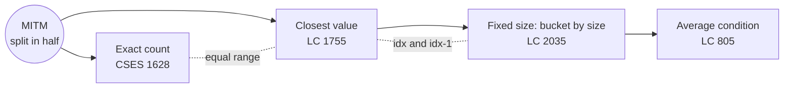

# Meet In The Middle: Pattern Map

> [!TIP]
> **🧠 One picture to keep**
> Two friends dig a tunnel **from both ends** of a mountain and meet in the middle.
> n ≈ 40 → 2^40 is impossible, but 2 × 2^20 ≈ 2 million is easy. **Split, enumerate each half, sort one half, binary-search the other.**
> Your iPad notes: MITM Introduction PDF · LC 2035 PDF

**All animations:** [▶ Meet In The Middle Animations](https://d9-cell.github.io/java-brain/Meet%20In%20The%20Middle/Meet%20In%20The%20Middle%20Animations.html) · ⬆ [00 Brain Map](../00%20Brain%20Map.md)

## Java toolkit
| Need | Java |
|---|---|
| All subset sums of a half in O(2^h) | `sums[m] = sums[m & (m-1)] + a[from + Integer.numberOfTrailingZeros(m)]` |
| Subset size of a mask | `Integer.bitCount(mask)` |
| lower_bound | hand-written loop (`Arrays.binarySearch` gives no guarantee about which duplicate it finds) |
| Count of equal values in a sorted array | `lowerBound(a, x + 1) - lowerBound(a, x)` |
| Big sums | `long` (40 × 1e9 overflows int) |

## Patterns in this folder

| # | Problem | Pattern | Mantra | Level |
|---|---|---|---|---|
| 1 | [CSES 1628 - Meet In The Middle](CSES%201628%20-%20Meet%20In%20The%20Middle.md) | Meet in the middle, Binary search | SPLIT, ENUMERATE, SORT ONE, SEARCH OTHER | Medium |
| 2 | [Closest Subsequence Sum](Closest%20Subsequence%20Sum.md) | Meet in the middle, Lower bound + neighbour | LOWER BOUND + ITS LEFT NEIGHBOUR | Hard |
| 3 | [Partition Array Into Two Arrays to Minimize Sum Difference](Partition%20Array%20Into%20Two%20Arrays%20to%20Minimize%20Sum%20Difference.md) | Meet in the middle, Bucket by subset size | BUCKET BY SIZE, k + (n−k), AIM AT S/2 | Hard |
| 4 | [Split Array With Same Average](Split%20Array%20With%20Same%20Average.md) | Meet in the middle, Bucket by subset size, Math reformulation | avg(A) = avg(ALL) ⇒ sum·N = size·S | Hard |

## Suggested learning order
1. [CSES 1628 - Meet In The Middle](CSES%201628%20-%20Meet%20In%20The%20Middle.md): the raw technique.
2. [Closest Subsequence Sum](Closest%20Subsequence%20Sum.md): closest instead of exact.
3. [Partition Array Into Two Arrays to Minimize Sum Difference](Partition%20Array%20Into%20Two%20Arrays%20to%20Minimize%20Sum%20Difference.md): adds size buckets.
4. [Split Array With Same Average](Split%20Array%20With%20Same%20Average.md): turns an average condition into a sum condition.

## Connections to other folders
- Subset enumeration with bitmasks: the `Bit_Magic` folder
- The plain 2^n version: [Recursion](../Recursion/Recursion%20-%20Pattern%20Map.md) → Power Set / Subsets
- Two halves + sorted search is also the core of 2-Sum: the `HashMap` and `Arrays` folders
