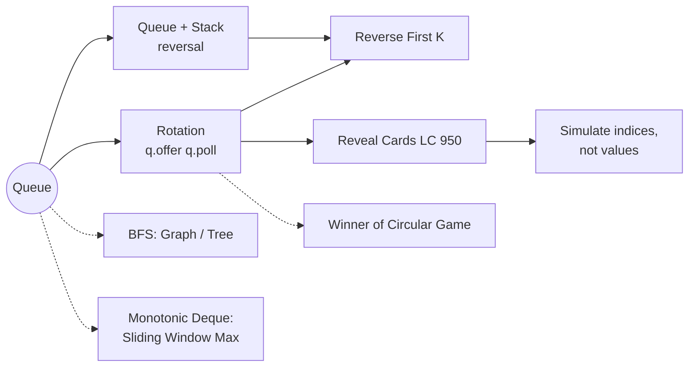

# Queue: Pattern Map

> [!TIP]
> **🧠 One picture to keep**
> A queue is a **line at a ticket counter**: join at the back (`offer`), leave from the front (`poll`).
> Its signature move is **rotation**, `q.offer(q.poll())`: the person at the front walks to the back. Any time a problem says *"move to the bottom/back"* or *"go around in a circle"*, think rotation.

**All animations:** [▶ Queue Animations](https://d9-cell.github.io/java-brain/Queue/Queue%20Animations.html) · ⬆ [00 Brain Map](../00%20Brain%20Map.md)

## Java Queue toolkit
| Need | Use | Avoid |
|---|---|---|
| Queue | `Queue<Integer> q = new ArrayDeque<>();` → `offer / poll / peek` | `add/remove` throw on empty |
| Stack | `Deque<Integer> st = new ArrayDeque<>();` → `push / pop / peek` | `java.util.Stack` (synchronized, slow → TLE) |
| Both ends | `Deque`: `offerFirst / offerLast / pollFirst / pollLast` | |
| Holds null | `LinkedList` | `ArrayDeque` rejects null |

## Patterns in this folder

| Problem | Pattern | Mantra | Stage |
|---|---|---|---|
| [Reverse First K elements of Queue](Reverse%20First%20K%20elements%20of%20Queue.md) | Stack reversal + rotation | POUR → POUR BACK → ROTATE REST | Easy |
| [Reveal Cards In Increasing Order](Reveal%20Cards%20In%20Increasing%20Order.md) | Rotation on indices | TAKE A SEAT, NEXT SEAT TO BACK | Medium |

## Where queues show up in other folders
- **BFS**: every level-order or shortest-path-in-unweighted-graph problem (Graph, Tree folders).
- **Monotonic deque**: [Sliding Window Maximum](../Sliding%20Window/Sliding%20Window%20Maximum.md).
- **Circular simulation**: [Find the Winner of the Circular Game](../Recursion/Find%20the%20Winner%20of%20the%20Circular%20Game.md).
- **Conversions**: Queue using Stacks · Stack using Queues.
