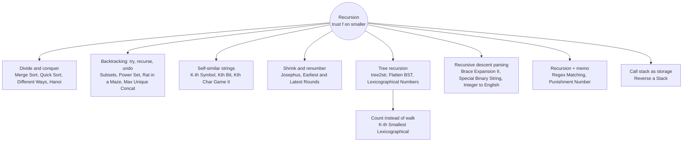

# Recursion: Pattern Map

> [!TIP]
> **🧠 One picture to keep**
> Recursion is **a story with a trusted helper**:
> 1. Say in one sentence what `f(input)` returns.
> 2. Handle the smallest input yourself (the base case).
> 3. **Trust** `f` on a smaller input, and use its answer.
> The recursion **tree** shows every call; the **call stack** shows where you are right now. Backtracking = recursion that **undoes** its change after each try.

**All animations:** [▶ Recursion Animations](https://d9-cell.github.io/java-brain/Recursion/Recursion%20Animations.html) · ⬆ [00 Brain Map](../00%20Brain%20Map.md)

## Java toolkit
| Need | Java |
|---|---|
| Growing / undoing a path | `StringBuilder.append(c)` … `deleteCharAt(len - 1)`, or `list.add` … `list.remove(list.size() - 1)` |
| Store a snapshot | `result.add(new ArrayList<>(temp))` (never the live list) |
| Memo with "unknown" | `Boolean[][] memo` (null = not computed) or `int[][]` filled with -1 |
| Deep recursion (1e5) | Java's default stack is small: convert to an iteration or BFS |
| Overflow in counting | `long` (e.g. the lexicographic subtree counts) |
| Sorted distinct results | `TreeSet<String>` |

## Patterns in this folder

| # | Problem | Pattern | Mantra | Level |
|---|---|---|---|---|
| 1 | [Tower of Hanoi](Tower%20of%20Hanoi.md) | Trust the helper, Divide and conquer | n−1 AWAY, BIG ONE OVER, n−1 BACK | Medium |
| 2 | [Reverse a Stack](Reverse%20a%20Stack.md) | Call stack as storage | POP, REVERSE REST, INSERT AT BOTTOM | Medium |
| 3 | [Subsets](Subsets.md) | Backtracking, Take / skip | TAKE → RECURSE → UNDO → SKIP → RECURSE | Medium |
| 4 | [Power Set](Power%20Set.md) | Backtracking, For-loop recursion | RECORD NODE, FOR i ≥ idx: ADD, RECURSE, REMOVE | Medium |
| 5 | [Merge Sort](Merge%20Sort.md) | Divide and conquer | SPLIT, SORT LEFT, SORT RIGHT, MERGE | Medium |
| 6 | [Quick Sort](Quick%20Sort.md) | Divide and conquer, Partition | PARTITION (≤ PIVOT LEFT), PIVOT FINAL, RECURSE BOTH SIDES | Medium |
| 7 | [K-th Symbol in Grammar](K-th%20Symbol%20in%20Grammar.md) | Self-similar string | k ≤ HALF → SAME, ELSE FLIP OF k−HALF | Medium |
| 8 | [Find the Winner of the Circular Game](Find%20the%20Winner%20of%20the%20Circular%20Game.md) | Josephus, Shrink and renumber | w(1) = 0; w(n) = (w(n−1) + k) % n | Medium |
| 9 | [Find Kth Bit in Nth Binary String](Find%20Kth%20Bit%20in%20Nth%20Binary%20String.md) | Self-similar string, Mirror | LEFT → RECURSE, MID → 1, RIGHT → MIRROR + FLIP | Medium |
| 10 | [Construct String from Binary Tree](Construct%20String%20from%20Binary%20Tree.md) | Tree recursion | LEAF → v; NO RIGHT → v(L); ELSE v(L)(R) | Easy |
| 11 | [Lexicographical Numbers](Lexicographical%20Numbers.md) | DFS on the digit tree | PRE-ORDER DIGIT TREE, ROOTS 1..9 | Medium |
| 12 | [Maximum Length of a Concatenated String with Unique Characters](Maximum%20Length%20of%20a%20Concatenated%20String%20with%20Unique%20Characters.md) | Backtracking, Bitmask | BITMASK PER WORD, ADD IF mask & m == 0 | Medium |
| 13 | [Special Binary String](Special%20Binary%20String.md) | Recursive decomposition, Balanced parentheses | SPLIT TOP BLOCKS, RECURSE INSIDE, SORT DESC | Hard |
| 14 | [Different Ways to Add Parentheses](Different%20Ways%20to%20Add%20Parentheses.md) | Divide and conquer | SPLIT AT EACH OP, COMBINE ALL L × R | Medium |
| 15 | [Rat in a Maze Problem - I](Rat%20in%20a%20Maze%20Problem%20-%20I.md) | Backtracking on grid | BLOCK, TRY D L R U, UNBLOCK | Medium |
| 16 | [Integer to English Words](Integer%20to%20English%20Words.md) | Recursive chunking | BIGGEST UNIT: solve(n / u) + NAME + solve(n % u) | Hard |
| 17 | [Flatten BST to sorted list](Flatten%20BST%20to%20sorted%20list.md) | In-order recursion, prev pointer | IN-ORDER + prev POINTER | Medium |
| 18 | [Regular Expression Matching](Regular%20Expression%20Matching.md) | Recursion + memo | x* → SKIP OR (MATCH AND STAY); MEMO (i, j) | Hard |
| 19 | [Find the Punishment Number of an Integer](Find%20the%20Punishment%20Number%20of%20an%20Integer.md) | Partition recursion, Pruning | PEEL 1–4 DIGITS (%, /), PRUNE sum > i | Medium |
| 20 | [Brace Expansion II](Brace%20Expansion%20II.md) | Recursive descent parsing | UNION OF CONCATS OF UNITS | Hard |
| 21 | [K-th Smallest in Lexicographical Order](K-th%20Smallest%20in%20Lexicographical%20Order.md) | Counting subtrees, Digit tree | COUNT SUBTREE → SKIP SIBLING OR GO DOWN | Hard |
| 22 | [Find the K-th Character in String Game II](Find%20the%20K-th%20Character%20in%20String%20Game%20II.md) | Self-similar string, Walk back | FIND DOUBLING, k − len/2, SHIFT IF op = 1 | Hard |
| 23 | [The Earliest and Latest Rounds Where Players Compete](The%20Earliest%20and%20Latest%20Rounds%20Where%20Players%20Compete.md) | Shrink and renumber, Memoised recursion | MIRROR, ENUMERATE SURVIVOR COUNTS, MIN/MAX + 1, MEMO | Hard |

## Suggested learning order
1. Trust the helper: [Tower of Hanoi](Tower%20of%20Hanoi.md), [Reverse a Stack](Reverse%20a%20Stack.md)
2. Backtracking: [Subsets](Subsets.md) → [Power Set](Power%20Set.md) → [Rat in a Maze Problem - I](Rat%20in%20a%20Maze%20Problem%20-%20I.md) → [Maximum Length of a Concatenated String with Unique Characters](Maximum%20Length%20of%20a%20Concatenated%20String%20with%20Unique%20Characters.md)
3. Divide and conquer: [Merge Sort](Merge%20Sort.md), [Quick Sort](Quick%20Sort.md), [Different Ways to Add Parentheses](Different%20Ways%20to%20Add%20Parentheses.md)
4. Self-similar strings: [K-th Symbol in Grammar](K-th%20Symbol%20in%20Grammar.md) → [Find Kth Bit in Nth Binary String](Find%20Kth%20Bit%20in%20Nth%20Binary%20String.md) → [Find the K-th Character in String Game II](Find%20the%20K-th%20Character%20in%20String%20Game%20II.md)
5. Renumbering: [Find the Winner of the Circular Game](Find%20the%20Winner%20of%20the%20Circular%20Game.md) → [The Earliest and Latest Rounds Where Players Compete](The%20Earliest%20and%20Latest%20Rounds%20Where%20Players%20Compete.md)
6. Trees: [Construct String from Binary Tree](Construct%20String%20from%20Binary%20Tree.md), [Flatten BST to sorted list](Flatten%20BST%20to%20sorted%20list.md), [Lexicographical Numbers](Lexicographical%20Numbers.md) → [K-th Smallest in Lexicographical Order](K-th%20Smallest%20in%20Lexicographical%20Order.md)
7. Parsing: [Integer to English Words](Integer%20to%20English%20Words.md), [Special Binary String](Special%20Binary%20String.md), [Brace Expansion II](Brace%20Expansion%20II.md)
8. Memo: [Find the Punishment Number of an Integer](Find%20the%20Punishment%20Number%20of%20an%20Integer.md), [Regular Expression Matching](Regular%20Expression%20Matching.md)

## Connections to other folders
- Josephus with a queue: [Queue](../Queue/Queue%20-%20Pattern%20Map.md) (the rotation `q.offer(q.poll())`)
- Subsets with bitmasks: the `Bit_Magic` folder, and [Meet In The Middle](../Meet%20In%20The%20Middle/Meet%20In%20The%20Middle%20-%20Pattern%20Map.md)
- Memoised recursion grows into DP: the `DP` folder (Regex Matching bottom-up)
- Backtracking folder: N-Queens, Sudoku and friends
